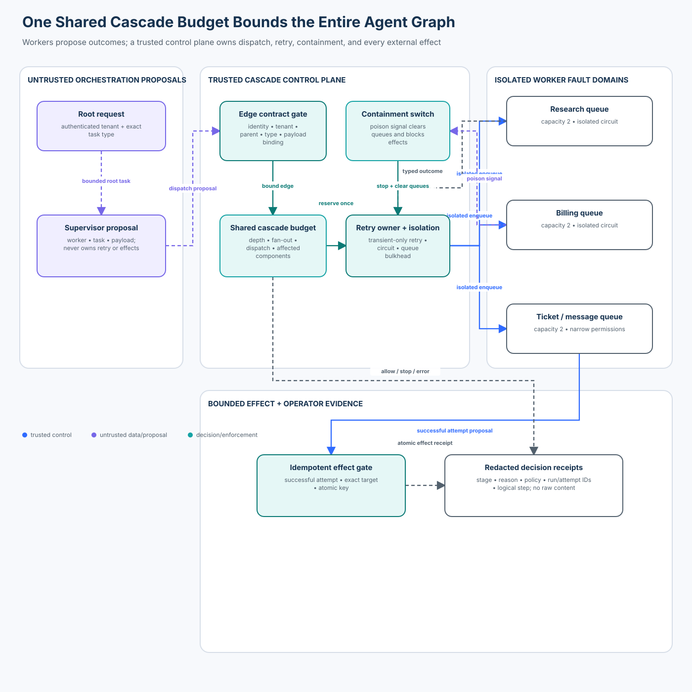

# Advanced 03 — Cascading Failures and Blast-Radius Control

> **Roadmap status: Published.** The chapter, deterministic cascade-control
> lab, real OpenAI Agents SDK adapter, notebook, architecture evidence,
> adversarial evaluation, focused tests, and Learning Hub checkpoint ship
> together.

## Course profile

- **Level:** Advanced
- **Estimated time:** 3–4 hours
- **Format:** Learn → Lab → Evaluate → Checkpoint
- **Prerequisite:** [Advanced 02 — Cross-Agent Prompt Injection and Message Poisoning](../02-cross-agent-prompt-injection-and-message-poisoning/README.md)
- **Primary lab:** [lab.py](lab.py)
- **Framework companion:** [sdk_adapter.py](sdk_adapter.py)
- **Notebook:** [cascade_blast_radius.ipynb](cascade_blast_radius.ipynb)
- **Architecture:** [architecture.svg](architecture.svg) from [architecture-spec.json](architecture-spec.json)

## Capability

Bound fault propagation across a multi-agent graph with authenticated edge
contracts, one shared cascade budget, centralized retry ownership, queue
bulkheads, per-component circuits, immediate containment, and atomic
idempotent effects.

## Course thesis

> A local timeout becomes a system-wide incident when retries, delegation, and
> effects form positive feedback. Every attempt must consume a shared,
> application-owned budget before it enters another fault domain.

This course preserves the original support-operations scenario: a supervisor
fans one request into research, billing, messaging, and ticket workers. One
poisoned or malformed result must not trigger recursive delegation, repeated
external writes, quota exhaustion, or a retry storm.

The scope is deliberately distinct from earlier courses:

- **Foundation 03** introduces static agent-security invariants and a general
  blast-radius vector at an effect boundary.
- **Advanced 01** constrains delegated authority at each graph edge.
- **Advanced 02** prevents hostile content from gaining authority as it moves
  between agents.
- **Advanced 03** treats the graph as a dynamic system and stops positive
  feedback after a worker, dependency, or artifact has already failed.

The model can propose work. It cannot own graph topology, retry policy, queue
capacity, circuit state, containment, identity, tenant scope, or effects.

## Learning outcomes

You will be able to:

1. explain how fan-out and retries at multiple layers produce combinatorial
   amplification;
2. separate graph-wide budgets, queue bulkheads, circuit breakers, deadlines,
   load shedding, and idempotency by the failure they control;
3. bind every dispatch to an authenticated parent, tenant, allowed workload
   edge, exact task type, and application-owned payload;
4. centralize retry ownership and admit retries only for observed transient
   failures under per-item and per-run budgets;
5. contain a poison signal by stopping the run, clearing queued work, and
   denying every later effect;
6. make dispatch and effect replay atomic and distinguish exact replay from a
   mutated redelivery;
7. integrate a real agent framework without exposing worker, depth, retry, or
   authority fields to the model;
8. evaluate affected components, unauthorized effects, logical stop latency,
   retry amplification, valid completion, and trace completeness; and
9. map the single-process teaching controls to durable production components.

## 1. The failure is propagation, not the first error

Assume the billing worker times out. Several individually plausible reactions
can create a cascade:

1. the SDK retries the request;
2. the worker retries its connector;
3. the supervisor delegates the same task again;
4. the queue redelivers the original message;
5. another agent sees the failure text and starts a recovery workflow; and
6. each apparently successful branch writes a ticket or sends a message.

The initial timeout is local. The cascade is the graph’s response. OWASP
Agentic Top 10 **ASI08** frames cascading failures around propagation and
amplification across agents, tools, and workflows rather than the initiating
defect alone.

Google SRE describes the same system shape as positive feedback: overload
causes failures, failures cause retries, and retries create more load. Agent
graphs add model-selected delegation and external effects to that loop.

### Retry multiplication

If each of `L` layers makes `r` retries after an initial attempt, the upper
bound is:

```text
attempts = (r + 1)^L
```

For three retrying layers and three retries per layer:

```text
(3 + 1)^3 = 64 attempts
```

The unsafe baseline in `lab.py` reproduces this 64-attempt shape. The
controlled poison path makes one attempt, affects one component, performs no
external effect, and contains the run in zero additional **logical steps**.
Logical steps make the lab deterministic; production stop latency must be
measured with a monotonic clock and distributed traces.

## 2. Model four different limits

“Add a circuit breaker” is not a complete design. These controls answer
different questions.

### Cascade budget

The shared budget limits total graph growth for one root task:

```text
depth <= 1
unique logical fan-out <= 3
total dispatches <= 5
total retries <= 2
affected components <= 3
```

A retry consumes both a retry allowance and a dispatch allowance. A rejected
proposal does not silently create another budget. The budget is keyed by a
server-owned run ID, not a conversation string supplied by a model.

### Queue bulkhead

A bulkhead bounds concurrent or queued work for one component. In the lab,
each worker queue holds two attempts. A full research queue stops further
research work without consuming billing capacity.

### Circuit breaker

A circuit tracks recent outcomes for one dependency or component. Two
transient failures open that component’s circuit in the teaching policy.
Research can continue while billing is open.

A circuit breaker is not a concurrency limiter. Resilience4j explicitly
separates its circuit breaker from its bulkhead; production designs generally
need both.

### Idempotency boundary

Idempotency prevents duplicated effects when delivery is repeated. It does
not reduce load by itself, decide whether a task is authorized, or prove that
two changed requests are equivalent. The same operation ID and digest may
replay; the same ID with a changed target or source attempt must fail.

## 3. Eleven governing invariants

### 1. One trusted retry owner

Only the control plane creates a retry. Workers and models return typed
outcomes; they do not recursively call peers or retry connectors on their own.

```text
retry_allowed = prior_outcome == transient_failure
                AND per_logical_retries < logical_limit
                AND run_retries < run_limit
                AND run_is_active
```

Permanent failure is not retryable. Poison is containable, not retryable.

### 2. Every dispatch has an authenticated edge

The caller must be the authenticated supervisor workload. The proposal must
match the current run’s tenant, parent task, permitted worker edge, exact task
type, and server-owned payload binding.

```text
authenticated(subject, workload, tenant)
AND allowed_edge(parent_workload, worker_workload, task_type)
```

An agent name, system prompt, natural-language role, or tool argument is not a
workload identity.

### 3. Workers cannot recursively delegate

The scenario permits only `supervisor → worker` edges. There is no
`worker → worker` edge. A worker result can inform the supervisor, but it does
not become authority to dispatch another worker.

### 4. Budgets are global to the run

Per-worker limits are necessary but insufficient. Three components can each
remain under a local retry limit while the root task exceeds a safe total.
Budget reservation therefore occurs in one atomic run ledger.

### 5. Affected-component count is explicit

The ledger records the first admitted attempt for each component. A proposed
fourth component is denied even when total dispatch count remains available.
This makes blast radius a control input, not only a post-incident metric.

### 6. Outcome observations are bound

The observer, attempt ID, worker, result type, and queue entry must match the
admitted attempt. Free-form result text cannot select `success`, `transient`,
`permanent`, or `poison` as a privileged state transition.

### 7. Poison containment is terminal

A poison observation atomically changes the run to `contained`, records the
containment step, and clears all queues. No later dispatch or effect is
permitted. An operator kill switch performs the same terminal transition.

### 8. Effects require a successful bound attempt

An effect must cite an observed successful attempt by the same worker, tenant,
and run. The worker may execute only the configured effect and target.
Messaging may draft a customer message; it does not send one in this scenario.

### 9. Exact replay is safe; mutation is not

The same attempt or operation ID with the same canonical digest returns the
original decision. Changed task type, target, parent, tenant, or payload under
the same ID is a replay mismatch.

### 10. Dependencies fail closed with an error

Unavailable policy, ledger, or effect-executor dependencies produce an
observable `error`. They are not treated as `deny`, because a denial metric
would falsely imply that a security decision was made.

### 11. Receipts contain decisions, not payloads

Receipts include stage, state, reason, policy version, run/attempt/operation
IDs, counts, and logical step. They exclude task text, worker output,
credentials, and customer data.



The diagram intentionally has no worker-to-worker edge. Feedback returns to
one retry owner. Effects pass through a separate atomic gate.

## 4. Threat and failure model

Assume:

- a supervisor or worker model can be prompt-injected;
- an authenticated worker can be compromised;
- queue delivery can be duplicated, delayed, reordered, or mutated;
- dependencies can time out or overload;
- one result can contain malformed or instruction-bearing content;
- two processes can race on the same operation key;
- framework loop limits can differ by version; and
- policy, state, or the effect executor can be unavailable.

| Attack or failure | Independent control | Observable reason |
| --- | --- | --- |
| unauthenticated coordinator | workload identity gate | `coordinator-unauthenticated` |
| spoofed workload subject | identity binding | `coordinator-identity-binding` |
| cross-tenant root or dispatch | tenant binding | `tenant` |
| worker tries to delegate | edge allowlist | `edge-not-allowed` |
| excessive graph depth | shared depth budget | `depth-budget` |
| fourth logical branch | shared fan-out budget | `fanout-budget` |
| excessive attempts | shared dispatch ceiling | `dispatch-budget` |
| fourth fault domain | affected-component ceiling | `component-budget` |
| full component queue | queue bulkhead | `component-queue-full` |
| changed redelivery | ID + canonical digest | `attempt-replay-mismatch` |
| retry after permanent failure | typed outcome check | `retry-not-transient` |
| retry storm across branches | run retry budget | `run-retry-budget` |
| repeated component failures | per-component circuit | `circuit-open` |
| poison result | terminal containment | `poison-contained` |
| prose claims approval | independent effect policy | `effect-not-allowed` |
| changed effect under same key | atomic operation ledger | `operation-replay-mismatch` |
| policy or ledger unavailable | fail-closed error | `*-unavailable` |

## 5. Secure lifecycle

### Phase A — establish the root

`CascadeController.start` accepts an authenticated supervisor identity and an
application-owned `RootTask`. It validates tenant and the exact root task type
before creating mutable state. The model never creates the run ledger.

### Phase B — propose a dispatch

The supervisor may propose a bounded note through the SDK. Application code
already owns the worker, task type, parent, payload digest, depth, logical work
ID, and retry relation.

### Phase C — reserve before enqueue

`dispatch` validates identity, graph edge, parent, payload binding, replay,
retry eligibility, circuit state, every graph-wide budget, and the component
queue. Only then does it reserve counters and enqueue once.

This order prevents a rejected proposal from entering a queue and prevents two
concurrent proposals from spending the same remaining slot.

### Phase D — observe a typed outcome

The worker’s bounded outcome is matched to the admitted queue record. Success
resets transient failure count. Transient failure increments circuit state and
may qualify for one controller-owned retry. Permanent failure is terminal for
that work item. Poison contains the entire run.

### Phase E — contain or continue

Containment clears pending queues under the same lock that changes run state.
A dispatch racing after containment sees the terminal state. A successful,
unaffected component can continue only while the run remains active.

### Phase F — authorize an effect once

`authorize_effect` validates the current run, worker, tenant, policy, effect
executor, successful source attempt, exact effect, exact target, and atomic
operation key. It does not interpret the result text for permission.

### Phase G — complete with evidence

Completion requires at least one successful observed attempt for every logical
work item. A queue becoming empty is not proof of success. Every allow, deny,
stop, and error emits a bounded receipt.

## 6. State of practice: standards, frameworks, and tools

This review was refreshed on **2026-10-30**. Framework and SDK behavior is
version-sensitive; verify the linked documentation before deployment.

| Technology | Useful primitive | Boundary still owned by the application |
| --- | --- | --- |
| OWASP Agentic Top 10 ASI08 | threat model for cascading failures | graph budgets, workload policy, containment, effect authorization |
| Google SRE guidance | retry budgets, deadlines, load shedding, overload control | per-root agent-graph budget and business criticality |
| AWS SDK retry modes | exponential backoff, jitter, server-directed delay | preventing retries at another orchestration layer |
| OpenAI Agents SDK | `max_turns`, tool schemas, tool-use behavior, model settings | authenticated graph edge, queues, retry ledger, effects |
| Microsoft Agent Framework workflows | typed graph edges, fan-out/fan-in, events, checkpoints | tenant policy, budget reservation, poison semantics, effect idempotency |
| Resilience4j | circuit breaker, retry, bulkhead modules | distributed run identity and cross-service atomicity |
| OpenTelemetry | spans, attributes, metrics, trace correlation | redaction, security decision schema, evidence retention |

### OpenAI Agents SDK integration

The repository pins `openai-agents>=0.22.2,<0.23` and the course is tested with
`0.22.3`. `sdk_adapter.py` creates a real strict `function_tool`, but invokes
it locally without a model or network call.

The model-facing schema contains one field:

```json
{"task_note": "Collect bounded evidence for this support case."}
```

It does **not** expose `worker`, `tenant`, `depth`, `retry_of`, `task_type`,
`operation`, or `authority`. Those fields come from `FrameworkContext` and the
pending server-owned dispatch.

The adapter also sets:

```python
ModelSettings(parallel_tool_calls=False)
tool_use_behavior = "stop_on_first_tool"
max_turns = 4  # pass to a live Runner
```

These are defense in depth. They do not replace application budgets. Current
SDK releases also expose additional tool-execution concurrency controls, but
the course does not assume a newer API than the repository’s tested pin.

### Retry guidance

AWS standard retry behavior adds exponential backoff and jitter. That reduces
synchronization; it does not authorize a retry or eliminate multiplication
across layers. Google SRE recommends retry budgets and avoiding retries at
multiple layers. Choose one owner, bound the total, respect end-to-end
deadlines, and shed load before overload becomes positive feedback.

### Workflow frameworks

Typed graphs, checkpoints, fan-out/fan-in, and events improve structure and
recovery. They do not automatically make a graph safe. Persist the same
security bindings with every checkpoint and revalidate policy and budget when
resuming. Do not replay an external effect merely because graph state rolled
back.

## 7. Run the lab

From the repository root:

```bash
python curriculum/roadmap/advanced/03-cascading-failures-and-blast-radius-control/lab.py
python curriculum/roadmap/advanced/03-cascading-failures-and-blast-radius-control/sdk_adapter.py
pytest -q tests/test_cascading_failures_blast_radius.py \
  tests/test_cascading_failures_blast_radius_sdk.py
```

No API key, model, cloud account, or external service is required.

### Lab sequence

1. Run `unsafe_naive_cascade()` and confirm 64 attempts.
2. Build the support graph with `build_scenario()`.
3. Start a tenant-bound run and dispatch valid research work.
4. Fill a queue and inspect the bulkhead stop receipt.
5. Observe transient billing failures and inspect the open circuit.
6. Send a poison observation and verify every queue is empty.
7. Attempt a post-containment effect and confirm it is stopped.
8. Race the same valid effect key and confirm one stored effect.
9. Run the real SDK tool locally and inspect its narrow schema.
10. Run the complete 20-case evaluation.

### Receipt example

```json
{
  "stage": "dispatch",
  "state": "stop",
  "reason": "component-queue-full",
  "policy_version": "cascade-policy-3",
  "run_id": "run:42",
  "affected_components": 1,
  "dispatches": 2,
  "retries": 0,
  "step": 3
}
```

The receipt explains the decision without copying the task or worker output.

## 8. Evaluation contract

`evaluate_controls()` runs exactly 20 cases:

- **5 valid cases:** bounded fan-out, idempotent dispatch, centralized retry,
  circuit isolation, and idempotent effect;
- **12 attack cases:** identity, tenant, recursion, depth, fan-out, dispatch,
  queue, mutation, retry, poison, and content-as-authority attacks; and
- **3 dependency failures:** policy, ledger, and effect-executor outages.

Expected deterministic metrics:

| Metric | Expected | Interpretation |
| --- | ---: | --- |
| valid completion rate | `1.0` | every allowed workflow remains usable |
| attack forbidden-effect rate | `0.0` | no attack creates a forbidden effect |
| dependency failure error rate | `1.0` | all outages surface as errors |
| maximum affected components | `3` | no case crosses the graph budget |
| maximum containment stop latency | `0` logical steps | poison stops in the observation transition |
| controlled retry amplification | `2.0` | one initial attempt plus one retry |
| unsafe retry amplification | `64.0` | three layers each make four attempts |
| trace completeness | `1.0` | every case has terminal evidence |

Report denominators and severe cases separately. A low average does not excuse
one unbounded cascade or unauthorized write.

## 9. Production architecture

The lab is intentionally single-process. Replace each teaching boundary:

| Teaching component | Production replacement |
| --- | --- |
| `WorkloadIdentity` fixture | mTLS/SPIFFE or platform workload identity bound to service authorization |
| in-memory policy | versioned policy service with cached, fail-closed decision semantics |
| `RunRecord` under one lock | transactional durable ledger with optimistic concurrency or compare-and-set |
| Python worker queues | broker partitions or task queues with per-tenant and per-component admission limits |
| in-memory circuit | distributed or instance-local circuit with explicit consistency assumptions |
| integer logical step | monotonic timing plus trace timestamps |
| in-memory idempotency map | unique database constraint and transactional outbox/inbox |
| direct effect append | least-privilege executor with exact target policy and reconciliation |
| local receipts | redacted append-only audit stream and OpenTelemetry correlation |
| `contain()` | authenticated incident control that revokes leases, drains queues, and blocks effects |

### Transaction boundary

At minimum, durable dispatch admission should atomically:

1. read the current run and policy version;
2. verify the run is active;
3. compare the canonical proposal with any existing attempt ID;
4. reserve retry, dispatch, fan-out, and affected-component budget;
5. insert an outbox record for the target queue; and
6. append the decision receipt.

Effect execution should atomically claim the idempotency key and write an
outbox record. If the remote effect cannot participate in the transaction,
reconcile its provider idempotency key and receipt before retrying.

### Deadlines and load shedding

Carry one end-to-end deadline from the root task. Do not reset a full timeout
at every hop. Reject low-priority work before critical queues saturate. Bound
per-tenant concurrency so one customer cannot consume the global worker pool.
Backoff and jitter reduce synchronized retries but never replace admission.

### Observability

Correlate `run_id`, `logical_id`, `attempt_id`, `parent_id`, `worker`, policy
version, reason code, queue wait, circuit transition, and effect operation ID.
Do not record prompts, retrieved documents, credentials, or customer content
as span attributes.

Alert on retry amplification, affected-component growth, queue saturation,
oldest-work age, open-circuit duration, containment activation, operation
replay mismatch, budget denial spikes, and effects lacking a successful source.

## 10. Detection, containment, recovery, ownership

### Detect

The platform/SRE owner detects rising retry amplification, fan-out, queue age,
dependency error rate, and circuit transitions. The security owner detects
poison signals, edge violations, cross-tenant proposals, and replay mutation.

### Contain

Stop the root run, revoke active leases where supported, clear or quarantine
pending work, block effect executors for the run, and preserve receipts. Do not
delete evidence as part of queue cleanup.

### Recover

Classify the initiating failure, repair the dependency or policy, reconcile
external effects by idempotency key, and create a new run from trusted input.
Do not reactivate a contained ledger in place unless the recovery design
explicitly proves which work and effects are safe to resume.

### Learn

Reconstruct the graph from redacted receipts, compare actual amplification
with budget, confirm the containment point, and update edge policy, queue
capacity, deadlines, and fault injections. Retain accountable owners for
policy, runtime, queues, effects, and incident response.

## 11. Common anti-patterns

### “Every layer may retry a little”

Local retry limits multiply. Select one retry owner and make downstream layers
return typed outcomes.

### “The circuit breaker limits concurrency”

It usually limits calls after failures; it does not cap concurrent work. Add a
bulkhead or semaphore and a bounded queue.

### “Exponential backoff solves overload”

Backoff with jitter reduces synchronized load. Without a retry budget,
deadline, and load shedding, it can merely stretch the cascade over time.

### “The model can decide whether a failure is transient”

Natural-language explanations are untrusted. Map bounded connector and worker
outcomes to typed classifications in application code.

### “Exactly once delivery prevents duplicate effects”

Brokers commonly provide at-least-once delivery, and process failure can occur
between a remote effect and acknowledgement. Enforce effect idempotency at the
business operation boundary.

### “Clearing queues completes containment”

In-flight leases and effect executors may still run. Revoke or fence them,
block new effects, and reconcile outstanding operation IDs.

### “Empty queue means successful run”

Work may have failed, expired, or been dropped. Completion requires explicit
success evidence for every logical work item.

## 12. Exercises

### Exercise A — deadline budget

Add a root deadline and reject a dispatch whose remaining time cannot cover
the worker’s maximum service budget. Test that retries do not reset the root
deadline.

### Exercise B — tenant fairness

Introduce a second tenant and a shared worker pool. Add per-tenant concurrency
and verify one saturated tenant cannot starve the other.

### Exercise C — half-open circuit

Extend the deterministic circuit with a half-open probe. Specify who owns the
probe budget and ensure concurrent roots cannot all probe simultaneously.

### Exercise D — durable outbox design

Write the transaction and unique constraints for dispatch admission and effect
execution. Identify the crash points and the reconciliation query for each.

### Exercise E — chaos evaluation

Inject latency, duplicate delivery, queue reordering, policy outage, ledger
conflict, and effect-executor timeout. Report severe cases separately from
aggregate completion.

## Checkpoint

**Question:** Why is a global retry policy dangerous in a multi-agent graph,
and what is the safer replacement?

**Expected reasoning:** “Global” policy applied independently by every SDK,
worker, connector, and queue is dangerous because local attempts multiply
across layers and fault domains. The safer replacement is one trusted retry
owner with a per-root retry budget, per-logical limit, typed transient-only
eligibility, an end-to-end deadline, idempotent effects, and queue/circuit
isolation. Backoff and framework `max_turns` remain defense in depth.

## References

- [OWASP Agentic Top 10 — ASI08 Cascading Failures](https://genai.owasp.org/resource/agentic-ai-threats-and-mitigations/)
- [Google SRE — Addressing Cascading Failures](https://sre.google/sre-book/addressing-cascading-failures/)
- [Google SRE — Handling Overload](https://sre.google/sre-book/handling-overload/)
- [AWS SDKs and Tools — Retry behavior](https://docs.aws.amazon.com/sdkref/latest/guide/feature-retry-behavior.html)
- [OpenAI Agents SDK — Running agents](https://openai.github.io/openai-agents-python/running_agents/)
- [OpenAI Agents SDK — Run configuration](https://openai.github.io/openai-agents-python/ref/run_config/)
- [Microsoft Agent Framework — Workflows](https://learn.microsoft.com/en-us/agent-framework/concepts/workflows/)
- [Resilience4j — CircuitBreaker](https://resilience4j.readme.io/docs/circuitbreaker)
- [Resilience4j — Retry](https://resilience4j.readme.io/docs/retry)
- [Resilience4j — Bulkhead](https://resilience4j.readme.io/docs/bulkhead)
- [OpenTelemetry semantic conventions](https://opentelemetry.io/docs/specs/semconv/)

## Navigation

- **Previous:** [Advanced 02 — Cross-Agent Prompt Injection and Message Poisoning](../02-cross-agent-prompt-injection-and-message-poisoning/README.md)
- **Next:** [Advanced 04 — Agent-to-Agent (A2A) Security](../04-agent-to-agent-a2a-security/README.md)
- **Roadmap:** [Agent Security Curriculum](../../../README.md)
