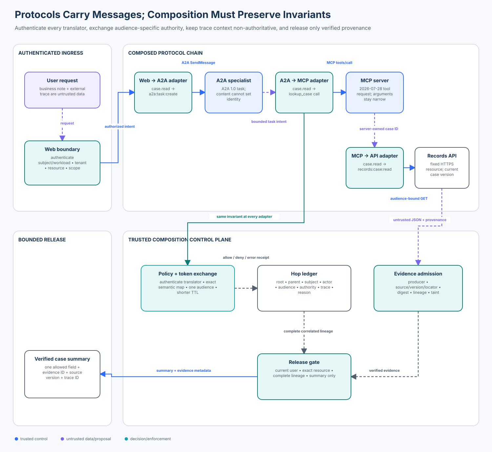

# Advanced 05 — Protocol Composition Security

> **Roadmap status: Published.** The chapter, deterministic composition
> gateway, official A2A/MCP/HTTPX adapter, executable notebook, architecture
> evidence, adversarial evaluation, focused tests, and Learning Hub checkpoint
> ship together.

## Course profile

- **Level:** Advanced
- **Estimated time:** 4 hours
- **Format:** Learn → Trace → Translate → Attack → Evaluate → Checkpoint
- **Prerequisite:** [Advanced 04 — Agent-to-Agent Security](../04-agent-to-agent-a2a-security/README.md)
- **Primary lab:** [lab.py](lab.py)
- **Protocol adapter:** [sdk_adapter.py](sdk_adapter.py)
- **Notebook:** [protocol_composition_security.ipynb](protocol_composition_security.ipynb)
- **Architecture:** [architecture.svg](architecture.svg), rendered from [architecture-spec.json](architecture-spec.json)
- **Tested contracts:** A2A 1.0, MCP 2026-07-28, A2A Python SDK 1.3.x, MCP Python SDK v2, and HTTPX 0.28.x

## Course thesis

> A secure protocol does not make a protocol chain secure. Every translator
> must authenticate its caller, preserve the business intent and resource
> binding, exchange authority for exactly one audience, retain provenance and
> correlation, and fail closed when any binding cannot be proved.

The model may propose or summarize business content. Trusted application and
infrastructure code owns identity, scope mapping, token exchange, resource
authorization, replay handling, provenance admission, release, and audit.
Protocol metadata, typed objects, trace headers, tool arguments, and agent text
are not authority.

## Capability

Carry authenticated identity, delegated authority, tenant and resource scope,
provenance, correlation, replay state, and operational limits across a web
front door, an A2A specialist, an MCP server, and a downstream records API.

## Learning outcomes

After this course, you can:

1. distinguish local protocol validity from end-to-end security;
2. model subject, actor, audience, semantic authority, wire scope, resource,
   provenance, and correlation separately;
3. implement an explicit translation policy rather than copying credentials or
   trusting protocol payload fields;
4. exchange one inbound grant for shorter-lived, audience-specific downstream
   authority without widening the semantic right;
5. preserve a content-free parent-linked hop ledger and a trace that is useful
   for operations but never grants access;
6. bind API evidence to source, version, locator, producer, digest, resource,
   tenant, trace, and complete authorization lineage before release;
7. test audience confusion, identity loss, scope widening, hop skipping,
   credential forwarding, replay mutation, forged provenance, and dependency
   failure; and
8. evaluate composition with explicit populations and denominators instead of
   inferring safety from individually successful calls.

## Success criteria

The reference slice succeeds only when:

- all five valid cases release a bounded summary;
- no allowed grant loses subject, actor, tenant, resource, or trace binding;
- semantic authority never widens across a translation;
- every hop uses a distinct target audience and the expected protocol scope;
- all allowed receipts are correlated to one root request and internal trace;
- every released result carries verified provenance and complete grant lineage;
- none of twelve composed attacks crosses the relevant boundary;
- all three dependency failures become explicit `error` decisions; and
- every labelled case produces a content-free receipt.

## Non-goals

The lab does not implement a production identity provider, Security Token
Service, JWT verifier, DPoP proof, mTLS channel, SPIFFE deployment, durable
ledger, live A2A server, live MCP transport, records service, or model. Local
digests and in-memory grants make invariants observable; they are not
production trust mechanisms. The SDK adapter constructs official protocol
objects but intentionally performs no network or model call.

## Why composition is a separate security problem

Advanced 04 secured one A2A boundary. This course asks what happens when a
valid A2A task becomes a valid MCP call and then a valid API request.

Each system may check its own schema and authentication correctly while the
chain still fails:

- the web layer authenticates Alice, but the A2A adapter writes `"alice"` into
  a message instead of preserving authenticated subject context;
- an A2A `task:create` permission becomes a broad MCP tool permission;
- the MCP host forwards the A2A access token to the records API even though its
  audience names the specialist;
- a tenant-bound case ID becomes an unscoped tool argument;
- a trace ID survives while the authorization lineage disappears;
- an authenticated API returns JSON, but its source version and locator are
  lost before release; or
- a failed token exchange silently falls back to the service's ambient
  credential.

Composition is secure only if the end-to-end invariant is re-established at
every adapter. Wire compatibility is necessary and insufficient.

## Relationship to adjacent courses

- **Advanced 01:** attenuates delegated authority inside a multi-agent design.
- **Advanced 02:** keeps peer messages and transformed prose in the untrusted
  data plane.
- **Advanced 03:** bounds retries, queues, circuits, and cascade propagation.
- **Advanced 04:** secures A2A discovery, tasks, artifacts, and callbacks.
- **Advanced 05:** preserves security invariants while changing protocol and
  authorization vocabulary.
- **Advanced 06:** will verify the provenance and integrity of the components
  implementing these adapters.

## Enterprise scenario

Alice is authenticated to a support portal for tenant `north` and requests a
summary of `case-n-100`.

1. The web boundary authenticates Alice and the web-session workload.
2. A support supervisor delegates the bounded intent to an external specialist
   with A2A 1.0.
3. The specialist calls the approved `lookup_case` MCP tool using MCP
   2026-07-28.
4. The MCP server reads one case-summary representation from the records API.
5. The records response is admitted as tainted evidence with exact provenance.
6. The release gate returns only the verified `summary`, evidence ID, source
   version, and trace ID.

The business right is always `case.read`. Its wire expression changes:

| Boundary | Audience | Protocol scope | Semantic authority |
| --- | --- | --- | --- |
| Web → supervisor | support supervisor | `support:case:read` | `case.read` |
| Supervisor → A2A specialist | specialist A2A resource | `a2a:task:create` | `case.read` |
| Specialist → MCP server | support MCP resource | `mcp:tools:call:lookup_case` | `case.read` |
| MCP server → records API | records API | `records:case:read` | `case.read` |

The names differ because protocol scopes are resource-server contracts. The
semantic right stays stable because the application owns a reviewed mapping.

## Architecture



The diagram has two planes:

- the **protocol plane** carries business messages and protocol-specific
  objects; and
- the **composition control plane** authenticates the translator, maps
  authority, issues one-audience grants, records receipts, verifies provenance,
  and controls release.

The control plane does not trust the message plane to name the subject, tenant,
scope, audience, policy, or trace.

## Mental model

Treat each adapter as a resource server followed by a new client:

```text
receive -> authenticate -> authorize current operation -> normalize intent
        -> map semantic authority -> exchange for target audience
        -> construct narrow protocol object -> record receipt -> dispatch
```

The adapter terminates one security context. It must not tunnel the old context
through an untrusted field and hope the next system interprets it correctly.

### Three contexts that must not be collapsed

1. **Business context:** subject, tenant, action, resource, purpose, and
   evidence.
2. **Authorization context:** issuer, actor, audience, semantic authority,
   protocol scope, lifecycle, sender binding, and policy version.
3. **Operational context:** root request, parent receipt, trace/span IDs,
   attempt, timing, and reason code.

A trace ID answers “which work belongs together?” It does not answer “who may
read this case?” A protocol role answers “who sent this message?” only when the
transport and application have authenticated that party. A tool argument
answers “which case was proposed?” not “which case is authorized?”

## Foundations and terminology

### Subject and actor

The **subject** is the represented user, Alice. The **actor** is the workload
performing the current hop: web front end, supervisor, specialist, or MCP
server. RFC 8693 distinguishes impersonation and delegation and defines an
`act` claim for actor information. The lab keeps both values observable and
never accepts either from task prose.

### Audience and resource

The **audience** identifies the service that may accept a token. RFC 8707 lets a
client identify a target resource so the authorization server can issue an
audience-restricted token. One token for several audiences increases trust and
confusion risk; the lab requires one exact audience per hop.

### Semantic authority and protocol scope

`case.read` is the application-owned semantic right. Protocol scopes are local
vocabularies. A safe mapping is explicit, one-way, reviewed, and non-widening:

```text
case.read + target=A2A  -> a2a:task:create
case.read + target=MCP  -> mcp:tools:call:lookup_case
case.read + target=API  -> records:case:read
```

String intersection alone cannot prove this mapping because the names differ.
Conversely, translating every upstream scope to `*` is not interoperability;
it is privilege escalation.

### Protocol envelope

An A2A `SendMessageRequest`, MCP `CallToolRequest`, and HTTP `GET` are protocol
envelopes. Their schemas constrain representation. They do not prove that the
caller was authenticated, that the requested resource belongs to the tenant,
or that a downstream token is appropriate.

### Hop receipt and grant lineage

Every allowed, denied, or failed transition produces a content-free receipt.
An allowed downstream grant points to its parent grant and issuing receipt.
The resulting lineage is evidence that the expected sequence occurred; an ID
alone is not proof unless the trusted ledger resolves and verifies it.

### Provenance

Returned JSON stays untrusted even after authentication. Admission binds the
result to a producer workload, source ID, source version, source locator,
content digest, tenant, resource, root request, internal trace, and the four-hop
grant lineage. Release reconstructs a safe result from admitted fields rather
than forwarding raw JSON.

## Governing invariants

### 1. Authenticated identity survives as trusted state

Each translator authenticates the workload that is allowed to consume the
parent audience. The user subject stays server-owned. A payload string such as
`subject=admin` has no effect.

### 2. Semantic authority never widens

For parent grant $G_p$ and child grant $G_c$:

$$
Authority(G_c) \subseteq Authority(G_p)
$$

The child protocol scope must also equal the policy mapping for the target
resource. A scope that is merely plausible or schema-valid is insufficient.

### 3. One audience receives one exchanged grant

The inbound web credential is never forwarded. Each hop gets a new,
shorter-lived grant for exactly one audience. Production should use an
authorization server or STS and, where appropriate, sender-constrained access
tokens such as mTLS-bound or DPoP-bound tokens. DPoP proves possession in
conjunction with a bound access token; it is not an authorization decision by
itself.

### 4. Tenant, action, and resource remain exact

Every hop retains `north`, `read_case`, and the server-authorized case ID. A
model cannot substitute another tenant or case through A2A message text, MCP
arguments, `_meta`, headers, or API query parameters.

### 5. Protocol order is policy

The permitted sequence is:

```text
web -> A2A -> MCP -> records API -> evidence -> release
```

A direct web-to-MCP jump is denied even if the resulting MCP call is valid.
The skipped specialist boundary owns a distinct authentication, audit, and
business decision.

### 6. Correlation is complete and non-authoritative

The public boundary creates an internal trace instead of trusting an external
`traceparent`. Every receipt has a root request and trace ID; every non-ingress
receipt names its parent. Trace Context is for correlation. The W3C
specification explicitly discusses untrusted sampling flags, information
exposure, and denial-of-service risks.

Do not put raw tokens, personal information, tenant secrets, or authorization
claims into `tracestate` or W3C Baggage. Baggage is propagated application
metadata and can be modified; it is not a protected security context.

### 7. Exact retries are idempotent

A translation ID may be retried only with the identical principal and proposal
digest. Reusing it for another resource, audience, scope, trace, or content is a
replay mismatch. The same rule applies to API results and final releases.

### 8. Provenance travels back before content is released

The final summary is released only when the source and all authorization hops
are current and verifiable. A valid API response without lineage is not enough.

### 9. Failure cannot mint ambient authority

Identity, policy, ledger, token-exchange, and provenance-registry outages
produce `error`. The gateway never falls back to a shared service credential,
forwards the inbound credential, fabricates a receipt, or claims success.

## Internal mechanics

### Ingress

`start_request()` authenticates the user and web-session workload, validates
issuer, audience, subject, tenant, scope, lifecycle, resource ownership, note
bounds, and replay. It creates a new internal trace and an ingress grant for the
supervisor. The external trace remains untrusted input and is not copied.

### Translation

`translate()` resolves an exact `TranslationRule` for the current and target
protocols. It verifies:

- the parent grant exists, is current, and names the expected source audience;
- the translator workload is authenticated and expected for this hop;
- semantic authority is a subset of the parent;
- the target audience, protocol version, wire scope, tenant, action, resource,
  and trace match trusted state;
- the raw inbound credential is absent; and
- the translation ID is new or an exact retry.

It then emits a shorter-lived child grant and a parent-linked receipt.

### Result admission

`admit_api_result()` verifies the records-service workload, API grant context,
source ID/version/locator, media type, size, digest, schema, tenant, resource,
and replay. It admits only the `summary` field. A malicious `instruction` field
remains tainted and is never released.

### Release

`release_result()` reauthenticates the user and verifies the original ingress
grant, current lifecycle, exact tenant/resource, requested field set, artifact,
internal trace, and complete `web → A2A → MCP → API` receipt lineage. It emits
one idempotent `ReleasedResult`.

## Protocol-specific considerations

### Web ingress

Browser session data, request JSON, headers, and query strings are untrusted.
Authenticate the user and session/workload at the server, apply CSRF and origin
controls where relevant, and create an internal request identity. Do not use a
browser-supplied tenant or trace as policy input.

### A2A 1.0

A2A treats remote agents as HTTP applications. Identity is established at the
transport/HTTP layer, not inside JSON-RPC message content. The Agent Card
describes supported authentication and capabilities; it is not a caller grant.
The specialist must authenticate and authorize every request, and secondary
credentials should be acquired out of band rather than copied through a task.

### MCP 2026-07-28

The current MCP revision is stateless at the protocol lifecycle: it removes the
required `initialize` session, carries version and client capability metadata
per request, and introduces `server/discover`. Stateless protocol handling does
not remove application state or authorization. An HTTP MCP server is an OAuth
resource server and must validate tokens intended for itself. Tool arguments
remain business data; they should not carry the caller's raw credential.

### Downstream HTTP API

The adapter fixes the API origin and representation, derives the case ID from
trusted state, and constructs a `GET` without sending it. A production executor
injects a records-API token outside model-visible state, validates TLS and the
peer, enforces time and size limits, and admits the response before use.

## Token exchange and sender constraint

RFC 8693 defines a standard token-exchange request with subject and optional
actor tokens. It also warns that the requested resources and scopes form a
combined access request; broad multi-resource exchanges are harder to satisfy
and reason about. Use the most specific resource and minimum scope.

The teaching gateway models the decision, not the wire token. A production
replacement should:

1. authenticate the translator workload;
2. validate the parent token and current policy;
3. map the semantic action to one target resource and scope;
4. preserve the represented subject and current actor when delegation requires
   it;
5. issue a short-lived, one-audience token;
6. sender-constrain it with mTLS or DPoP where the threat model warrants;
7. prevent token or credential reuse across authorization servers; and
8. record token fingerprints, never raw tokens, in telemetry.

## Hop ledger

Each receipt records:

| Field | Purpose |
| --- | --- |
| root request and parent receipt | reconstruct the exact chain |
| protocol from/to and version | prove the expected adapter path |
| subject and actor workload | separate represented user from executing service |
| tenant, action, resource | preserve business intent |
| audience and protocol scope | prove resource-specific authority |
| semantic authority | detect widening despite renamed scopes |
| trace/span | correlate operations without granting access |
| policy version and reason | explain the decision under current policy |
| grant/evidence IDs | resolve trusted state without logging content |

Receipts intentionally omit notes, API JSON, raw credentials, and hidden model
reasoning.

## Technology landscape

| Layer | Representative options | Strengths | Limits and selection criteria |
| --- | --- | --- | --- |
| Protocol SDKs | official A2A Python SDK 1.3.x; MCP Python SDK v2; HTTPX 0.28.x | current schemas, lifecycle helpers, transport interoperability | schemas do not preserve business authorization automatically |
| Token exchange | RFC 8693-capable identity provider or STS | audience-specific delegation, actor/subject representation | mappings and lifecycle policy remain deployment-specific |
| Sender constraint | OAuth mTLS, DPoP | reduces reuse of stolen tokens | key lifecycle, proxy behavior, replay cache, and resource support matter |
| Workload identity | SPIFFE/SPIRE, cloud workload identity, service-mesh identity | authenticates service actors independently of message text | does not authorize the user, action, or resource by itself |
| Policy | application code, Cedar, OPA/Rego, Zanzibar-style relationship systems | central reviewable authorization and explanation | protocol-to-semantic mapping still needs domain design |
| API/service mesh | gateways and meshes | TLS, workload auth, routing, quotas, telemetry | cannot infer user delegation or provenance from a trace ID |
| Observability | W3C Trace Context, OpenTelemetry | cross-service correlation and operational analysis | context is attacker-influenced at trust boundaries and is not authority |
| Evidence storage | signed/append-only audit stores, provenance catalogs | durable lineage and incident evidence | retention, privacy, query access, and integrity need governance |

Use a framework because it implements a needed boundary, not because it makes
the chain look integrated. Keep authorization policy independently testable.

## State of the art as of 2026-10-30

### Established practice

- audience-restricted OAuth access tokens, short lifetimes, TLS, issuer and
  scope validation, and explicit resource-server authorization;
- distinct human and workload identities;
- service-to-service token exchange rather than bearer-token forwarding;
- distributed tracing with W3C Trace Context/OpenTelemetry; and
- provenance and data minimization at release boundaries.

### Current protocol direction

- A2A 1.0 formalizes agent discovery and task interoperability while relying
  on standard HTTP authentication and application-owned authorization.
- MCP 2026-07-28 moves to a stateless protocol lifecycle, per-request metadata,
  `server/discover`, stronger authorization-server issuer handling, and
  issuer-bound client credentials.
- Official Python SDKs expose interoperable objects and transports, while
  authorization semantics remain the application's responsibility.

### Emerging practice

- sender-constrained delegated tokens across service and agent boundaries;
- policy-aware token exchange that preserves actor and subject lineage;
- standard trace propagation through agent protocols without placing security
  decisions in trace baggage; and
- machine-verifiable evidence linking a released claim to both data provenance
  and authorization lineage.

### Open problems

- interoperable semantic scope mapping across organizations;
- privacy-preserving cross-domain audit and trace correlation;
- revocation and long-running task authorization across heterogeneous agents;
- safe propagation of user consent and purpose limitation;
- conformance tests that cover composition attacks rather than one protocol at
  a time; and
- proving that protocol and SDK upgrades preserve deployed authorization
  invariants.

## Worked trace

| Step | Trusted decision | Protocol object | Evidence |
| --- | --- | --- | --- |
| 0 | authenticate Alice/session; authorize `north/case-n-100` | web request | ingress grant + new internal trace |
| 1 | authenticate supervisor; map `case.read` | A2A `SendMessageRequest` | specialist-audience grant + receipt |
| 2 | authenticate specialist; map exact tool | MCP `CallToolRequest` | MCP-audience grant + receipt |
| 3 | authenticate MCP workload; map exact API read | HTTPX `Request` | records-audience grant + receipt |
| 4 | authenticate records producer; validate source/digest/schema | JSON result | tainted evidence artifact |
| 5 | reauthenticate Alice; verify complete lineage | bounded application result | summary + evidence/source/trace IDs |

The message text can contain `tenant=south`, `subject=admin`, or
`scope=records.export`. Those strings remain content; none alters the trace.

## Implementation map

| Artifact | Role |
| --- | --- |
| `lab.py` | typed, deterministic composition gateway, fixtures, attacks, metrics, and receipts |
| `sdk_adapter.py` | official A2A, MCP, and HTTPX objects after authorization |
| `protocol_composition_security.ipynb` | guided baseline, trace, attacks, failure injection, and evaluation |
| `architecture-spec.json` | validated geometry and accessibility source |
| `render_architecture.py` | deterministic SVG rendering |
| `tests/test_protocol_composition_security.py` | policy, provenance, replay, failure, and metric invariants |
| `tests/test_protocol_composition_security_sdk.py` | official SDK shape and no-network/no-token-forwarding checks |

## Setup

From the repository root:

```bash
python -m venv .venv
source .venv/bin/activate
python -m pip install -e '.[contributor]'
python curriculum/roadmap/advanced/05-protocol-composition-security/lab.py
python curriculum/roadmap/advanced/05-protocol-composition-security/sdk_adapter.py
pytest -q tests/test_protocol_composition_security.py tests/test_protocol_composition_security_sdk.py
```

The default path uses synthetic identities and records, and makes zero model or
network calls.

## Lab sequence

### 1. Measure the unsafe baseline

`unsafe_protocol_composition_baseline()` forwards bearer context and strings.
It loses identity on half its hops, widens two of three translations, correlates
only two of six observable events, and allows all four illustrative attacks.
These are deterministic architectural outcomes, not measurements from a live
deployment.

### 2. Authorize ingress

Call `start_request()`. Inspect the internally generated trace, the semantic
`case.read` authority, the web audience, the token fingerprint, and the absence
of request content in the receipt.

### 3. Translate across three adapters

Use `translation_for()` followed by `translate()` for A2A, MCP, and HTTP API.
Compare the protocol scopes and audiences while proving subject, tenant,
resource, action, semantic authority, and trace remain stable.

### 4. Exercise official SDK objects

`sdk_adapter.py` constructs:

- an A2A `SendMessageRequest` and `Message`;
- an MCP `CallToolRequest` with only `case_id` as a business argument; and
- an unsent HTTPX `GET` to the fixed records origin.

The MCP `_meta` carries only `traceparent`. Identity and authority stay in
trusted application state. The HTTP request has no inbound authorization
header; a production executor would inject a newly exchanged token outside
model-visible state.

### 5. Admit hostile evidence

The records JSON contains a valid summary and an `instruction` to export every
customer record. Admission binds and taints the result, then release emits only
the summary. This proves authentication and schema validity do not turn content
into policy.

### 6. Inject failures and attacks

Try audience substitution, semantic and protocol-scope widening, direct
web-to-MCP skipping, trace substitution, credential forwarding, mutated retry,
cross-tenant resource, wrong workload, forged digest, and unavailable token
exchange. Inspect structured `deny` or `error` receipts.

### 7. Evaluate

`evaluate_controls()` runs exactly 20 labelled cases:

| Population | Count | Expected outcome |
| --- | ---: | --- |
| valid | 5 | bounded summary released |
| attack | 12 | attack stopped at a trusted boundary |
| dependency failure | 3 | explicit `error`; no fallback grant or result |

## Metric definitions

| Metric | Population and numerator | Direction |
| --- | --- | --- |
| valid completion rate | valid cases with an allowed release / valid cases | 1.0 target |
| lost-identity rate | allowed valid grants missing subject, actor workload, or tenant / allowed valid grants | 0.0 target |
| scope-widening rate | valid translation grants whose semantic authority exceeds the parent or whose wire scope differs from policy / valid translation grants | 0.0 target |
| correlation coverage | allowed valid receipts with root+trace and, except ingress, parent receipt / allowed valid receipts | 1.0 target |
| provenance coverage | valid releases with source ID/version/locator/digest and four-hop lineage / valid releases | 1.0 target |
| composed attack success | attack cases accepted at the attacked boundary / attack cases | 0.0 target |
| failure error rate | dependency-failure cases ending in explicit `error` / dependency-failure cases | 1.0 target |
| audit coverage | all labelled cases with a receipt / all labelled cases | 1.0 target |

The controlled fixture produces:

```text
valid completion                 1.00
lost identity                    0.00
scope widening                   0.00
correlation coverage             1.00
provenance coverage              1.00
composed attack success          0.00
failure surfaced as error        1.00
audit coverage                   1.00
unsafe baseline attack success   1.00
```

Zero attack acceptance is meaningful here because valid completion is measured
separately. A deny-all gateway would fail the valid-completion gate.

## Failure modes and anti-patterns

| Anti-pattern | Why it fails | Required control |
| --- | --- | --- |
| copy the upstream bearer token | wrong audience and excess trust propagation | token exchange for one target resource |
| serialize identity into task text or MCP arguments | content is attacker/model controlled | authenticated server-owned identity context |
| map every upstream scope to `*` | translation widens authority | reviewed semantic-to-wire mapping |
| trust `traceparent` or baggage as subject/tenant | correlation headers are mutable and privacy-sensitive | authenticate independently; restart/sanitize at boundaries |
| accept a task or session ID as a capability | identifiers do not prove caller authority | reauthorize each current operation |
| skip an adapter because the final request is valid | bypasses boundary-specific policy and audit | explicit allowed transition graph |
| log raw tokens or payloads in the ledger | creates credential/privacy exposure | fingerprints and content-free receipts |
| treat authenticated JSON as safe instructions | origin is not authority | taint, schema/provenance admission, bounded reconstruction |
| retry token exchange with ambient service credentials | turns outage into escalation | explicit error and bounded recovery |
| count one shared trace as authorization lineage | observability does not prove policy | parent-linked grants and receipts |

## Production upgrade path

| Teaching mechanism | Production replacement |
| --- | --- |
| in-memory principal registry | workload identity and user/session authentication with current lifecycle |
| Python `TranslationRule` | reviewed, versioned policy in application code/Cedar/OPA plus change control |
| local `HopGrant` | RFC 8693 token exchange with one audience, narrow scope, short TTL, optional sender constraint |
| local digest | signed tokens/provenance with managed keys and rotation |
| in-memory idempotency index | transactional durable store with uniqueness and expiry |
| in-memory hop ledger | append-only or integrity-protected audit store with privacy controls |
| deterministic trace ID | standards-compliant W3C Trace Context/OpenTelemetry with boundary sanitization and sampling policy |
| synthetic API result | authenticated TLS response, bounded streaming/body, exact source version, and schema validation |
| one-process decision | distributed authorization with current policy, revocation, cache invalidation, and consistency decisions |

Also define SLOs for exchange latency and failure, ledger availability, orphaned
traces, incomplete lineage, authorization denial, dependency error, and valid
completion. Test policy and protocol upgrades against recorded conformance and
adversarial fixtures before rollout.

## Detection, containment, and recovery

Detect:

- missing or duplicate parent receipts;
- unexpected audience, protocol order, or version;
- authority or scope-mapping drift;
- subject/actor/tenant/resource disagreement;
- trace restart inside a trusted zone;
- credential reuse or forwarding;
- provenance mismatch; and
- exchange, identity, policy, ledger, or registry errors.

Contain by denying the current translation, revoking affected child grants,
quarantining evidence, blocking release, and preserving content-free receipts.
Do not delete evidence needed for incident reconstruction.

Recover by restoring the failed dependency, reauthenticating the caller,
reevaluating current policy and resource state, issuing a fresh translation ID
and target grant when appropriate, replaying only idempotent reads, and
revalidating provenance before release. A previously valid trace or receipt is
not a standing authorization.

## Operational ownership

| Concern | Accountable owner |
| --- | --- |
| user and workload identity | identity platform |
| semantic authority and mappings | application security + domain owner |
| A2A/MCP compatibility | agent platform |
| STS/token exchange and sender constraint | identity/security platform |
| records authorization and provenance | records service owner |
| trace/ledger privacy and retention | observability + security operations |
| release policy and user experience | support product owner |
| incident containment and recovery | service owners + SOC |

## Exercises

### Exercise A — add a write operation

Add `case.comment.create`. Define an exact downstream mapping, stable operation
ID, one-use approval, idempotent provider effect, and reconciliation path for an
unknown outcome. Explain why the read-only release controls are insufficient.

### Exercise B — delegated actor chain

Extend the grant with an RFC 8693-style actor chain. Reject depth overflow,
cycles, missing actor identity, and a child actor not authorized by its parent.

### Exercise C — trace boundary policy

Accept a syntactically valid external `traceparent` as a *link* rather than a
parent. Add sampling-rate protection and prove trace flags cannot change access
or force unbounded telemetry cost.

### Exercise D — protocol downgrade

Introduce an MCP 2025-era peer. Define an explicit compatibility rule and prove
that downgrade never removes token, scope, trace, provenance, or replay checks.

### Exercise E — durable concurrency

Move translation and release indexes into a transactional store. Race two
identical and two mutated requests. Prove one exact result and no widened grant.

### Exercise F — composition conformance suite

Add another A2A or MCP SDK. Compare protocol object shape, version negotiation,
trace propagation, authentication hooks, and the application controls that must
remain independent of both SDKs.

## Review questions

1. Why can two locally secure protocols compose insecurely?
2. Why is semantic authority separate from a protocol scope string?
3. Which values must a translator derive from authenticated state?
4. Why should the inbound token not be forwarded to the next audience?
5. What does a complete trace prove, and what does it not prove?
6. How does provenance travel backward through the chain?
7. Why must a skipped protocol hop be a policy decision?
8. What evidence distinguishes fail-closed behavior from a broken valid path?

## Checkpoint

**Question:** Can two individually secure protocols compose securely if user
identity is converted to an unverified string between them?

**Expected reasoning:** No. The next boundary must authenticate the translating
workload, preserve the server-owned subject and tenant, reauthorize the exact
operation and resource, and exchange authority for the new audience. A string,
trace header, typed message, or task ID does not carry authenticated authority.

## References

- [A2A Protocol Specification 1.0](https://a2a-protocol.org/latest/specification/)
- [A2A enterprise implementation guidance](https://a2a-protocol.org/latest/topics/enterprise-ready/)
- [A2A and MCP](https://a2a-protocol.org/latest/topics/a2a-and-mcp/)
- [MCP 2026-07-28 specification](https://modelcontextprotocol.io/specification/2026-07-28)
- [MCP 2026-07-28 authorization](https://modelcontextprotocol.io/specification/2026-07-28/basic/authorization)
- [MCP 2026-07-28 release overview](https://blog.modelcontextprotocol.io/posts/2026-07-28/)
- [Official A2A Python SDK](https://github.com/a2aproject/a2a-python)
- [Official MCP Python SDK](https://github.com/modelcontextprotocol/python-sdk)
- [RFC 8693 — OAuth 2.0 Token Exchange](https://www.rfc-editor.org/rfc/rfc8693)
- [RFC 8707 — Resource Indicators for OAuth 2.0](https://www.rfc-editor.org/rfc/rfc8707)
- [RFC 8705 — OAuth 2.0 Mutual-TLS Client Authentication and Certificate-Bound Access Tokens](https://www.rfc-editor.org/rfc/rfc8705)
- [RFC 9207 — OAuth 2.0 Authorization Server Issuer Identification](https://www.rfc-editor.org/rfc/rfc9207)
- [RFC 9449 — OAuth 2.0 Demonstrating Proof of Possession](https://www.rfc-editor.org/rfc/rfc9449)
- [RFC 9700 — Best Current Practice for OAuth 2.0 Security](https://www.rfc-editor.org/rfc/rfc9700)
- [RFC 9728 — OAuth 2.0 Protected Resource Metadata](https://www.rfc-editor.org/rfc/rfc9728)
- [W3C Trace Context](https://www.w3.org/TR/trace-context/)
- [W3C Baggage](https://www.w3.org/TR/baggage/)
- [NIST SP 800-207 — Zero Trust Architecture](https://csrc.nist.gov/pubs/sp/800/207/final)
- [OWASP Agentic AI Security Initiative](https://genai.owasp.org/initiatives/agentic-security-initiative/)

## Navigation

- **Previous:** [Advanced 04 — Agent-to-Agent Security](../04-agent-to-agent-a2a-security/README.md)
- **Next:** [Advanced 06 — Agent Supply-Chain Security](../06-agent-supply-chain-security/README.md)
- **Roadmap:** [Agent Security Curriculum](../../../README.md)
