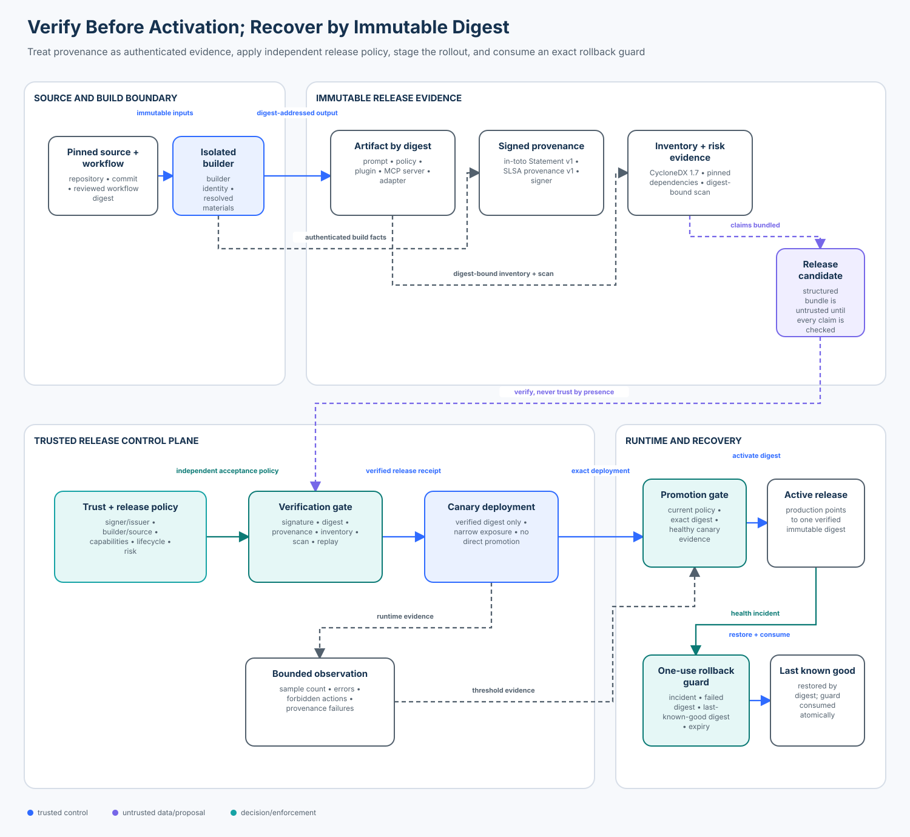

# Advanced 06 — Agent Supply-Chain Security

> **Roadmap status: Published.** The chapter, deterministic release gate,
> Sigstore adapter, executable notebook, architecture evidence, adversarial
> evaluation, focused tests, and Learning Hub checkpoint ship together.

## Course profile

- **Level:** Advanced
- **Estimated time:** 4 hours
- **Format:** Learn → Inventory → Verify → Attack → Stage → Recover → Evaluate
- **Prerequisite:** [Advanced 05 — Protocol Composition Security](../05-protocol-composition-security/README.md)
- **Primary lab:** [lab.py](lab.py)
- **SDK adapter:** [sdk_adapter.py](sdk_adapter.py)
- **Notebook:** [agent_supply_chain_security.ipynb](agent_supply_chain_security.ipynb)
- **Architecture:** [architecture.svg](architecture.svg), rendered from [architecture-spec.json](architecture-spec.json)
- **Tested contracts:** SLSA 1.2, in-toto Statement v1, SLSA provenance v1, CycloneDX 1.7, Sigstore Python 4.5.x, and Ed25519

## Course thesis

> An artifact is eligible for an agent runtime only when a trusted release
> gate independently verifies its immutable digest, signer identity and issuer,
> expected builder and source, signed provenance, least-privilege manifest,
> complete dependency inventory, current risk evidence, rollout state, and
> recovery binding. The presence of a signature, SBOM, or attestation is not an
> acceptance decision.

Models and agents may propose a component, version, rollout, or rollback.
Trusted infrastructure code resolves immutable artifacts, verifies cryptography
and identity, evaluates current policy, persists state atomically, activates
one exact digest, and records the observable decision. Structured metadata is
untrusted until its authenticity and policy meaning have both been established.

## Capability

Inventory, verify, stage, monitor, promote, revoke, and recover every prompt
bundle, policy bundle, plugin, MCP server, and model adapter that can change an
agent's behavior or authority.

## Learning outcomes

After this course, you can:

1. map source, build, dependency, distribution, deployment, and recovery trust
   boundaries for heterogeneous agent components;
2. distinguish artifact integrity, signer identity, provenance authenticity,
   policy acceptability, dependency transparency, and runtime health;
3. verify an Ed25519-signed provenance statement against the exact artifact,
   signer/issuer, builder, source revision, workflow, environment, and tenant;
4. reject mutable references, dependency substitution, artifact swapping,
   forged or stale attestations, privilege widening, incomplete inventory, and
   risk evidence bound to the wrong digest;
5. construct and validate an official Sigstore Python in-toto Statement and
   exact identity policy without requiring OIDC credentials or network calls;
6. require a verified release receipt before canary deployment and bind
   promotion to sufficient, healthy observations for that exact digest;
7. issue and atomically consume a short-lived rollback guard that binds a
   failed digest to one last-known-good digest; and
8. calculate verified-artifact coverage, unpinned-component rate, provenance
   failure detection, forbidden-release rate, and rollback time using explicit
   populations and denominators.

## Success criteria

The reference slice succeeds only when:

- all five valid agent-component kinds pass verification, canary, and promotion;
- every activated artifact and dependency is immutable and digest-bound;
- signer, issuer, signature, subject, builder, source, workflow, materials,
  tenant, environment, lifecycle, inventory, scan, and capabilities agree;
- none of fourteen substitution, provenance, privilege, inventory, or risk
  attacks reaches release eligibility;
- all three dependency outages surface as explicit errors with no fallback;
- both recovery cases restore the exact last-known-good digest with one-use
  guards in 12 and 14 logical seconds; and
- every labelled case has a content-free audit receipt.

## Non-goals

This teaching implementation does not:

- operate a production certificate authority, transparency log, TUF repository,
  registry, CI platform, KMS/HSM, vulnerability service, or deployment system;
- claim a deterministic local Ed25519 key is equivalent to Sigstore keyless
  signing, hardware-backed keys, or organizational key management;
- prove source code is benign, a builder is uncompromised, an SBOM is complete,
  a vulnerability database is current, or runtime behavior will remain safe;
- make live OIDC, Sigstore, registry, cluster, model, or network calls;
- treat a signature, SLSA level, SBOM, scanner result, or vendor reputation as a
  universal trust score; or
- replace incident response, key rotation, reproducible builds, vulnerability
  management, or business authorization.

## Why agent supply chains are a distinct security problem

An agent's effective program is assembled from more than application binaries.
Prompts, policies, tool schemas, plugins, MCP servers, model adapters, retrieval
configuration, container images, and deployment manifests can independently
change what the system sees, decides, or is allowed to do. Several are text or
configuration files that conventional binary-centric pipelines overlook.

The dangerous shortcut is:

```text
artifact exists + metadata exists + signature verifies -> deploy
```

The required reasoning is:

```text
resolve bytes -> compute digest -> authenticate signer -> verify signature
-> parse known statement/predicate -> bind subject -> evaluate source/builder
-> verify materials/inventory/risk -> check least privilege and lifecycle
-> issue exact release receipt -> canary -> bind observations -> promote
-> retain one-use rollback path to an immutable last-known-good digest
```

Cryptography answers whether an authenticated key signed specific bytes.
Release policy answers whether that signer, builder, source, workflow, artifact,
capability set, tenant, environment, time, and evidence are acceptable now.

## Relationship to adjacent courses

| Course | Boundary owned there | What this course adds |
| --- | --- | --- |
| [Advanced 04 — A2A Security](../04-agent-to-agent-a2a-security/README.md) | remote peer discovery and task resources | verifies the peer implementation before it becomes an allowed component |
| [Advanced 05 — Protocol Composition](../05-protocol-composition-security/README.md) | identity and authority across protocol adapters | verifies the code, prompt, policy, and server artifacts that implement those adapters |
| [Advanced 07 — Security Testing and Fuzzing](../07-agent-security-testing-and-fuzzing/README.md) | generated boundary and sequence tests | fuzzes release-gate and metadata invariants defined here |
| [Enterprise 05 — Production Readiness](../../enterprise/05-security-release-gates-and-production-readiness/README.md) | organization-wide release evidence and decision ownership | consumes this course's component-level verification evidence in a broader gate |

## Enterprise scenario

The Northstar support platform releases five behavior-changing component kinds:

| Component | Example | Principal supply-chain risk |
| --- | --- | --- |
| prompt bundle | support summarization instructions | invisible behavior change through an unsigned or mutable text update |
| policy bundle | authorization policy data | downgrade or capability widening disguised as configuration |
| plugin | ticket connector | dependency substitution and excess permissions |
| MCP server | case-lookup service | malicious tool implementation behind a familiar server name |
| model adapter | provider/client integration | changed request routing, data handling, or tool semantics |

Each release candidate includes artifact bytes, a least-privilege manifest,
signed provenance, a complete dependency inventory, and scan evidence. The
candidate is still untrusted. A release verifier independently applies a
versioned policy; a deployer can start only a verified canary; a promoter needs
healthy, digest-bound observations; and a health monitor can issue only a
short-lived rollback guard to a retained last-known-good digest.

### Primary attacks

- substitute bytes after provenance was produced;
- use `latest`, a branch, or another mutable reference instead of a digest;
- sign with an unexpected workflow, repository, OIDC issuer, or builder mode;
- reuse valid provenance for a different subject or tenant;
- omit or replace transitive dependencies in the inventory;
- widen plugin, tool, policy, or adapter capabilities;
- bind a clean scan to a different digest;
- replay a candidate ID with changed evidence;
- bypass the canary or promote on insufficient or unhealthy observations; and
- replay or retarget a rollback authorization.

## Architecture



The primary flow is left to right: pinned source and workflow enter an isolated
builder; immutable artifacts and authenticated evidence enter an independent
verification gate; a release receipt permits only a canary; healthy observations
permit promotion. Recovery is a separate state transition, not a tag change or
an ad hoc redeploy.

## Mental model

Ask four different questions. Do not collapse them into “is it signed?”

1. **What exact bytes are proposed?** Resolve the artifact and every executable
   dependency to immutable digests; compute the root digest locally.
2. **Who made which authenticated claim?** Verify the signature and signer
   identity/issuer over a known statement type and predicate.
3. **Is the claim acceptable here and now?** Evaluate the subject, source,
   builder, workflow, materials, tenant, environment, lifecycle, capabilities,
   inventory, risk, revocation, and replay state against current policy.
4. **May this release become active?** Require a verified receipt, staged
   rollout evidence, current authorization, and a recoverable state transition.

The first three questions establish release eligibility. They do not authorize
promotion by themselves. Runtime evidence does not retroactively repair missing
provenance, and provenance does not predict runtime health.

## Foundations and terminology

### Artifact identity

An artifact name or version is a human-friendly locator. A cryptographic digest
is an immutable identity for exact bytes under the selected algorithm. The lab
uses SHA-256 and accepts root references only in `sha256:<64 lowercase hex>`
form. A digest proves equality to bytes, not safety or source.

### Signature and signer identity

A signature binds a payload to a private key. Verification also needs a trust
decision about the public key or certificate identity. In keyless Sigstore, the
certificate and OIDC claims establish a short-lived signing identity and the
transparency log supplies independently verifiable inclusion evidence. The
consumer must still require the expected identity and issuer.

### Attestation, Statement, and predicate

The in-toto Attestation Framework separates:

- the **subject**, the artifact digest being described;
- the **predicate type**, which identifies the meaning/schema of the claim;
- the **predicate**, such as SLSA build provenance; and
- the **envelope/bundle**, which authenticates and packages the statement.

Unknown statement or predicate types must not be silently treated as equivalent.
Extensions should be monotonic: ignoring an extension must not convert deny to
allow.

### Provenance

SLSA provenance describes where, when, and how an artifact was produced. Its
builder ID represents the transitive trust base of the build platform. External
parameters are untrusted inputs and must be checked by consumers. Resolved
dependencies connect the output to exact source and materials.

Provenance authenticity is necessary but not sufficient. A perfectly authentic
attestation can describe an attacker-controlled repository, an unapproved
self-hosted runner, a vulnerable dependency, or an over-privileged plugin.

### Inventory and risk evidence

An SBOM or xBOM lists components and relationships. The lab uses a CycloneDX
1.7-shaped inventory contract and requires exact equality with the manifest's
declared dependencies. Completeness, lifecycle, subject binding, and format are
policy inputs; mere file presence is not coverage.

Risk evidence is another digest-bound observation. Scanner identity/version,
database snapshot, generation time, severity threshold, exploitability, and
accepted exceptions all matter in production. “No findings” is not proof that
no vulnerability exists.

### Release receipt

A verified release is an application-owned capability, not a boolean. It binds
candidate, component, digest, kind, tenant, environment, capabilities, signer,
builder, source revision, inventory, scan, policy version, and receipt. The
canary controller accepts this record rather than reparsing model- or
developer-supplied prose.

### Last known good

“Previous” is not necessarily good. A rollback target must be a retained,
verified, compatible digest with policy and migration context. The teaching lab
starts with a synthetic known-good digest and binds it into a short-lived guard.

## Governing invariants

### 1. Every executable or behavior-changing component has immutable identity

Root artifacts and dependencies are resolved by digest before policy evaluation.
Tags, branches, package ranges, URLs without hashes, and model-generated version
choices remain proposals, not activation identities.

### 2. Authentication and acceptance are separate

The verifier authenticates the signature and exact identity/issuer, then
independently evaluates release policy. An authenticated unauthorized signer is
still denied.

### 3. Provenance binds exact subject, builder, source, workflow, and materials

The SLSA-shaped statement must name the locally computed artifact digest and
match the approved builder, build type, repository, commit, workflow digest,
tenant, environment, and dependency set.

### 4. Capabilities never widen during packaging or deployment

The manifest's requested capabilities must be a subset of policy for the exact
component kind. Prompt text, plugin metadata, MCP descriptions, or signed prose
cannot add permissions.

### 5. Inventory and risk evidence bind the same digest

The release cannot borrow an SBOM or scan from a sibling build. Evidence must be
complete, current, supported, and attached to the exact artifact.

### 6. Verification is idempotent but mutation is not replay

The same candidate ID and exact fingerprint returns the original decision.
Reusing that ID with changed bytes, manifest, provenance, inventory, or scan is
denied as a replay mismatch.

### 7. Verification does not directly activate production

The output is a release capability. A distinct, authenticated deployer starts a
canary. A distinct promotion transition rechecks current state and exact binding.

### 8. Runtime evidence is sufficient, healthy, and digest-bound

Promotion requires the expected deployment/digest, observation window, sample
count, error threshold, zero forbidden actions, and zero provenance failures.
Insufficient evidence stops rather than fabricating success.

### 9. Dependency failure cannot turn into ambient trust

Unavailable trust, policy, signature-verifier, inventory, or rollout state is an
explicit error. The system never falls back to unsigned artifacts, cached
`latest`, broad service credentials, or a direct production deployment.

### 10. Rollback authority is exact, short-lived, and one-use

The guard binds incident, deployment, failed digest, last-known-good digest,
tenant, environment, issuance, and expiry. Consumption is atomic; replay,
retargeting, and expired recovery are denied.

## Internal mechanics

### Candidate acquisition

1. Resolve the proposed root reference without executing it.
2. Download or fetch into a quarantine boundary.
3. Compute the digest locally and compare it with the immutable reference.
4. Fetch signatures, bundles, attestations, SBOMs, VEX/risk evidence, and policy
   by their own authenticated or immutable locators.
5. Bound size, media type, decompression, parsing, and resource use before deep
   inspection.

The teaching lab starts after bounded acquisition with synthetic bytes. A real
system must not execute package hooks, image entrypoints, plugins, or prompt
loaders while gathering verification evidence.

### Signature and identity verification

`lab.py` verifies an Ed25519 signature over canonical provenance bytes against a
trusted `(signer identity, issuer)` key registry. This proves a real
cryptographic invariant while remaining offline. Production Sigstore verification
must additionally validate certificate chains, identity policy, signed time,
transparency inclusion/consistency, bundle format, and current trusted roots.

`sdk_adapter.py` uses Sigstore Python 4.5.x to parse the in-toto Statement and
construct an exact `Identity` policy. It deliberately does not instantiate
`Verifier.production()`: doing so may refresh TUF metadata or require network
state, and the repository's default course path must remain credential-free.

### Provenance policy evaluation

After authentication, the gate checks:

- known in-toto Statement and SLSA provenance predicate types;
- locally computed subject name and digest;
- expected signer identity and OIDC issuer;
- approved builder identity and build type;
- exact source repository and approved immutable commit;
- reviewed workflow digest;
- tenant, environment, issue/expiry, and maximum evidence age; and
- exact equality between resolved materials and manifest dependencies.

The order matters. Parse only bounded known formats; authenticate before
trusting claims; then apply local acceptance policy.

### Inventory and vulnerability policy

The lab requires a complete CycloneDX 1.7 inventory whose subject is the root
digest and whose component set equals the manifest's dependencies. A current
scan must bind the same digest and remain below configured critical/high
thresholds. Production policy should add exception workflow, VEX applicability,
license/cryptographic policy, transitive graph analysis, and risk-database
freshness.

### Staged rollout

Verification creates `VerifiedRelease`; it does not mutate production. The
deployer presents that exact ID to start a canary. Promotion rebinds the
verification, deployment, tenant, environment, artifact digest, current policy,
revocation state, and canary observation. A replayed exact promotion is
idempotent; mutation under the same promotion ID is denied.

### Recovery

After a production health incident, an authenticated monitor issues a bounded
rollback guard. An authenticated executor consumes it once. The controller
verifies that production still points to the failed digest, restores the exact
known-good digest, updates deployment state to `rolled-back`, and records the
logical recovery duration. Unknown effect outcomes require reconciliation before
retry in a distributed production system.

## Component-specific considerations

| Component | Verification emphasis | Runtime containment |
| --- | --- | --- |
| prompt bundle | signed source revision, reviewed template, allowed variables, policy-owned instruction tier | immutable prompt ID in traces; injection controls still apply to runtime content |
| policy bundle | signer separation, semantic diff, monotonicity tests, compatibility, rollback migration | independent PDP/PEP; a signed policy cannot authorize itself |
| plugin | package digest, dependencies, install hooks, requested permissions, native code | sandbox, narrow credentials, egress and filesystem policy |
| MCP server | image/package digest, server implementation, tool schema, dependency graph, identity | authenticated connection, catalog pinning, per-call authorization, result admission |
| model adapter | package and configuration digest, provider endpoint, data handling, tool-call semantics | bounded credentials, egress, schema validation, model/version telemetry |

Model weights and hosted model APIs require additional controls: licensing,
dataset/model cards, weight format safety, deserialization boundaries, provider
identity, endpoint configuration, regional/data-retention terms, evaluation,
and change monitoring. A package signature does not prove model behavior.

## Architecture patterns

### CI verification only

CI verifies signatures, provenance, SBOM, scans, and policy before publishing a
release. It is simple and fast, but a compromised registry, deployment path, or
mutable reference can bypass the result after CI. Use it as one layer, not the
only consumer-side gate.

### Admission-time verification

A cluster or application admission controller resolves the proposed digest and
verifies current policy immediately before activation. This reduces time-of-
check/time-of-use gaps and catches out-of-band deploys, but adds availability,
latency, trust-root, caching, and emergency-procedure design work.

### Precomputed verification summary attestation

A trusted verifier evaluates rich evidence once and emits a signed Verification
Summary Attestation. Consumers verify the VSA and local deployment policy. This
scales complex verification but moves trust into the verifier identity, policy
version, evidence freshness, and VSA lifecycle.

### Continuous supply-chain graph

SBOM, provenance, vulnerability, scorecard, VEX, deployment, and ownership data
are linked in a queryable graph. This improves impact analysis and incident
response, but ingestion completeness, identity reconciliation, freshness, and
conflicting evidence become first-class reliability problems.

### Air-gapped verification

Trust roots, signed metadata, attestations, artifacts, policy, and revocation
state are transferred into the environment through a controlled channel.
Offline does not mean static: root rotation, expiry, transparency evidence,
revocation, time, and rollback still need an explicit update process.

## Technology landscape

| Layer | Representative options | Strengths | Limits and selection criteria |
| --- | --- | --- | --- |
| maturity model and provenance | SLSA 1.2 | approved build/source tracks, threat model, provenance and VSA formats | levels are scoped guarantees, not artifact safety scores |
| attestation model | in-toto Attestation Framework 1.2 | standardized subject/predicate/envelope/bundle separation; language bindings | consumers must authenticate and apply predicate-specific policy |
| signing and transparency | Sigstore/cosign, Sigstore Python 4.5.x | keyless identity, short-lived certs, transparency, DSSE and bundle support | identity, issuer, trusted-root, online/offline, privacy, and log policy remain local decisions |
| update security | TUF specification 1.0.x | threshold roles, expiry, rollback/freeze/mix-and-match protection, root rotation | protects update metadata flow; deployment and artifact policy remain out of scope |
| inventory | CycloneDX 1.7, SPDX | interoperable components, relationships, licensing, services, vulnerabilities and other BOM forms | generation and presence do not prove completeness or correctness |
| artifact attestations | GitHub Artifact Attestations, cloud/build-platform provenance | integrated build identity and verification workflows | platform identity and workflow must match local policy; private/public transparency behavior differs |
| policy enforcement | Sigstore Policy Controller, Ratify, Kyverno/Gatekeeper integrations | deployment admission from verified metadata and Rego/CUE-style policies | fail-open defaults, caching, namespace scope, emergency paths, and availability require review |
| graph and response | GUAC/Trustify and organizational inventory graphs | connects artifacts, source, SBOM, vulnerability, VEX, ownership, deployment | correlation quality is bounded by ingestion coverage and identity normalization |
| source posture | OpenSSF Scorecard and OSPS evidence | repeatable repository practice evidence and ecosystem signals | scores are risk signals, not release authorization or proof a particular artifact is safe |

Choose by trust model and operating environment, not feature count. Record what
the verifier trusts, which evidence is mandatory, how identity is matched, how
offline state is refreshed, whether missing evidence denies, and how emergency
recovery avoids becoming a permanent bypass.

## State of the art as of 2026-10-30

### Established practice

- digest-addressed artifacts and lock files for reproducible dependency
  resolution;
- signed releases with exact signer verification;
- SBOM generation, vulnerability scanning, protected source review, isolated
  builds, least privilege, staged rollout, and retained known-good releases;
- admission policy that verifies metadata before execution rather than relying
  only on publisher-side CI; and
- explicit key/root rotation, revocation, audit, and incident ownership.

### Current standards and tooling

- **SLSA 1.2** is the approved current specification and adds a Source track
  alongside the Build track. Consumers must name the track, level, and version
  rather than saying only “SLSA compliant.”
- **in-toto Attestation Framework 1.2** defines the current Statement v1 model
  and separates predicate, Statement, envelope, and bundle layers.
- **Sigstore Python 4.5.x** supports current Sigstore bundle and Rekor v2-era
  verification. The course pins the supported major/minor line because public
  APIs and trust-root behavior evolve.
- **CycloneDX 1.7** is the current published 1.x specification; CycloneDX 2.0
  was announced for later 2026 and is treated here as emerging, not as the
  stable contract.
- **TUF 1.0.36** was the current dated 1.0 specification revision inspected for
  this course; consumers should follow the maintained `latest` spec and pin the
  version used in conformance claims.
- GitHub Artifact Attestations use Sigstore and can carry build provenance and
  SBOM predicates; GitHub explicitly warns that generating attestations without
  verification provides no security benefit.

### Emerging practice

- signed verification summaries to decouple rich evidence evaluation from
  high-volume deployment admission;
- graph-based impact analysis that links source, artifacts, dependencies,
  vulnerabilities, deployments, ownership, and response actions;
- evidence engines that preserve probe-level facts rather than reducing source
  posture to one score;
- policy evaluation over multiple attestations, VEX, runtime observations, and
  organization-specific risk acceptance; and
- agent-specific BOMs that include prompts, tool schemas, policies, model
  adapters, MCP servers, external services, data sources, and behavioral evals.

### Open problems

- proving completeness for dynamic, generated, or remotely hosted agent
  components;
- representing prompt, policy, dataset, model, and hosted-service lineage with
  stable identities and compatible lifecycle semantics;
- measuring behavioral equivalence or regression across signed updates;
- reconciling transparency with private-repository, privacy, and air-gap needs;
- preventing trusted-build compromise and maintaining reproducibility across
  hardware, services, mutable package ecosystems, and external APIs; and
- defining safe, auditable emergency changes without institutionalizing a
  fail-open path.

## Worked trace

The notebook releases the MCP case-lookup server:

| Step | Trusted decision | Evidence | Result |
| --- | --- | --- | --- |
| 0 | acquire and hash quarantined bytes | local SHA-256 | root digest |
| 1 | authenticate statement signer and issuer | Ed25519 signature; identity policy | authenticated provenance |
| 2 | verify subject, builder, source commit, workflow, materials and scope | in-toto/SLSA-shaped statement | provenance accepted |
| 3 | compare manifest capabilities and immutable dependencies with policy | component manifest | least-privilege release shape |
| 4 | bind complete inventory and current risk scan to root digest | CycloneDX 1.7-shaped inventory; scan evidence | verification receipt |
| 5 | start canary from verified release ID | deployer identity; current policy/revocation | canary deployment |
| 6 | evaluate sample count, errors, forbidden actions and provenance failures | digest-bound observation | production promotion |
| 7 | inject incident and issue guard | current failed digest; retained known-good digest | rollback capability |
| 8 | consume guard once | executor identity; expiry; current state | restored digest + recovery duration |

The same release candidate fails if its reference becomes `latest`, bytes change,
the signature or identity changes, source becomes a branch, builder/source/
workflow differs, provenance is stale, a dependency is mutable, capabilities
widen, inventory is incomplete, or the scan contains a critical finding.

## Implementation map

| Artifact | Role |
| --- | --- |
| `lab.py` | typed deterministic verification, rollout, rollback, fixtures, attacks, metrics, and receipts |
| `sdk_adapter.py` | official Sigstore Statement validation and exact signer-identity policy |
| `agent_supply_chain_security.ipynb` | guided baseline, verification, attacks, staging, recovery, and evaluation |
| `architecture-spec.json` | validated geometry and accessibility source |
| `render_architecture.py` | deterministic SVG renderer and port validation |
| `tests/test_agent_supply_chain_security.py` | signature, policy, inventory, replay, rollout, recovery, failure, and metric invariants |
| `tests/test_agent_supply_chain_security_sdk.py` | Sigstore schema/identity and no-network/no-OIDC checks |

## Setup

From the repository root:

```bash
python -m venv .venv
source .venv/bin/activate
python -m pip install -e '.[contributor]'
python curriculum/roadmap/advanced/06-agent-supply-chain-security/lab.py
python curriculum/roadmap/advanced/06-agent-supply-chain-security/sdk_adapter.py
pytest -q tests/test_agent_supply_chain_security.py tests/test_agent_supply_chain_security_sdk.py
```

The default path uses synthetic non-sensitive components, deterministic local
keys, and in-memory state. It performs real Ed25519 verification and official
Sigstore Statement validation, but makes zero network, OIDC, deployment, model,
or paid API calls.

## Lab sequence

### 1. Quantify the unsafe baseline

`unsafe_supply_chain_baseline()` verifies only one of five candidates,
leaves ten of fifteen references unpinned, detects none of eight provenance
failures, allows all four illustrative forbidden releases, and takes a median
1,050 logical seconds to recover. These are deterministic architectural fixture
values, not measurements from a live platform.

### 2. Inspect exact artifact and policy state

Call `build_scenario()` and inspect the root digest, immutable references,
least-privilege capabilities, approved signer/issuer, builder/source/workflow,
inventory, scan, current digest, and last-known-good digest.

### 3. Verify cryptography and provenance

Call `verify_candidate()`. Inspect the content-free receipt and
`VerifiedRelease`. Mutate artifact bytes, signature, identity, issuer, builder,
source, source revision, workflow, lifecycle, subject, and materials. Resign
changed statements when testing semantic policy so the experiment does not stop
only at signature failure.

### 4. Exercise official Sigstore objects

Use `sdk_adapter.py` to validate the in-toto Statement with Sigstore Python and
construct an exact `Identity` policy. Compare schema validity with the teaching
gate's actual cryptographic and release-policy decision. Never replace identity
policy with `UnsafeNoOp`.

### 5. Verify inventory and least privilege

Make a dependency mutable, widen the component capabilities, omit an inventory
entry, bind a scan to the wrong subject, or add a critical finding. Observe that
each fails at its owning boundary with a distinct reason.

### 6. Stage and promote

Start a canary only from a verified release ID. Vary sample count, error rate,
forbidden actions, provenance failures, observation digest, tenant, environment,
and revocation state. Insufficient evidence stops; binding failures deny;
dependency outage errors.

### 7. Recover and prove one-use semantics

Issue a rollback guard after a simulated incident, consume it 12 logical seconds
later, confirm the retained digest is restored, then replay the guard. Repeat
with an expired guard or wrong executor.

### 8. Evaluate

`evaluate_controls()` runs exactly 24 labelled cases:

| Population | Count | Expected outcome |
| --- | ---: | --- |
| valid releases | 5 | verified canary promoted for each component kind |
| attacks | 14 | candidate denied before release eligibility |
| dependency failures | 3 | explicit `error`; no fallback receipt/deployment |
| recovery | 2 | exact known-good digest restored with one-use guard |

## Metric definitions

| Metric | Population and numerator | Direction |
| --- | --- | --- |
| valid deployment completion | valid releases promoted / valid releases | 1.0 target |
| verified-artifact coverage | valid candidate roots with verified release records / valid candidate roots | 1.0 target |
| unpinned-component rate | root/dependency references lacking exact SHA-256 identity / all referenced valid components | 0.0 target |
| provenance failures | labelled attacks targeting authenticated provenance fields | count, reported separately |
| provenance failure detection | provenance attacks stopped / provenance attacks | 1.0 target |
| forbidden-release rate | attacks accepted by the verification boundary / attacks | 0.0 target |
| dependency failure error rate | dependency-failure cases ending in explicit `error` / dependency failures | 1.0 target |
| rollback success | recovery cases restoring the bound target / recovery cases | 1.0 target |
| median/maximum rollback time | guard issue to completed restore in logical seconds | bounded SLO; 13/14 here |
| audit coverage | labelled cases with a receipt / all labelled cases | 1.0 target |

The controlled fixture produces:

```text
valid deployment completion          1.00
verified-artifact coverage           1.00
unpinned-component rate              0.00
provenance failures                  9
provenance failure detection         1.00
forbidden-release rate               0.00
dependency failure surfaced error    1.00
rollback success                     1.00
median rollback seconds             13.00
maximum rollback seconds            14
audit coverage                       1.00
unsafe forbidden-release rate        1.00
```

Zero forbidden releases is meaningful only because valid completion is measured
separately. A deny-all gate would fail the valid-deployment metric.

## Failure modes and anti-patterns

| Anti-pattern | Why it fails | Required control |
| --- | --- | --- |
| deploy `latest` after verifying an earlier digest | reference may resolve to different bytes | resolve and activate the exact verified digest |
| accept any valid signature | attacker or unauthorized team can sign | exact signer identity, issuer, key/root, and role policy |
| trust provenance because it is well-formed | schema does not authenticate or authorize claims | verify bundle/signature, known type, then local semantic policy |
| accept matching subject digest only | wrong builder/source/workflow can produce it | check signer-builder-source-workflow-material relationship |
| treat SLSA level as “secure” | levels express scoped supply-chain guarantees | name track/version/level and apply artifact-specific policy |
| require an SBOM file, not completeness | empty or sibling SBOM passes presence check | bind subject, format, lifecycle, completeness and component equality |
| trust a zero-vulnerability scan | database may be stale or wrong artifact scanned | bind digest, scanner/version/database time, policy and exceptions |
| let signed manifest request permissions | signature authenticates request, not entitlement | intersect capabilities with independent least-privilege policy |
| verify in CI, deploy by tag | registry/deploy path can substitute after CI | admission-time verification and digest activation |
| promote after a timer | elapsed time is not health evidence | bound samples, errors, forbidden actions and provenance signals |
| fail open when verifier is unavailable | outage becomes supply-chain bypass | explicit error, safe degradation and controlled emergency process |
| rollback to “previous” tag | target may be unknown, revoked or incompatible | retained verified known-good digest plus migration context |
| reuse emergency approval indefinitely | incident path becomes standing privilege | exact, expiring, one-use guard with atomic consumption |
| log artifact bytes, signatures or secrets | audit store becomes exfiltration target | IDs, digests, reason codes and minimal evidence locators |

## Production upgrade path

| Teaching mechanism | Production replacement |
| --- | --- |
| deterministic Ed25519 teaching key | Sigstore keyless identity or managed HSM/KMS keys with rotation, threshold policy and separation of duties |
| in-memory signer registry | TUF-distributed trust roots, certificate and issuer policy, revocation and signed-time validation |
| Python provenance dataclass | verified Sigstore bundle/DSSE envelope containing in-toto Statement and SLSA provenance |
| local artifact bytes | bounded quarantine acquisition from registry/package/artifact store by digest |
| static source/commit policy | reviewed policy-as-code with repository/environment/workflow/build-mode rules and current exceptions |
| CycloneDX-shaped inventory | signed/generated CycloneDX or SPDX SBOM plus completeness policy, VEX, license and cryptographic inventory |
| synthetic scan | digest-bound OSV/vendor/commercial analysis with database snapshot, exploitability and exception workflow |
| in-memory idempotency | transactional durable candidate/deployment/guard store with uniqueness, optimistic concurrency and reconciliation |
| local canary counters | deployment controller plus telemetry provenance, SLO windows, minimum traffic and independent monitors |
| one-process rollback | orchestrated rollback with compatibility/migration checks, replicated known-good artifacts and unknown-outcome reconciliation |
| local receipts | integrity-protected audit/evidence store with retention, access control, privacy, export and incident linkage |

Production architecture should also cover:

- builder isolation, hermeticity and reproducibility proportional to risk;
- source protection, required review, branch protection, workflow ownership and
  untrusted pull-request isolation;
- package and image namespace ownership, deletion/retention and immutable tags;
- recursive dependencies, build services, caches, base images and toolchains;
- signer and trust-root compromise, transparency monitoring and mass revocation;
- policy rollout, simulation, staged enforcement and rollback of the verifier;
- regional/offline verification, clock quality, expiry and stale cache handling;
- concurrent releases, deployment leases and atomic current-version pointers;
- data/model licensing, privacy and provenance limitations;
- behavioral evaluations for prompts, policies, model adapters and tool servers;
- evidence-retention and regulatory requirements; and
- disaster recovery when the registry, log, identity provider, policy service,
  build platform or deployment plane is unavailable.

## Detection, containment, and recovery

Detect:

- mutable or unresolved production references;
- signature, identity, issuer, trusted-time or transparency failures;
- subject, builder, source, workflow, material or environment mismatch;
- missing/incomplete inventory, stale risk data and evidence bound to another
  digest;
- capability additions, policy downgrade and unexpected component ownership;
- direct deployment without a current verification receipt;
- canary observations missing, insufficient, unhealthy or cross-digest;
- digest drift between desired, admitted and running state;
- revoked digest still active; and
- rollback guard issue, expiry, replay, failure or excessive duration.

Contain:

1. stop new admission and promotion for affected identities, builders, sources,
   workflows, components and digests;
2. quarantine evidence and preserve bundles, policy versions, receipts, logs,
   inventory, scans and deployment state;
3. revoke or distrust compromised identities/keys and distribute updated trust
   metadata through the governed root process;
4. map affected deployments and dependents from the inventory/graph;
5. issue exact rollback guards where compatibility permits; and
6. isolate components whose safe previous state is unknown.

Recover:

1. restore the retained compatible known-good digest;
2. verify actual runtime state and external effects rather than assuming the
   deployment API succeeded;
3. rebuild from reviewed source with a trusted builder and new authenticated
   provenance;
4. refresh inventory, risk data, policy and behavioral evaluations;
5. rerun verification and staged rollout from a new candidate ID;
6. monitor for persistence, replay and downstream compromise; and
7. document residual risk and evidence gaps before closing the incident.

## Operational ownership

| Owner | Accountable decisions |
| --- | --- |
| component team | source ownership, manifest, dependencies, tests, remediation and compatibility |
| build platform | builder isolation, identity, provenance accuracy, workflow controls and availability |
| security platform | trust roots, signature/provenance policy, inventory/risk services, exceptions and revocation |
| release engineering | staged rollout, deployment state, idempotency, promotion and rollback mechanisms |
| service owner | capability allowance, SLO thresholds, business risk and known-good selection |
| incident response | containment scope, evidence retention, compromise assessment, recovery and closure |
| governance/risk | evidence requirements, retention, exceptions, separation of duties and residual-risk acceptance |

No single owner should be able to create source, alter the protected build,
change acceptance policy, approve an exception, and deploy the same release
without independently observable controls.

## Exercises

### Exercise A — add a prompt bundle semantic diff

Add a deterministic prompt AST or structured template comparison. Reject new
tool names, instruction-tier changes, secret placeholders or unbounded variables
unless a separate reviewed policy explicitly allows them. Explain why signature
verification alone cannot evaluate behavior.

### Exercise B — verification summary attestation

Emit a signed VSA after the teaching gate passes. Bind artifact digest, verifier
identity, policy version, decision, evidence digests and expiry. Build a consumer
that verifies the VSA and a local deployment rule without trusting unrecognized
verified properties.

### Exercise C — threshold trust and root rotation

Replace the single teaching key with TUF-style threshold roles. Rotate one root,
expire another, simulate a compromised targets key and prove the client rejects
rollback/freeze/mix-and-match metadata.

### Exercise D — transitive impact analysis

Add a component graph linking prompt, policy, plugin, MCP server, adapter and
base dependencies. Revoke one dependency digest and compute the exact affected
candidate and active-deployment set without treating missing relationships as
safe.

### Exercise E — concurrent promotion and rollback

Move state to a transactional store. Race promotion, revocation and rollback;
use versions or compare-and-swap so only one terminal transition commits. Add
unknown deployment outcomes and reconcile before retry.

### Exercise F — live Sigstore verification

In an isolated optional environment, verify a real Sigstore bundle with
`Verifier.production()` or offline trusted metadata and an exact `Identity`
policy. Record network/trust-root assumptions, never use `UnsafeNoOp`, and keep
the course's default path credential-free.

### Exercise G — emergency change governance

Design an expiring break-glass flow that can operate during verifier outage
without becoming fail-open. Specify quorum, scope, artifact digest, compensating
controls, audit, post-event rebuild and automatic expiry.

## Review questions

1. What does a digest prove, and what does it not prove?
2. Why is an authenticated provenance statement not automatically acceptable?
3. Which SLSA fields must a consumer evaluate rather than merely record?
4. Why must a scan and SBOM bind the same digest as the artifact?
5. How can a signed component still widen agent authority?
6. Why should admission verify again after CI succeeds?
7. What evidence distinguishes insufficient canary traffic from a healthy
   release?
8. Why is rollback a privileged state transition rather than a tag update?
9. Which dependency failures should stop release, and how should the platform
   recover availability safely?
10. How would you prove that emergency procedures cannot become permanent
    bypasses?

## Checkpoint

**Question:** Does the presence of provenance prove an agent component is
acceptable for production?

**Expected reasoning:** No. Provenance is authenticated evidence about how an
exact subject was produced. A trusted verifier must validate the signature,
signer and issuer, subject digest, expected source, builder, workflow, materials,
scope and lifecycle, then independently evaluate least privilege, inventory,
risk, revocation and deployment policy. Even accepted provenance grants only a
bounded release capability; staged rollout and current promotion authorization
are separate decisions.

## References

- [SLSA specification 1.2](https://slsa.dev/spec/v1.2/)
- [SLSA 1.2 build provenance](https://slsa.dev/spec/v1.2/build-provenance)
- [SLSA verifying artifacts](https://slsa.dev/spec/v1.2/verifying-artifacts)
- [SLSA verification summary attestation](https://slsa.dev/spec/v1.2/verification_summary)
- [in-toto Attestation Framework specification 1.2](https://github.com/in-toto/attestation/blob/main/spec/README.md)
- [in-toto Statement v1](https://github.com/in-toto/attestation/blob/main/spec/v1/statement.md)
- [Sigstore Python client](https://docs.sigstore.dev/language_clients/python/)
- [Sigstore Python releases](https://github.com/sigstore/sigstore-python/releases)
- [Sigstore keyless verification](https://docs.sigstore.dev/cosign/verifying/verify/)
- [Sigstore in-toto attestation verification](https://docs.sigstore.dev/cosign/verifying/attestation/)
- [Sigstore Policy Controller](https://docs.sigstore.dev/policy-controller/overview/)
- [The Update Framework specification](https://theupdateframework.github.io/specification/)
- [CycloneDX 1.7 specification overview](https://cyclonedx.org/specification/overview/)
- [SPDX specification](https://spdx.github.io/spdx-spec/)
- [GitHub Artifact Attestations](https://docs.github.com/en/actions/concepts/security/artifact-attestations)
- [GitHub artifact attestation verification](https://docs.github.com/en/actions/how-tos/secure-your-work/use-artifact-attestations/use-artifact-attestations)
- [Ratify verification engine](https://ratify.dev/docs/what-is-ratify/)
- [GUAC documentation](https://docs.guac.sh/guac/)
- [OpenSSF Scorecard](https://github.com/ossf/scorecard)
- [NIST SP 800-218 — Secure Software Development Framework](https://csrc.nist.gov/pubs/sp/800/218/final)
- [OWASP Agentic AI Security Initiative](https://genai.owasp.org/initiatives/agentic-security-initiative/)

## Navigation

- **Previous:** [Advanced 05 — Protocol Composition Security](../05-protocol-composition-security/README.md)
- **Next:** [Advanced 07 — Agent Security Testing and Fuzzing](../07-agent-security-testing-and-fuzzing/README.md)
- **Roadmap:** [Agent Security Curriculum](../../../README.md)
