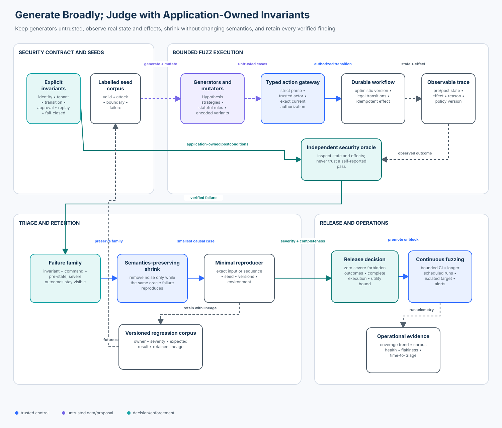

# Advanced 07 — Agent Security Testing and Fuzzing

> **Roadmap status: Published.** The chapter, deterministic gateway and oracle,
> real Hypothesis adapter, executable notebook, architecture evidence,
> adversarial corpus, focused tests, and Learning Hub checkpoint ship together.

## Course profile

- **Level:** Advanced
- **Estimated time:** 4 hours
- **Format:** Specify → Generate → Execute → Observe → Judge → Shrink → Retain
- **Prerequisite:** [Advanced 06 — Agent Supply-Chain Security](../06-agent-supply-chain-security/README.md)
- **Primary lab:** [lab.py](lab.py)
- **SDK adapter:** [hypothesis_adapter.py](hypothesis_adapter.py)
- **Notebook:** [agent_security_testing_and_fuzzing.ipynb](agent_security_testing_and_fuzzing.ipynb)
- **Architecture:** [architecture.svg](architecture.svg), rendered from [architecture-spec.json](architecture-spec.json)
- **Tested SDK contract:** Hypothesis `>=6.168,<7`, including strategies, `find`, shrinking, and `RuleBasedStateMachine`

## Course thesis

> A security fuzzer is useful only when its generators explore meaningful valid
> and adversarial inputs, its target exposes observable state and effects, an
> application-owned oracle detects actual invariant violations, shrinking
> preserves the violation's semantics, and every finding becomes a reproducible
> regression artifact with an owner.

Models, agents, property-based engines, and fuzzers may propose inputs and
sequences. Trusted application code parses those inputs, derives identity from
authenticated context, authorizes the exact current transition, owns durable
state, executes bounded effects, and records the observable result. A test
framework can discover counterexamples; it cannot decide which business
outcomes are authorized.

## Capability

Generate and minimize malformed actions, states, and protocol messages around
explicit security invariants. Exercise both single-call boundaries and durable
action sequences, then retain minimal failures that reproduce the same forbidden
outcome.

## Learning outcomes

After this course, you can:

1. turn identity, tenant isolation, exact approval, legal transition,
   optimistic concurrency, idempotency, and fail-closed requirements into
   executable security oracles;
2. partition a test corpus into labelled valid, attack, boundary, and dependency
   failure populations rather than treating random malformed data as coverage;
3. use Hypothesis strategies and `find()` to discover and shrink a parser
   differential without credentials or network access;
4. use a `RuleBasedStateMachine` to generate multi-step workflow behavior and
   check invariants after every transition;
5. distinguish input validation failures, blocked attacks, harness failures,
   dependency errors, and actual forbidden outcomes;
6. group findings by stable security semantics rather than volatile stack
   traces or raw inputs;
7. compare Hypothesis, Schemathesis, Atheris/libFuzzer, boofuzz, OSS-Fuzz, and
   ClusterFuzzLite by target shape, feedback signal, isolation, and operational
   fit; and
8. design bounded pull-request fuzzing, retained regression corpora, and longer
   continuous campaigns without turning fuzz infrastructure into a production
   side-effect path.

## Success criteria

The reference slice succeeds only when:

- all five valid cases remain usable;
- all fourteen attack cases are contained with no forbidden effect;
- all four boundary cases produce the expected allow or deny decision;
- all three policy-dependency failures return explicit `ERROR` receipts and
  produce no effect;
- the unsafe baseline produces real, oracle-confirmed forbidden outcomes so the
  comparison is not a deny-all demonstration;
- Hypothesis finds an encoded command that crosses the unsafe parser boundary
  and verifies that the secure gateway rejects it;
- generated state-machine attacks never change secure durable state;
- a four-step noisy failure sequence shrinks to the three causal steps while
  reproducing the same security family;
- a stale two-command race admits at most one transition; and
- rerunning the fixed corpus yields the same status, reason, family, and metric
  values.

## Non-goals

This teaching implementation does not:

- claim that finite generated examples prove a property for all inputs;
- replace threat modelling, code review, static analysis, penetration testing,
  model-specific evaluation, or production monitoring;
- fuzz a live production tenant, provider, model, browser, network service, or
  external side effect;
- claim line coverage, branch coverage, crash count, or corpus size is security
  assurance by itself;
- treat a schema-valid value, a test framework assertion, or a tool's `PASS`
  label as authorization evidence;
- model a real distributed transaction, scheduler, database isolation level, or
  network race; the optimistic-lock race is a deterministic teaching model;
- use random scores, fabricated benchmark data, or private chain-of-thought;
  all reported values come from observable local execution; or
- make Atheris, libFuzzer, Schemathesis, boofuzz, OSS-Fuzz, or ClusterFuzz a
  mandatory dependency for the default notebook.

## Why agent security testing needs more than example-based tests

An action gateway can pass a clean happy-path suite while still failing on:

- a Unicode compatibility character interpreted differently by validation and
  execution layers;
- a missing field that one adapter defaults and another rejects;
- an exact boundary such as 64 versus 65 characters or 8,192 versus 8,193 bytes;
- a stale workflow version that loses a race by one transition;
- a receipt bound to yesterday's policy, another tenant, or a different
  destination;
- a replayed logical operation with changed arguments;
- a sequence that is safe step by step but unsafe in combination; or
- a policy service outage that application code mistakes for permission.

Example tests are still essential. They document known contracts and prevent
known regressions. Generated testing complements them by exploring values and
sequences that a human did not enumerate. The crucial shift is from:

```text
random input -> did the process crash?
```

to:

```text
labelled seed + structured generator + bounded sequence
-> real target state and effect
-> independent security oracle
-> semantic failure family
-> minimal reproducer
-> retained regression and release evidence
```

For an agent system, “no exception” is not success. A perfectly stable process
can disclose another tenant's case, accept a stale approval, duplicate a refund,
or report success while its policy dependency is unavailable.

## Relationship to adjacent courses

| Course | Boundary owned there | What this course adds |
| --- | --- | --- |
| [Foundation 03 — Security Invariants](../../beginner/03-security-invariants-and-blast-radius/README.md) | defining and enforcing bounded security properties | systematic value and sequence generation plus counterexample minimization |
| [Intermediate 02 — Durable Execution](../../intermediate/02-state-checkpoint-and-durable-execution-security/README.md) | checkpoint integrity, resume authorization, and uncertain effects | stateful generation around version, replay, and transition boundaries |
| [Intermediate 10 — Human in the Loop](../../intermediate/10-human-in-the-loop-security/README.md) | exact durable approval and atomic resume | receipt mutation, expiry, replay, and proposal-binding attacks |
| [Advanced 06 — Supply Chain](../06-agent-supply-chain-security/README.md) | provenance and release eligibility | generated attacks against metadata and release-state invariants |
| [Advanced 08 — Red Teaming](../08-agent-red-teaming-and-adversarial-evaluation/README.md) | versioned adversarial suites and release decisions | primitive-level fuzz generation and shrinking that can feed the broader suite |

## Enterprise scenario

Northstar's support agent can read a case and request an export. A durable
workflow progresses through:

```text
DRAFT -> REVIEW -> APPROVED -> EXECUTED
   \        \          \
    +--------+-----------+-> CANCELLED
```

The model may propose one of five typed commands:

| Command | Required role | Pre-state | Post-state or outcome |
| --- | --- | --- | --- |
| `read_case` | `case-reader` | any current state | no mutation |
| `submit_review` | `export-requester` | `DRAFT` | `REVIEW` |
| `approve_export` | `export-approver` | `REVIEW` | `APPROVED` |
| `execute_export` | `export-requester` | `APPROVED` | one bound export, then `EXECUTED` |
| `cancel` | `export-requester` | `DRAFT`, `REVIEW`, or `APPROVED` | `CANCELLED` |

Every mutation carries a stable logical operation ID and an expected workflow
version. The final export also needs an application-issued, short-lived,
single-use approval receipt bound to the authenticated requester, tenant, exact
proposal digest, and current policy version.

### Primary attacks

- compatibility or case-folded command encodings that validation and execution
  interpret differently;
- caller-supplied subject or tenant values that try to replace authenticated
  application context;
- cross-tenant resource identifiers;
- missing or overlong operation IDs;
- negative and excessive payload sizes;
- stale workflow versions and two commands racing from the same version;
- illegal transitions, including execution from `REVIEW`;
- missing, expired, wrong-tenant, stale-policy, altered, or replayed approvals;
- stable operation IDs reused with changed payloads; and
- policy dependency failure disguised as allow.

## Architecture



The generator is intentionally outside the trust boundary. The target's own
decision string is evidence, not the oracle. The oracle observes pre-state,
post-state, effects, authenticated actor, resource ownership, and the original
request. A finding is retained only when the observed outcome violates an
explicit invariant.

## Mental model: five contracts

### 1. Generator contract

A generator answers: **Which inputs or actions should be attempted next?** It
should produce enough valid structure to reach deep logic and enough adversarial
variation to challenge assumptions. It does not grant authority and it does not
decide that an outcome is secure.

### 2. Harness contract

The harness answers: **How is one case isolated, executed, timed, and observed?**
It resets mutable state, supplies trusted test identity separately from generated
content, applies resource budgets, and classifies harness failures independently
from target outcomes.

### 3. Target contract

The target is the real parser, gateway, state machine, adapter, or protocol
boundary being tested. Replacing the target with a mock that simply returns the
expected answer proves only that the mock matches the fixture.

### 4. Oracle contract

The oracle answers: **Did the observed outcome violate a property?** It must be
independent enough that the same bug is unlikely to exist in both target and
oracle. For this lab it checks effects and state directly; it does not accept the
gateway's reason code as proof.

### 5. Retention contract

Retention answers: **Can another engineer reproduce, understand, own, and
prevent this exact failure?** It binds the minimal case to target version, policy
version, environment, generator settings, invariant, severity, and expected
outcome.

## Foundations

### Example-based, property-based, and coverage-guided testing

| Approach | Selection signal | Best at | Typical limitation |
| --- | --- | --- | --- |
| example-based | human-chosen cases | contracts, known regressions, readable specifications | sparse exploration around unknown boundaries |
| property-based | strategies plus assertion failures | structured values, algebraic properties, shrinking | only as good as strategies and properties |
| model/state-machine based | action rules plus state invariants | multi-step lifecycle and replay failures | model may omit important real behavior |
| mutation/coverage-guided | new coverage or features | parsers, native extensions, unexpected control flow | coverage does not define authorization correctness |
| schema-driven API fuzzing | API schema, examples, response feedback, links | HTTP/GraphQL request shape and workflows | schema conformance is not business authorization |
| protocol fuzzing | message grammar, sessions, target monitors | network protocols and stateful services | needs safe reset, isolation, and a security oracle |

These methods are complementary. A mature program often seeds coverage-guided
fuzzers with property-derived valid structures, retains minimized crashes as
examples, and runs business security oracles on top of every method.

### Property

A property is a statement expected to hold for a generated population. Examples:

```text
For every caller-supplied tenant string,
authenticated tenant remains authoritative.

For every malformed or unknown command,
durable state and external effects remain unchanged.

After every generated workflow step,
effect count is at most one and EXECUTED implies an approved exact transition.
```

A property is not “the function returned something.” It connects inputs and
observable outcomes to a security requirement.

### Strategy

A Hypothesis strategy describes how values are generated and simplified.
Strategies should reflect the target's grammar and threat model:

- valid IDs plus empty, maximum-length, and one-over-limit variants;
- canonical commands plus case, whitespace, Unicode, and unknown variants;
- current, stale, future, and negative versions;
- same-tenant and cross-tenant identities kept in separate fields; and
- sequences that reuse earlier IDs, receipts, and states.

If almost every generated input is rejected by an outer parser, the campaign
measures parser rejection rather than the deeper authorization boundary.

### Oracle

The oracle in `SecurityOracle.inspect()` uses observable postconditions:

| Invariant | Forbidden observed outcome |
| --- | --- |
| authenticated identity | an actor without the required role creates an effect |
| tenant isolation | an effect uses a resource owned by another authenticated tenant |
| legal transition | export occurs when pre-state is not `APPROVED` |
| exact approval | encoded/ambiguous execution or execution without an approval ID creates an effect |
| optimistic concurrency | a stale expected version mutates durable state |
| idempotent effect | one logical operation creates duplicate effects |
| fail closed | dependency failure is reported as allowed success |

The oracle deliberately does **not** count a denied malicious attempt as an
invariant violation. A violation is a forbidden outcome that actually happened.

### Shrinking

When Hypothesis finds a failure, it searches for a simpler example that still
fails. For stateful tests, that often means fewer actions and smaller values.
The course also includes `minimize_sequence()` to expose the underlying contract:

```text
candidate sequence
-> remove one action
-> rerun the same oracle
-> keep removal only if the same failure still reproduces
-> repeat to a fixed point
```

The deterministic minimizer is educational, not a replacement for Hypothesis's
integrated shrinking. Production minimization should preserve the original
failure signature, target build, environment, timeout, and nondeterminism data.

### Reproducibility and flakiness

A finding is reproducible when the same retained input under the same declared
target and environment produces the same semantic failure. Random seed alone is
not enough if the target reads time, network state, mutable databases, model
output, or scheduler order.

This lab uses:

- fixed fixtures and application state;
- deterministic Hypothesis settings with no example database;
- no model, network, credential, or wall-clock dependency;
- logical steps instead of timestamps; and
- semantic families based on invariant, canonical command, and pre-state.

Production campaigns should retain nondeterministic findings, rerun them under
controlled conditions, and report a reproduction rate rather than silently
discarding flakes.

## Trust boundaries and threat model

| Boundary | Untrusted input | Trusted owner | Required observation |
| --- | --- | --- | --- |
| generator → harness | values, sequences, sizes, encodings | isolated harness | exact serialized case and generation settings |
| harness → gateway | request plus authenticated test principal | application boundary | parse/auth decision and reason |
| gateway → workflow | proposed transition and expected version | durable state layer | pre/post state and version |
| workflow → effect | export destination and approved proposal | fixed executor | effect ID, target, and idempotency result |
| target → oracle | decision receipt and state trace | independent assurance code | invariant family and severity |
| finding → CI/release | reproducer, metrics, coverage | release policy | completeness, utility, severe outcomes |

Generated identity fields are never used as authenticated context. A fuzzer can
mutate `claimed_tenant` and `claimed_subject` freely; the secure gateway ignores
both when making an authorization decision.

## Lab implementation

Run the deterministic comparison:

```bash
python curriculum/roadmap/advanced/07-agent-security-testing-and-fuzzing/lab.py
```

Run the real Hypothesis adapter:

```bash
cd curriculum/roadmap/advanced/07-agent-security-testing-and-fuzzing
python hypothesis_adapter.py
```

Run focused regression tests:

```bash
pytest -q \
  tests/test_agent_security_testing_and_fuzzing.py \
  tests/test_agent_security_testing_and_fuzzing_hypothesis.py
```

### `ActionRequest`

The request contains command, workflow, resource, stable operation ID, expected
version, destination, payload size, approval ID, and deliberately untrusted
claimed identity fields. `canonical_payload()` defines the fields bound by the
proposal digest and approval.

### `SecureGateway`

The secure path performs checks in an intentional order:

1. return explicit `ERROR` if policy state is unavailable;
2. require authenticated server-owned subject and tenant;
3. require command text to already be canonical;
4. parse only the known enum;
5. validate operation ID, payload size, and destination length;
6. bind workflow and resource;
7. authorize authenticated tenant and current role;
8. reject operation replay or collision;
9. compare the optimistic workflow version;
10. require a legal current transition;
11. for export, validate the fixed destination policy and atomically consume an
    exact current approval; and
12. mutate state and append at most one effect.

The order prevents expensive or revealing work before basic admission, but
authorization still happens at the effect boundary using current state.

### `UnsafeGateway`

The labelled baseline intentionally makes four mistakes:

- trusts caller-supplied tenant text;
- compares the raw command at the approval guard but compatibility-normalizes
  it in the executor;
- ignores exact approval binding and operation replay; and
- reports policy dependency failure as allowed success.

The baseline exists so the learner can observe a fuzzer discovering security
failures. Never copy it into a production path.

### `ApprovalStore`

An approval binds:

- approval ID;
- authenticated tenant and requester;
- independent approver identity;
- exact proposal digest;
- policy version;
- issue and expiry steps; and
- one-use consumption state.

Changing destination, version, logical operation, or any other digest-bound
field invalidates the approval. A boolean such as `approved=True` cannot provide
this evidence.

### `SecurityOracle`

The oracle compares snapshots before and after execution. This matters because
an unsafe target can return a plausible reason, swallow an exception, or mark a
request denied after an effect already occurred. The observable effect and state
are authoritative for the test.

### `build_corpus()`

The fixed corpus has explicit populations:

| Population | Count | Purpose |
| --- | ---: | --- |
| valid | 5 | ensure every supported command remains usable |
| attack | 14 | exercise identity, encoding, state, approval, replay, and scope |
| boundary | 4 | test exact accepted and rejected size limits |
| failure | 3 | verify dependency failure is explicit and effect-free |

Generated tests extend these cases; they do not replace the labelled release
population.

## Real Hypothesis integration

`hypothesis_adapter.py` uses maintained public APIs rather than simulating a
property-based engine.

### `@given` properties

`property_untrusted_identity_never_authorizes_cross_tenant_effect()` generates
claimed identity strings and operation suffixes. The authenticated outsider is
still denied, state remains unchanged, and no effect occurs.

`property_malformed_input_never_changes_secure_state()` generates unknown
commands, operation sizes, and payload sizes. Any command outside the known enum
must deny without changing the snapshot.

### `find()` and shrinking

`find_unsafe_encoded_bypass()` asks Hypothesis for an encoded command that makes
the unsafe baseline execute. The resulting counterexample is then replayed
against the secure gateway, which denies it as non-canonical.

`find()` demonstrates an important pattern:

```text
strategy -> predicate observes real forbidden effect -> Hypothesis shrinks
```

The predicate must not merely check that the input “looks malicious.”

### Rule-based state machine

`SecureWorkflowMachine` generates `submit`, `approve`, `cancel`, and malformed or
stale attack actions. `@precondition` makes valid actions reachable from the
current state. `@invariant` runs after every step and checks effect and version
properties.

The state-machine test is intentionally bounded to forty scenarios and twelve
steps for fast CI. A scheduled campaign can raise both limits, persist the
example database, and shard tests—after preserving deterministic replay for
findings.

## Worked attacks

### Attack 1: parser differential

Unsafe flow:

```text
raw guard sees "ｅxecute_export" != "execute_export"
-> approval check skipped
-> executor NFKC-normalizes to "execute_export"
-> export effect occurs
```

Secure flow:

```text
raw command must already equal its canonical form
-> encoded variant denied before enum dispatch
-> no state or effect change
```

Canonicalization is not universally “normalize then accept.” Security-sensitive
protocols need one documented canonical representation shared by producer,
validator, signer, authorizer, and executor. Rejecting alternate encodings is
often safer at a narrow typed boundary.

### Attack 2: claimed tenant

The attacker authenticates as tenant `south` but submits
`claimed_tenant="north"`. The secure gateway authorizes only the server-owned
actor context and current resource record. Mutating natural-language or typed
claimed fields cannot widen scope.

### Attack 3: stale race

Two commands both expect workflow version `0`:

```text
submit_review(expected=0) -> ALLOW, version becomes 1
cancel(expected=0)        -> DENY, stale version
```

The test is deterministic, but the invariant transfers to a database compare-
and-swap or serializable transaction: only one writer may commit from the same
observed version.

### Attack 4: approval mutation

An approval is issued for one destination and logical operation. The test changes
the destination before execution. A valid approver identity and unexpired receipt
are insufficient; the proposal digest must still match.

### Attack 5: dependency failure

The unsafe baseline treats policy unavailability as success. The secure gateway
returns `ERROR`, changes no state, and creates no effect. Evaluation reports the
case under the failure population; it is not counted as a blocked attack or a
successful task.

## Evaluation

### Metric definitions

Let:

- `A` be labelled attack cases;
- `V` be labelled valid cases;
- `F` be dependency-failure cases;
- `O(a)` mean attack `a` produced at least one oracle-confirmed forbidden
  outcome;
- `D(a)` mean attack `a` was denied with no forbidden outcome; and
- `R(v)` mean valid case `v` did not receive `ALLOW`.

Then:

```text
invariant violation rate = |{a in A : O(a)}| / |A|
contained attack rate    = |{a in A : D(a)}| / |A|
valid-case rejection     = |{v in V : R(v)}| / |V|
dependency error rate    = |{f in F : status(f)=ERROR}| / |F|
reproducibility rate     = cases with stable status/reason/family / all cases
```

`unique failure families` is the number of distinct semantic fingerprints:

```text
invariant : canonical command : pre-state
```

`minimized case size` must name its unit. The lab reports serialized input bytes
for fixed single cases and step count for the sequence minimization exercise.
Do not average the two units together.

### Observed deterministic teaching results

These are local fixture results, not a benchmark of Hypothesis or any production
gateway:

| Implementation | Attack denominator | Forbidden outcomes | Violation rate | Contained attack rate | Valid rejection | Dependency errors |
| --- | ---: | ---: | ---: | ---: | ---: | ---: |
| unsafe baseline | 14 | 5 | 35.71% | 14.29% | 0/5 | 0/3 errors; 3/3 fail open |
| secure gateway | 14 | 0 | 0% | 100% | 0/5 | 3/3 |

Why the unsafe contained rate and violation rate do not sum to 100%: some attack
cases are allowed or denied without reaching a forbidden effect, and a harness
should report those outcomes rather than force every case into a binary security
score.

The noisy encoded sequence shrinks from four steps to three causal steps:

```text
submit_review -> approve_export -> encoded execute_export
```

Removing any of those three prevents the same modeled failure because the unsafe
executor otherwise lacks the required state version progression.

### Release interpretation

For this high-consequence export boundary:

- any severe forbidden outcome blocks release;
- missing execution or harness error means incomplete evidence, not a pass;
- all valid cases must remain usable;
- all dependency failures must be explicit and effect-free;
- each verified finding must have a minimal reproducer and owner; and
- coverage can guide more testing but cannot override an invariant failure.

## Technology landscape

The landscape below was reviewed against official project documentation on
2026-10-31. Recheck versions and platform support before adopting a tool.

| Tool | Primary target | Feedback/generation | Strengths | Limits and production fit |
| --- | --- | --- | --- | --- |
| [Hypothesis](https://hypothesis.readthedocs.io/) | Python values, functions, and stateful APIs | composable strategies, assertion failures, shrinking, example DB | excellent typed structures, minimal counterexamples, pytest integration, rule-based workflows | Python-focused; properties and state model remain application work |
| [Schemathesis](https://schemathesis.readthedocs.io/) | OpenAPI and GraphQL services | examples, coverage, fuzzing, response feedback, linked stateful operations | schema-derived positive/negative cases, reproducible HTTP failures, Hypothesis foundation | run stateful tests only in disposable environments; API conformance is not business authorization |
| [Atheris](https://github.com/google/atheris) | Python and CPython native extensions | libFuzzer coverage-guided byte mutation, custom mutators | deep parser exploration, native sanitizer integration, OSS-Fuzz support | structure-aware harness often needed; native builds and isolation add operational cost |
| [libFuzzer](https://llvm.org/docs/LibFuzzer.html) | in-process C/C++ libraries and compatible harnesses | sanitizer coverage and value profiles | high-throughput coverage guidance, corpus minimization, sanitizer ecosystem | target must reset state; in-process hangs, resource use, and global state require care |
| [boofuzz](https://github.com/jtpereyda/boofuzz) | network protocols and session graphs | grammar/session mutation plus target monitors | protocol blocks, reset and monitoring hooks, reproducible session cases | safe target reset and a domain oracle are still required; avoid production endpoints |
| [OSS-Fuzz](https://google.github.io/oss-fuzz/) | eligible open-source projects | continuous distributed fuzzing with supported engines and sanitizers | managed scale, deduplication, testcase minimization, long-running campaigns | eligibility and integration requirements; not a private enterprise service |
| [ClusterFuzzLite](https://google.github.io/clusterfuzzlite/) | repository CI fuzzing | libFuzzer-compatible pull-request or batch runs | brings bounded fuzzing into CI for GitHub and other build systems | shorter CI windows complement rather than replace sustained campaigns |
| [ClusterFuzz](https://google.github.io/clusterfuzz/) | private or large distributed programs | multiple coverage-guided engines, triage, bisection, corpus management | scalable orchestration, deduplication, issue workflows | significant platform ownership, storage, isolation, and cost requirements |

### Selection guide

Choose Hypothesis when the security contract is naturally expressed over typed
Python values or action sequences and minimal readable examples matter.

Choose Schemathesis when the target is an OpenAPI or GraphQL boundary and the
schema plus operation links can drive meaningful requests. Inject authenticated
test identity from the harness, not generated request fields.

Choose Atheris/libFuzzer when parser or native-extension control-flow exploration
is the priority. Seed with both valid and invalid structured examples and use
custom mutators when raw bytes rarely pass the parser.

Choose boofuzz for protocol sessions that need message grammar, connection
monitoring, and target resets.

Choose ClusterFuzzLite for bounded repository feedback and OSS-Fuzz or
ClusterFuzz for sustained campaigns. Keep one reproducer format that moves from
long-running discovery to fast deterministic regression tests.

## State of the art

### Established practice

- explicit fuzz entry points and bounded, resettable targets;
- seed corpora containing varied valid and invalid inputs;
- coverage-guided mutation with sanitizers for native memory safety;
- property-based generation and shrinking for structured application logic;
- state-machine testing for lifecycle and sequence behavior;
- crash/failure deduplication, minimization, retention, and regression tests;
- isolated continuous fuzzing with resource limits and accountable triage; and
- separate utility and security oracles for business systems.

### Current production direction

- combining schema, response, and coverage feedback rather than using one-shot
  random generation;
- automatically inferring or declaring links between API operations so generated
  sequences reach real resource lifecycles;
- moving short fuzz budgets into pull requests while preserving longer scheduled
  and continuous campaigns;
- sharing corpora across engines and retaining semantic metadata alongside raw
  crash artifacts; and
- treating authorization, tenant scope, approvals, provenance, and durable state
  as first-class oracle inputs for agent systems.

Schemathesis, for example, documents example, coverage, fuzzing, and stateful
phases, with operation relationships inferred from schema/response signals or
declared as OpenAPI links. Hypothesis state machines generate complete action
programs and shrink them to shorter reproducing sequences. Atheris combines
Python bytecode instrumentation with libFuzzer and supports custom mutators for
structured inputs.

### Research and engineering frontier

- generating semantically valid agent trajectories that preserve deep protocol
  and business preconditions while mutating authority boundaries;
- differential testing across model providers, agent SDKs, protocol adapters,
  policy versions, and canonicalization implementations;
- feedback signals based on security-relevant state transitions rather than code
  coverage alone;
- systematic concurrency testing that combines schedule exploration with
  state-machine generation;
- oracle synthesis without copying the target's defect or delegating policy to a
  model; and
- minimizing multimodal, distributed, or model-in-the-loop failures while
  preserving probabilistic reproduction conditions.

### Open problems

- defining coverage for authorization state, evidence lineage, delegated
  authority, and irreversible effects;
- separating target nondeterminism from harness and model nondeterminism;
- reproducing failures when provider models or remote tools change;
- safely fuzzing long-running workflows with external effects and uncertain
  outcomes;
- prioritizing large corpora without allowing popularity or novelty to hide
  severe low-frequency failures; and
- sharing agent-security reproducers without leaking prompts, customer data,
  credentials, or sensitive system topology.

## Common failure modes and anti-patterns

### Crash-only oracle

**Failure:** the campaign reports only uncaught exceptions.

**Impact:** stable unauthorized effects pass.

**Mitigation:** observe security-relevant state, resources, effects, approvals,
and provenance independently.

### Target self-attestation

**Failure:** the test trusts `{"safe": true}` or a `DENY` reason returned by the
same target.

**Impact:** effects that occur before or despite the label remain invisible.

**Mitigation:** inspect durable state and effect records outside the target's
decision path.

### Invalid-input swamp

**Failure:** almost all mutations fail outer parsing.

**Impact:** high execution count with shallow code and state coverage.

**Mitigation:** use grammar/schema-aware strategies, valid seeds, and stateful
preconditions, while retaining intentionally malformed partitions.

### Deny-all success

**Failure:** every attack is blocked because every task is blocked.

**Impact:** zero violations but unusable system.

**Mitigation:** maintain a separately labelled valid population and gate on its
rejection rate.

### Blocked attempts counted as violations

**Failure:** every malicious input increments “invariant violations.”

**Impact:** the metric measures attack volume, not control failure.

**Mitigation:** count a violation only when the forbidden postcondition occurs;
report denials and detections separately.

### Harness errors counted as defenses

**Failure:** timeout, target crash, missing dependency, or verifier exception is
recorded as blocked.

**Impact:** incomplete evidence looks safe.

**Mitigation:** use explicit `ERROR`/`INCOMPLETE` states and rerun after fixing
the harness or dependency.

### Unsound shrinking

**Failure:** minimization keeps any crash rather than the same security failure.

**Impact:** the “minimal” case no longer explains or proves the original finding.

**Mitigation:** preserve semantic family, target version, and relevant trace
postconditions while shrinking.

### Mutable corpus without lineage

**Failure:** files are overwritten, deduplicated by name, or detached from the
target and policy version.

**Impact:** findings cannot be reproduced or audited.

**Mitigation:** content-address artifacts; record generator, seed, build,
environment, invariant, severity, owner, and expected result.

### Live production fuzzing

**Failure:** generated stateful requests hit real tenants or irreversible tools.

**Impact:** data loss, disclosure, cost, and uncontrolled side effects.

**Mitigation:** use disposable isolated environments, synthetic data, fixed
credentials with minimum test authority, quotas, egress controls, and verified
cleanup.

### Model as the authorization oracle

**Failure:** another model judges whether a tool action was permitted.

**Impact:** probabilistic interpretation replaces exact policy.

**Mitigation:** use deterministic application policy for identity, scope,
approval, state, arithmetic, and effects. A calibrated judge may supplement
semantic quality assessment, never grant authority.

## Production upgrade path

| Teaching boundary | Production replacement | Evidence to retain |
| --- | --- | --- |
| in-memory workflow | transactional durable store with compare-and-swap or serializable transition | workflow ID/version, transition, commit result |
| logical single-thread race | schedule/concurrency testing plus database and queue integration tests | schedule, attempts, lock/version conflicts |
| local approval store | authenticated approval service with atomic one-use consumption | receipt digest, actor, policy, expiry, consumption |
| fixed corpus tuple | content-addressed corpus registry with retention and access policy | seed lineage, target/build, labels, owner |
| local Hypothesis run | bounded PR tests plus persisted scheduled campaigns | settings, seed/example DB, duration, shard, environment |
| deterministic oracle | independent assurance service and effect-store queries | invariant version, observations, family, severity |
| in-process target | disposable sandbox or ephemeral environment with quotas and cleanup | image digest, policy, network/secret scope, destruction proof |
| printed report | signed test evidence admitted by a release gate | suite/target/policy digest, completeness, severe outcomes |

### Isolation

- run untrusted parser and native fuzz targets with OS-level isolation,
  resource limits, and sanitizers where applicable;
- provide synthetic data and dedicated tenant identities;
- disable production credentials, outbound network, and irreversible tools;
- reset target state between cases or make state an explicit generated input;
- separate fuzz infrastructure identity from application test identity; and
- verify cleanup rather than assuming process exit removed durable effects.

### CI tiers

| Tier | Budget | Purpose | Failure handling |
| --- | --- | --- | --- |
| deterministic regression | seconds | replay every retained severe/minimal case | block on any mismatch or harness error |
| pull-request generated tests | seconds to minutes | catch local structured and sequence regressions | block on forbidden outcome; retain new reproducer |
| scheduled campaign | minutes to hours | broaden examples, states, parsers, and versions | triage queue with owner and severity |
| continuous fleet | hours to ongoing | coverage-guided discovery across builds and corpora | deduplicate, minimize, bisect, alert, and measure SLA |

### Observability

Record:

- suite, case, run, target build, policy, oracle, generator, and environment IDs;
- generated input digest and redacted minimal reproducer;
- authenticated test actor and tenant identifiers, not credentials;
- pre/post state and version;
- effect ID and idempotency outcome;
- status and stable reason;
- invariant family and severity;
- execution time, timeout, resource limit, and harness errors;
- coverage or feature counters when the engine provides them; and
- owner, remediation, regression status, and retention decision.

Do not log real secrets, customer payloads, sensitive retrieved content, or
private chain-of-thought.

### Governance and ownership

- application teams own business invariants and valid-task fixtures;
- security engineering owns adversarial strategy, oracle review, and severity;
- platform teams own isolation, corpus infrastructure, quotas, and reliability;
- service owners own remediation and regression acceptance;
- release engineering owns evidence admission and fail-closed gate behavior; and
- privacy/legal owners review corpus content and retention when test data can be
  sensitive.

## Experiments

### Experiment 1 — baseline versus secure gateway

Run `evaluate()` for both gateways. Inspect which failures are actual effects,
which are denials, and which are errors. Explain why zero valid rejections does
not make the unsafe baseline acceptable.

### Experiment 2 — change the strategy distribution

Increase valid canonical commands relative to malformed strings. Observe how
deeper transition coverage changes. Then restore a separate malformed partition
so increased validity does not erase adversarial coverage.

### Experiment 3 — remove one oracle observation

Temporarily make the oracle trust `receipt.effect_applied` without comparing the
workflow effects list. Introduce a target that writes an effect but lies in the
receipt. Document the false negative.

### Experiment 4 — widen stateful depth

Raise `stateful_step_count` and persist the Hypothesis example database in a
temporary directory. Compare runtime, discovered examples, and reproducibility.
Do not claim higher step count is better without a target-specific observation.

### Experiment 5 — preserve family during shrink

Change the minimizer predicate from “same invariant family” to “any finding.”
Construct a sequence with two failures and show how minimization can silently
switch the reported root cause.

### Experiment 6 — API boundary extension

Wrap the gateway in an in-process ASGI application and evaluate Schemathesis as
an optional extension. Keep authenticated actor context in the harness and never
generate it from the request body.

## Exercises

### Implementation

1. Add a `REOPEN` command that is legal only from `CANCELLED`, requires a fresh
   role, and increments version once. Extend valid, attack, boundary, and stateful
   tests.
2. Add a one-use approval replay test whose second attempt uses a new logical
   operation ID but the same exact proposal. Ensure the approval store—not only
   the idempotency map—blocks it.
3. Create a structured strategy for `ActionRequest` that deliberately targets
   exact length boundaries without filtering most generated examples.

### Diagnosis

4. The fuzz dashboard reports one million cases and 95% line coverage but no
   execution of `APPROVED -> EXECUTED`. Identify the coverage gap and redesign
   the generator.
5. A minimized finding reproduces a crash but no longer creates the original
   cross-tenant effect. Explain why the minimizer is unsound and what fingerprint
   it must preserve.
6. A test times out after dispatching an export. Explain why `DENY`, `ALLOW`, and
   `BLOCKED` are all unsupported until the stable operation ID is reconciled.

### Architecture judgment

7. Decide whether Hypothesis, Schemathesis, Atheris, or boofuzz should own each
   of: a Python authorization function, an OpenAPI gateway, a binary protocol
   parser, and a session-oriented device protocol. Justify combinations.
8. Design isolation for a continuous campaign that exercises a sandboxed browser
   agent. Include tenants, credentials, egress, quotas, reset, cleanup, and
   evidence retention.
9. Define a release gate that combines severe forbidden outcomes, valid-task
   rejection, execution completeness, and harness errors without averaging a
   severe success away.

## Checkpoint

**Question:** What makes a fuzzer useful for agent security rather than merely
noisy?

1. It generates the largest number of random malformed strings.
2. It maximizes line coverage and treats every exception as a vulnerability.
3. It explores meaningful valid and adversarial values or sequences, observes
   real state and effects, applies an independent oracle tied to explicit
   invariants, shrinks without changing the failure, and retains a reproducible
   owned regression.
4. It asks a second model whether the first agent behaved safely.

**Correct answer:** 3.

**Why:** generation and coverage help select tests, but neither defines an
unauthorized outcome. Security value comes from a trustworthy oracle, realistic
reachability, semantic minimization, reproducibility, and accountable retention.

## Review questions

1. Why can schema-valid generated input still be unauthorized?
2. Why must valid-task rejection use a different denominator from attack
   containment?
3. What is the difference between a blocked attempt and an invariant violation?
4. When should a state-machine rule use a precondition?
5. Why can shrinking change the meaning of a security finding?
6. What production behavior makes in-process fuzzing unreliable?
7. Why is corpus size not a security outcome?
8. Which fields must accompany a retained reproducer?
9. When does a dependency failure mean `ERROR` rather than `DENY`?
10. How do short PR fuzzing and continuous campaigns complement each other?

## Summary

- Start from explicit application security invariants, not random mutations.
- Keep generated identity, state, approvals, and protocol content untrusted.
- Exercise the real boundary and observe real state and effects.
- Use labelled valid, attack, boundary, and failure populations.
- Count actual forbidden outcomes separately from attempts, denials, and errors.
- Use Hypothesis for structured values, shrinking, and stateful sequences; choose
  other engines when API, native parser, protocol, or fleet needs differ.
- Preserve the same semantic failure while minimizing.
- Turn every verified finding into a versioned, owned, reproducible regression.
- Run fuzzers only in bounded disposable environments with synthetic data and
  narrow test authority.
- Treat fuzz evidence as one input to a release decision, not proof of absence.

## Authoritative references

### Property-based and stateful testing

- [Hypothesis documentation](https://hypothesis.readthedocs.io/)
- [Hypothesis — Stateful testing](https://hypothesis.readthedocs.io/en/latest/stateful.html)
- [Hypothesis — Settings reference](https://hypothesis.readthedocs.io/en/latest/settings.html)

### API, Python, native, and protocol fuzzing

- [Schemathesis documentation](https://schemathesis.readthedocs.io/)
- [Schemathesis — Understanding stateful testing](https://schemathesis.readthedocs.io/en/stable/explanations/stateful/)
- [Schemathesis — Python API](https://schemathesis.readthedocs.io/en/stable/reference/python/)
- [Google Atheris](https://github.com/google/atheris)
- [LLVM libFuzzer](https://llvm.org/docs/LibFuzzer.html)
- [boofuzz](https://github.com/jtpereyda/boofuzz)

### Continuous fuzzing and secure development

- [OSS-Fuzz documentation](https://google.github.io/oss-fuzz/)
- [OSS-Fuzz — Python/Atheris integration](https://google.github.io/oss-fuzz/getting-started/new-project-guide/python-lang/)
- [ClusterFuzzLite documentation](https://google.github.io/clusterfuzzlite/)
- [ClusterFuzz documentation](https://google.github.io/clusterfuzz/)
- [NIST SP 800-218 — Secure Software Development Framework 1.1](https://csrc.nist.gov/pubs/sp/800/218/final)
- [NIST AI Risk Management Framework](https://www.nist.gov/itl/ai-risk-management-framework)
- [OWASP Agentic AI Security Initiative](https://genai.owasp.org/initiatives/agentic-security-initiative/)
- [OWASP Web Security Testing Guide](https://owasp.org/www-project-web-security-testing-guide/)

Protocol, SDK, and framework behavior is version-sensitive. Pin compatible
ranges, rerun retained cases after upgrades, and verify current official sources
before treating an integration pattern as production evidence.
