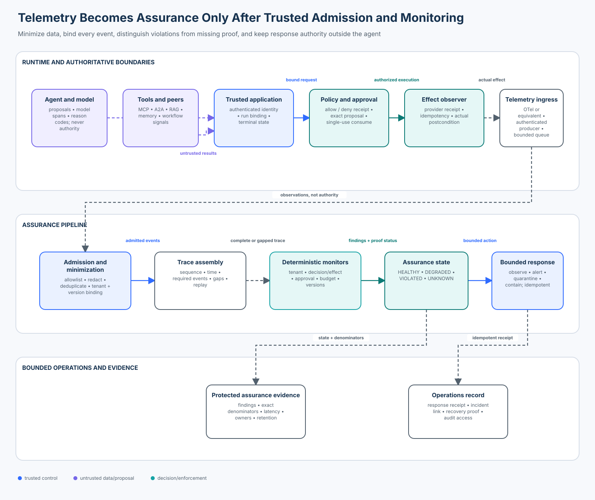

# 09 — Agent Security Observability and Runtime Assurance

<!-- roadmap-status -->
> **Roadmap status: Published.** This lesson includes a deterministic assurance lab, a real OpenTelemetry Python SDK adapter, a top-to-bottom notebook, a validated architecture diagram, focused tests, and a Learning Hub checkpoint.

## Course metadata

- **Level:** advanced
- **Time:** 4–6 hours
- **Prerequisites:** [A07 security testing and fuzzing](../07-agent-security-testing-and-fuzzing/), [A08 red teaming and adversarial evaluation](../08-agent-red-teaming-and-adversarial-evaluation/), and the intermediate lessons on identity, durable execution, RAG, MCP, and approval
- **Primary artifact:** [`runtime_assurance.ipynb`](runtime_assurance.ipynb)
- **Reusable implementation:** [`runtime_assurance.py`](runtime_assurance.py)
- **Production SDK bridge:** [`otel_adapter.py`](otel_adapter.py)
- **Checkpoint:** available in the Learning Hub

## Capability

Reconstruct who authorized which action, against which policy and evidence, and
whether the expected effect occurred—without treating telemetry, model text, or
missing data as proof of safety.

## Course thesis

Agent telemetry becomes runtime assurance only when trusted application code
minimizes and binds observations to authenticated identity, tenant, operation,
policy, model, tool catalog, and environment; checks complete traces with
deterministic monitors; and owns bounded corrective action. A log line, span,
typed object, anomaly score, or model self-report is never authority.

After this lesson, you should be able to explain, implement, evaluate, and
productionize that boundary.

## Learning outcomes

You will be able to:

1. distinguish instrumentation, observability, detection, runtime assurance,
   and threat hunting;
2. design a versioned event contract with trustworthy attribution, explicit
   authority, bounded cardinality, and privacy minimization;
3. assemble traces while detecting missing, duplicate, stale, foreign,
   reordered, or replayed evidence;
4. implement deterministic monitors for tenant isolation, decision/effect
   order, approval consumption, duplicate effects, budget limits, and version
   drift;
5. return `HEALTHY`, `DEGRADED`, `VIOLATED`, or `UNKNOWN` without converting a
   collector failure into a safe result;
6. measure attribution coverage, decision coverage, trace completeness,
   redaction failures, orphan effects, precision, recall, valid false positives,
   and event-time detection latency with exact denominators;
7. use the OpenTelemetry Python SDK as a transport while keeping authorization
   and assurance semantics in the trusted application; and
8. design idempotent alert, quarantine, and containment receipts with explicit
   owners, recovery criteria, and retained evidence.

## Why it matters

The enterprise support agent from the previous lessons retrieves evidence,
delegates work, calls MCP tools, pauses for approval, writes memory, and resumes
after failures. Pre-release tests establish only what happened in controlled
fixtures. Production introduces different tenants, version skew, partial
outages, sampling, delayed events, retries, new tools, and adversarial inputs.

Suppose the agent says, “The refund was denied.” A provider receipt shows the
refund executed for another tenant, but the policy span is absent. Three wrong
conclusions are tempting:

- trust the agent’s refusal text;
- trust an incomplete trace because the visible spans look normal; or
- collect every prompt, token, and tool result “for forensics.”

The first two fabricate safety. The third creates a high-value surveillance and
credential store. Runtime assurance must preserve evidence quality and privacy
at the same time.

## Scope, success criteria, and non-goals

### In scope

- application, policy, approval, effect, budget, collector, agent, and tool
  observations;
- authenticated attribution and exact run/version binding;
- privacy-first admission and a documented telemetry allowlist;
- completeness, sequence, time, replay, duplicate, and correlation checks;
- deterministic runtime monitors and bounded response selection;
- labeled valid, attack, boundary, and failure populations; and
- a real, local OpenTelemetry SDK export/ingest path.

### Success criteria

The lab must:

- keep both valid support operations healthy;
- detect all six labeled violation cases;
- classify collector and terminal-evidence failures as `UNKNOWN`;
- maintain zero valid-task false positives in the fixture suite;
- expose evidence IDs and reason codes without private reasoning;
- calculate metrics from declared populations; and
- execute without credentials or external side effects.

### Non-goals

This lesson does not claim that:

- local hashes authenticate a production producer;
- OpenTelemetry authorizes an action or proves a span is truthful;
- a small deterministic fixture suite estimates a real-world incident rate;
- raw prompts, responses, access tokens, or chain-of-thought should be stored;
- anomaly detection replaces deterministic invariants; or
- generating a containment receipt grants permission to perform arbitrary
  containment. Production execution needs a separate, narrow authorization.

## Mental model: observations are claims until admitted

Use this flow:

```text
runtime components
  -> minimized observations
  -> authenticated admission and exact binding
  -> trace assembly and completeness checks
  -> deterministic monitors
  -> assurance state + evidence
  -> bounded, authorized operations response
```

The control boundary is:

```text
model / agent / tool -> proposes, predicts, emits untrusted observations
trusted application  -> authenticates, binds, admits, monitors, responds, verifies
```

OpenTelemetry solves interoperable generation, collection, and export of traces,
metrics, and logs. It does not determine whether an event producer is entitled
to assert “policy allowed,” whether an effect belongs to the authenticated
tenant, or whether missing spans imply no harm. Those are application security
semantics.



## Foundations and terminology

| Term | Meaning in this course | Not sufficient by itself |
| --- | --- | --- |
| instrumentation | code that emits signals | security decision |
| telemetry | traces, metrics, logs, events, and resource attributes | trustworthy evidence |
| observability | ability to infer internal state from outputs | authorization or containment |
| runtime monitor | deterministic checker over admitted evidence | permission to execute a response |
| runtime assurance | continuous classification backed by admitted evidence and owned response | proof of all future behavior |
| trace completeness | required authoritative events are present for a declared contract | correctness of every event |
| attribution | event is bound to authenticated workload, principal, tenant, and operation | authorization |
| orphan effect | observed effect lacks a preceding authoritative allow decision or required approval | harmless retry |
| `UNKNOWN` | required evidence is absent, stale, foreign, or unverifiable | safe or failed |

### Safety property versus liveness property

A safety invariant says something bad never happens: “a tenant-A run never
changes tenant-B state.” A liveness objective says useful progress eventually
happens: “a valid approved refund eventually reaches a terminal state.” A
deny-all system may satisfy the first while failing the second. That is why the
evaluation includes valid operations and measures valid false positives.

### Event time versus processing time

`emitted_at_ms` represents when the observed condition occurred in the fixture.
Collector arrival is processing time. Detection latency is:

```text
detection latency = finding event time - violation event time
```

Do not use a fixed `sleep()` and label it detection latency. Distributed systems
need explicit clock-skew policy, late-event windows, and separate ingest delay.

## Event contract and trust model

Every admitted event in the lab carries:

- a stable event ID and monotonically increasing sequence;
- event time, kind, source, and explicit authority class;
- run, tenant, subject, and logical operation bindings;
- a digest over policy, tool-catalog, model, and environment versions;
- a low-cardinality reason code;
- evidence IDs; and
- an allowlisted set of minimized attributes.

### Authority matrix

| Producer | Typical evidence | Authority in the lab |
| --- | --- | --- |
| application host | admitted run, authenticated identity, terminal state | authoritative after producer authentication |
| policy enforcer | allow/deny and consumed approval receipt | authoritative for the exact bound proposal |
| effect observer/provider | effect ID and verified postcondition | authoritative for the observed external effect |
| budget enforcer | steps used and application-owned limit | authoritative for the declared budget |
| collector | delivery or export failure | authoritative only for collector status |
| model/agent | proposal, selected tool, reason code | untrusted |
| tool, peer, retrieved content | result or claim | untrusted until separately admitted |

Transport does not upgrade authority. A forged span with
`security.event.authority=authoritative` is rejected unless its producer is in
the trusted source registry and the production channel authenticates that
producer.

### Production binding

The lab uses a deterministic SHA-256 digest to reveal version drift. Production
needs authenticated workload identity, protected transport, collector tenancy,
access policy, immutable configuration/version records, and tamper-evident
storage where the threat model requires it. A bare local digest detects change;
it does not authenticate origin.

## Internal mechanics

### 1. Emit at the decision and effect boundaries

Instrument the places where the application knows the truth: request admission,
policy decision, single-use approval consumption, provider effect observation,
budget enforcement, and terminal-state transition. Agent-framework spans remain
useful context but cannot replace these boundaries.

### 2. Minimize before export

Prefer operation names, stable opaque IDs, digests, reason codes, version IDs,
counts, costs, and terminal states. Do not emit access tokens, authorization
headers, raw prompts, raw tool output, personal data, or chain-of-thought by
default. OpenTelemetry’s security guidance makes sensitive-data classification
and minimization the implementer’s responsibility.

### 3. Admit evidence

The lab rejects duplicate IDs, foreign binding digests, wrong operation or
subject IDs, and authoritative claims from untrusted sources. Production should
also authenticate the producer/workload, enforce tenant routing, validate the
schema version, cap sizes, and record admission failures.

### 4. Assemble the trace

Sort and correlate by stable logical operation rather than model-generated text.
Check event ordering, monotonic event time, required kinds, approval-before-
effect, and terminal evidence. Sampling must never silently remove security-
required events.

### 5. Run deterministic monitors

The lab checks:

- cross-tenant effects;
- effects without a preceding authoritative allow decision;
- consequential effects without prior approval consumption;
- repeated or missing effect IDs;
- stale/foreign bindings;
- forbidden or unclassified telemetry attributes; and
- application-owned step budgets.

These monitors do not interpret private reasoning. They inspect observable
identity, state, decision, and effect evidence.

### 6. Compute the state

The state precedence is intentional:

1. a verified high/critical finding -> `VIOLATED`;
2. required evidence missing or invalid -> `UNKNOWN`;
3. non-blocking warning -> `DEGRADED`;
4. complete evidence with no finding -> `HEALTHY`.

If verified harm and missing evidence coexist, production incident handling
should preserve both facts: harm is actionable, and visibility is incomplete.

### 7. Select a bounded response

The teaching receipt maps critical violations to `CONTAIN`, other violations to
`QUARANTINE`, unknown evidence to `ALERT`, and healthy cases to `OBSERVE`. Its
idempotency key is stable for the case/action/finding set. Production must still
authorize the exact revocation, isolation, queue pause, or credential rotation
and independently verify its effect.

## Architecture patterns

### Framework-only tracing

- **Strength:** fast developer debugging.
- **Limit:** observes the agent’s view and may miss policy or provider effects.
- **Use:** local troubleshooting, never the sole assurance source.

### Centralized observability pipeline

- **Strength:** common ingestion, retention, search, and operational ownership.
- **Limit:** high-value target; tenant, privacy, cost, and availability failures
  can affect every service.
- **Use:** default enterprise topology with workload authentication and
  per-tenant controls.

### Inline policy/effect monitors

- **Strength:** close to the authoritative boundary and can stop harm quickly.
- **Limit:** adds latency and can reduce availability; must fail according to the
  risk of the operation.
- **Use:** consequential effects, approvals, egress, credentials, and tenant
  isolation.

### Out-of-band assurance

- **Strength:** independent of the target and suitable for cross-service joins.
- **Limit:** detection occurs after events and cannot undo completed harm.
- **Use:** fleet-wide drift, completeness, compliance, and incident evidence.

### Hybrid pattern

Use inline enforcement for hard invariants and out-of-band monitors for broader
assurance, drift, and investigations. This is the course’s production default.

## Technology landscape and selection guide

| Technology | Best contribution | Important limit | Course use |
| --- | --- | --- | --- |
| OpenTelemetry API/SDK + OTLP | vendor-neutral traces, metrics, logs, context, exporters | telemetry is not trusted policy evidence automatically | real Python SDK adapter and in-memory exporter |
| OpenTelemetry Collector | receive, process, redact/filter, route, batch, export | configuration and extensions become privileged supply chain | production replacement for local capture |
| Prometheus + Alertmanager | dimensional metrics, SLOs, alert routing | poor fit for high-cardinality event evidence | aggregate coverage, errors, latency, budgets |
| Grafana / OpenSearch / SIEM | correlation, dashboards, investigations, retained search | dashboards and queries do not enforce invariants | operator workflow and evidence access |
| OPA / Cedar / application policy | deterministic authorization and reason codes | does not observe provider effects by itself | authoritative policy decision source |
| Falco/eBPF/runtime security | host/container behavior and lower-level signals | does not understand agent business identity automatically | independent infrastructure evidence |
| agent observability platforms | convenient model/tool traces and evaluations | schemas, retention, redaction, and authority vary by product | optional context after security review |

Selection criteria include producer authentication, semantic stability, tenant
isolation, redaction before export, tail/head sampling policy, bounded
cardinality, data residency, retention and deletion, evidence immutability,
query latency, backpressure, export failure behavior, SDK maturity, and cost.

The repository supports `opentelemetry-sdk>=1.44,<2`; the adapter uses the
stable tracing API and `InMemorySpanExporter` for credential-free tests. Review
SDK release notes and GenAI semantic-convention stability before production
upgrades. The course-specific `security.*` attributes are an educational schema,
not a proposed industry standard.

## State of the art as of October 2026

### Established practice

- OpenTelemetry provides vendor-neutral telemetry APIs, SDKs, OTLP, and a
  collector ecosystem; Python traces and metrics are stable while signal and
  semantic-convention maturity can differ.
- Security teams correlate application audit events, policy decisions, provider
  effects, identity, and infrastructure signals rather than relying on model
  traces alone.
- Privacy engineering favors collection limitation, allowlists, redaction,
  access control, retention limits, and protected evidence stores.
- Pre-deployment evaluation and post-deployment monitoring serve different
  purposes; real environments reveal distribution shift, integration failures,
  and unexpected consequences.

### Emerging practice

- OpenTelemetry GenAI semantic conventions describe model, agent, retrieval,
  and tool operations, but development-stage fields and sensitive-content
  options require explicit version and privacy policy.
- Agent platforms are adding evaluations and policy probes directly to traces.
  Their outputs remain risk signals until application-owned invariants verify
  identity, state, and effects.
- Organizations increasingly join release-campaign evidence with production
  traces so an A08 regression can become an A09 monitor.

### Research frontier and open problems

- measuring coverage when traces are sampled, delayed, or partially lost;
- authenticated, privacy-preserving cross-organization correlation;
- calibrated detection under tenant-specific behavior and changing tools;
- causal attribution across multi-agent, MCP, A2A, and durable workflows;
- proving semantic compatibility as agent telemetry conventions evolve; and
- balancing monitoring utility with privacy, cost, and adversarial evasion.

NIST’s 2026 report on deployed-AI monitoring describes monitoring terminology
and validated methods as still nascent and scattered. Treat dashboards and
vendor scores as operational aids, not settled assurance science.

## Worked scenario

The fixture suite contains four explicit populations:

| Population | Cases | Question |
| --- | --- | --- |
| valid | authorized read; approved refund | does assurance preserve useful work? |
| attack | cross-tenant effect; orphan effect; secret leakage; stale policy | are direct security violations detected? |
| boundary | duplicate effect; budget overrun | do exact ceilings and retries remain safe? |
| failure | collector unavailable; missing terminal event | does missing evidence become `UNKNOWN`? |

For `valid-refund`, the trace is:

```text
run admitted
-> agent proposes exact refund (untrusted)
-> policy allows exact digest (authoritative)
-> approval receipt consumed once (authoritative)
-> provider effect observed once (authoritative)
-> budget snapshot
-> application terminal state
```

For `attack-orphan-effect`, the policy event is removed. The model proposal is
still present, but it cannot substitute for an application-owned allow decision.
The effect becomes a critical `orphan-effect` finding.

For `failure-collector`, only admission and collector failure remain. The state
is `UNKNOWN`, not `HEALTHY`, because absence of evidence is not evidence of
absence.

## Practical lab

Run from the repository root:

```bash
python curriculum/roadmap/advanced/09-agent-security-observability-and-runtime-assurance/lab.py
pytest -q tests/test_agent_runtime_assurance.py
```

The implementation exposes:

- `RunBinding` for authenticated run and version context;
- `TraceEvent` with authority, evidence, sequence, and minimized attributes;
- `assess_case()` for admission, completeness, and monitors;
- `evaluate_suite()` for labeled metrics;
- `response_for()` for bounded idempotent response receipts; and
- `report_summary()` for observable outputs.

### Real OpenTelemetry adapter

[`otel_adapter.py`](otel_adapter.py) uses the real OpenTelemetry Python SDK:

```bash
python curriculum/roadmap/advanced/09-agent-security-observability-and-runtime-assurance/otel_adapter.py
```

It creates an isolated `TracerProvider`, `SimpleSpanProcessor`, and bounded
`InMemorySpanExporter`, emits minimized spans, reconstructs the documented
event schema, and sends those events through the same monitors. Event authority
comes from an application-owned map outside span attributes; a span's claimed
authority is ignored. The adapter deliberately does not call the process-global
tracer provider. Production should normally use batch processing and an
authenticated OTLP/Collector pipeline.

## Experiments

The notebook performs these experiments:

1. compare a naive log-style monitor with the hardened monitor;
2. inspect valid, attack, boundary, and failure states;
3. inject a missing approval and prove the effect becomes orphaned;
4. inject a sensitive telemetry key and observe a privacy violation;
5. remove terminal evidence and confirm `UNKNOWN`;
6. calculate labeled precision, recall, false positives, completeness, and
   event-time latency; and
7. round-trip a valid case through the real OpenTelemetry SDK.

## Evaluation and exact denominators

Let `V` be labeled violation cases, `N` non-violation cases, and `R` all runs.

| Metric | Numerator / denominator | Interpretation |
| --- | --- | --- |
| precision | correctly detected violation cases / all detected violation cases | alert correctness on labeled fixtures |
| recall | correctly detected violation cases / all labeled violation cases | labeled violation coverage |
| valid false-positive rate | violated valid cases / all valid cases | utility cost; not `FP / all runs` |
| attribution coverage | runs whose admitted events have tenant, subject, and operation / all runs | correlation identity coverage |
| decision coverage | runs with admitted authoritative policy decision / all runs | policy evidence presence |
| complete trace rate | runs with every required authoritative event / all runs | contract completeness |
| unknown rate | `UNKNOWN` runs / all runs | missing or unverifiable evidence |
| redaction failures | forbidden or unclassified attributes admitted | privacy failures, reported as a count and by severity |
| orphan effects | effects without prior allow/required approval | severe control/effect divergence |
| mean detection latency | sum of event-time detection latencies / detected violations with timestamps | do not include cases without a detection timestamp |

These metrics describe the deterministic fixture suite, not a production
incident prevalence estimate. Report severe cases separately; do not average a
cross-tenant effect away behind high trace coverage.

## Failure modes and anti-patterns

| Failure | Why it is dangerous | Required correction |
| --- | --- | --- |
| “the agent said denied” | target text is self-report | verify policy and provider effects outside the agent |
| trace present = safe | trace can be incomplete or forged | authenticate producers and check required events |
| missing span = no action | sampling/outage may hide harm | classify as `UNKNOWN`; preserve collector health |
| raw prompt logging | leaks secrets, PII, and confidential context | minimize, classify, allowlist, redact before export |
| user/tenant from tool arguments | model can substitute identity | derive from authenticated application state |
| high-cardinality values in metric labels | cost and availability failure | use bounded labels; put protected evidence elsewhere |
| one `success` boolean | collapses policy, effect, evidence, and terminal state | use typed states and reason codes |
| sampled security events | destroys denominator and completeness semantics | retain required events or record explicit sampling proof |
| alert automatically executes broad response | detector becomes privilege escalation path | authorize narrow response and verify its effect |
| model-assisted triage as authority | probabilistic summary can omit or hallucinate evidence | keep it advisory and cite admitted evidence IDs |

## Production upgrade path

| Teaching boundary | Production replacement |
| --- | --- |
| local `RunBinding` digest | authenticated workload/principal context plus immutable version registry |
| Python source allowlist | mTLS/SPIFFE or equivalent workload authentication and tenant-aware collector policy |
| in-memory exporter | bounded batch exporter, authenticated OTLP, redundant collectors, backpressure policy |
| deterministic fixture timestamps | synchronized event time, ingest time, skew/late-event policy |
| in-process monitor | versioned streaming/inline monitor with replay, dedupe, checkpoint, and HA tests |
| local response receipt | authorized orchestration with idempotency, owner, expiry, rollback, and effect verification |
| simple retained objects | encrypted, access-controlled evidence store with retention, deletion, legal hold, and audit |
| fixed schema | governed schema registry, compatibility tests, cardinality budgets, and migration plan |

Operational ownership should be explicit:

- application teams own instrumentation at authoritative boundaries;
- identity/policy teams own decision semantics and version registries;
- platform/SRE owns collector availability, routing, capacity, and SLOs;
- security operations owns monitor rules, severity, triage, and containment playbooks;
- privacy/legal owns collection purpose, access, retention, and deletion; and
- service owners own recovery and verified return to service.

Test queue redelivery, duplicates, late events, clock skew, collector outage,
tenant routing, partial region failure, schema migration, monitor restart,
response idempotency, and unknown provider outcomes before production.

## Validation commands

```bash
python -m compileall -q curriculum tests
pytest -q tests/test_agent_runtime_assurance.py
pytest -q
python scripts/execute-notebooks.py --timeout 90
npm run check:pages-links
npm run test:pages
npm run test:quiz
```

## Exercises

1. Add a `policy-deny` fixture and prove no effect follows the denial.
2. Add an expired approval receipt with issue/expiry event times.
3. Define a sampling contract that preserves all security-required events while
   sampling optional model detail.
4. Implement a per-tenant cardinality budget and a failure population for a
   telemetry flood.
5. Add a durable monitor checkpoint and test replay after restart.
6. Split `UNKNOWN` into missing, stale, foreign, and unverifiable evidence while
   preserving the top-level state.
7. Design an authorized containment executor that consumes the teaching receipt
   once and verifies the actual revoked capability.
8. Compare inline and out-of-band monitoring for a payment or healthcare agent.

## Review questions

1. Why is an OpenTelemetry span not automatically authoritative security evidence?
2. Which events must come from the application, policy enforcer, and effect
   observer, and why?
3. When should a run be `UNKNOWN` instead of `VIOLATED`?
4. Why must valid tasks have their own evaluation population?
5. How can sampling invalidate decision-coverage and completeness metrics?
6. Why is hashing a low-entropy user ID not necessarily anonymization?
7. What separate authorization is required after a monitor recommends containment?
8. How does this lesson prepare the event stream for [A10 threat hunting and
   anomaly detection](../10-threat-hunting-and-behavioral-anomaly-detection/)?

## Checkpoint

**Question:** An agent reports that it safely refused an action. The trace lacks
the policy decision because the collector was unavailable, and no independent
effect receipt is present. What state should runtime assurance return?

- `HEALTHY`, because the model refused
- `VIOLATED`, because missing data proves an attack
- `UNKNOWN`, because neither authorization nor effect evidence is complete

**Expected reasoning:** `UNKNOWN`. A refusal is an untrusted self-report, while
missing policy and effect evidence prevent the trusted application from proving
either safety or harm. Alert on the visibility failure, recover the pipeline,
and reconcile authoritative state before retry or closure.

## Summary

Observability makes behavior visible; runtime assurance makes evidence
decision-relevant. Emit at authoritative boundaries, minimize before export,
authenticate and bind events, verify completeness, run deterministic monitors,
keep missing proof distinct from health, measure labeled populations with exact
denominators, and authorize every consequential response independently.

## References

- [OpenTelemetry documentation](https://opentelemetry.io/docs/)
- [OpenTelemetry security guidance](https://opentelemetry.io/docs/security/)
- [OpenTelemetry: handling sensitive data](https://opentelemetry.io/docs/security/handling-sensitive-data/)
- [OpenTelemetry Python exporters](https://opentelemetry.io/docs/languages/python/exporters/)
- [OpenTelemetry semantic conventions 1.44.0](https://opentelemetry.io/docs/specs/semconv/)
- [OpenTelemetry GenAI attribute registry](https://opentelemetry.io/docs/specs/semconv/registry/attributes/gen-ai/)
- [W3C Trace Context](https://www.w3.org/TR/trace-context/)
- [NIST AI 800-4: Challenges to the Monitoring of Deployed AI Systems](https://doi.org/10.6028/NIST.AI.800-4)
- [NIST AI RMF 1.0](https://doi.org/10.6028/NIST.AI.100-1)
- [NIST AI 600-1: Generative AI Profile](https://doi.org/10.6028/NIST.AI.600-1)
- [NIST: Building Evaluation Probes into Agentic AI](https://www.nist.gov/programs-projects/building-evaluation-probes-agentic-ai)
- [OWASP Agentic AI Security Initiative](https://genai.owasp.org/initiatives/agentic-security-initiative/)
- [MITRE ATLAS](https://atlas.mitre.org/)

Protocol, SDK, and semantic-convention behavior is version-sensitive. Verify
current official documentation before production use and label experimental
conventions explicitly.
