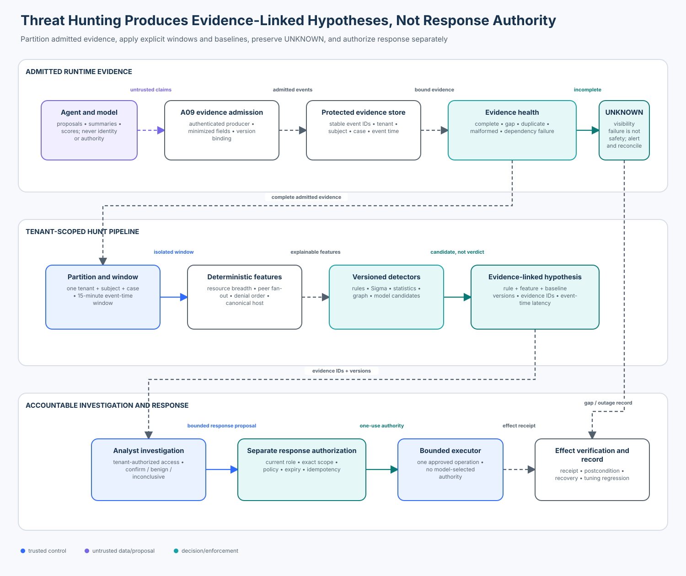

# 10 — Threat Hunting and Behavioral Anomaly Detection

<!-- roadmap-status -->
> **Roadmap status: Published.** This lesson includes a deterministic sequence-hunting lab, a real pySigma 2 adapter, a portable Sigma rule, a top-to-bottom notebook, a validated architecture diagram, focused tests, and a Learning Hub checkpoint.

## Course metadata

- **Level:** advanced
- **Time:** 4–6 hours
- **Prerequisites:** [A08 red teaming](../08-agent-red-teaming-and-adversarial-evaluation/) and [A09 runtime assurance](../09-agent-security-observability-and-runtime-assurance/)
- **Primary artifact:** [`threat_hunting.ipynb`](threat_hunting.ipynb)
- **Reusable implementation:** [`threat_hunting.py`](threat_hunting.py)
- **Production SDK bridge:** [`sigma_adapter.py`](sigma_adapter.py) with [`agent_egress_drift.yml`](agent_egress_drift.yml)
- **Checkpoint:** available in the Learning Hub

## Capability

Turn admitted, tenant-scoped agent trajectories into explainable hypotheses;
evaluate detectors against labeled events; and hand evidence to an accountable
analyst without allowing an anomaly score, model summary, or alert to authorize
containment.

## Course thesis

Threat hunting is defensible only when deterministic sequence features and
baselines are bound to the correct tenant, subject, time window, and evidence.
A detector may prioritize investigation. A trusted application must still
validate evidence, authorize any response, persist the decision, execute a
bounded action, and verify the outcome.

```text
model / agent / anomaly detector -> proposes, scores, summarizes
trusted security application     -> admits, correlates, decides, authorizes, records
response executor                -> performs one bounded, authorized operation
effect verifier                  -> observes the result independently
```

After this lesson, you should be able to explain, implement, evaluate, and
productionize that boundary.

## Learning outcomes

You will be able to:

1. distinguish observability, runtime assurance, detection, hunting, triage,
   disposition, and response;
2. formulate behavior hypotheses from retrieval, delegation, approval, effect,
   and egress sequences rather than isolated strings;
3. bind correlation to an authenticated tenant, subject, case, event-time
   window, and stable evidence identifiers;
4. implement tenant-normalized rules for scope probing, peer fan-out, approval
   pressure, and destination drift;
5. preserve `UNKNOWN` when telemetry is missing, malformed, foreign, or when a
   detector dependency fails;
6. compare exact-match detection with canonicalization and sequence-aware
   detection, including a Unicode-lookalike bypass;
7. calculate precision, recall, alerts per 100 cases, event-time detection
   latency, unknown rate, evidence coverage, and macro tenant false-positive
   rate with declared denominators;
8. parse and convert a real Sigma rule with pySigma 2 while keeping correlation
   and authorization semantics in trusted application code; and
9. design analyst disposition, tuning, containment, recovery, and evidence
   retention as separate accountable workflows.

## Why this course follows runtime assurance

A09 established how observations become admissible runtime evidence: producers
are authenticated, security versions are bound, sensitive data is minimized,
and trace completeness is checked. A10 does not repeat those admission checks.
It consumes admitted evidence and asks a different question:

> Across several legitimate-looking operations, is there a behavior pattern
> worth investigating?

That distinction prevents two dangerous shortcuts:

- hunting over untrusted model logs as if their claims were facts; and
- treating a hunting result as permission to change production state.

The next enterprise lessons can consume the evidence-backed hypotheses and
dispositions produced here when designing long-running operations, escalation,
and governance.

## Enterprise scenario

A support agent retrieves customer records, delegates work to specialist peers,
requests approval for consequential actions, and sends bounded traffic to
approved providers. An attacker cannot trigger an obvious forbidden action.
Instead, the attacker:

- probes one restricted resource per run;
- gradually expands delegation fan-out;
- repeatedly seeks approval, then attempts an effect;
- sends data to an Internationalized Domain Name that resembles a familiar
  destination; or
- times activity to evade single-run rules.

Every individual event can look plausible. The trajectory is the signal.

### Success criteria

The course implementation must:

- keep three valid workflows and the exact threshold boundary quiet;
- detect all six labeled attack trajectories;
- detect slow probing spread across runs but inside the tenant window;
- avoid combining different tenants, subjects, or cases;
- classify telemetry and dependency failures as `UNKNOWN`;
- attach every hypothesis to stable evidence identifiers;
- maintain zero valid/boundary false positives in the fixture suite;
- use event timestamps—not wall-clock sleeps—for latency; and
- execute without credentials, a SIEM account, network access, or side effects.

### Non-goals

This lesson does not claim that:

- twelve synthetic cases estimate production incident prevalence;
- a tenant baseline is automatically fair, current, or attack-free;
- a Sigma rule or pySigma conversion is a complete correlation engine;
- an unsupervised anomaly score establishes malicious intent;
- an LLM explanation is decision-grade evidence;
- a local Python object is a production identity or storage boundary; or
- an analyst disposition authorizes containment.

## Mental model: evidence → features → hypothesis → disposition



```text
admitted evidence
  -> tenant + subject + case + time-window partition
  -> deterministic feature extraction
  -> rule / statistical / graph candidate generation
  -> evidence-linked hypothesis
  -> analyst investigation and disposition
  -> separate authorization for bounded response
  -> independently verified effect
```

### Terms that must not collapse into one another

| Term | Purpose | What it does not prove |
| --- | --- | --- |
| observability | make system behavior inspectable | trustworthiness or malicious intent |
| runtime assurance | check explicit invariants against admitted evidence | absence of unknown attack patterns |
| detection | match a defined condition or learned deviation | cause, intent, or response authority |
| threat hunting | investigate hypotheses across evidence and time | that every hypothesis is an incident |
| alert | route a candidate for attention | confirmed harm |
| disposition | accountable analyst classification with supporting evidence | authorization to contain |
| response | an authorized operation to reduce harm | successful recovery |
| verification | observe whether the response had the expected effect | that the system is safe forever |

## Trust and data model

The lab consumes `HuntEvent` records with:

- stable `event_id` and `case_id`;
- authenticated `tenant_id` and `subject_id` bindings;
- `run_id` for within-run and cross-run analysis;
- event time in milliseconds;
- a typed event kind;
- stable evidence IDs; and
- allowlisted, low-cardinality attributes.

The course uses deterministic fixtures. Production should take these fields from
the A09 admission layer or an equivalent authenticated pipeline. Never derive
tenant or subject from model output, prompt text, a tool argument, or an
unverified log attribute.

### Partitioning invariant

For a hunting sequence `S`:

```text
one tenant(S) ∧ one subject(S) ∧ one case(S) ∧ event_time(S) within tenant window
```

Runs may differ because slow probing intentionally crosses runs. The other
bindings may not. Mixing them can frame another user, leak one tenant's behavior
to another, or manufacture an anomaly from unrelated activity.

### Window semantics

The lab uses a trailing 15-minute event-time window ending at the newest event.
An event one millisecond outside the window is excluded. Production systems need
an explicit policy for watermarking, late arrivals, clock skew, backfill, and
window revision. Processing time alone can reorder the story.

## Threat model

| Threat | Naive failure | Hardened property |
| --- | --- | --- |
| slow scope probing | per-run count stays low | correlate unique restricted resources across runs within one bound window |
| delegation fan-out | every peer call is individually allowed | compare unique peers with the correct tenant profile |
| approval pressure | count denials without order | require denials above threshold and a later effect attempt |
| direct egress drift | exact blocked URL list misses new host | canonicalize host and compare with tenant allowlist |
| encoded destination | Unicode lookalike defeats string match | IDNA canonicalization before comparison |
| stale aggregation | old events accumulate forever | exclude events older than the tenant hunt window |
| cross-tenant contamination | global aggregation changes another tenant's baseline | reject mixed tenant, subject, or case evidence |
| missing telemetry | no match is mistaken for safety | return `UNKNOWN`, preserve the gap, and investigate visibility |
| detector outage | pipeline emits no alerts | record `UNKNOWN`; monitor the monitor |
| alert-driven containment | high score triggers broad action | separate disposition and response authorization |

## Detector design

### 1. Scope probing

Count distinct restricted resources for one tenant and subject within the
window. The tenant-A baseline permits three; the fourth creates an
`AGENT-SCOPE-PROBE` hypothesis. Duplicate access to the same resource does not
inflate breadth.

### 2. Fan-out drift

Count distinct delegated peers. Tenant A permits three, while the legitimate
tenant-B batch workflow permits five. A global threshold of three would create
a false positive for tenant B; a global threshold of five would miss the
tenant-A attack.

### 3. Approval pressure

Count denied approval events and require a later effect attempt. Denials alone
may reflect a cautious workflow. An effect that happened before the denials is
not evidence of pressure after denial. Order is security semantics.

### 4. Destination drift

Parse an absolute URL, reject user-info, remove a trailing dot, apply IDNA, and
lowercase the host before comparison. This catches direct and Unicode-lookalike
destinations. It is still only detection: the egress boundary must independently
enforce its own approved destination and connection policy.

### 5. Completeness before confidence

If required evidence is absent, malformed, duplicated, foreign, or the detector
dependency fails, the result is `UNKNOWN`. The engine does not silently turn a
visibility failure into `NO_HYPOTHESIS`.

## Naive versus hardened experiment

The lab includes a deliberately weak detector that matches only:

```text
https://exfil.example/upload
```

It catches one direct case and misses the encoded domain plus every multi-event
trajectory. Run both modes:

```bash
python curriculum/roadmap/advanced/10-threat-hunting-and-behavioral-anomaly-detection/lab.py
python - <<'PY'
from pathlib import Path
import sys

course = Path("curriculum/roadmap/advanced/10-threat-hunting-and-behavioral-anomaly-detection")
sys.path.insert(0, str(course))
from threat_hunting import evaluate_suite

print("naive recall:", evaluate_suite(naive=True).recall)
print("hardened recall:", evaluate_suite().recall)
PY
```

The experiment demonstrates why detection quality must be measured separately
from policy enforcement. A missed hypothesis must not make the dangerous egress
possible; the network boundary remains authoritative.

## Evaluation contract

The fixture suite contains:

| Population | Cases | Included in attack recall? | Included in tenant FPR? |
| --- | ---: | ---: | ---: |
| valid | 3 | no | yes |
| attack | 6 | yes | no |
| boundary | 1 | no | yes |
| failure | 2 | no | no; reported as unknown |

### Metrics and denominators

```text
precision = detected labeled attacks / all hypotheses
recall = detected labeled attacks / all labeled attacks
alerts per 100 cases = alerted cases / all evaluated cases × 100
tenant FPR_t = alerted valid-or-boundary cases for tenant t / all valid-or-boundary cases for t
macro tenant FPR = mean(FPR_t across represented tenants)
unknown rate = UNKNOWN cases / all evaluated cases
evidence coverage = events with evidence IDs / evaluated window events
case detection latency = first-hypothesis detection event time - its first suspicious event time
```

An `UNKNOWN` attack is conservatively a false negative for recall and is also
visible in the unknown rate. Otherwise a broken collector could improve recall
by removing difficult attacks from the denominator.

### Why macro tenant FPR

A global false-positive rate can hide a noisy small tenant behind the volume of
a large tenant. The lab reports each tenant and their unweighted macro mean.
Production should additionally inspect workload class, region, model, tool,
policy version, and other justified slices while protecting privacy.

### What the fixture score means

The hardened fixture suite intentionally reaches precision and recall of 1.0.
That proves only that the implementation satisfies these declared examples and
invariants. It is not a claim of perfect production detection. Shadow deployment,
representative replay, analyst feedback, drift review, and incident backtesting
are still required.

## State of the art and standards review

NIST AI 800-4, published in March 2026, describes post-deployment monitoring as
crucial while noting that validated methods, best practices, and shared
terminology remain nascent and scattered. It organizes monitoring into six
categories, including security monitoring. This lesson therefore presents a
testable pattern, not a universal standard.

The NIST AI RMF Manage playbook calls for post-deployment monitoring plans that
connect to incident response, recovery, change management, user input, appeal,
override, and decommissioning. A detector without owners and response lifecycle
is incomplete.

MITRE ATLAS supplies an AI-focused adversary knowledge base. Use it to seed and
communicate hypotheses, not as proof that a local event implements a technique.
The mapping remains an analyst claim that should cite evidence and version.

The OWASP Agentic Security Initiative supplies additional community threat and
control material for agentic systems. Use it to expand hypotheses and review
coverage; it does not replace local evidence, tenant authorization, or tested
response policy.

Sigma provides a portable rule format. Its correlation specification warns that
backends differ and must error when a required feature cannot be represented
without changing intent. Portability is therefore something to validate per
backend, not assume from successful YAML parsing.

### Detection approaches

| Approach | Strength | Failure mode | Appropriate role |
| --- | --- | --- | --- |
| deterministic rule | explainable, testable, stable evidence | misses novel variants; thresholds need tuning | high-confidence known patterns and invariants |
| sequence/correlation rule | captures order and cross-event behavior | window, identity, and backend semantics can drift | trajectory hypotheses |
| statistical baseline | adapts to volume and tenant behavior | poisoning, seasonality, cold start, opaque thresholds | prioritization with guardrails |
| unsupervised outlier model | can surface novel combinations | outlier does not mean malicious; weak explanations | candidate generation, never direct authority |
| graph analysis | reveals unusual paths and coordinated actors | identity resolution errors create false structure | multi-agent and delegation hunts |
| LLM-assisted summary/query | accelerates analyst exploration | hallucination, prompt injection, data exposure | untrusted proposal with source citations |

## Tools and SDK review

The course uses pySigma because it is a real, widely used Python library that
parses and converts Sigma rules locally without credentials. The sequence engine
remains explicit so learners can see the security semantics.

| Tool or SDK | What it provides | What it does not provide |
| --- | --- | --- |
| OpenTelemetry | vendor-neutral generation, collection, and export of traces, metrics, and logs | producer trust, tenant authorization, hypothesis semantics |
| Sigma specification | portable single-event and correlation rule representation | guaranteed support or identical behavior in every backend |
| pySigma 2.0.1 | Python parsing, validation, processing, and backend conversion; centralized `SigmaPolicy` | SIEM storage, scheduling, analyst workflow, response authority |
| Sigma CLI/backends | target query conversion through installed plugins | assurance that the target data model and fields are correct |
| MITRE ATLAS | shared AI adversary tactics and techniques | local detection coverage or incident confirmation |
| scikit-learn `IsolationForest` | batch outlier scoring over numeric features | intent, calibrated risk, sequence semantics, tenant fairness |
| Elastic anomaly detection | operational jobs for metric, population, categorization, and rare behavior | automatic correctness of tenancy, labels, or response policy |
| SIEM/XDR case systems | storage, correlation, routing, investigation, and integrations | trustworthy source admission or permission for broad containment |

### pySigma 2 security boundary

pySigma 2 centralizes security-sensitive parser and processing options in
`SigmaPolicy`. The adapter passes an explicit default policy and does not enable
external sources, template-variable execution, or a less restricted regular
expression engine. pySigma 2.0.1 also added limits for YAML alias and expansion
abuse. Treat uploaded rules and pipelines as untrusted input anyway: pin the
library, limit input size and processing resources, review enabled plugins, and
run conversion in a constrained service.

The adapter converts the course's single-event egress rule with pySigma's test
backend:

```bash
python curriculum/roadmap/advanced/10-threat-hunting-and-behavioral-anomaly-detection/sigma_adapter.py
```

Expected query:

```text
event_type="egress" and destination_trust="unknown"
```

This proves parsing and conversion, not target-SIEM equivalence. The course's
multi-event sequence rules remain in `threat_hunting.py`; a production team may
express them using Sigma correlations only after testing the selected backend's
support and window semantics.

## Production architecture

### Required components

1. **Admission layer:** authenticate producers, bind identity and versions,
   minimize sensitive data, and reject replay or malformed events.
2. **Immutable evidence store:** retain stable IDs, access controls, integrity
   evidence, lifecycle, and legal/privacy policy.
3. **Partitioned stream processor:** key by tenant, subject, and case; apply
   event-time windows and late-event policy.
4. **Feature and rule registry:** version definitions, thresholds, owner,
   evidence contract, tests, rollout state, and rollback.
5. **Hypothesis store:** preserve rule version, features, evidence IDs,
   timestamps, and state transitions.
6. **Analyst case workflow:** authenticate the analyst, enforce tenant access,
   capture disposition and supporting evidence, and audit changes.
7. **Response authorizer/executor:** accept only narrow response proposals,
   reauthorize current state, use idempotency, and emit a receipt.
8. **Independent verifier:** observe the expected effect and drive recovery or
   escalation if the outcome is unknown.

### Rule lifecycle

```text
draft -> peer review -> replay/backtest -> shadow -> limited enablement
      -> measured production -> tune or retire
```

Every transition needs an owner and retained evidence. Track rule version,
schema version, feature version, tenant-profile version, backend version, and
deployment time. Never silently edit a production threshold in place.

### Baseline governance

Tenant normalization is not “learn whatever happened recently.” A compromised
period can poison a learned baseline. Define:

- eligible training intervals and data-quality gates;
- minimum history and cold-start behavior;
- robust statistics and bounded update rates;
- exclusions for known incidents and maintenance;
- drift alerts and human review;
- versioned approval and rollback; and
- privacy-preserving minimum aggregation sizes where relevant.

When no trustworthy baseline exists, prefer a declared conservative state such
as `UNKNOWN` or a reviewed static threshold. Do not borrow another tenant's raw
behavior without a justified, privacy-preserving design.

## Analyst workflow and response separation

An evidence-linked hypothesis begins in `OPEN`. A completed disposition requires:

- an authenticated analyst identifier;
- `CONFIRMED`, `BENIGN`, or `INCONCLUSIVE`;
- supporting evidence identifiers; and
- an auditable timestamp and version in production.

Disposition does not call a tool or change agent state. If response is needed,
the security application constructs a narrow proposal such as:

```text
pause tenant-A / run-17 for 15 minutes
```

The response authorizer then checks current incident state, analyst role,
separation of duties, affected scope, expiry, policy, and idempotency before one
execution. The verifier confirms the pause and records a receipt. Broad commands
such as “disable all agents” require a separate emergency policy and authority.

### Ownership table

| Lifecycle stage | Accountable owner | Evidence |
| --- | --- | --- |
| telemetry admission | platform security | admission reason, producer identity, schema/version |
| hunt rule and baseline | detection engineering | rule tests, replay report, version, change approval |
| hypothesis triage | security operations | evidence IDs, analyst notes, disposition |
| containment authorization | incident commander or delegated role | exact scope, policy decision, approval, expiry |
| effect execution | platform operations | idempotent operation receipt |
| recovery | service owner + incident command | restored controls, validation, monitoring window |
| tuning and regression | detection engineering | false-positive/negative review and retained fixture |

## Failure handling

| Failure | Required behavior |
| --- | --- |
| missing evidence ID | `UNKNOWN`; request/reconcile evidence |
| mixed tenant, subject, or case | reject partition; security signal for pipeline integrity |
| duplicate event ID | `UNKNOWN`; investigate replay or ingestion defect |
| malformed destination | `UNKNOWN`; do not coerce into known-safe |
| state store unavailable | `UNKNOWN`; alert on detector health |
| late event | apply declared watermark/revision policy and retain change history |
| unsupported Sigma correlation | conversion error; never silently weaken the rule |
| analyst system unavailable | retain hypothesis durably; use documented escalation path |
| response timeout | reconcile the original idempotency key before retry |

## Privacy and evidence safety

Hunting increases pressure to collect “everything.” Resist that pressure.
Prefer identifiers, categories, digests, policy decisions, destination hosts,
and bounded reason codes. Do not store raw prompts, chain-of-thought, access
tokens, customer documents, or full tool payloads merely because an analyst
might someday want them. Apply purpose limitation, field-level access, retention,
deletion, legal hold, tenant isolation, and access auditing.

An analyst interface is itself an attack surface. Escape untrusted strings,
prevent retrieved content from issuing instructions, restrict exports, and keep
LLM-generated summaries visibly untrusted and linked to exact evidence.

## Practical lab

### Files

- [`threat_hunting.py`](threat_hunting.py): reusable feature, detector,
  evaluation, and disposition implementation;
- [`lab.py`](lab.py): credential-free entry point;
- [`agent_egress_drift.yml`](agent_egress_drift.yml): portable Sigma rule;
- [`sigma_adapter.py`](sigma_adapter.py): real pySigma 2 parser/converter;
- [`threat_hunting.ipynb`](threat_hunting.ipynb): guided experiment; and
- [`architecture.svg`](architecture.svg): validated control-boundary diagram.

### Run

From the repository root:

```bash
python -m pip install -e '.[learner]'
python curriculum/roadmap/advanced/10-threat-hunting-and-behavioral-anomaly-detection/lab.py
python curriculum/roadmap/advanced/10-threat-hunting-and-behavioral-anomaly-detection/sigma_adapter.py
pytest -q tests/test_agent_threat_hunting.py
```

### Exercises

1. **Baseline:** run the suite and inspect per-case states and exact metric
   denominators.
2. **Primary attack:** inspect the cross-run slow scope probe and identify the
   event that crosses the tenant threshold.
3. **Naive detector:** compare exact-string recall with the hardened engine.
4. **Encoded bypass:** inspect the Unicode hostname and its IDNA canonical form.
5. **Window boundary:** move the first scope event one millisecond beyond the
   15-minute window and explain why the hypothesis disappears.
6. **Tenant normalization:** compare the five-peer tenant-B batch with the same
   fan-out under tenant A.
7. **Failure state:** remove one evidence ID and confirm `UNKNOWN`, not
   `NO_HYPOTHESIS`.
8. **Disposition:** confirm one hypothesis with supporting evidence and explain
   why the returned object still cannot authorize containment.
9. **SDK bridge:** parse and convert the Sigma rule, then identify which
   multi-event semantics remain outside that rule.

### Extension challenges

- Add an event-time watermark and revision receipt for late evidence.
- Add a duplicate-resource test proving breadth counts unique values.
- Add a reviewed per-workload baseline nested inside tenant scope.
- Express one supported sequence as a Sigma correlation and test a real target
  backend; fail if the backend cannot preserve semantics.
- Add an Isolation Forest only as a candidate generator, then compare its
  explanations, tenant slices, and false positives with deterministic rules.

## Tests as executable claims

The focused test suite proves that:

- all four evaluation populations are present;
- valid and exact-boundary cases remain usable;
- six attack trajectories create evidence-linked hypotheses;
- naive recall is lower than hardened recall;
- cross-run activity inside the window is detected;
- stale, cross-tenant, cross-subject, and foreign-case aggregation is blocked;
- IDNA canonicalization catches the encoded destination;
- an effect before denials is not mislabeled as pressure after denial;
- visibility failures remain `UNKNOWN`;
- metrics use declared denominators and event timestamps;
- disposition requires analyst identity and supporting evidence; and
- pySigma 2 parses and converts the actual course rule.

Run all repository quality gates before promotion; focused green tests do not
replace notebook execution, link validation, Pages build, or the full suite.

## Checkpoint

**Question:** Why is an opaque anomaly score insufficient for a security
response?

**Expected reasoning:** An outlier score does not establish malicious intent,
source trust, tenant binding, causality, or response authority. Responders need
the exact admitted events, feature and baseline versions, rule or model version,
window, and evidence that supports the hypothesis. An accountable analyst must
disposition the case, and trusted application policy must separately authorize
one bounded response and verify its effect.

## Review questions

1. Why may run ID vary inside a slow-probing sequence while tenant, subject, and
   case may not?
2. Which events belong in the tenant false-positive denominator?
3. Why does an `UNKNOWN` attack count as a recall miss?
4. What is lost if detection latency uses processing time rather than event time?
5. What must a target backend do when it cannot represent required Sigma
   correlation semantics?
6. Why can a confirmed analyst disposition still not execute containment?

## Production-readiness checklist

- [ ] Producers and analysts are authenticated independently of event content.
- [ ] Tenant, subject, case, run, event, and evidence identifiers have owners.
- [ ] Time-window, watermark, skew, and late-event behavior are explicit.
- [ ] Rule, feature, schema, baseline, and backend versions are retained.
- [ ] Valid, attack, boundary, and failure populations are representative.
- [ ] Metrics declare denominators and tenant/workload slices.
- [ ] Missing evidence and detector outages are visible as `UNKNOWN`.
- [ ] Sigma conversions are tested against the selected backend and data model.
- [ ] Rule inputs, plugins, and conversion run with constrained resources.
- [ ] Hypotheses preserve exact evidence and do not include sensitive payloads.
- [ ] Analyst access, disposition, export, and tuning are audited.
- [ ] Response authorization, execution, verification, recovery, and rollback are separate.
- [ ] Detector health and baseline poisoning have monitoring and owners.

## References and version notes

Accessed 2026-10-31 unless otherwise stated.

- [NIST AI 800-4, *Challenges to the Monitoring of Deployed AI Systems* (March 2026)](https://doi.org/10.6028/NIST.AI.800-4)
- [NIST AI RMF Playbook — Manage](https://airc.nist.gov/airmf-resources/playbook/manage/)
- [MITRE ATLAS](https://atlas.mitre.org/)
- [OWASP Agentic AI Security Initiative](https://genai.owasp.org/initiatives/agentic-security-initiative/)
- [Sigma specification](https://sigmahq.io/sigma-specification/)
- [Sigma correlation rules specification 2.1.0](https://sigmahq.io/sigma-specification/specification/sigma-correlation-rules-specification.html)
- [pySigma repository](https://github.com/SigmaHQ/pySigma)
- [pySigma releases; course adapter verified with 2.0.1](https://github.com/SigmaHQ/pySigma/releases/tag/v2.0.1)
- [OpenTelemetry: what it is and is not](https://opentelemetry.io/docs/what-is-opentelemetry/)
- [OpenTelemetry log correlation specification](https://opentelemetry.io/docs/specs/otel/logs/)
- [scikit-learn `IsolationForest`](https://scikit-learn.org/stable/modules/generated/sklearn.ensemble.IsolationForest.html)
- [Elastic anomaly-detection job types](https://www.elastic.co/docs/explore-analyze/machine-learning/anomaly-detection/ml-anomaly-detection-job-types)

Protocol, SDK, and hosted-product behavior is version-sensitive. Recheck the
selected backend, pySigma policy defaults, and product documentation when
implementing this pattern. Recommendations and experimental patterns are
identified as such; the lab is not a certification claim.
