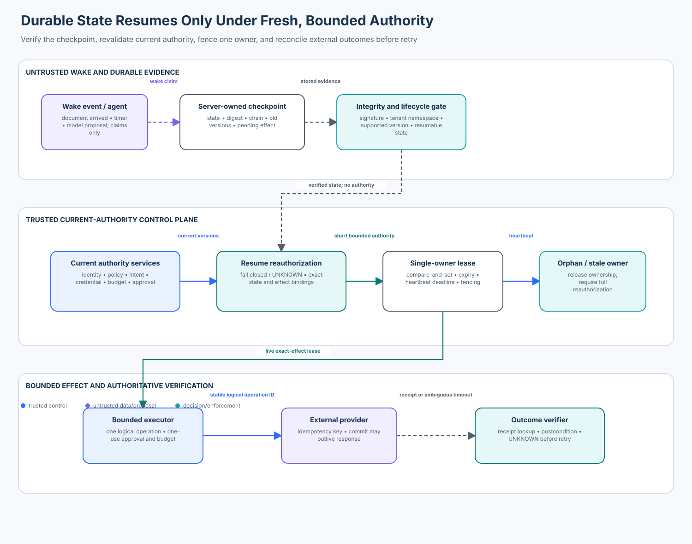

# 01 — Secure Long-Running Agents

<!-- roadmap-status -->
> **Roadmap status: Published.** This lesson includes a deterministic authority-lease lab, a real OpenAI Agents SDK `RunState` bridge, a top-to-bottom notebook, a validated architecture diagram, focused tests, and a Learning Hub checkpoint.

## Course metadata

- **Level:** enterprise
- **Time:** 5–7 hours
- **Prerequisites:** [I02 checkpoint and durable execution security](../../intermediate/02-state-checkpoint-and-durable-execution-security/), [I03 identity and delegated authority](../../intermediate/03-agent-identity-and-delegated-authority/), [I10 human-in-the-loop security](../../intermediate/10-human-in-the-loop-security/), and [A09 runtime assurance](../../advanced/09-agent-security-observability-and-runtime-assurance/)
- **Primary artifact:** [`secure_long_running_agents.ipynb`](secure_long_running_agents.ipynb)
- **Reusable implementation:** [`secure_long_running_agents.py`](secure_long_running_agents.py)
- **Production SDK bridge:** [`sdk_adapter.py`](sdk_adapter.py), using `openai-agents>=0.22.2,<0.23`
- **Checkpoint:** available in the Learning Hub

## Capability

Operate agents that pause for hours or days without allowing yesterday's
checkpoint, approval, credential, budget, policy, or intent to become today's
authority.

## Course thesis

A durable checkpoint proves what was stored. It does not prove who may resume
the run now or what the run may do next. Every resume needs a short-lived lease
bound to the current principal, tenant, intent, state, policy, credential,
budget, pending effect, and time. One owner may advance the run. Unknown
external outcomes must be reconciled before retry.

```text
model / agent          -> proposes the next step
workflow engine        -> persists and replays progress
trusted control plane  -> validates current authority and issues a lease
bounded executor       -> performs one lease-bound operation
effect verifier        -> reconciles the provider's authoritative outcome
```

The model and orchestration engine are important components. Neither replaces
application-owned authorization.

## Learning outcomes

You will be able to:

1. distinguish checkpoint integrity, workflow durability, liveness, and current
   authorization;
2. model authority as a renewable, short-lived lease instead of a durable flag;
3. bind a resume lease to tenant, subject, intent, checkpoint state, policy,
   credential, budget, workflow version, and exact pending effect;
4. use optimistic concurrency and stable resume request IDs to guarantee one
   active resume owner under duplicate delivery and races;
5. separate a stable logical operation ID from per-attempt IDs;
6. stop blind retries when a provider may have committed an effect;
7. reconcile an unknown effect against authoritative provider state;
8. use heartbeats for liveness without extending the authority expiry;
9. measure unsafe resume, stale-lease use, duplicate effects, orphan detection,
   valid completion, and denial reasons with declared denominators;
10. place a real OpenAI Agents SDK `RunState` behind the application resume
    gate; and
11. select and productionize a durable workflow runtime without confusing its
    persistence guarantees with business authorization.

## Relationship to earlier courses

I02 secures one checkpoint and replay boundary. E01 operates the same ideas at
enterprise run-lifecycle scope: long waits, fleet ownership, live policy and
credential changes, budget renewal, orphan detection, provider ambiguity, and
accountable operations. It intentionally does not reteach basic serialization.

I10 binds a human decision to one exact action. E01 shows why the approval must
still be current at execution and why a restored agent state cannot execute the
SDK's tool path directly.

A09 supplies admitted runtime evidence. E01 consumes heartbeat, lease, resume,
and provider receipts so operators can distinguish healthy waiting from an
orphaned or outcome-unknown run.

## Enterprise scenario

A case-management agent pauses for six hours while awaiting documents. During
the pause, any of the following can change:

- the assigned analyst is removed;
- the analyst's credential rotates;
- organizational policy is deployed;
- the customer changes the case intent;
- the approval expires;
- a quarterly effect budget rolls over;
- the workflow implementation is upgraded;
- a worker dies while owning the run; or
- a provider commits an effect but the worker times out before receiving the
  response.

A valid checkpoint can faithfully preserve every stale value in that list.
That is why integrity and present authority are separate controls.

### Success criteria

The course implementation must:

- restore a valid run with a freshly issued current-version lease;
- deny unauthenticated, cross-tenant, revoked, stale-credential, scope-less,
  changed-intent, unsupported-version, and exhausted-budget resumes;
- reject a tampered state even when an attacker keeps the original signature;
- allow exactly one winner in a concurrent resume race;
- return the same lease for a duplicated stable resume request;
- reject policy, credential, intent, and budget changes after lease issuance;
- treat the heartbeat deadline and authority expiry as exclusive boundaries;
- detect an orphan at the heartbeat deadline;
- bind approval and lease to the exact effect;
- stop a retry while a previous provider outcome is unknown;
- reconcile a committed effect without dispatching it twice; and
- run without credentials, network access, sleeps, or external side effects.

### Non-goals

The teaching lab does not claim that:

- an in-memory dictionary is a durable database;
- an HMAC literal is a production KMS boundary;
- a Python lock coordinates multiple processes or regions;
- a heartbeat proves a worker is uncompromised;
- an agent session is a workflow engine;
- one synthetic fixture estimates incident prevalence;
- provider idempotency exists unless the provider contract documents it; or
- an orchestration product automatically supplies application authorization.

## Architecture



```text
durable checkpoint + external wake event
  -> verify server-owned state and chain
  -> authenticate current principal and tenant
  -> revalidate policy, credential, intent, budget, approval, and version
  -> compare-and-set one resume owner
  -> issue short lease + independent heartbeat deadline
  -> authorize one exact logical operation
  -> dispatch with provider idempotency key
  -> verify / reconcile authoritative outcome
  -> checkpoint the next safe state
```

## Trust boundaries and invariants

### Boundary 1: durable state is evidence, not authority

Agent state may contain tool calls, model output, summaries, and old decisions.
Treat all of those as claims. Load the state from a server-owned namespace,
verify integrity, and then make a new authorization decision.

```text
checkpoint_valid(run) does not imply resume_authorized(run, now)
```

### Boundary 2: one resume owner

For every open run:

```text
count(active_resume_lease(run, now)) <= 1
```

Enforce this with a transaction, optimistic compare-and-set, or workflow-engine
single-writer guarantee. A prompt such as "only one worker should resume" is not
a concurrency control.

### Boundary 3: exact effect binding

A lease authorizes only the effect digest reviewed at resume:

```text
lease.effect_digest == digest(action, resource, arguments)
```

The logical operation ID is stable across attempts. The attempt ID is unique
per dispatch. Conflating the two either defeats idempotency or hides retry
history.

### Boundary 4: unknown is a first-class state

If a worker sends a request and loses the response, the system cannot infer
failure. The run becomes `OUTCOME_UNKNOWN`. It queries an authoritative provider
receipt before considering another dispatch.

```text
timeout_after_send -> UNKNOWN -> reconcile -> COMMITTED | CONFIRMED_NOT_COMMITTED
```

### Boundary 5: liveness is not authorization

A heartbeat says the owner recently reported progress. It must not silently
extend credential, policy, approval, or authority expiry. The lab renews the
heartbeat deadline while keeping the lease expiry fixed.

## Authority-lease contract

The lab issues an `AuthorityLease` containing:

| Field | Security purpose |
| --- | --- |
| `run_id` and `checkpoint_id` | bind the lease to one lifecycle position |
| `tenant` and `subject` | prevent cross-tenant or cross-principal use |
| `state_digest` | bind the lease to the verified state |
| `intent_digest` | detect changed user/business intent |
| `effect_digest` | authorize one exact proposed effect |
| `policy_version` | invalidate the lease when policy changes |
| `credential_version` | invalidate rotated or revoked credentials |
| `budget_epoch` and `max_effects` | constrain time-bounded resource use |
| `issued_at` and `expires_at` | bound authority lifetime |
| `heartbeat_deadline` | detect abandoned ownership independently |

The checkpoint intentionally contains older policy, credential, and budget
versions. A successful resume demonstrates that the application did not reuse
them; it issued a lease from current authority.

## Lifecycle state machine

| State | Meaning | Permitted transition |
| --- | --- | --- |
| `WAITING` | durable progress exists; no worker owns execution | current-authority gate may issue one lease |
| `RUNNING` | exactly one live lease owns progress | heartbeat, effect authorization, pause, or orphan sweep |
| `OUTCOME_UNKNOWN` | provider may have committed | reconciliation only; never blind retry |
| `COMPLETED` | terminal effect and receipt are recorded | read and audit only |
| `TERMINATED` | operator/policy ended the run | read, audit, and separately authorized recovery |

The lab rejects resume from `OUTCOME_UNKNOWN`: recovery must first reconcile the
external effect.

## Practical lab

Run the complete credential-free evaluation:

```bash
python curriculum/roadmap/enterprise/01-secure-long-running-agents/lab.py
```

Run the real SDK bridge after installing learner dependencies:

```bash
python curriculum/roadmap/enterprise/01-secure-long-running-agents/sdk_adapter.py
```

The first program evaluates eight declared cases:

| Population | Cases | Denominator use |
| --- | ---: | --- |
| valid | 1 | valid completion rate |
| attack | 4 | unsafe resume rate |
| boundary | 1 | stale-lease use at the exact heartbeat deadline |
| failure | 2 | orphan detection and safe unknown-outcome handling |

The deterministic fixture is deliberately small. The metric contract—not the
sample size—is the lesson.

## Lab walkthrough

### 1. Create and seal a waiting checkpoint

`create_waiting_run` records state, a state digest, old security versions, the
intent digest, and the exact pending effect. `CheckpointSigner` detects changes
to either the payload or signature. In production, use authenticated encryption
or a KMS-backed signature, tenant-scoped access control, key rotation, and a
transactional database.

### 2. Approve the exact current effect

The approval binds tenant, subject, effect digest, current policy version, and
expiry. Execution consumes it once. A Boolean such as `approved=true` inside
agent state is not an approval.

### 3. Revalidate on resume

`resume` authenticates the principal; verifies tenant, state, signature,
workflow compatibility, identity, current credential, current intent, scope,
and budget; and performs version-based single-owner acquisition.

Missing or unavailable current authority produces denial or `UNKNOWN`, never a
fallback to checkpoint values.

### 4. Heartbeat without extending authority

`heartbeat` moves only the heartbeat deadline. At the deadline, the owner is
stale. `sweep_orphans` releases ownership and returns the run to `WAITING`, where
the full current-authority gate must run again.

### 5. Execute one bounded effect

Before dispatch, `execute` rechecks the live lease and exact effect, atomically
consumes approval and budget, and records an in-flight logical operation. The
provider receives the stable logical ID. A different per-attempt ID remains in
the operation ledger for investigation.

### 6. Reconcile an ambiguous provider outcome

The failure fixture commits at the provider and then simulates a lost response.
The operation becomes `UNKNOWN`; a second attempt is denied. `reconcile` queries
the provider and marks the original operation committed without another
dispatch.

### 7. Inspect privacy-minimized receipts

Receipts contain phase, decision, reason, run/checkpoint/lease IDs, policy
version, timestamp, and a truncated subject digest. They do not store prompts,
documents, secrets, raw credentials, or chain-of-thought.

## OpenAI Agents SDK bridge

`sdk_adapter.py` creates a real `Agent`, `RunContextWrapper`, and `RunState`,
serializes the state, stores it in a digest-bound server-side vault, obtains a
fresh application lease, and only then calls `RunState.from_json`.

This ordering matters:

```text
verify vault object -> issue current application lease -> deserialize RunState
```

The SDK's session and run-state facilities preserve agent context. They do not
authenticate the current analyst, validate enterprise policy, renew effect
budgets, or prove that an old approval is still valid. The application boundary
does that work.

The adapter also mutates the stored SDK payload while retaining its old digest
and proves that restoration is rejected. No model call is made.

## Current tools and SDKs

Review date: **2026-10-31**. Verify behavior and versions before production
adoption; workflow and agent SDKs evolve quickly.

| Tool / SDK | Durable mechanism | Useful capabilities | Security work the application still owns |
| --- | --- | --- | --- |
| [Temporal](https://docs.temporal.io/workflows) | event history and deterministic replay | workflows, activities, signals, timers, retries, versioning | identity, current authorization, approval binding, provider idempotency contract, data classification |
| [Dapr Workflow](https://docs.dapr.io/developing-applications/building-blocks/workflow/workflow-overview/) | sidecar workflow engine persists completed steps and resumes after restart | multi-app workflows, external events, timers, retry policies, management APIs, access policies | business authority, exact effect grants, fail-closed dependency policy, state-store governance |
| [Azure Durable Task / Functions](https://learn.microsoft.com/azure/azure-functions/durable/durable-functions-orchestrations) | event-sourced orchestration history and replay | orchestrations, activities, entities, durable timers, external events | tenant and role checks, approval semantics, downstream reconciliation, evidence policy |
| [LangGraph](https://docs.langchain.com/oss/python/langgraph/durable-execution) | checkpointer and thread-scoped replay | interrupts, persistence, human review, resumable graph execution | authenticated thread ownership, current policy, secrets, exact effect authorization |
| [Restate](https://docs.restate.dev/concepts/durable_execution) | durable execution log and replay | durable services, objects, promises, retries, idempotency | enterprise identity, intent and policy renewal, provider-specific postconditions |
| [OpenAI Agents SDK](https://openai.github.io/openai-agents-python/running_agents/) | serializable run state, sessions, interruptions, and documented durable integrations | agent loop, tools, handoffs, sessions, HITL, Dapr/Temporal/Restate integrations | application authorization, effect boundary, run ownership, budgets, external verification |

### Selection questions

Ask each vendor or platform team:

1. What is the execution delivery guarantee for activities?
2. How are workflow code changes replayed and tested against old history?
3. Which state is encrypted, tenant-isolated, retained, exported, and deleted?
4. Can two workers advance one run, and what primitive prevents it?
5. How are signals authenticated and authorized?
6. What happens when the workflow service, policy service, KMS, identity
   provider, or downstream provider is unavailable?
7. Can an operator inspect and reconcile a logical operation without replaying
   it?
8. How are stuck, orphaned, canceled, and outcome-unknown runs surfaced?
9. How do kill switches and credential revocation reach in-flight work?
10. What evidence proves the externally observed effect, not merely activity
    completion?

## Why retries are a security decision

Workflow engines commonly provide at-least-once activity execution or
effectively-once orchestration behavior. That does not make every external API
call exactly once. A secure activity needs:

- one stable logical operation ID;
- provider-supported idempotency or an application idempotency ledger;
- an in-flight record created atomically with budget/approval consumption;
- timeout classification that distinguishes "not sent" from "possibly sent";
- an authoritative lookup or compensating workflow; and
- bounded retry count, deadline, and backoff.

Retries must not multiply authority. Each attempt inherits no more authority
than the logical operation and may require fresh authorization if policy,
credentials, intent, approval, budget, or lease changes.

## Workflow evolution and replay safety

Long-running runs outlive deployments. Production needs:

- deterministic workflow code where the engine requires replay;
- explicit, reviewed version markers or migrations;
- replay tests against representative open and closed histories;
- a rollback plan that understands old histories;
- schema compatibility for stored state and signals;
- quarantine when no safe migration exists; and
- separate authorization after migration.

A successful technical migration still does not renew business intent.

## Operations and evidence

### Signals and service-level indicators

Measure at least:

- open runs by lifecycle state and tenant;
- resume attempts, allows, denials, conflicts, and unknowns;
- lease age, expiry, heartbeat lag, and orphan count;
- unsupported workflow/schema versions;
- approval and budget renewal denial reasons;
- operations in flight or outcome-unknown;
- reconciliation age and success;
- duplicate provider dispatches;
- valid completion latency excluding external wait time; and
- evidence completeness.

Do not average away severe cases. Report stale-lease use and duplicate effects
as counts and rates with exact denominators.

### Detection

Alert on:

- multiple live leases for one run;
- repeated cross-tenant resume attempts;
- a run executing after policy or credential change;
- heartbeat silence beyond the reviewed threshold;
- a growing `OUTCOME_UNKNOWN` backlog;
- reconciliation without an authoritative provider receipt;
- logical operation IDs reused with different effect digests; and
- terminal runs receiving new wake events.

### Containment

Containment should independently stop new scheduling, lease issuance, effect
execution, credentials, tools, destinations, or one tenant. A prompt asking the
agent to stop is not a kill switch. E02 develops this operational control.

### Recovery

Recovery is a new authorized workflow:

1. freeze the affected run and evidence;
2. reconcile every in-flight or unknown effect;
3. identify the last verified checkpoint;
4. validate code and schema compatibility;
5. reacquire user/business intent;
6. obtain current approvals and budgets;
7. issue a new short lease; and
8. verify each resulting effect.

## Threat model

| Threat | Naive failure | Hardened property |
| --- | --- | --- |
| old checkpoint contains `approved=true` | restore and execute | approval registry is current, exact, expiring, and one-use |
| analyst revoked during wait | checkpoint identity is trusted | current identity and credential version checked at resume and execution |
| policy changes after resume | lease treated as timeless | short lease is version-bound and denied after policy change |
| duplicate wake event | two workers advance state | stable request ID plus compare-and-set single owner |
| worker dies silently | lease remains forever | independent heartbeat deadline and orphan sweep |
| changed customer intent | old goal continues | current intent digest must match |
| quarterly budget rollover | old allowance remains | budget epoch and remaining effects are rebound |
| timeout after provider commit | retry duplicates effect | outcome becomes unknown; provider lookup precedes retry |
| operation ID reused for another action | provider returns unrelated old receipt | operation ID is bound to effect digest |
| authority service outage | fail open using checkpoint | preserve `UNKNOWN` and do not resume |
| workflow upgrade is incompatible | replay corrupts progress | supported versions, migrations, replay tests, quarantine |
| SDK state tampering | deserialize attacker-controlled state | server-side digest verified before restoration |

## Evaluation contract

For a set of resume attempts `R`, stale-lease executions `S`, external dispatches
`D`, orphans `O`, and legitimate runs `V`:

```text
unsafe resume rate       = unauthorized resumes allowed / unauthorized resume attempts
stale-lease use rate     = effects allowed with stale lease / stale-lease effect attempts
duplicate effect rate    = duplicate provider commits / logical operations attempted
orphan detection rate    = orphans detected within threshold / injected or observed orphans
valid completion rate    = legitimate completed runs / legitimate runs attempted
safe failure rate        = safely contained dependency failures / injected dependency failures
```

An `UNKNOWN` attack outcome is not a successful defense and an `UNKNOWN` valid
outcome is not a successful completion. Preserve it separately.

## Production upgrade map

| Teaching component | Production replacement |
| --- | --- |
| Python dictionary | transactional multi-tenant state store or workflow history |
| process-local lock | compare-and-set, serializable transaction, or engine single-writer primitive |
| HMAC course key | KMS/HSM-backed authenticated encryption or signature with rotation |
| `Principal` dataclass | verified workload/user identity and tenant claims |
| `CurrentAuthority` | highly available policy, credential, intent, budget, and approval services |
| local lease object | durable lease record with fencing token and regional failure policy |
| synthetic heartbeat | authenticated worker heartbeat with monotonic/fencing semantics |
| synthetic provider | real API with documented idempotency and outcome-query contract |
| local receipts | append-only, tenant-scoped security evidence with retention and access policy |
| fixed fixtures | replay corpus, incidents, shadow traffic, chaos, race, and migration tests |

## Validation

Run focused tests:

```bash
pytest -q tests/test_secure_long_running_agents.py
```

Run the repository regression suite:

```bash
pytest -q
```

The tests cover positive, negative, boundary, failure, concurrency, replay,
tamper, SDK-gate-order, and metrics behavior.

## Exercises

1. Add lease fencing tokens and prove a recovered old worker cannot write.
2. Add deterministic workflow migration from `workflow-v2` to `workflow-v3` and
   reject a nondeterministic migration.
3. Add a provider that confirms an operation was not committed; issue a new
   approval and lease before retry.
4. Add a queue-redelivery fixture with the same resume request ID and a new
   delivery ID.
5. Add a regional clock-skew policy without relying on wall-clock sleeps.
6. Add one tenant-specific run limit and show that another tenant's budget does
   not affect it.
7. Map the course lease gate to Temporal, Dapr Workflow, or Azure Durable Task
   and document which guarantees are engine-owned versus application-owned.
8. Design an emergency revocation control for E02 and prove propagation latency.

## Checkpoint

**Does a valid checkpoint digest prove that its old authorization is still
current?**

No. Integrity proves that stored state was not altered relative to its seal.
Current authority requires new checks for identity, tenant, policy, credential,
intent, approval, budget, workflow compatibility, time, and exact effect. The
result should be a short, version-bound, single-owner lease—not a reused Boolean.

## References

- [NIST AI Risk Management Framework](https://www.nist.gov/itl/ai-risk-management-framework)
- [NIST SP 800-207: Zero Trust Architecture](https://csrc.nist.gov/pubs/sp/800/207/final)
- [OWASP Agentic AI Security Initiative](https://genai.owasp.org/initiatives/agentic-security-initiative/)
- [Temporal workflow and replay model](https://docs.temporal.io/workflows)
- [Dapr Workflow overview](https://docs.dapr.io/developing-applications/building-blocks/workflow/workflow-overview/)
- [Dapr workflow activity delivery and retries](https://docs.dapr.io/developing-applications/building-blocks/workflow/workflow-features-concepts/)
- [Azure Durable orchestration model](https://learn.microsoft.com/azure/azure-functions/durable/durable-functions-orchestrations)
- [OpenAI Agents SDK running agents and durable integrations](https://openai.github.io/openai-agents-python/running_agents/)
- [OpenAI Agents SDK sessions](https://openai.github.io/openai-agents-python/sessions/)

## Summary

Persist progress for availability; renew authority for security. Verify the
checkpoint, authenticate the current owner, revalidate policy and intent, issue
one short lease, heartbeat without extending authority, authorize one exact
effect, and reconcile uncertainty before retry. Durable execution keeps a run
alive. The trusted application keeps it within present authority.
