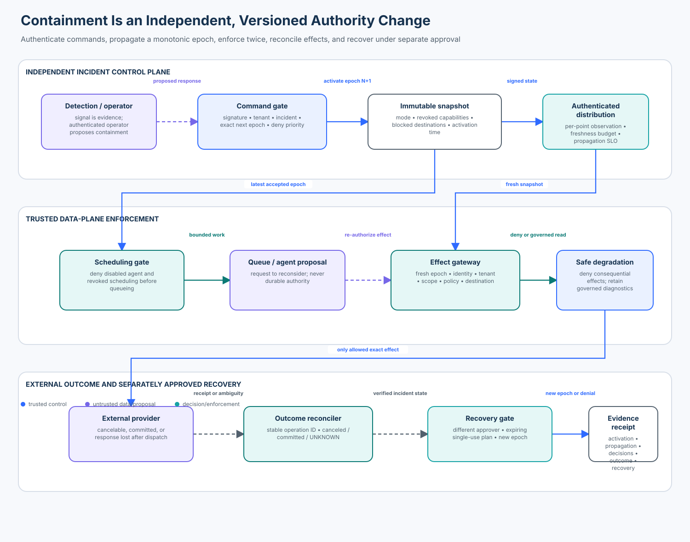

# 02 — Kill Switches, Revocation, and Safe Degradation

<!-- roadmap-status -->
> **Roadmap status: Published.** Includes a credential-free control-plane lab, real OpenFeature SDK adapter, deterministic notebook, architecture diagram, security tests, and evidence checkpoint.

## Course promise

An enterprise agent must remain stoppable when its model, prompt, memory, tool
output, or orchestration context is compromised. A prompt instruction to “stop”
is therefore not a kill switch. The trusted application needs an independently
operated, rapidly distributed, deny-first control plane whose decisions are
enforced when work is scheduled and again immediately before every external
effect.

In this course you will contain unexpected egress from a support agent, preserve
bounded diagnostic access, resolve an in-flight effect whose provider cannot
cancel it, and prove that recovery cannot silently undo containment.



## Learning objectives

By the end, you can:

1. distinguish model cooperation, orchestration cancellation, authorization
   revocation, credential revocation, and network containment;
2. define authenticated, tenant-bound control commands with monotonic epochs;
3. enforce revocation at scheduling and effect boundaries without trusting an
   agent's report that it stopped;
4. fail safely when a control snapshot is missing, stale, replayed, or arrives
   out of order;
5. preserve policy-governed read-only diagnostics without creating an incident
   bypass;
6. classify in-flight work as canceled, committed, or unknown and reconcile it
   before retry;
7. require a separate, expiring, single-use recovery approval; and
8. measure stop latency, propagation SLO compliance, unsafe effects, and useful
   diagnostic retention with exact denominators.

## Prerequisites and timebox

You should understand authentication, authorization, idempotency, distributed
systems, and the difference between a policy decision and an external effect.
Complete Enterprise 01 first if durable checkpoints and ambiguous provider
outcomes are new to you.

| Activity | Suggested time |
| --- | ---: |
| Threat model and control semantics | 45 minutes |
| Core lab and attacks | 75 minutes |
| OpenFeature adapter | 30 minutes |
| Production design and checkpoint | 45 minutes |

## 1. The security boundary

The model may propose a tool call, an orchestrator may queue it, and a feature
provider may distribute an operational flag. None of those components grants
business authority. The trusted application must authenticate the actor, bind
the tenant and agent, validate the control epoch, evaluate current policy,
execute a bounded action, and verify the result.

```text
model proposes
    ↓ untrusted claim
application validates identity + command + current control epoch
    ↓ bounded decision
scheduler/effect gateway enforces
    ↓ external outcome
application records receipt + reconciles authoritative state
```

The lab places the control plane outside the agent runtime. A signed command
updates an immutable snapshot. Each enforcement point accepts only the same or
a newer snapshot for one tenant and agent. Consequential work fails closed when
the snapshot is absent or stale.

### Five mechanisms that are often confused

| Mechanism | What it actually stops | Important limitation |
| --- | --- | --- |
| prompt instruction | cooperative model generation | attacker-controlled context can override or hide it |
| task cancellation | one orchestration execution | queued, retried, detached, or dispatched effects may survive |
| policy/capability revoke | future application authorization | only works where every effect checks current authority |
| credential revoke | future use of one identity/token | caches, long-lived sessions, and other credentials need separate controls |
| egress/network block | traffic to a destination or class | does not prove application state or undo prior commits |

Use defense in depth. A production incident commonly activates several of these
at once, but their receipts and failure modes remain distinct.

## 2. Threat model

### Protected assets

- customer and tenant data;
- tool, retrieval, MCP, credential, and network capabilities;
- control commands, snapshots, signing keys, and recovery plans;
- incident evidence and operator attribution; and
- external systems that may receive effects after local cancellation.

### Adversaries and failures

Assume a malicious document or compromised model can request any tool, claim
that containment succeeded, replay an old “active” state, invent a tenant, and
keep a worker busy. Also assume delayed messages, duplicate delivery, partial
partitions, clock disagreement, provider timeouts after commit, operator
mistakes, and a failed control-plane dependency.

### Security invariants

1. Agent text and model output never activate, weaken, or recover controls.
2. A command is accepted only from an authenticated incident operator for the
   bound tenant and agent and with a valid integrity proof.
3. The next accepted epoch is exactly the current epoch plus one; replay,
   skipping, conflict, and rollback are denied.
4. Restrictive changes accumulate. Recovery requires a different, approved,
   expiring, single-use plan bound to one incident and epoch transition.
5. Scheduling authorization cannot substitute for effect-time authorization.
6. Missing or stale control state denies consequential effects.
7. Read-only diagnostics still require authenticated identity, tenant match,
   scope, current policy, destination policy, and audit.
8. A kill switch does not roll back an already committed effect.
9. An unconfirmed provider outcome remains `UNKNOWN` until authoritative
   reconciliation; it is never relabeled safe for reporting convenience.
10. Every activation, denial, propagation observation, and recovery produces
    privacy-minimized evidence.

## 3. Control command and snapshot design

| Field | Security purpose |
| --- | --- |
| `command_id` | stable idempotency key for redelivery |
| `incident_id` | binds change to an accountable response case |
| `tenant`, `agent_id` | prevents cross-tenant or broad accidental activation |
| `epoch` | orders changes and rejects rollback or skipped state |
| `issued_at` | supports freshness and investigation |
| `reason_code` | makes activation explainable and auditable |
| `mode`, `revoke`, `block_destinations` | explicit effect of containment |
| `restore`, `recovery_plan_id` | explicit weakening path, never implicit reset |
| `key_id`, `signature` | distribution authenticity and integrity analogue |

The course uses HMAC only to teach the authenticated-envelope boundary. In
production use a protected signing service or mutually authenticated control
channel, rotate keys, constrain operators through identity-aware policy, and
record tamper-evident receipts. Do not ship the course secret or derive control
authority from a feature-flag targeting context.

### Monotonicity and deny priority

A new restrictive command unions revoked capabilities and blocked destinations
with current state. It can move the mode from `active` to `read-only`,
`quarantined`, or `stopped`, but cannot move backwards. This is a small
deny-first lattice: stronger containment wins during races.

Recovery is a new epoch, not deletion of incident history. An independent
recovery approver creates a plan bound to `(incident, tenant, agent,
from_epoch, to_epoch, expiry)`. The incident commander then activates a signed
recovery command consuming that plan once. Production designs should also
require verified remediation and health checks before activation.

## 4. Granularity and safe degradation

One global boolean is easy to operate but creates an unnecessarily large blast
radius. Use the smallest reliable scope that responders can reason about.

| Control | Stops | Preserve when safe | Evidence to test |
| --- | --- | --- | --- |
| agent disable | new scheduling | incident trace and status | no new run leases |
| write revoke | state-changing effects | authorized reads | effect gateway denial |
| tool revoke | one tool family | unrelated bounded tools | exact tool capability denied |
| credential revoke | identity use/refresh | attribution metadata | refresh and downstream use fail |
| retrieval revoke | new context access | already admitted, policy-valid evidence | retrieval gate denial |
| MCP server revoke | one protocol peer | other approved servers | host blocks server/tool call |
| egress block | destination or class | local diagnosis | independent network denial |
| read-only mode | consequential actions | governed diagnostic reads | writes denied; valid reads retained |

“Read-only” is not “authorization-free.” A diagnostic endpoint can leak secrets,
cross tenants, trigger lazy writes, or become an SSRF channel. Keep normal
identity, resource, policy, data-minimization, destination, rate-limit, and audit
checks. Prefer dedicated diagnostic projections over broad production read
credentials.

## 5. Distributed propagation

An activation is authoritative at control-plane time `T0`. Scheduler, gateway,
worker, credential broker, retrieval service, MCP host, and egress layer observe
it later. For each enforcement point record:

```text
propagation latency = observation time - authoritative activation time
SLO rate = points observing required epoch by deadline / expected points
```

Do not start the clock when the agent notices the change; that hides delivery
delay. Do not average away a critical laggard. Report maximum and per-point
latency alongside the ratio.

An enforcement point tracks the last accepted epoch and observation time. It
rejects older snapshots and conflicting content at the same epoch. Once its
freshness budget expires, it denies consequential work. A narrow diagnostic
read may continue only when identity and current application policy remain
available and the last snapshot permits it.

Production distribution choices include push streams, watches, polling,
sidecars, local caches, and short-lived authorization leases. Whatever the
transport, test partitions, subscriber restarts, backlog, duplicate delivery,
out-of-order updates, corrupt payloads, and cold starts.

## 6. Scheduling is not the effect boundary

The scheduler checks current control state before allocating work. That reduces
load and exposure but leaves a race:

```text
T0 scheduler authorizes write
T1 operator activates revocation
T2 worker calls external provider
```

The worker or effect gateway must check again at T2. Bind the decision to the
authenticated principal, tenant, agent, exact capability, destination,
operation, policy version, control epoch, and short validity period. A queued
task is a request to reconsider; it is not durable authority.

## 7. In-flight effects and honest outcomes

Containment partitions effects into three meaningful outcomes:

- **canceled** — the provider confirms cancellation or no dispatch occurred;
- **committed** — authoritative provider evidence confirms the effect happened;
- **unknown** — neither safety nor harm is yet proven.

If a provider supports cancellation, request it and verify its receipt. If it
does not, mark the operation unknown and reconcile by stable logical operation
ID. Never issue a fresh ID merely to escape ambiguity: that can duplicate the
effect. Already committed work may need a compensating transaction, which is a
new authorized effect, not rollback by the kill switch.

## 8. Tool and SDK landscape (reviewed 2026-10-31)

No single SDK supplies the whole security invariant. Compose operational
distribution, policy, identity, network, orchestration, and verification at the
trusted application boundary.

| Tool/category | Useful capability | What you must still own |
| --- | --- | --- |
| [OpenFeature](https://openfeature.dev/docs/reference/intro/) | vendor-neutral typed flag evaluation, provider lifecycle, context, hooks | command authenticity, monotonic epochs, tenant authorization, SLOs, effect reconciliation |
| [OpenFeature Python SDK](https://openfeature.dev/docs/reference/technologies/server/python/) | real adapter used in this lab; in-memory provider supports credential-free exercises | security meaning of a flag and fail-safe application defaults |
| [Open Policy Agent](https://www.openpolicyagent.org/docs/latest/) | externalized policy decisions with policy/data separation | identity proof, reliable revoke distribution, effect execution and receipts |
| [Cedar](https://docs.cedarpolicy.com/) / [AWS Verified Permissions](https://docs.aws.amazon.com/verifiedpermissions/latest/userguide/what-is-avp.html) | explicit authorization policy and managed policy store | incident command plane, network/credential revocation, outcome verification |
| cloud IAM/STS | disable principals, revoke sessions where supported, issue short-lived credentials | application capability state and cached/other credentials |
| service mesh, gateway, firewall, eBPF | independent traffic and destination enforcement | business authorization and provider commit truth |
| Kubernetes/workload scheduler | stop or scale workloads, constrain service accounts/network | already dispatched effects and application-level read-only behavior |
| workflow engines | cancel durable workflows and track state | present business authority; provider cancellation and reconciliation |

The lab uses OpenFeature 0.10.x. `set_provider_and_wait` avoids evaluating while
the provider is still initializing. The application supplies `False` as the
default for security-sensitive flags. Even so, a flag result is an operational
input, not a signed incident command or proof of authorization.

## 9. Practical lab

### Setup

From the repository root:

```bash
uv sync --python 3.11 --extra contributor
python curriculum/roadmap/enterprise/02-kill-switches-revocation-and-safe-degradation/lab.py
pytest -q tests/test_enterprise_kill_switches.py
```

No cloud credentials or external services are required. The provider, clock,
operators, and identities are deterministic teaching fixtures.

### File map

| File | Purpose |
| --- | --- |
| `kill_switches.py` | command plane, epochs, enforcement, effects, recovery, metrics |
| `openfeature_adapter.py` | real OpenFeature Python SDK integration and boundary proof |
| `lab.py` | end-to-end credential-free execution |
| `kill_switches.ipynb` | guided investigation and exercises |
| `architecture-spec.json` | validated structured layout source |
| `architecture.svg` | deterministic rendered diagram |
| `tests/test_enterprise_kill_switches.py` | attacks, boundary cases, failures, and positive controls |

### Lab sequence

1. Build an active control plane, operator, principal, and effect gateway.
2. Sign and activate epoch 1: read-only mode, capability revocations, and a
   blocked destination.
3. Deliver the snapshot and prove writes are denied while an authorized
   diagnostic read survives.
4. Replay, skip, tamper with, and reorder commands/snapshots; inspect denials.
5. Let one worker's snapshot become stale and confirm consequential work fails.
6. Contain a provider call that cannot be canceled; retain `UNKNOWN`, then
   reconcile authoritative provider state.
7. Attempt recovery without a plan; then use a separate, expiring, single-use
   plan for a new epoch.
8. Run the real OpenFeature adapter and identify which guarantees remain in the
   application.

## 10. Evaluation design

| Population | Examples | Intended result |
| --- | --- | --- |
| valid | authorized diagnostic read during read-only containment | allow and audit |
| attack | revoked write/tool/credential/egress, blocked destination, forged command | deny |
| boundary | exact freshness deadline, same epoch redelivery, committed effect | defined deterministic result |
| failure | missing/stale snapshot, provider unable to cancel, policy unavailable | deny or explicit unknown |

The course report computes:

```text
valid diagnostic retention rate
  = allowed valid diagnostics / valid diagnostic attempts

unsafe effect rate
  = allowed forbidden effects after activation / forbidden effect attempts after activation

stale-snapshot safe-denial rate
  = denied consequential effects under stale control / consequential attempts under stale control

recovery bypass rate
  = successful unapproved recoveries / unapproved recovery attempts

propagation SLO rate
  = points observing required epoch by deadline / expected enforcement points
```

Do not combine these into one score. Utility cannot cancel verified harm, and an
unknown outcome is neither safe nor successful.

## 11. Production upgrade map

| Course component | Production replacement |
| --- | --- |
| HMAC signer and in-memory operator | protected KMS/HSM signing or mTLS channel; workload and human identity |
| integer logical time | synchronized monotonic/UTC timestamps with skew handling |
| in-memory snapshot | durable, highly available control store plus authenticated streaming/cache |
| local enforcement object | shared gateway/sidecar/library with versioned policy and conformance tests |
| static scopes | current identity and resource authorization service |
| synthetic provider | provider-specific idempotency, cancel, status, and receipt APIs |
| in-memory receipts | append-only incident/audit store with retention and access policy |
| recovery plan object | ticket/change workflow with separation of duties and expiry |

Operational readiness also requires:

- named owners and on-call escalation for every control;
- propagation and enforcement telemetry that does not rely on the agent;
- regular game days measuring real stop latency;
- short-lived credentials and independent egress containment;
- capacity planning for a control-plane outage;
- tested key rotation and compromised-operator response;
- rollback of software without rollback of containment epoch; and
- documented compensating actions for committed provider effects.

## 12. Checkpoint

### Knowledge check

1. Why is a model refusal not evidence that an external effect stopped?
2. What happens when a worker has not refreshed within the freshness budget?
3. Why is a same-epoch snapshot with different content rejected?
4. Which checks remain mandatory for a read-only diagnostic request?
5. How do cancellation and reconciliation differ?
6. Why must recovery use a new epoch and a separately approved plan?

### Applied checkpoint

Extend the lab with a retrieval-only degradation mode. Submit:

- a signed command revoking MCP and external egress while preserving one
  tenant-scoped retrieval index;
- tests for cross-tenant diagnostics, stale state, command replay, a
  non-cancelable retrieval request, and an expired recovery plan;
- a propagation report for scheduler, retrieval gateway, MCP host, and egress;
- a short design naming identity, command authenticity, current policy,
  provider outcome, and audit sources.

Pass when every security invariant has an observable test, all four populations
are present, no unknown is counted safe, and the valid diagnostic case remains
useful.

## References

- [NIST SP 800-61 Rev. 3 — Incident Response Recommendations and Considerations](https://csrc.nist.gov/pubs/sp/800/61/r3/final)
- [NIST SP 800-207 — Zero Trust Architecture](https://csrc.nist.gov/pubs/sp/800/207/final)
- [OpenFeature specification](https://openfeature.dev/specification/)
- [OpenFeature Python SDK reference](https://openfeature.dev/docs/reference/technologies/server/python/)
- [Open Policy Agent documentation](https://www.openpolicyagent.org/docs/latest/)
- [Cedar policy language documentation](https://docs.cedarpolicy.com/)
- [AWS Verified Permissions documentation](https://docs.aws.amazon.com/verifiedpermissions/latest/userguide/what-is-avp.html)
- [OWASP Agentic Security Initiative](https://genai.owasp.org/initiatives/agentic-security-initiative/)

## Exit criteria

You are ready to continue when you can explain why the model, orchestration
engine, feature provider, and policy engine are inputs rather than the entire
authority boundary; demonstrate deny-first propagation under faults; retain
honest unknown outcomes; and recover only through a new, separately approved
control epoch.
