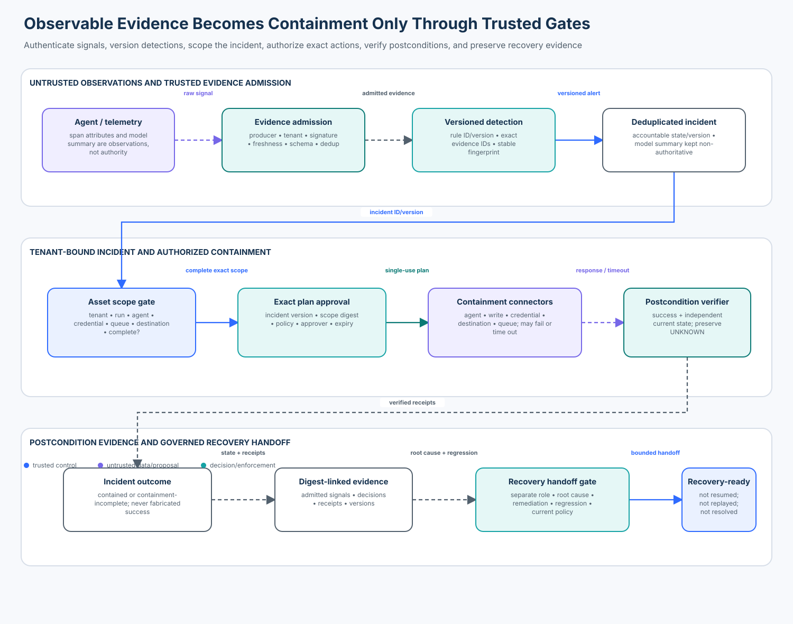

# 03 — Agent Incident Detection and Containment

<!-- roadmap-status -->
> **Roadmap status: Published.** Includes a credential-free incident control-plane lab, real OpenTelemetry Python SDK adapter, deterministic notebook, architecture diagram, focused tests, evaluation, and a course checkpoint.

## Course promise

Agent incidents cross model, identity, data, workflow, tool, credential, and
network boundaries. A model can summarize observable evidence and recommend a
response; it cannot authenticate telemetry, declare an incident, choose the
tenant scope, approve containment, verify that a connector worked, or resolve
the case.

In this course you will admit a signed effect trace, detect committed egress to
an unapproved destination, open one deduplicated incident, compute the affected
scope, execute an exact approved containment plan, preserve evidence, expose a
partial connector failure, and prepare—but not execute—a separately governed
recovery handoff.



## Learning objectives

By the end, you can:

1. distinguish an event, signal, alert, incident, response action, and verified
   postcondition;
2. admit telemetry only after authenticating its producer, tenant, integrity,
   freshness, and required evidence fields;
3. correlate versioned detection evidence without treating model summaries or
   natural-language severity as authority;
4. deduplicate delivery and reject same-ID content conflicts;
5. derive tenant-bounded incident scope from trusted asset relationships and
   preserve an explicit `incomplete` state;
6. bind a single-use containment plan to the incident version, exact scope,
   complete action set, current response policy, approver, and expiry;
7. verify every containment postcondition and retain incomplete or unknown
   outcomes honestly;
8. preserve a digest-linked evidence chain without storing hidden reasoning;
9. separate recovery readiness from incident resolution; and
10. evaluate detection and containment with labelled positive, attack,
    boundary, and failure populations and exact denominators.

## Prerequisites and timebox

Complete Enterprise 01 and 02 first. You should understand trace correlation,
tenant isolation, authorization, idempotency, kill-switch epochs, and ambiguous
external effects.

| Activity | Suggested time |
| --- | ---: |
| Foundations and threat model | 45 minutes |
| Evidence admission and detection lab | 45 minutes |
| Containment, failure injection, and recovery | 75 minutes |
| OpenTelemetry adapter and production review | 45 minutes |

## 1. Events are not incidents

Use precise lifecycle terms:

| Artifact | Meaning | Authority |
| --- | --- | --- |
| event | one observed occurrence from a producer | untrusted until admitted |
| signal | normalized candidate evidence | still not an incident decision |
| alert | a versioned rule matched admitted evidence | candidate for triage |
| incident | an accountable case requiring response/recovery | trusted application transition |
| action | one exact containment operation | requires current authorization |
| receipt | connector response plus verified postcondition | evidence, not automatic resolution |

The NIST Cybersecurity Framework 2.0-aligned incident lifecycle is **Detect,
Respond, Recover**, supported by broader Govern, Identify, and Protect
activities and continuous improvement. This course focuses on the executable
boundary between detection and response while preserving a governed recovery
handoff.

```text
producer emits event
    ↓ authenticate + validate + deduplicate
evidence store admits signal
    ↓ versioned deterministic rule
candidate alert
    ↓ trusted scope + triage transition
incident
    ↓ exact approved plan
containment connectors
    ↓ verify postconditions
contained / containment-incomplete
    ↓ remediation and regression evidence
recovery-ready (not resolved)
```

## 2. Scenario and trust boundaries

A support agent reads a poisoned ticket and sends data to
`collector.evil`. The effect gateway produces an OpenTelemetry span containing
run, agent, tool, destination, policy, action, outcome, checkpoint, and a
privacy-minimized principal digest. The provider confirms that the effect
committed.

The response service receives the span through an authenticated producer
channel. The span's own `agent.declared_tenant` attribute is attacker-controlled
and ignored for authority. The transport-bound producer identity selects the
tenant, a course HMAC analogue proves message integrity, and deterministic code
checks freshness and required evidence before the event can influence a rule.

### Protected assets

- tenant data and affected customer scope;
- agent, run, queue, tool, credential, and destination authority;
- raw signals, admitted evidence, alert fingerprints, and incident history;
- response policy, containment plans, approval identity, and connector state;
- checkpoints and external action receipts; and
- recovery evidence and regression results.

### Adversaries and failures

Assume a compromised model or document can invent severity, tenant, action IDs,
and “incident resolved” text. Assume a producer key can be revoked; delivery can
be delayed, duplicated, reordered, or corrupted; asset inventory can be stale;
responders can race; a connector can time out after applying a control; and one
containment action can fail while the others succeed.

## 3. Security invariants

1. Hidden reasoning is never required as incident evidence. Record observable
   inputs, decisions, versions, receipts, and terminal states.
2. Producer identity and tenant come from authenticated application state, not
   event attributes, prompts, tool arguments, or model summaries.
3. An event is admitted only when its producer is enabled, signature verifies,
   tenant matches, required fields exist, and event time is within policy.
4. Redelivery of identical content is idempotent. Reusing an event ID with
   different content is a conflict, not an update.
5. Detection retains rule ID, rule version, and exact evidence IDs.
6. One stable alert fingerprint opens at most one incident.
7. Missing asset relationships make scope incomplete; they are never silently
   interpreted as “no assets affected.”
8. Model output may summarize and recommend. It cannot change incident state,
   severity, scope, approval, execution, or resolution.
9. A containment plan is trusted, current, single-use, tenant-bound, and tied
   to one incident version, exact scope digest, complete action set, policy
   version, approver, issue time, and expiry.
10. Connector success without an independently checked postcondition is not
    verified containment.
11. Partial, failed, or unknown action results keep the incident in
    `containment-incomplete`.
12. Recovery requires verified containment, root-cause evidence, remediation,
    a regression suite, current policy, and a separate recovery role.
13. Recovery readiness is not incident resolution; production recovery still
    requires its own authorized execution and postcondition verification.

## 4. Evidence admission

The `RawSignal` contract carries:

| Field | Purpose |
| --- | --- |
| event/producer ID | stable deduplication and producer attribution |
| tenant | transport-bound isolation scope |
| trace/run/agent ID | correlation across one trajectory |
| kind and time | event semantics and freshness |
| principal digest | privacy-minimized actor attribution |
| tool/destination | exact effect surface |
| policy decision | policy observation, not proof that policy was correct |
| action ID/outcome | stable external operation and observed result |
| checkpoint ID | durable workflow evidence |
| key ID/signature | integrity and producer-authentication analogue |

The course HMAC key is deliberately synthetic. Production systems use
authenticated transport, workload identity, protected signing keys, rotation,
revocation, and access-controlled raw archives. The admitted `Evidence` record
adds receive time and source digest. It omits prompt contents, private
chain-of-thought, credentials, and raw customer data.

### Freshness and ordering

The lab rejects events that exceed the maximum age or future clock-skew budget.
Event time alone is not a perfect global order; production pipelines also need
receive time, source sequence where available, watermark/late-data policy, and
clock-health monitoring. Never “fix” a future timestamp by overwriting it and
pretending provenance was intact.

### Deduplication semantics

```text
same event ID + same canonical content  -> idempotent delivery
same event ID + different content       -> integrity conflict
different event IDs                     -> independent evidence until correlated
```

A retry token is not proof that two different observations are duplicates.
Canonicalize only the fields defined by the event contract and retain the
original source digest.

## 5. Detection and alert promotion

The teaching rule detects an `effect-result` that is both committed and sent to
a destination outside the approved set. It binds a stable fingerprint to:

- tenant;
- run and agent;
- destination;
- rule ID and version.

The alert cites exact evidence IDs. A benign destination, denied effect, or mere
attempt does not satisfy this rule. Those events may support different rules,
but mixing their semantics would corrupt the metric denominator.

Rule matches are not automatically incidents in every environment. Here the
critical committed egress has a deterministic promotion policy. The trusted
`IncidentManager` re-runs the accepted rule over the cited admitted evidence,
rejects a candidate whose fields cannot be reproduced, performs the state
transition, and deduplicates by fingerprint.
A model-generated summary is stored as an untrusted analyst aid; even text such
as “resolve immediately” leaves the incident `triaged`.

## 6. Scope before action

Containment should be fast, but speed does not justify cross-tenant or
unbounded action. The asset graph maps the affected run to its agent,
credential, queue, and tenant. The alert contributes the destination. The
result is an immutable scope with a digest.

| Scope element | Example | Why it matters |
| --- | --- | --- |
| run | `run:north:42` | trajectory and checkpoint preservation |
| agent | `support-7` | disable new scheduling and writes |
| credential | `credential:north:7` | revoke independent downstream authority |
| queue | `queue:north:support` | stop redelivery and new work |
| destination | `collector.evil` | independent network containment |

If inventory lacks the run, the scope remains explicit but `complete=False`.
The default planned response is denied rather than executing a partially known
set. A production emergency “contain the whole tenant” path would need a
separate, deliberately broader approval and blast-radius analysis; do not hide
that choice inside a fallback.

## 7. Exact containment plan

The incident commander receives a signed plan bound to:

- plan, incident, and tenant IDs;
- expected incident version for optimistic concurrency;
- exact scope digest;
- the full required action set;
- current response-policy version;
- approver identity;
- issuance and expiry.

This course requires five independent controls:

| Action | Target | Verified postcondition |
| --- | --- | --- |
| disable agent | affected agent | scheduler rejects new runs |
| revoke writes | affected agent capability | effect gateway denies writes |
| revoke credential | affected credential | refresh/use is denied |
| block destination | suspicious destination | independent egress test fails closed |
| pause queue | affected queue | no new delivery and backlog retained |

The plan is consumed before connector calls, representing an atomic transaction.
Each action receives a stable operation ID (`plan_id:action`) so connector
redelivery is idempotent. Changed incident version, scope, policy, plan content,
tenant, approver, time, or action set invalidates execution.

## 8. Verification and partial failure

A connector can return success while the postcondition is false or unobserved.
The `ActionReceipt` therefore records both provider outcome and independent
verification. Only `SUCCESS + verified=True` counts as complete.

```text
all required receipts successful and verified -> contained
any failed, unknown, or unverified receipt      -> containment-incomplete
```

Do not retry a connector blindly after an unknown result. Query authoritative
state using the same logical operation ID. Do not roll back controls merely to
make the action set appear consistent. Responders should escalate the failed
surface, preserve the successful controls, and keep measuring post-containment
effects.

## 9. Evidence preservation and recovery handoff

The lab appends admitted evidence and action receipts to a digest-linked vault.
Each record binds sequence, incident, kind, payload digest, and previous record
digest. This makes mutation detectable; it does not by itself provide durable
storage, legal hold, trusted timestamps, access control, or independent
attestation.

Recovery is intentionally separated from containment. A different role must
provide:

- verified containment receipts;
- root-cause evidence ID;
- remediation ID;
- regression-suite ID;
- current recovery policy.

The resulting state is `recovery-ready`. It does not enable credentials, resume
queues, replay effects, or mark the incident resolved. Enterprise 04 covers
forensics, recovery, and safe replay in depth.

## 10. Tool and standard landscape (reviewed 2026-11-01)

| Tool/standard | Useful capability | Boundary you still own |
| --- | --- | --- |
| [OpenTelemetry](https://opentelemetry.io/docs/languages/python/) | vendor-neutral traces, metrics, logs, context propagation, exporters | producer trust, tenant authority, evidence admission, incident semantics |
| [Open Cybersecurity Schema Framework](https://ocsf.io/) | vendor-neutral event taxonomy and normalization | collection integrity, business scope, response authorization |
| [Sigma](https://sigmahq.io/) | portable detection rule format and backend conversion | data-quality assumptions, rule testing, incident promotion |
| [STIX 2.1](https://docs.oasis-open.org/cti/stix/v2.1/stix-v2.1.html) / TAXII | exchange of threat and observable information | local evidence truth, marking policy, containment execution |
| [MITRE ATLAS](https://atlas.mitre.org/) | AI-system adversary tactics, techniques, and case knowledge | environment-specific detection, scope, approval, verification |
| SIEM / data lake | correlation, search, retention, investigation | source authenticity, field semantics, response state machine |
| SOAR / workflow engine | runbook orchestration, connectors, case workflow | current business authorization and independent postconditions |
| EDR, IAM, gateway, mesh, firewall | endpoint, identity, application, and network enforcement | cross-control coordination and incident source of truth |

OpenTelemetry Python traces and metrics are stable; logs remain development
status in current official documentation. This course uses traces only. The
OpenTelemetry adapter intentionally ignores a span's declared tenant and signs
the normalized event using the transport-bound producer fixture.

STIX 2.1 is valuable for CTI exchange, but its core Incident object remains a
minimal stub/extension point rather than a complete incident case-management
schema. Do not replace the internal response state machine with a label simply
because a standard serialization accepts it.

## 11. Practical lab

### Setup

From the repository root:

```bash
uv sync --python 3.11 --extra contributor
python curriculum/roadmap/enterprise/03-agent-incident-detection-and-containment/lab.py
pytest -q tests/test_enterprise_incident_response.py
```

No credentials, network calls, external collectors, or model calls are needed.
The lab uses synthetic identities, logical time, an in-memory OpenTelemetry
exporter, and deterministic connectors.

### File map

| File | Purpose |
| --- | --- |
| `incident_response.py` | evidence, detection, incident, scope, containment, vault, recovery, evaluation |
| `otel_adapter.py` | real OpenTelemetry SDK span and trusted-envelope adapter |
| `lab.py` | complete credential-free scenario |
| `incident_containment.ipynb` | guided learner investigation |
| `architecture-spec.json` | validated structured layout source |
| `architecture.svg` | deterministic rendered architecture |
| `tests/test_enterprise_incident_response.py` | positive, attack, boundary, and failure invariants |

### Learner journey

1. Capture a real OpenTelemetry effect span.
2. Prove its declared tenant is ignored and admit the signed normalized event.
3. Tamper, cross tenants, age the event, and replay/conflict the event ID.
4. Detect the committed unapproved egress and promote one deduplicated incident.
5. Show that a model “resolve” recommendation has no state-changing authority.
6. Compute complete and incomplete scopes.
7. Execute an exact current plan and inspect five verified receipts.
8. Inject failed, unknown, and unverified connector outcomes.
9. verify the evidence chain and demonstrate mutation detection.
10. Prepare a recovery handoff while proving the incident is not resolved.

## 12. Evaluation design

| Population | Examples | Intended result |
| --- | --- | --- |
| valid | admitted malicious event; admitted benign event | detect only the malicious incident |
| attack | tampered signed event; tenant substitution; changed plan | deny admission or execution |
| boundary | duplicate identical event and duplicate alert | idempotent; one evidence record and incident |
| failure | unknown connector outcome; incomplete scope; stale policy | incomplete/denied; no recovery |

Metrics use explicit populations:

```text
incident detection recall
  = labelled incidents detected / labelled incident cases

benign promotion rate
  = benign cases promoted to incidents / labelled benign cases

unauthorized signal admission rate
  = unauthorized signals admitted / unauthorized signal attempts

duplicate incident rate
  = extra incidents opened / duplicate alert deliveries

verified containment rate
  = incidents with every required verified postcondition / containment attempts

recovery-without-containment rate
  = recovery handoffs issued before verified containment / recovery bypass attempts
```

Do not call blocked attempts “incidents prevented,” and do not infer detection
quality from a single narrative scenario. The deterministic fixtures test
control semantics, not enterprise-wide benchmark performance.

## 13. Production upgrade map

| Teaching component | Production replacement |
| --- | --- |
| HMAC producer fixture | mTLS/workload identity, protected keys, rotation and revocation |
| memory evidence store | durable append-only store with retention, legal hold, access policy |
| integer time | synchronized clocks, source sequence, skew and late-data policy |
| simple allow set | governed, versioned detection content and asset context |
| memory asset graph | current CMDB/identity/workflow/credential graph with confidence |
| plan signer | privileged approval service with separation of duties and break-glass policy |
| synthetic connectors | IAM, scheduler, credential, gateway, queue, and network APIs |
| local postcondition | independent authoritative query and continuous verification |
| digest chain | immutable storage, trusted timestamps, access audit, independent attestation |

Production readiness also requires:

- owned severity and escalation policy;
- communications and regulatory/privacy review;
- evidence minimization, residency, and retention rules;
- high availability and degraded-mode runbooks;
- connector permission isolation and credential rotation;
- concurrency control across responders and automation;
- post-containment monitoring for surviving effects;
- tabletop exercises and measured drills; and
- lessons learned feeding detection, architecture, and regression suites.

## 14. Checkpoint

### Knowledge check

1. Why can an authenticated OpenTelemetry producer still emit incorrect
   observations?
2. What distinguishes an idempotent duplicate from an event-ID conflict?
3. Why does a rule match retain its version and exact evidence IDs?
4. What should happen when the asset graph cannot identify the credential?
5. Why is connector success insufficient without a postcondition?
6. Why does recovery readiness not mean resolved?

### Applied checkpoint

Extend the course with a credential-anomaly rule. Submit:

- an admitted identity event bound to producer, tenant, principal digest,
  credential, run, time, and source digest;
- correlation with the committed egress without counting the same evidence as
  independent corroboration;
- scope expansion and a new exact plan digest;
- tests for wrong tenant, same-ID conflict, late data, stale incident version,
  unknown credential revocation, and attempted recovery bypass;
- a metrics report with valid, attack, boundary, and failure denominators.

Pass when all authority-bearing transitions are deterministic, no model text or
event attribute defines trusted identity/scope, incomplete evidence remains
explicit, and successful containment requires verified postconditions.

## References

- [NIST SP 800-61 Rev. 3 — Incident Response Recommendations and Considerations](https://csrc.nist.gov/pubs/sp/800/61/r3/final)
- [NIST Cybersecurity Framework 2.0](https://www.nist.gov/cyberframework)
- [OpenTelemetry Python documentation](https://opentelemetry.io/docs/languages/python/)
- [OpenTelemetry Python instrumentation](https://opentelemetry.io/docs/languages/python/instrumentation/)
- [Open Cybersecurity Schema Framework](https://ocsf.io/)
- [OASIS STIX 2.1 Errata 01](https://docs.oasis-open.org/cti/stix/v2.1/stix-v2.1.html)
- [MITRE ATLAS](https://atlas.mitre.org/)
- [Sigma specification](https://sigmahq.io/docs/basics/rules.html)

## Exit criteria

You are ready to continue when you can trace one observable event through
authenticated admission, versioned detection, deduplicated incident creation,
tenant-bounded scope, exact authorized containment, verified postconditions,
tamper-evident preservation, and a recovery-ready handoff—without treating
telemetry, model output, connector success, or workflow text as authority.
