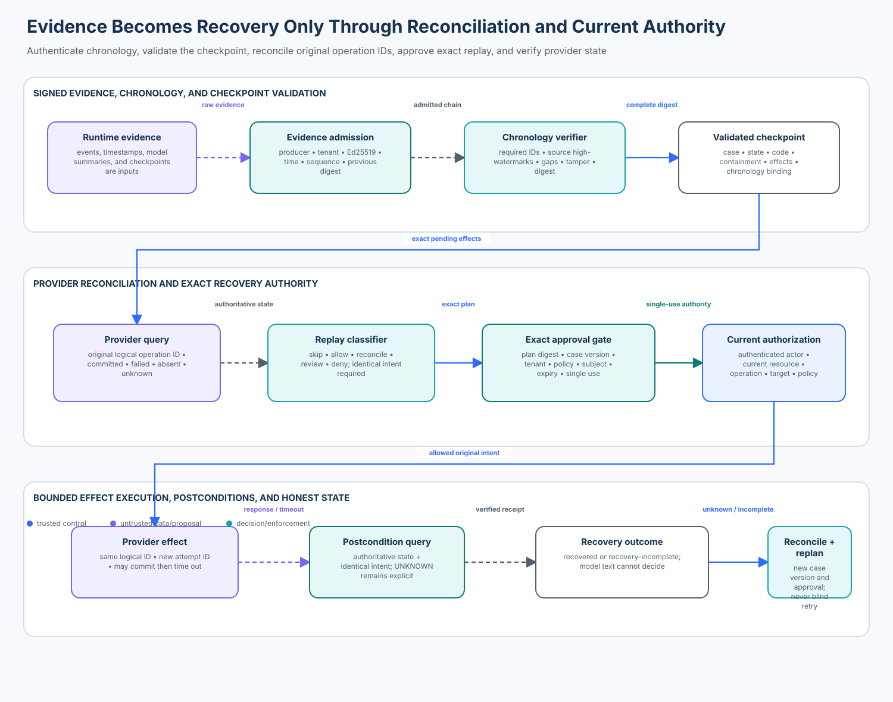

# 04 — Agent Forensics, Recovery, and Safe Replay

<!-- roadmap-status -->
> **Roadmap status: Published.** Includes a credential-free forensics and recovery control-plane lab, a real `cryptography` Ed25519 adapter, deterministic notebook, architecture diagram, 59 focused tests, evaluation, and a course checkpoint.

## Course promise

An agent crash does not tell you whether an external effect committed. A
checkpoint does not prove that its state is authentic, complete, safe, or
currently authorized. A retry with a new identifier can duplicate a payment,
message, access grant, or destructive change.

In this course you will reconstruct a signed per-source chronology, detect
missing or altered evidence, validate an exact recovery manifest, reconcile
ambiguous provider state, distinguish workflow-history replay from business
effect replay, reuse the original logical operation identity, apply current
authorization, consume a separate recovery approval, and verify recovery
postconditions. Prior model output can help an analyst explain evidence; it can
never authorize replay or declare recovery complete.



## Learning objectives

By the end, you can:

1. distinguish acquisition, preservation, chronology, interpretation,
   recovery planning, workflow replay, effect reconciliation, and effect
   replay;
2. admit evidence only after authenticating its producer, tenant, signature,
   freshness, required fields, sequence, and previous digest;
3. explain why source sequence and receive time provide evidence ordering while
   observed timestamps alone do not establish a global total order;
4. detect duplicate delivery, same-ID conflicts, gaps, regressions, broken
   chains, and post-admission storage tampering;
5. validate a signed checkpoint manifest against the exact chronology,
   containment evidence, code version, state digest, expected source
   high-watermarks, and pending effects;
6. classify each effect as already committed, replayable, unresolved,
   manually reviewed, or denied by reconciling authoritative provider state;
7. bind a single-use recovery approval to the exact case version, plan digest,
   tenant, policy, approver, issuance time, and expiry;
8. reauthorize every replayable effect under current policy and reuse its
   original logical operation ID with a new attempt ID;
9. retain timeout-after-dispatch as `unknown`, replan after reconciliation,
   and prove that no duplicate provider effect occurred; and
10. evaluate safety and utility across valid, attack, boundary, and failure
    populations with explicit numerators and denominators.

## Prerequisites and timebox

Complete Enterprise 01–03 first. You should understand checkpoints, durable
state, current authority, incident containment, tenant isolation, exact
approvals, idempotency, and unknown external outcomes.

| Activity | Suggested time |
| --- | ---: |
| Evidence and chronology foundations | 50 minutes |
| Checkpoint and replay planning lab | 55 minutes |
| Approval, execution, and failure injection | 70 minutes |
| Tools, evaluation, and production design | 45 minutes |

## 1. Recovery is a new decision, not a rewind button

Use precise terms:

| Term | Meaning | What it does not prove |
| --- | --- | --- |
| event | one producer observation | authenticity or completeness |
| admitted evidence | an event that passed producer, integrity, tenant, and time checks | that its interpretation is correct |
| chronology | a defensible ordering with known gaps and uncertainty | one perfect global clock |
| checkpoint | captured workflow state and references | present authority or safe side effects |
| workflow replay | rebuilding workflow state from durable history | permission to repeat an external effect |
| reconciliation | querying authoritative provider state for an old logical operation | that a new intent is equivalent |
| effect replay | a new attempt of the same authorized logical operation | permission to invent a new operation ID |
| recovery receipt | provider observation plus verified postcondition | automatic incident resolution |

Recovery crosses two independent questions:

1. **What happened?** Forensics admits and preserves evidence, then exposes
   gaps, conflicts, tampering, and uncertainty.
2. **What may happen now?** Recovery validates current state and policy,
   reconciles provider effects, approves an exact plan, executes bounded work,
   and verifies the result.

Do not let an attractive incident narrative answer either question. A model
may summarize admitted events, propose hypotheses, or draft a report. Trusted
application code owns evidence admission, state transitions, authorization,
execution, and terminal status.

## 2. Scenario and trust boundaries

A support agent persisted `checkpoint:north:42`, requested a case update, and
then received a network timeout. The incident team contained the run. The local
history says the case update is `unknown`; the provider ledger says it
committed. An audit notification was never dispatched.

The recovery service must:

- prove that runtime evidence belongs to tenant `north` and forms the expected
  source chain;
- bind the recovery manifest to that exact chronology and a reviewed code
  version;
- skip the already committed case update;
- permit the missing audit notification only under current authorization;
- reuse `effect:case:42:audit`, not mint a convenient replacement identity;
- record a new attempt ID without changing logical intent; and
- move to `recovered` only after authoritative postconditions verify.

### Assets and boundaries

- evidence producer identity, signing key, and revocation state;
- raw and admitted events, source sequences, timestamps, and payload digests;
- case, tenant, run, checkpoint, code, and policy versions;
- logical operation IDs, attempt IDs, provider observations, and resources;
- recovery plan, approval, responder identity, and current authorization; and
- immutable retention, analyst annotations, reports, and verified receipts.

### Adversaries and failures

Assume compromised model or tool output can claim a false tenant, success,
sequence, timestamp, checkpoint, or `RESOLVED` state. Events can be late,
duplicated, missing, reordered, or altered. Storage and signing keys can be
compromised. Code and policy can change after capture. Provider queries can be
unavailable or outside their idempotency retention window. A provider can
commit an effect and then time out. Responders can race, and a valid approval
can be replayed.

## 3. Governing invariants

1. Evidence producer, key, and tenant come from trusted configuration, not
   event attributes, prompts, or model summaries.
2. A valid signature proves possession of a configured key; it does not prove
   semantic truth, benign intent, completeness, or current authorization.
3. Identical redelivery is idempotent. The same event ID with different signed
   content is quarantined as a conflict.
4. Every controlled source starts at sequence 1 and binds each event to the
   previous canonical event digest. Gaps and regressions remain explicit.
5. Observed time, receive time, source sequence, and causal IDs are separate.
   No single device clock silently becomes a perfect global chronology.
6. The chronology is reverified before recovery. Admission-time success does
   not protect against later storage tampering.
7. The checkpoint manifest binds the case, tenant, run, state digest, code
   version, captured policy version, chronology digest, containment evidence,
   expected events, source high-watermarks, and exact pending effects.
8. A compromised, untrusted, incomplete, wrongly scoped, or unsupported
   checkpoint is not replayed.
9. Workflow-history replay reconstructs deterministic state. External I/O,
   model calls, clocks, randomness, and business effects stay outside that
   replay path.
10. Each business effect retains one caller-chosen logical operation ID across
    attempts. A new attempt ID is diagnostic metadata, not new intent.
11. `committed` is skipped only when the provider binds the same logical ID to
    the same intent digest. Same ID plus different intent is denied.
12. Missing or non-final provider state remains `reconcile-required`; unknown
    does not become safe merely because enough time passed.
13. Non-replayable operations require review. The model cannot relabel them.
14. A recovery approval is authenticated, exact, current, tenant-bound,
    case-version-bound, policy-bound, expiring, and single-use.
15. The incident commander and recovery approver are separate subjects, even
    if one person happens to hold both roles.
16. Current authorization is checked before approval consumption or provider
    dispatch.
17. A timeout after dispatch produces `unknown`, never fabricated failure or
    success. A new plan reconciles the original operation before any retry.
18. Recovery completes only when every required effect is authoritatively
    verified. Model text never sets the terminal state.

## 4. Evidence acquisition and preservation

The lab's `ForensicEvent` carries:

| Field | Purpose |
| --- | --- |
| event/case/tenant ID | stable identity and isolation |
| producer/key ID | trusted source and verification key lookup |
| source sequence | gap and regression detection for one controlled source |
| previous source digest | hash-link to the preceding canonical event |
| observed/received time | separate source observation from collector receipt |
| kind/run/checkpoint | lifecycle and trajectory correlation |
| logical operation/attempt ID | durable business intent versus one dispatch |
| payload digest | privacy-minimized binding to retained content |
| Ed25519 signature | authenticity and integrity check for canonical fields |

The course signs canonical records using the real `cryptography` Ed25519 API.
Its fixed 32-byte private seeds are public test fixtures. They are not secrets
and are not a production key-management pattern. Production replaces them with
workload identity, HSM/KMS-backed keys, rotation, revocation, trusted time,
access-controlled acquisition, immutable retention, and legal or regulatory
handling appropriate to the organization.

### Integrity is not immutability

A hash chain can reveal some alteration when trusted heads or signatures remain
available. It does not stop deletion, key theft, rollback of both data and head,
or an authorized insider from creating a new valid chain. Preserve signed
source manifests and high-watermarks outside the evidence store; use retention
locks, independent replication, access logs, and custody records where needed.

### Privacy and minimization

The lab keeps payload digests instead of prompts, customer text, credentials,
or hidden reasoning. A production investigation may require raw data, but
collection still needs purpose, scope, access control, retention, deletion,
legal review, and analyst accountability. “Forensics” is not permission to log
everything forever.

## 5. Build a defensible chronology

For each controlled source:

```text
sequence 1 + GENESIS
    ↓ canonical digest
sequence 2 + digest(sequence 1)
    ↓ canonical digest
sequence 3 + digest(sequence 2)
```

The store admits only the next expected sequence. A gap is quarantined rather
than sorted away. The analyzer later rebuilds the expected range from a signed
high-watermark, reverifies every signature, checks each link, reports missing
required event IDs, and binds the result into `chronology_digest`.

Multiple sources do not automatically share one total order. Prefer causal
links such as trace ID, run ID, checkpoint ID, logical operation ID, and
provider request ID. Display timestamps with source, clock quality, precision,
and uncertainty. When two events cannot be ordered defensibly, preserve a
partial order rather than inventing certainty.

The lab sorts its learner-facing view by observed time, receive time, producer,
source sequence, and event ID for deterministic display. That display order is
not a claim that wall clocks proved causality.

## 6. Validate the recovery manifest

`CheckpointManifest` is a signed recovery input, not a Python object that is
trusted because its fields type-check. The planner verifies:

- checkpoint signing authority, purpose, tenant, and enabled state;
- signature over every bound field;
- known-compromised checkpoint denial;
- exact case and tenant match with the chronology;
- complete chronology and identical chronology digest;
- admitted verified-containment evidence;
- an allowed code version;
- non-empty state digest and effect inventory; and
- an eligible case state: `contained`, `planned` when superseding a stale or
  expired plan, or `recovery-incomplete` after reconciliation.

The captured policy version remains evidence of what governed the old run. It
does not grant present authority. The generated recovery plan binds the current
policy version separately.

## 7. Classify before executing

For every pending `EffectIntent`, query the authoritative provider using the
original logical operation ID:

| Provider/history evidence | Decision | Reason |
| --- | --- | --- |
| committed + same intent digest | `skip-committed` | effect already happened |
| committed + different intent digest | `denied` | idempotency identity collision |
| final not-found or final failure + replayable intent | `replay-allowed` | bounded new attempt may proceed |
| provider unavailable or outcome non-final | `reconcile-required` | ambiguity remains |
| operation declared non-replayable | `review-required` | automation may not widen policy |
| history says committed but provider says not found | `denied` | material evidence conflict |

An idempotency token expresses caller intent. Deriving a token from parameters
can accidentally collapse two genuinely distinct operations; minting a new
token during recovery can duplicate one old operation. The caller chooses a
stable logical ID when it first creates the intent and retains it in history,
provider metadata, evidence, and recovery receipts.

## 8. Approve and execute the exact recovery

The recovery plan binds:

- case and tenant;
- checkpoint and chronology digests;
- expected case version;
- current policy version;
- every effect, classification, and reason;
- issuance and expiry.

The separate approval signs the exact plan digest and repeats the case version,
tenant, current policy, approver, and validity window. Application code then
checks authenticated responder identity, role, subject binding, separation from
the incident commander, tenant, signature, single use, optimistic version,
policy, and time.

Before consuming approval, the effect boundary reauthorizes each
`replay-allowed` operation under current policy. After consumption:

1. query provider state again to close the planning/execution race;
2. skip a matching commit that won the race;
3. dispatch only an authoritative absence or final failure;
4. reuse the original logical operation ID;
5. assign a new attempt ID for this dispatch;
6. query authoritative postcondition state; and
7. retain any timeout or unavailable query as `unknown`.

The in-memory `set` used for approval consumption is a teaching analogue. A
production implementation uses an atomic conditional write or transaction
with durable uniqueness and optimistic locking.

## 9. State machines and terminal conditions

```text
contained
   ↓ verified chronology + checkpoint
planned
   ↓ exact approval + current authorization
recovering
   ├─ every required provider state verified → recovered
   └─ failure, timeout, or unknown state       → recovery-incomplete
                                                     ↓ reconcile + new plan
```

`recovered` means the exact required recovery postconditions verified. It does
not erase the incident, waive reporting, prove root cause was removed, or
authorize an autonomy increase. Those are separate governed decisions.

## 10. Current standards, tools, and SDKs

Tool choice does not replace the invariants:

| Technology | Useful role | Boundary or caveat |
| --- | --- | --- |
| NIST SP 800-61 Rev. 3 (April 2025) | CSF 2.0-aligned incident response and recovery | organizational guidance, not an executable replay protocol |
| NIST SP 800-86 | forensic techniques in incident response | older baseline; adapt to cloud, SaaS, agent, and privacy realities |
| `cryptography` 50.0.2 in the validated environment | Ed25519 sign/verify exercise | hazardous-material API; fixture keys are not production custody |
| Temporal Python SDK | deterministic workflow-history replay and activity separation | history replay is not authorization to repeat business effects |
| OpenTelemetry | correlated traces, logs, metrics, and baggage conventions | telemetry needs producer admission, retention, and evidence controls |
| Plaso/log2timeline | extraction and construction of forensic timelines | parsed events still need source context and cautious time interpretation |
| Timesketch | collaborative timeline search, annotation, and stories | analyst narratives and enrichment are not raw-evidence authority |
| Velociraptor | enterprise endpoint collection, hunting, notebooks, and automation | endpoint collection must be scoped, authorized, and resource-bounded |
| provider idempotency tokens | stable caller intent across retries | retention windows and same-ID/different-intent behavior are provider-specific |

Temporal documents that workflow code must produce the same SDK commands when
replayed and that external I/O belongs in activities. The newer agent/MCP
integrations are version-sensitive and some are pre-release. Keep their
workflow-replay semantics distinct from the application's recovery decision,
current authorization, and provider reconciliation.

The lab deliberately uses the already pinned `cryptography>=46,<51` learner
dependency and its Ed25519 `sign()`/`verify()` interfaces. No network, account,
credential, paid model, or live provider is needed.

## 11. Lab map and execution

| File | Purpose |
| --- | --- |
| `forensics_recovery.py` | evidence admission, chronology, planning, provider, approval, execution, and metrics contracts |
| `cryptography_adapter.py` | real Ed25519 SDK signing and verification with deterministic fixture keys |
| `fixtures.py` | one shared scenario used by lab, notebook, and tests |
| `lab.py` | end-to-end recovery plus nine-case evaluation |
| `forensic_recovery.ipynb` | guided baseline, attacks, failure injection, metrics, and production mapping |
| `architecture-spec.json` | validated diagram source |
| `render_architecture.py` | deterministic SVG renderer |
| `tests/test_enterprise_forensics_recovery.py` | 59 focused invariant tests |

From the repository root:

```bash
uv sync --python 3.11 --extra contributor
.venv/bin/python curriculum/roadmap/enterprise/04-agent-forensics-recovery-and-safe-replay/lab.py
.venv/bin/python -m pytest -q tests/test_enterprise_forensics_recovery.py
```

The guided path:

1. verify the real Ed25519 adapter;
2. admit five signed runtime events and inspect the source chain;
3. construct the complete chronology and signed checkpoint manifest;
4. reconcile the provider and inspect `skip-committed` versus
   `replay-allowed`;
5. approve and execute the exact plan;
6. alter stored evidence and confirm planning cannot proceed;
7. inject timeout-after-commit, retain `unknown`, and replan without a
   duplicate effect; and
8. inspect evaluation populations and production replacements.

## 12. Evaluation with exact denominators

The deterministic suite contains:

- **2 valid cases:** one missing effect is replayed; both effects already
  committed are skipped;
- **3 attack cases:** altered evidence, same-ID/different-intent, and a
  currently unauthorized target;
- **2 boundary cases:** unavailable provider state and a non-replayable
  operation; and
- **2 failure cases:** timeout after commit followed by reconciliation, and a
  policy change after approval.

| Metric | Formula | Desired direction |
| --- | --- | --- |
| chronology completion rate | complete valid chronologies / 2 valid chronologies | high |
| tamper detection rate | detected altered histories / 1 altered history | high |
| unsafe replay rate | forbidden effects executed / 3 forbidden attempts | zero |
| duplicate effect count | additional provider commits after reconciliation | zero |
| valid recovery success rate | verified recovered valid cases / 2 valid cases | high |
| false block rate | valid cases denied / 2 valid cases | low |
| unknown outcomes reconciled rate | unknown effects later resolved without duplication / 1 unknown case | high |

These are deterministic control tests, not model-quality benchmarks or
production incident statistics. A larger evaluation needs representative
providers, retention windows, event sources, code migrations, concurrency,
clock failures, analyst decisions, privacy constraints, and severity slices.

## 13. Production replacement map

| Teaching component | Production replacement |
| --- | --- |
| fixed Ed25519 seeds | HSM/KMS-backed keys, workload identity, rotation, revocation, custody policy |
| in-memory event store | immutable or retention-locked evidence storage plus independent signed heads |
| integer time | synchronized clocks, monotonic durations, trusted timestamp evidence, uncertainty |
| one source chain | per-source manifests, broker offsets, late-data policy, causal correlation |
| local checkpoint manifest | encrypted durable state, schema migration, compatibility testing, backups |
| synthetic provider | provider-specific query and idempotent APIs with documented retention semantics |
| in-memory approval set | transactional single-use receipt store and optimistic case versioning |
| static authorizer | current identity, resource, purpose, environment, policy, and risk engine |
| deterministic fixture suite | replay corpus, provider sandbox, chaos tests, incident exercises, human review |

Operational owners normally include incident response, platform/workflow,
identity and access, application/tool owners, provider integration, legal and
privacy, evidence custodians, business recovery owners, and risk governance.
Define retention, access, export, breach notification, recovery objectives,
escalation, and accountable terminal-state approval before an incident.

## 14. Applied exercises

1. Add a second producer with its own sequence and clock skew. Represent causal
   links without inventing a global order.
2. Add a signed high-watermark stored outside the evidence database. Prove that
   deleting the last local event becomes detectable.
3. Give the synthetic provider an idempotency-retention expiry. Require a
   manual disposition when authoritative absence is no longer provable.
4. Add optimistic concurrency with two recovery planners. Prove that only one
   exact approval can reach dispatch.
5. Add a code-schema migration. Reject a checkpoint whose state can parse but
   whose semantics are incompatible.
6. Export the chronology as JSONL suitable for a Timesketch import while
   keeping raw sensitive content out of the learner artifact.

## Knowledge checkpoint

Why must recovery reuse the original effect identifier instead of generating a
new idempotency key?

A. The identifier makes the checkpoint signature shorter.

B. The original logical identity lets the provider and application reconcile
the earlier ambiguous attempt and deduplicate a new attempt of the same intent.

C. A new key is safe whenever the model describes the action identically.

**Answer: B.** A new ID describes a new operation to most providers and can
duplicate an effect that already committed. Reusing the original ID is still
not enough by itself: recovery must verify identical intent, provider state,
current authorization, exact approval, and postconditions.

## Applied checkpoint

Your history says `effect:grant:17` timed out. The provider query is currently
unavailable, the old policy allowed the grant, and a recovery approver signs a
plan that uses `effect:grant:18`. What should the boundary do?

**Expected reasoning:** reject the plan. Provider state for the original
logical operation is unresolved, the new ID could duplicate a committed grant,
old policy is not current authority, and approval cannot repair an unsafe plan.
Retain `reconcile-required`, restore authoritative query capability or use an
approved manual evidence process, reauthorize the same exact intent under
current policy, and issue a new version-bound plan only after ambiguity is
resolved.

## Authoritative references

- [NIST SP 800-61 Rev. 3 — Incident Response Recommendations and Considerations for Cybersecurity Risk Management](https://csrc.nist.gov/pubs/sp/800/61/r3/final)
- [NIST SP 800-86 — Guide to Integrating Forensic Techniques into Incident Response](https://csrc.nist.gov/pubs/sp/800/86/final)
- [`cryptography` Ed25519 documentation](https://cryptography.io/en/stable/hazmat/primitives/asymmetric/ed25519/)
- [Temporal workflow definition and deterministic replay](https://docs.temporal.io/workflow-definition)
- [Temporal Python SDK sandbox and determinism](https://docs.temporal.io/develop/python/best-practices/python-sdk-sandbox)
- [AWS Builders' Library — Making retries safe with idempotent APIs](https://aws.amazon.com/builders-library/making-retries-safe-with-idempotent-APIs/)
- [Plaso/log2timeline documentation](https://plaso.readthedocs.io/en/stable/)
- [Timesketch basic concepts](https://timesketch.org/guides/user/basic-concepts/)
- [Velociraptor overview](https://docs.velociraptor.app/docs/overview/)
- [OpenTelemetry specifications](https://opentelemetry.io/docs/specs/)

Protocol, provider, framework, and SDK behavior is version-sensitive. Verify
the exact provider idempotency window, workflow replay constraints, signing
API, evidence retention, and authorization semantics for your deployment.
