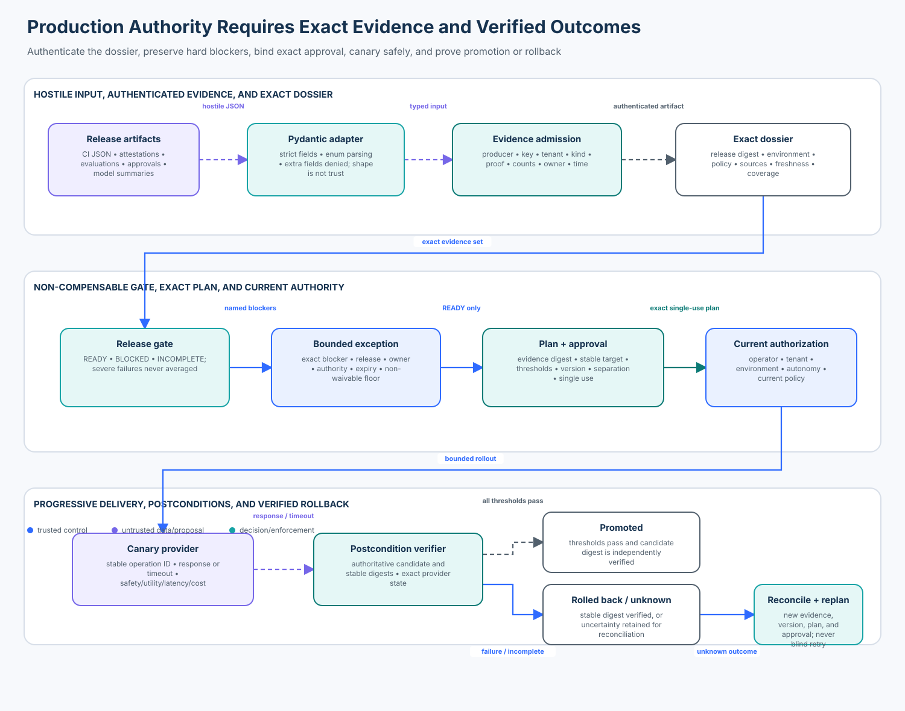

# 05 — Security Release Gates and Production Readiness

<!-- roadmap-status -->
> **Roadmap status: Published.** This course includes a deterministic release-control plane, real Pydantic v2 boundary adapter, executable lab, generated notebook, architecture diagram, focused invariant tests, and an applied checkpoint.

## Course promise

A production release is not authorized because a file exists, CI is green, an
average score is high, a reviewer is senior, or a model says “ready.” A release
is authorized only when trusted application code can establish that:

1. each required evidence item is authentic, current, owned, and bound to the
   exact candidate digest, tenant, environment, and policy version;
2. every mandatory population has meaningful coverage and a determinate result;
3. no non-compensable severe failure is present;
4. any risk acceptance is narrow, authenticated, owned, expiring, and allowed
   by policy;
5. a separate approver authorizes one exact rollout plan and record version;
6. the operator remains currently authorized at execution time; and
7. the canary, promotion, or rollback is independently verified from provider
   state rather than inferred from a request or response string.

The model may summarize evidence or recommend a disposition. It never
authenticates evidence, grants an exception, consumes approval, changes traffic,
or declares a rollout successful.

## Learning objectives

By the end of the course, you can:

- distinguish schema validity, artifact integrity, provenance, test meaning,
  current policy compliance, and production authority;
- design a typed evidence dossier with exact subject, environment, producer,
  policy, freshness, result, coverage, owner, and source bindings;
- keep verified forbidden outcomes outside weighted or average scores;
- represent `READY`, `BLOCKED`, and `INCOMPLETE` without collapsing unknown
  evidence into either success or failure;
- scope risk exceptions to one release and blocker while preserving a
  non-waivable security floor;
- bind a canary and rollback plan to the exact evidence snapshot, stable target,
  autonomy change, thresholds, and optimistic record version;
- enforce approver/operator separation and current execution authorization;
- reconcile timeout-after-commit outcomes with stable operation identities;
- verify promotion and rollback postconditions; and
- report severe failures, coverage, age, rollback outcomes, duplicate effects,
  and false blocks with exact denominators.

## Prerequisites and timebox

- Complete Enterprise 01–04 or understand version-bound authorization,
  independent control planes, incident containment, and unknown-effect
  reconciliation.
- Be comfortable reading Python dataclasses, enums, and pytest.
- Suggested time: 60 minutes reading, 75 minutes notebook/lab, 45 minutes
  exercises and checkpoint.
- No credentials or network calls are required.

## 1. Release readiness is an authority decision

Release workflows often mix five questions that must remain separate:

| Question | Useful evidence | What it does **not** prove |
|---|---|---|
| Is the payload well shaped? | Pydantic/JSON Schema validation | who produced it, whether it is true, or whether it applies here |
| Is the artifact intact and attributable? | signature, transparency bundle, provenance subject digest | that tests were sufficient or current policy allows release |
| Did a control population pass? | retained cases, oracle results, coverage, failure artifacts | that another required population passed |
| Is residual risk accepted? | exact, owned, expiring exception | that a non-waivable severe violation disappeared |
| May this release enter production now? | current gate decision, exact plan, separate approval, current operator authorization | that deployment or rollback succeeded |

The governing invariant is:

> Production authority exists only for the exact candidate, evidence snapshot,
> environment, autonomy, plan, approval, policy, actor, record version, and
> time that trusted application code has validated. A verified severe failure
> remains a blocker outside aggregate scores.

This is why a 99.9% score can still mean “do not release”: the missing 0.1% may
contain the one forbidden cross-tenant write.

## 2. Enterprise scenario and threat model

A change board is evaluating `sha256:candidate-500`, a support-agent release
that will gain permission to write support cases in production. The existing
stable version is `sha256:stable-499`. CI, red-team, supply-chain, rollback,
observability, runbook, and owner systems contribute evidence.

### Assets

- production data and external side effects;
- the stable release and rollback path;
- candidate artifact, configuration, model, prompts, tools, and dependencies;
- evidence, approvals, exceptions, and audit history;
- rollout traffic, canary metrics, and provider postconditions; and
- the decision record that explains why production authority existed.

### Trust boundaries

1. **Artifact producers → evidence intake.** JSON, attestations, reports, links,
   and model summaries are hostile until validated and authenticated.
2. **Evidence store → release gate.** Stored evidence is reverified; admission-
   time success does not make mutable storage trustworthy forever.
3. **Gate → exception and approval authorities.** Roles cannot invent or widen
   the policy floor.
4. **Approval → effect boundary.** Approval is exact and single-use; current
   operator authorization is a separate check.
5. **Deployment controller → provider.** A successful request is not a verified
   canary, promotion, or rollback.
6. **Metrics → promotion decision.** Missing, delayed, poisoned, or aggregate
   metrics must not silently become success.

### Primary attacks and failures

- **presence-only assurance:** upload a report without enough exercised cases;
- **subject substitution:** reuse valid evidence from a different digest,
  tenant, environment, or policy version;
- **stale green:** keep a once-passing artifact after code, policy, or threat
  assumptions change;
- **aggregate masking:** bury a critical forbidden outcome under a high average;
- **ownerless exception:** accept a waiver without accountable owner, expiry,
  exact blocker, or independent authority;
- **storage tampering:** edit an admitted failed result into a pass;
- **approval replay:** reuse an approval after record or plan state changes;
- **role conflation:** let one operator both approve and execute a release;
- **timeout-after-commit:** retry a canary under a new operation identity;
- **metric blackout:** promote because safety evidence is unavailable; and
- **rollback optimism:** treat a rollback request as proof that stable traffic
  was restored.

## 3. Model the evidence dossier

`ReleaseEvidence` carries:

- globally stable `evidence_id`;
- exact `release_digest`, `tenant`, and `environment`;
- typed `kind` such as build provenance or adversarial evaluation;
- registry-resolved `producer_id` and `key_id`;
- current `policy_version`;
- `issued_at` and `expires_at`;
- explicit `PASS`, `FAIL`, or `INCONCLUSIVE` result;
- `checked`, `passed`, and `severe_failures` counts;
- accountable `owner` and durable `source_uri`; and
- a digest of the retained report payload.

The course requires nine distinct kinds:

| Evidence kind | Purpose | Example non-ready condition |
|---|---|---|
| build provenance | bind artifact to expected build identity and process | subject digest or builder does not match |
| unit test | deterministic component behavior | required population absent or coverage below policy |
| integration test | full boundary and provider contracts | one boundary remains unexercised |
| adversarial evaluation | forbidden outcomes and bypasses | any verified severe failure |
| supply chain | dependencies, provenance, signatures, vulnerability policy | unverified artifact or critical exposure |
| rollback drill | stable-target restoration and timing | rollback not independently verified |
| observability | required signals and alert paths | deployment would be unobservable |
| runbook | accountable detection, containment, recovery | missing owner or untested procedure |
| owner approval | business and service ownership | wrong release, stale approval, or missing owner |

No one item substitutes for another. A valid SBOM does not prove agent
authorization correctness. A perfect unit suite does not prove a rollback.

### Admission sequence

The executable gate performs this order:

1. parse the untrusted dictionary through Pydantic;
2. resolve the producer from trusted configuration;
3. verify producer key, tenant, and allowed evidence kind;
4. verify proof over the canonical payload;
5. reject missing ownership, source, count, and time fields;
6. make identical delivery idempotent and conflicting reuse quarantine-worthy;
7. retain the admitted digest; and
8. reverify proof and retained digest again at gate time.

Pydantic v2 (`pydantic>=2.11,<3` in this repository) is the real SDK exercise.
`ConfigDict(extra="forbid")` rejects smuggled fields, `StrictInt` prevents
string-to-integer coercion, and enum fields constrain result vocabulary. This
is deliberately only the shape boundary. It cannot authenticate CI, validate
a SLSA subject, or grant production authority.

The lab's HMAC keyring is a deterministic public fixture. Replace it with a
KMS/HSM-backed signing or attestation verifier in production; never embed
shared secrets in course-style application code.

## 4. Evaluate completeness, freshness, and coverage

Each `EvidenceRequirement` defines:

- required evidence kind;
- maximum age;
- minimum coverage; and
- whether its blocker may ever be waived.

The gate selects only evidence matching the exact release, tenant, and
environment. It then checks current policy, expiry, maximum age, determinate
result, coverage, severe failures, stored digest, and proof.

The states are intentionally not Boolean:

- `READY`: every current requirement is satisfied and no blocker remains;
- `BLOCKED`: evidence establishes a failed policy condition; and
- `INCOMPLETE`: required evidence is missing or inconclusive, so neither safety
  nor failure is fully established.

`INCOMPLETE` is not a softer form of ready. It prevents rollout and routes work
to evidence restoration or human review.

### Exact metrics

For admitted items `i`:

```text
evidence coverage = Σ passed_i / Σ checked_i
oldest evidence age = max(evaluated_at - issued_at_i)
severe failure escape rate = promoted releases with severe_failures > 0
                             / releases with severe_failures > 0
rollback success rate = verified stable rollbacks / attempted rollbacks
false block rate = valid releases denied / valid releases evaluated
```

Always show the numerator, denominator, and exact severe cases. Do not average
missing evidence into zero, mix attack and valid populations, or let a high
utility result compensate for unauthorized effects.

## 5. Preserve the non-waivable floor

Risk acceptance is sometimes legitimate—for example, a small unit-coverage
gap may be temporarily accepted while a low-risk migration completes. The
course represents an exception as a signed object bound to:

- one exception ID;
- one release digest, tenant, and environment;
- one exact blocker code;
- one accountable owner and independent approver; and
- issue and expiry times.

The policy still decides what is waivable. The course makes build provenance,
adversarial evaluation, supply-chain evidence, rollback drill, owner approval,
and every `severe-failure` non-waivable. A role named “executive” or “security”
does not override code-enforced policy.

An exception removes only its exact blocker. It does not repair tampered
evidence, cover other missing requirements, change the candidate digest, or
survive expiry.

## 6. Bind the plan, approval, and current actor

`ReleasePlan` fixes:

- candidate and stable digests;
- tenant, environment, and requested autonomy;
- current policy and exact evidence-set digest;
- gate evaluation time;
- canary percentage;
- safety, error, latency, and cost thresholds;
- stable logical operation identity; and
- its own canonical plan digest.

`ReleaseApproval` fixes the plan digest, candidate, tenant, environment,
expected release-record version, separate approver, issue time, and expiry.
The executor verifies it once and consumes it only immediately before the first
provider mutation.

The operator must still have the current `release-operator` role and an exact
tenant/environment/autonomy grant. Approval and current authorization are
complementary controls:

- approval says *this reviewed plan may be attempted once*;
- authorization says *this authenticated operator may execute this class of
  change here now*.

Neither implies the other, and the approver cannot be the operator.

## 7. Progressive delivery is another state machine

The provider boundary uses one stable logical operation ID. The executor:

1. re-evaluates the gate at execution time;
2. validates plan, record version, approval, and current authorization;
3. queries provider state before dispatch;
4. dispatches a bounded canary once;
5. queries the exact candidate digest and canary state;
6. evaluates safety, utility/error, latency, and cost with explicit thresholds;
7. promotes only when every threshold passes; otherwise requests rollback;
8. queries the exact promoted or stable digest; and
9. records `PROMOTED`, `ROLLED_BACK`, `OUTCOME_UNKNOWN`, or
   `ROLLBACK_UNKNOWN` honestly.

If the canary commits and the response times out, the turn ends unknown. A new
random operation ID could create a second rollout. Reconciliation must query
the original logical identity and produce a new gate decision, plan version,
and approval if additional action is necessary.

The same reasoning applies to rollback. Calling a rollback API is an attempt;
only authoritative provider state showing the expected stable digest is a
verified rollback.

## 8. Current standards, tools, and SDKs

Version-sensitive review performed 2026-11-02. Recheck official documentation
before production adoption.

| Source/tool | What it contributes | Boundary this course keeps explicit |
|---|---|---|
| [NIST AI RMF 1.0 and AIRC Core](https://airc.nist.gov/airmf-resources/airmf/5-sec-core/) | GOVERN, MAP, MEASURE, MANAGE; pre-deployment and ongoing risk measurement | NIST states AI RMF 1.0 is being revised; it is a risk framework, not an executable release token |
| [NIST AI 600-1 GenAI Profile](https://nvlpubs.nist.gov/nistpubs/ai/NIST.AI.600-1.pdf) | governance, pre-deployment testing, content provenance, incident disclosure | organizations must translate profile actions into owned evidence and enforceable policy |
| [NIST SSDF 1.1](https://csrc.nist.gov/pubs/sp/800/218/final) | secure development practices and common supplier vocabulary | process conformance does not replace exact agent behavior and effect-boundary testing |
| [SLSA 1.2](https://slsa.dev/spec/v1.2/) | current approved supply-chain levels and provenance formats | provenance must be verified; presence alone is insufficient |
| [SLSA artifact verification](https://slsa.dev/spec/v1.2/verifying-artifacts) | verify signature, subject digest, predicate type, builder identity, and expected parameters | the release gate must bind verified provenance to the artifact actually being deployed |
| [Sigstore Cosign verification](https://docs.sigstore.dev/cosign/verifying/verify/) | identity-bound signature and bundle verification; image digest claim checking | use configured certificate identity/issuer; disabling claim checks is not a release shortcut |
| [CycloneDX 1.7](https://cyclonedx.org/specification/overview/) | components, services, dependencies, composition completeness, vulnerabilities, declarations, and signed annotations | an SBOM can be incomplete or stale and does not prove safe runtime behavior |
| [OpenSSF Scorecard](https://scorecard.dev/) | automated repository and build-risk checks | its aggregate score must not hide a critical individual check or serve as production authority |
| [Argo Rollouts analysis](https://argo-rollouts.readthedocs.io/en/stable/features/analysis/) | canary/blue-green analysis, failed aborts, inconclusive pause, provider plugins | controller status remains evidence; exact application policy and postconditions still matter |
| [Argo Rollouts rollback windows](https://argo-rollouts.readthedocs.io/en/stable/features/rollback/) | fast-tracked rollback to recent revisions | skipping steps for rollback is an operational mechanism, not proof that stable state was restored |
| [Pydantic v2 models](https://docs.pydantic.dev/latest/concepts/models/) | typed validation at hostile Python/JSON boundaries | schema validity is not provenance, authorization, or semantic correctness |

This course intentionally does not repeat the full Sigstore supply-chain lab
from Advanced 06. It consumes provenance as one required dossier component and
focuses on the higher-level release decision, exception floor, progressive
delivery, and verified rollback.

### Production tool composition

A mature deployment commonly composes rather than substitutes:

- CI and evaluation systems produce retained, immutable reports;
- SLSA/Sigstore bind artifacts to trusted build and identity roots;
- CycloneDX expresses inventory and completeness;
- Scorecard contributes specific repository-risk evidence;
- policy-as-code evaluates the exact dossier;
- a change system issues a plan- and version-bound approval;
- Argo Rollouts or Flagger performs progressive delivery; and
- an independent telemetry/provider query verifies promotion or rollback.

No product should be treated as a universal security oracle. Define which
claims each system can establish and which trusted boundary consumes them.

## 9. Architecture



The checked-in SVG is generated from
[`architecture-spec.json`](architecture-spec.json). Regenerate it with:

```bash
.venv/bin/python curriculum/roadmap/enterprise/05-security-release-gates-and-production-readiness/render_architecture.py
```

## 10. Lab and notebook

The vertical slice contains:

- [`pydantic_adapter.py`](pydantic_adapter.py): real Pydantic v2 hostile-input
  adapter plus clearly labeled deterministic proof fixture;
- [`release_readiness.py`](release_readiness.py): evidence admission, exact
  dossier gate, bounded exceptions, plan/approval contracts, progressive
  delivery, rollback, reconciliation states, and metrics;
- [`release_fixtures.py`](release_fixtures.py): repeatable release evidence and provider state;
- [`lab.py`](lab.py): valid, attack, boundary, and failure populations;
- [`release_readiness.ipynb`](release_readiness.ipynb): guided top-to-bottom
  practical; and
- [`tests/test_enterprise_release_readiness.py`](../../../../tests/test_enterprise_release_readiness.py): focused invariant regression suite.

Run the lab:

```bash
PYTHONPATH=curriculum/roadmap/enterprise/05-security-release-gates-and-production-readiness \
  .venv/bin/python curriculum/roadmap/enterprise/05-security-release-gates-and-production-readiness/lab.py
```

Run focused tests:

```bash
PYTHONPATH=. .venv/bin/pytest -q tests/test_enterprise_release_readiness.py
```

Regenerate the notebook:

```bash
.venv/bin/python curriculum/roadmap/enterprise/05-security-release-gates-and-production-readiness/generate_notebook.py
```

### Practical sequence

1. parse an authenticated evidence payload through Pydantic;
2. inspect the producer-registry admission receipt;
3. build a ready exact dossier;
4. inject a presence-only low-coverage report;
5. inject one severe adversarial failure under a high aggregate pass rate;
6. attempt a signed exception across the non-waivable floor;
7. bind one plan and separate approval;
8. promote a safe canary and verify its digest;
9. fail a canary and verify the stable rollback; and
10. preserve timeout-after-commit as unknown without duplicate deployment.

## 11. Evaluation design

The lab separates populations:

| Population | Cases | Expected behavior |
|---|---:|---|
| valid | exact complete dossier and safe canary | ready, promote, verify |
| attack | severe failure, shallow presence-only evidence, waiver bypass | block with named reason |
| boundary | evidence present but stale | remain non-ready |
| failure | unsafe canary; timeout after commit | verified rollback; explicit unknown without duplicate |

Required reporting:

- population counts;
- ready rate for valid cases;
- severe-failure escape rate;
- stale-evidence rejection rate;
- rollback success rate;
- duplicate deployment effects; and
- false-block rate.

The course test suite also covers cross-release substitution, tenant and key
confusion, idempotent delivery, conflicting IDs, strict schema behavior,
post-admission tampering, policy drift, inconclusive results, exception expiry,
approval replay, role conflation, current authorization, plan tampering,
provider unavailability, rollback uncertainty, and stable logical identities.

## 12. Production replacement map

| Course component | Production replacement | Required property |
|---|---|---|
| in-memory producer registry | centrally governed trust configuration | reviewed roots, allowed claim types, rotation and revocation |
| public HMAC fixture | KMS/HSM, Sigstore, or attestation-verification service | identity-bound proof, protected keys, audit, revocation |
| dataclass evidence store | immutable/WORM evidence and metadata store | retention, tenant isolation, integrity revalidation, access audit |
| local policy tuple | versioned policy-as-code decision service | exact input/output contract, change control, fail-safe availability behavior |
| in-memory exception object | governed risk register/change system | owner, expiry, exact scope, non-waivable floor, review history |
| local approval key | independent change authority | separation of duties, MFA, exact plan/version binding, single use |
| synthetic provider | Argo Rollouts/Flagger plus deployment platform | stable operation identity, canary state, abort/rollback, idempotency |
| local metrics | independently collected telemetry and effect evidence | coverage, integrity, freshness, missing-data semantics |
| process memory version | transactional release record | optimistic concurrency, durable terminal/unknown states |

The course simulates no production trust root, deployment controller, or
telemetry backend. It demonstrates the contract those systems must satisfy.

## 13. Operational ownership

| Lifecycle | Minimum owner action |
|---|---|
| detect | alert on missing/stale evidence, severe failures, invalid exceptions, approval conflicts, metric blackout, and unknown provider outcomes |
| contain | prevent gate transition and stop promotion; preserve candidate and evidence immutably |
| recover | restore evidence sources or provider visibility; verify stable rollback before reopening traffic |
| retain | keep exact evidence, policy, plan, approval, exception, provider observations, and decision reasons |
| improve | convert every severe or unknown outcome into an owned regression and update requirement versions |

Do not delete failed evidence after a replacement run. Link superseding evidence
while retaining the original decision history.

## 14. Applied exercises

### Exercise A — Cross-environment evidence

Add a staging integration report to a production dossier. Prove that the gate
reports missing production integration evidence rather than accepting the
staging pass.

### Exercise B — Policy rotation

Rotate `release-policy-2026-11` to a new version after approval but before
execution. Show that the executor re-evaluates the dossier and rejects the old
plan without consuming its approval.

### Exercise C — Waivable but bounded

Create a valid signed exception for a small unit-test coverage gap. Then change
its candidate digest, environment, expiry, and blocker one at a time. Each
mutation must fail independently.

### Exercise D — Metric blackout

Remove canary metrics after deployment. Confirm that the release does not
promote and that the rollback postcondition, not the rollback request, decides
the final state.

### Exercise E — Approval race

Simulate two operators reading the same release version. Let one complete the
rollout, then show that the other's plan/approval cannot mutate the new record
version or create a second provider effect.

## Knowledge checkpoint

1. Why can a valid Pydantic model still be hostile?
2. What must bind build provenance to the deployed candidate?
3. When is `INCOMPLETE` more accurate than `BLOCKED`?
4. Why is a severe forbidden outcome not compensable by average utility?
5. Which parts of a risk exception must be trusted configuration rather than
   model-generated content?
6. Why are approval and current authorization separate checks?
7. What does a stable logical operation ID prevent after timeout?
8. Why is a successful rollback API response insufficient?

## Applied checkpoint

A release passes 999 of 1,000 adversarial cases, has valid SLSA provenance, a
complete CycloneDX inventory, and a high Scorecard aggregate. The one failure
is an independently verified cross-tenant write. A senior reviewer signs an
exception and the deployment controller reports that the canary request was
accepted. Can the release be considered production-ready?

**Expected reasoning:** No. The cross-tenant write is a verified severe
invariant violation and remains a non-waivable blocker outside aggregate
scores. Tool outputs and reviewer seniority do not change that floor. The
canary request also proves neither canary state nor safe outcomes. Preserve the
evidence, contain the rollout, fix the boundary, rerun the exact release-bound
campaign, obtain a new current gate decision and approval, then independently
verify the canary and any promotion or rollback.

## Authoritative references

- [NIST AI Risk Management Framework](https://www.nist.gov/itl/ai-risk-management-framework)
- [NIST AI RMF Core](https://airc.nist.gov/airmf-resources/airmf/5-sec-core/)
- [NIST AI 600-1: Generative AI Profile](https://nvlpubs.nist.gov/nistpubs/ai/NIST.AI.600-1.pdf)
- [NIST SP 800-218: Secure Software Development Framework 1.1](https://csrc.nist.gov/pubs/sp/800/218/final)
- [SLSA specification 1.2](https://slsa.dev/spec/v1.2/)
- [SLSA artifact verification](https://slsa.dev/spec/v1.2/verifying-artifacts)
- [Sigstore: verifying signatures](https://docs.sigstore.dev/cosign/verifying/verify/)
- [CycloneDX specification overview](https://cyclonedx.org/specification/overview/)
- [OpenSSF Scorecard](https://scorecard.dev/)
- [Argo Rollouts analysis and progressive delivery](https://argo-rollouts.readthedocs.io/en/stable/features/analysis/)
- [Argo Rollouts rollback windows](https://argo-rollouts.readthedocs.io/en/stable/features/rollback/)
- [Pydantic v2 models](https://docs.pydantic.dev/latest/concepts/models/)

Standards, tools, and provider semantics are version-sensitive. Pin production
versions, preserve the policy and verifier version used for each decision, and
recheck the authoritative documentation before relying on a specific claim.
