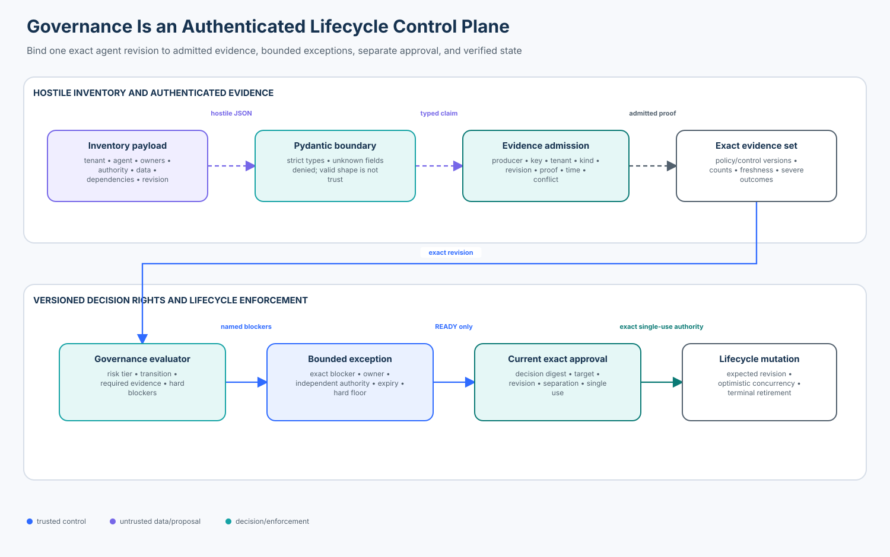

# 06 — Agent Security Governance

> **Roadmap status: Published.** This course includes an authenticated governance
> control plane, strict Pydantic v2 intake adapter, deterministic notebook,
> architecture diagram, adversarial tests, and an assessed checkpoint.

Governance is not a policy PDF, a committee name, an inventory row, or a model
score. It is a continuously enforced system of decision rights and evidence:
who may change an agent's lifecycle, which exact version is being considered,
which evidence is admissible, which risks may be accepted, and which outcomes
must always block operation.



## Learning objectives

By the end of this course, you can:

1. design an agent inventory that represents identity, ownership, authority,
   dependencies, data, effects, lifecycle state, and review obligations;
2. distinguish schema-valid submissions from authenticated, applicable evidence;
3. classify risk and map it to proportional evidence without hiding severe
   outcomes inside aggregate scores;
4. detect material changes and invalidate evidence bound to an older revision;
5. implement explicit lifecycle transitions with separation of duties and
   single-use approvals;
6. scope, expire, and authenticate exceptions while retaining non-waivable floors;
7. measure governance coverage with honest denominators and actionable owners; and
8. evaluate governance frameworks, catalogs, policy engines, GRC systems, and
   control-automation formats without confusing any one tool for the control plane.

## Prerequisites and timebox

Complete Enterprise 01–05 or bring equivalent experience with authorization,
incident response, evidence provenance, and release gates. Plan 90 minutes for
the lesson, 75 minutes for the lab, and 20 minutes for the checkpoint.

The lab uses Python 3.11+, `pytest`, and Pydantic v2. It is deterministic,
credential-free, and makes no network calls.

## 1. Security thesis

An agent couples probabilistic decisions to tools, memory, data, protocols, and
durable workflows. A model identifier alone cannot tell an incident commander
which tenants are affected, which credentials must be revoked, or who can stop
an external effect. The governed object is the complete deployed system.

Use this invariant:

> A lifecycle change is permitted only when trusted application code evaluates
> authenticated, current evidence for one exact tenant, agent revision, policy,
> control set, and target state—and consumes a separate, current, single-use
> approval after rechecking operator authority.

The model may summarize evidence or draft a recommendation. It must not create
its own approval, lower its risk tier, waive blockers, or mutate terminal state.

## 2. State of the art, November 2026

The major frameworks are complementary rather than interchangeable:

- **NIST AI RMF 1.0** organizes risk management into GOVERN, MAP, MEASURE, and
  MANAGE. GOVERN is cross-cutting; its outcomes include defined roles, ongoing
  review, inventories, and safe decommissioning. NIST's AIRC notes that AI RMF
  1.0 is being updated, so record the framework version used by each decision.
- **NIST AI 600-1** profiles generative-AI risks and actions. It helps teams map
  GenAI-specific risks; it does not issue runtime authorization.
- **ISO/IEC 42001:2023** specifies an AI management system that organizations
  establish, operate, maintain, and continually improve. Certification or a
  management-system process does not replace system-specific security evidence.
- **EU Regulation 2024/1689 (AI Act)** defines obligations by actor and system
  context, including requirements for certain high-risk systems. Applicability
  is a legal determination, not a string returned by this lab. Maintain
  jurisdiction, role, use, and classification evidence and involve counsel.
- **OWASP Agentic AI guidance** and threat models help translate governance into
  agent-specific controls around tools, identities, memory, protocols, and
  autonomy. They are inputs to the control set, not approval authorities.

This course is engineering education, not legal advice. Regulatory scope,
timelines, and harmonized standards change; use current official text and legal
counsel for production decisions.

## 3. The governed system record

A useful inventory must answer operational questions, not merely satisfy form
completion. Give the system a stable ID; version material changes rather than
silently editing history.

| Domain | Minimum record | Question it answers |
| --- | --- | --- |
| identity | tenant, stable agent ID, revision, environment | Which deployed thing is this? |
| accountability | business, technical, security, and kill-switch owners | Who decides, fixes, and stops it? |
| intent | purpose, prohibited uses, user population | What may it do and for whom? |
| authority | autonomy, tools, effects, identities, permissions | What real-world change can it cause? |
| data/state | classifications, stores, retention, residency, memory | What must be protected or erased? |
| supply chain | model/provider versions, SDKs, MCP/A2A peers, prompts | Which dependencies can alter behavior? |
| controls | policy/control versions, evidence set, exceptions | What exact rules justified this state? |
| operations | lifecycle, review due date, telemetry, incident path | Is it monitored, stoppable, and current? |

An inventory does not need to duplicate every CMDB, catalog, IAM, SBOM, privacy,
or deployment record. It needs stable references, owners, versions, and a way to
prove referenced state. Copying mutable descriptions into another database can
create a reassuring but stale shadow inventory.

### Inventory anti-patterns

- using a repository name as the system identity;
- recording only the foundation model and omitting tools or service identities;
- giving every system the same risk tier to avoid differentiated review;
- counting a blank owner field as “complete”;
- overwriting the old row when permissions or data use changes;
- allowing a model or deploying team to self-approve its classification; and
- treating “retired” as a label while credentials, data, schedules, or endpoints remain.

## 4. Risk classification and decision rights

Risk tiering determines review depth; it does not predict every loss. Include at
least impact, reversibility, scale, sensitivity, affected people, autonomy,
external effects, and dependency exposure. Document the rationale and reviewer.

The lab illustrates this proportional policy:

| Tier | Evidence floor before pilot/authorization |
| --- | --- |
| low | threat model, security test |
| medium | low + privacy review |
| high | medium + incident drill and kill-switch owner |
| critical | high + independent review |

Production policy may require more. A severe unauthorized effect remains a hard
blocker even when 999 of 1,000 cases passed. Never reduce non-compensable safety
conditions to an average score.

### RACI is not authorization

A RACI chart clarifies communication; it does not prove current authority. The
control plane still needs authenticated identities, exact resource scope,
separation of duties, expiry, replay protection, and an audit trail.

| Decision | Requester | Independent authority | Enforcer |
| --- | --- | --- | --- |
| register/change record | system team | inventory owner for conflicts | inventory service |
| change risk tier | system team/risk analyst | accountable risk owner | policy service |
| accept compensable risk | control owner | named risk authority | exception service |
| enter production | release operator | security/release approver | lifecycle service |
| suspend | incident automation/operator | pre-authorized response policy | independent control plane |
| recover | recovery operator | separate recovery approver | recovery gate |
| retire | system owner | data/IAM/service owners | decommission workflow |

## 5. Evidence admission before evaluation

JSON validity proves shape, not truth. Before evidence influences a decision,
bind it to:

- authenticated producer and key;
- producer-allowed evidence kind and tenant;
- exact agent ID and record revision;
- policy and control versions;
- created and expiry times;
- explicit passed/checked counts and severe outcomes; and
- stable evidence ID with conflict detection.

The fixture uses HMAC only to make provenance behavior deterministic. Production
systems should use workload identity and KMS/HSM-backed signing or attestations,
protect the producer registry, rotate keys, record revocation, and retain the
original artifact outside the decision service.

### Delivery semantics

The same evidence ID and digest is an idempotent redelivery. The same ID with a
different digest is a conflict, not an update. Assign a new artifact ID for a
new run. Otherwise a retry or compromised producer can rewrite the basis of an
already recorded decision.

## 6. Material change governance

A material change can invalidate risk assumptions even when application code
does not change. Examples include:

- model, provider, prompt, system instruction, embedding, or guardrail change;
- new tool, MCP/A2A peer, identity, permission, or external effect;
- new data class, tenant, user population, jurisdiction, or retention rule;
- greater autonomy, schedule, scale, or workflow duration;
- new memory or retrieval source;
- policy/control version change; and
- incident finding, vulnerability, or provider deprecation.

Generate a normalized change set, classify it with trusted policy, increment the
record revision, and demand evidence for that new revision. An LLM may help draft
the diff explanation; deterministic code and accountable humans own the result.

The lab demonstrates that evidence for revision 7 cannot authorize revision 8,
even if every artifact is otherwise fresh and passing.

## 7. Lifecycle state machine

```text
draft ──> pilot ──> authorized ──> suspended ──> pilot
  │         │            │              │
  └─────────┴────────────┴──────────────┴──> retired (terminal)
```

Each transition is an explicit command against an expected revision. The
inventory uses optimistic concurrency: a stale writer cannot overwrite a newer
owner, permission, or lifecycle change. Retirement is terminal in the teaching
control; a new deployment needs a new governed identity/revision and evidence.

Suspension must remain independently operable during model, workflow, or primary
application failure. Retirement requires postconditions: schedules disabled,
credentials revoked, endpoints withdrawn, retained data handled, downstream
catalogs updated, and exceptions closed.

## 8. Exceptions and residual risk

An exception is not a comment field. It must identify:

- the exact tenant, system, revision, environment, control, and blocker;
- the accountable risk owner and independent approving authority;
- compensating controls, residual risk, start, expiry, and review cadence; and
- closure evidence or a new decision before expiry.

Non-waivable floors belong in policy. This lab prevents exceptions from waiving
`severe-failure`, missing high-risk kill-switch ownership, or terminal retirement.
An expired exception restores the blocker automatically. Track overdue exceptions
as failures, not as a smaller denominator.

## 9. Governance metrics that resist gaming

Always publish numerator, denominator, scope, freshness window, and owner.

| Metric | Honest definition | Misleading shortcut |
| --- | --- | --- |
| inventory coverage | governed in-scope systems / discovered in-scope systems | rows completed / rows created |
| review freshness | currently valid reviews / reviews required | reviews performed this quarter |
| evidence coverage | applicable controls with current admitted proof / applicable controls | artifacts uploaded / expected uploads |
| exception health | active exceptions within scope and expiry / all active exceptions | exceptions approved |
| kill-switch readiness | systems with exercised, verified containment / systems requiring it | systems naming an owner |
| change detection | material deployed changes linked to new decisions / material deployed changes | pull requests with labels |
| retirement closure | retired systems with verified IAM/data/runtime closure / retired systems | records marked retired |

Segment by tier, business unit, tenant, and environment. Keep `unknown` visible;
do not silently exclude systems that cannot be classified.

## 10. Tools and SDK landscape

No product spans discovery, policy, evidence, workflow, runtime enforcement,
and legal accountability by itself.

| Category | Examples | Good fit | Critical limitation |
| --- | --- | --- | --- |
| framework | NIST AI RMF/AIRC, NIST AI 600-1, ISO/IEC 42001 | outcomes, management system, profiles | not a runtime authorization service |
| service catalog | Backstage Catalog, CMDB products | ownership and system/dependency discovery | catalog metadata can be stale or self-asserted |
| policy engine | Open Policy Agent, Cedar | deterministic policy decisions | input provenance and effect enforcement remain yours |
| GRC workflow | ServiceNow IRM, Archer and peers | ownership, attestations, exceptions, audits | workflow completion is not control effectiveness |
| control format | NIST OSCAL | machine-readable catalogs, profiles, assessments | representation does not authenticate evidence |
| supply chain | SBOM/Sigstore/SLSA tooling | component and artifact provenance | does not model full agent authority or use context |
| schema SDK | Pydantic v2 (used here) | strict boundary validation and JSON schema | valid fields are not truthful or authorized |

### Why Pydantic is in the lab

`governance_pydantic_adapter.py` rejects unknown fields, coercion, and empty critical
collections at the untrusted intake boundary. The core uses plain immutable
dataclasses so learners can see where SDK validation ends and governance begins.
Pydantic neither authenticates the submitter nor approves the record.

## 11. Reference architecture

The architecture separates four trust decisions:

1. **Intake:** strict schema and authenticated evidence producer admission.
2. **Evaluation:** exact applicability, freshness, coverage, hard blockers, and
   bounded exceptions under a versioned policy.
3. **Authorization:** current operator authority plus a separate exact,
   single-use approval.
4. **Mutation and verification:** optimistic-concurrency lifecycle change and
   externally verified operational postconditions.

Logs are outputs, not authorities. Protect decision/evidence digests in an
append-only evidence system and reconcile catalog state with deployment, IAM,
data, and runtime sources.

## 12. Practical lab

From the repository root:

```bash
python -m pip install -e '.[contributor]'
python curriculum/roadmap/enterprise/06-agent-security-governance/lab.py
pytest -q tests/test_enterprise_security_governance.py
jupyter lab curriculum/roadmap/enterprise/06-agent-security-governance/governance_inventory.ipynb
```

The lab performs this sequence:

1. parse a hostile-boundary inventory payload with strict Pydantic v2;
2. admit signed evidence only from a scoped producer;
3. evaluate high-risk evidence for one exact record revision;
4. consume an exact approval from an actor other than the operator;
5. reject reuse of revision-7 evidence after a revision-8 tool change; and
6. prove that a signed exception cannot waive a severe failure.

### Extension challenge

Add a deployment-source reconciliation adapter. A record may enter `retired`
only when the deployment source reports zero active workloads, IAM reports zero
active service credentials, and the data owner supplies a retention/disposal
receipt. Preserve `retirement-unknown` when a source is unavailable; do not turn
missing evidence into success.

## 13. Failure modes and design review prompts

| Failure mode | Required response |
| --- | --- |
| producer key revoked after evidence admission | identify affected decisions; re-evaluate under revocation policy |
| provider commits change but inventory update times out | reconcile by stable operation ID before retry |
| two owners edit the same record | reject stale expected revision; require rebase/review |
| framework or law changes | version obligations; classify impacted systems; open review work |
| exception approver owns the delivery target | enforce separation and escalation |
| discovery denominator is unknown | publish unknown coverage; do not claim 100% |
| model recommends its own lower tier | treat as untrusted input; require policy and accountable decision |
| runtime differs from catalog | block or suspend based on reconciliation policy |

## 14. Knowledge check

1. Why can a complete inventory row still be unsafe?
2. Which fields bind evidence to one governance decision?
3. Why is a severe failure separate from an average pass rate?
4. What makes an exception bounded and auditable?
5. Why must the approver differ from the operator?
6. How does optimistic concurrency protect governance integrity?
7. Which events should cause a new record revision and evidence set?
8. What must be verified after retirement?

### Answer key

1. Completeness does not authenticate claims, prove freshness, or establish
   authority and control effectiveness.
2. At minimum: tenant, agent ID, record revision, policy/control versions,
   evidence kind, producer, creation/expiry, and artifact digest.
3. A non-compensable event can be hidden by a high aggregate score; it must
   remain an explicit hard blocker.
4. Exact scope, accountable owner, independent approval, compensating controls,
   expiry, review, residual risk, proof, and automatic re-blocking on expiry.
5. Separation reduces self-approval and ensures the exact decision receives
   independent authorization.
6. The store rejects writes based on an old revision, preventing silent erasure
   of concurrent owner, authority, or lifecycle changes.
7. Any change affecting purpose, users, data, autonomy, effects, identities,
   dependencies, environments, policy, controls, or material risk assumptions.
8. Workloads/schedules stopped, credentials revoked, endpoints removed, data
   disposition complete, downstream records reconciled, and exceptions closed.

## 15. Definition of done

- the complete agent system has a stable, tenant-scoped, versioned identity;
- owners and decision rights are explicit and operationally reachable;
- risk tier drives a documented, proportional evidence floor;
- evidence is authenticated, current, exact-scope, and conflict-protected;
- material change creates a new revision and invalidates stale proof;
- lifecycle transitions are deterministic and concurrency-safe;
- operator authority and independent single-use approval are rechecked;
- exceptions are bounded, expiring, owned, and unable to waive hard floors;
- runtime, IAM, data, catalog, and incident sources are reconciled;
- metrics expose denominators, unknowns, freshness, and overdue work; and
- retirement has verified postconditions rather than a label.

## References

- [NIST AI Risk Management Framework 1.0](https://doi.org/10.6028/NIST.AI.100-1)
- [NIST AI RMF Core and update status](https://airc.nist.gov/airmf-resources/airmf/5-sec-core/)
- [NIST AI 600-1: Generative AI Profile](https://doi.org/10.6028/NIST.AI.600-1)
- [ISO/IEC 42001:2023 overview](https://www.iso.org/standard/42001)
- [Regulation (EU) 2024/1689 consolidated text](https://eur-lex.europa.eu/eli/reg/2024/1689)
- [NIST OSCAL](https://pages.nist.gov/OSCAL/)
- [Open Policy Agent documentation](https://www.openpolicyagent.org/docs/latest/)
- [Backstage Software Catalog system model](https://backstage.io/docs/features/software-catalog/system-model/)
- [Pydantic strict mode](https://docs.pydantic.dev/latest/concepts/strict_mode/)
- [OWASP Agentic AI Threats and Mitigations](https://genai.owasp.org/resource/agentic-ai-threats-and-mitigations/)
