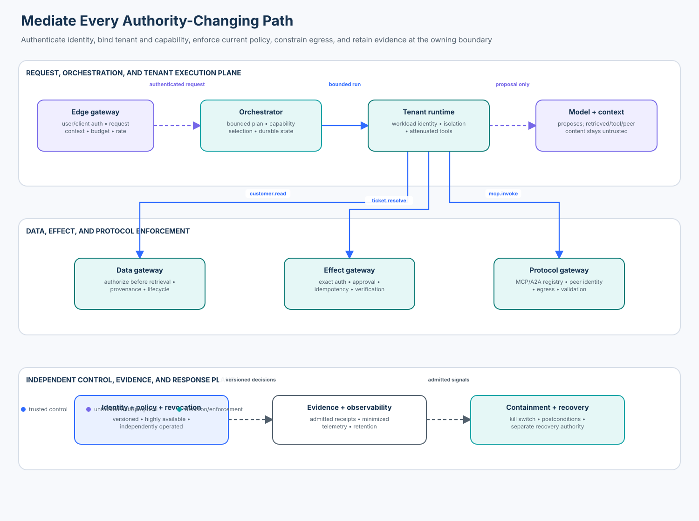

# 07 — Enterprise Agent Security Architecture

> **Roadmap status: Published.** This course includes a credential-free
> architecture evaluator, effect-boundary policy lab, real OpenTelemetry SDK
> adapter, deterministic notebook, validated diagram, adversarial tests, and an
> assessed Learning Hub checkpoint.

Enterprise agent security is not a perimeter around an LLM. It is an end-to-end
architecture that constrains identity, context, models, tools, protocols, data,
state, effects, telemetry, and response at every boundary where authority can change.



## Learning objectives

By the end of this course, you can:

1. map a shared multi-tenant agent platform into explicit trust zones and
   authority-changing flows;
2. place authentication, authorization, isolation, egress, evidence, and
   response controls at the resource or effect boundary that owns the decision;
3. calculate control coverage, owner coverage, unmediated paths, critical
   single points of failure, and residual-risk closure with exact denominators;
4. derive principal and tenant scope from authenticated application state
   rather than prompts, model output, tool arguments, or protocol metadata;
5. distinguish shared policy decisions from local enforcement and verified effects;
6. design fail-closed consequential paths while preserving explicit degraded
   or unknown states during control-plane failure;
7. instrument decisions with minimized, useful OpenTelemetry evidence; and
8. compare current identity, policy, service-mesh, protocol, telemetry, and
   sandbox technologies without mistaking a product for the architecture.

## Prerequisites and timebox

Complete Enterprise 01–06 or bring equivalent experience with workload
identity, authorization, tenant isolation, evidence provenance, incident
response, release gates, and governance. Plan 100 minutes for the lesson,
75 minutes for the lab, and 20 minutes for the checkpoint.

The default path uses Python 3.11+, `pytest`, and OpenTelemetry SDK 1.44.x. It
uses synthetic records, needs no credentials, and makes no network calls.

## 1. Security thesis

Use this invariant:

> Every authority-changing path must terminate at an independently enforceable
> boundary that authenticates current identity, binds tenant and capability,
> evaluates current policy, constrains data or egress, emits a verifiable
> decision receipt, and fails safely when required evidence is unavailable.

The model may propose, classify, plan, and explain. Trusted application and
infrastructure code authenticate, authorize, isolate, persist, execute, verify,
and record. A system prompt, typed object, internal network location, service
name, MCP server description, or agent persona does not grant authority.

## 2. Scenario and threat model

A shared enterprise platform serves multiple business units and tenants. It
uses RAG, memory, durable workflows, model providers, code execution, MCP/A2A
peers, business-system tools, and human approval. A single run may cross a dozen
services before an irreversible effect.

### Protected assets

- customer and employee data;
- workload identities, user delegation, credentials, and policy state;
- prompts, memory, retrieval indexes, checkpoints, and approval receipts;
- external-effect authority in ticketing, payments, communications, and cloud;
- audit evidence, incident state, kill switches, and recovery authority; and
- model/tool packages, protocol registries, and deployment configuration.

### Credible adversaries and failures

- an external user supplying indirect injection through retrieved content;
- a compromised model, tool, MCP/A2A peer, or tenant runtime;
- a confused deputy using a shared service identity across tenants;
- stale policy, approval, checkpoint, catalog, or dependency metadata;
- a direct internal route that bypasses the intended gateway;
- a control-plane outage or a timeout after an external effect commits;
- a malicious or mistaken operator changing an architecture record; and
- correlated failure of “redundant” controls in one failure domain.

The goal is to prevent cross-tenant access and unapproved effects, contain one
compromise, retain verifiable evidence, stop safely, reconcile uncertainty, and
recover only under current independent authority.

## 3. State of the art, November 2026

Architecture guidance is layered:

- **NIST SP 800-207** defines zero trust around resource protection and
  per-request authentication and authorization rather than implicit network
  location. Agent platforms need this at data and effect boundaries, not only
  at the user-facing API.
- **NIST SP 800-207A** applies identity-tier and network-tier policies to
  cloud-native, multi-location services and calls for distributed monitoring.
- **NIST SP 1800-35**, finalized in June 2025, documents 19 example zero-trust
  implementations. It demonstrates integration patterns rather than selecting
  one universal product stack.
- **NIST AI RMF and AI 600-1** add AI/GenAI risk outcomes and governance. They
  do not replace resource authorization, workload identity, or effect verification.
- **CISA Zero Trust Maturity Model 2.0** organizes progress across identity,
  devices, networks, applications/workloads, and data with cross-pillar
  visibility, automation, and governance. A maturity label is not evidence that
  a particular agent path is mediated.
- **SPIFFE/SPIRE** standardize workload identity and attestation patterns.
  Identity answers “which workload?”; policy still decides “may it perform this
  exact action on this exact resource now?”
- **Service meshes and policy engines** can distribute enforcement, but they do
  not understand business effects unless the application exposes precise
  resource, tenant, action, approval, and state context.

Protocols and SDKs evolve. Pin versions used by deployments and verify current
official specifications before production design.

## 4. Reference trust zones

The lab models eight logical zones. They may map to several clusters/accounts or
to strongly isolated workloads inside one platform; a box is not isolation by itself.

| Zone | Purpose | Key controls | Must not be trusted to do |
| --- | --- | --- | --- |
| edge | authenticate user/client and establish request context | strong auth, posture, rate/budget limits | translate prompt text into roles |
| orchestration | plan bounded work and manage lifecycle | capability selection, budgets, durable state, cancellation | own business-resource authorization |
| tenant runtime | execute one tenant/run under narrow identity | workload identity, sandbox, tenant state, capability attenuation | reuse shared credentials across tenants |
| data | mediate retrieval, memory, and records | authorize before retrieval, lifecycle/freshness, provenance | trust model-generated tenant filters |
| effect | execute consequential business changes | exact authorization, approval, idempotency, verification | accept “approved” text as a receipt |
| protocol | mediate MCP/A2A/provider peers | registry, identity, schema, egress, response validation | inherit peer-declared permissions |
| control | policy, identity, revocation, kill switch | independent operation, versioning, HA, protected administration | share fate with the model/runtime |
| observability | collect minimized evidence and drive response | producer admission, integrity, retention, incident controls | treat logs or model summaries as authority |

### Control plane versus data plane

The policy decision point evaluates current identity, resource, action, context,
and policy. The enforcement point owns the protected boundary and denies when
the decision is absent, stale, mismatched, or inapplicable. Central policy can
improve consistency; local enforcement prevents a central recommendation from
becoming an unverified side effect.

The kill switch, evidence store, and recovery authority should remain operable
when the model provider, orchestrator, tenant runtime, or primary application is
compromised or unavailable.

## 5. Model the authority graph

Inventory components and directed flows rather than drawing only product boxes.

Each component needs a stable ID, zone, owner, tenant mode, criticality,
replicas, distinct failure domains, workload identity, data classification,
administrative boundary, and current evidence.

Each flow needs source, target, capability, data class, owner, whether it changes
authority, controls, fail behavior, degraded-mode contract, and request/operation
IDs. A route is unmediated if a required control is absent or a consequential
path is configured fail-open. The lab counts required control slots explicitly;
it does not award a whole path for having one gateway-shaped component.

## 6. Required controls by boundary

All authority-changing flows in the teaching architecture require:

1. authenticated workload identity;
2. tenant binding from trusted state;
3. policy enforcement at the resource/effect owner;
4. an evidence receipt; and
5. transport protection when crossing zones.

Data flows also require data authorization before retrieval. Effect and protocol
flows also require egress control. Production systems commonly add posture,
consent, purpose limitation, approval, budget, residency, time, and risk constraints.

Prompts can encourage behavior but cannot guarantee which credentials are
present, which tenant owns a resource, whether an approval is current, or
whether a provider committed an effect. Injected content must not alter the
application-derived principal, policy input, or capability exposed at a gateway.

## 7. Identity and tenant isolation

Use separate identities for the end user, delegated user authority, orchestrator
workload, tenant-scoped runtime, effect gateway, and provider/protocol peer. Bind
them through short-lived, audience-restricted credentials and exact policy context.

Avoid one platform-wide API key that turns every component into a confused
deputy. A shared gateway is safe only when it re-establishes tenant, principal,
capability, resource ownership, and current authorization for every request.

Network reachability is not application authorization. Mutual TLS authenticates
peers and protects transport; it does not prove that a ticket belongs to the
tenant or that the principal may resolve it.

## 8. Context, RAG, memory, and state architecture

Keep four planes distinct:

- **instruction plane:** trusted policy assembled by the application;
- **evidence plane:** retrieved documents, tool results, peer messages, and user content;
- **state plane:** checkpoints, memory candidates, budgets, approvals, and operation status;
- **authority plane:** authenticated identity, grants, policy, and resource ownership.

Evidence remains untrusted even when its source is authentic. Authorize the
search population before ranking, carry source ID/version/locator, verify claim
support, and prevent retrieved text from changing tool policy. Memory is a
candidate write with subject, tenant, retention, supersession, and deletion.

Durable workflows must revalidate authority on resume, use optimistic locking,
fence one owner, and reconcile uncertain external effects before retry.

## 9. Tools, protocols, and external effects

Expose narrow capabilities such as `ticket.resolve` rather than generic HTTP,
shell, or database tools. Trusted code validates schema and business rules,
checks exact authorization, consumes approval atomically, and verifies provider state.

MCP and A2A improve interoperability; they do not create transitive trust. The
host/gateway must authenticate peers, constrain methods and resources, bind
tenant and audience, validate results, and prevent capability widening. Treat
peer metadata, tool descriptions, prompts, artifacts, and messages as untrusted.

For writes, separate stable logical operation IDs from attempts. If a provider
times out after commit, preserve `UNKNOWN`, query authoritative provider state,
and retry only with the same logical identity under current authorization.

## 10. Failure containment and recovery

| Dependency or failure | Read-only behavior | Consequential behavior |
| --- | --- | --- |
| policy unavailable | only bounded, current cache if policy permits | `UNKNOWN`/deny; never assume allow |
| evidence pipeline unavailable | bounded buffering may preserve service | record local receipt; alert and reconcile evidence |
| model/provider unavailable | deterministic status or no answer | no fallback model with broader authority |
| protocol peer unavailable | return dependency failure | no alternate peer unless registered and authorized |
| kill-switch channel unavailable | alert, isolate, use independent path | block new effects until control state is known |
| effect response timeout | retain logical operation ID | reconcile provider state before retry |

“High availability” means independence across failure domains and administrative
paths, not three replicas in one cluster. The evaluator flags a critical
component with fewer than two replicas or two distinct failure domains.

## 11. Residual risk and architecture decisions

Each residual risk needs a stable ID, affected flow, accountable owner, status,
expiry when accepted, and evidence. Open or expired accepted risk blocks the
lab's release readiness. Production policy can distinguish approval tiers, but
it must not hide unresolved risk by removing it from the denominator.

Use Architecture Decision Records for consequential choices: context, decision,
alternatives, trust assumptions, consequences, owner, validation, and revisit
trigger. Re-evaluate when models, tools, data, protocols, tenants, failure
domains, policies, or business effects change.

## 12. Metrics and release gates

| Metric | Definition | Release interpretation |
| --- | --- | --- |
| control coverage | present required control slots / required slots across authority flows | must be 1.0 for this profile |
| owner coverage | owned components + flows + risks / all governed objects | blanks block readiness |
| unmediated paths | unique authority flows missing a control or failing open | any is a hard blocker |
| single points of failure | critical controls without replica/failure-domain diversity | any blocks this profile |
| residual-risk closure | no open or expired accepted risks | open/expired entries remain visible |
| unsafe allow rate | forbidden cases allowed / forbidden cases exercised | must be zero |
| valid allow rate | valid cases allowed / valid cases exercised | protects usability |

Do not collapse severe outcomes into a maturity score. Report slices by tenant,
capability, zone, environment, and policy version. Coverage depends on discovery;
unknown systems and shadow routes stay in the denominator or are reported separately.

## 13. Technology and SDK landscape

| Layer | Representative tools/standards | What they provide | What remains yours |
| --- | --- | --- | --- |
| workload identity | SPIFFE/SPIRE, cloud workload identity | attested identity and credentials | business authorization, tenant ownership |
| policy | OPA/Rego, Cedar, cloud IAM | deterministic policy evaluation | trusted inputs, enforcement, effect verification |
| mesh/gateway | Envoy/Istio and API gateways | mTLS, routing, filters, network policy | domain capability and resource semantics |
| agent runtime | OpenAI Agents SDK and peers | orchestration, sessions, traces, handoffs | enterprise policy, isolation, approvals, reconciliation |
| protocol | MCP, A2A | interoperability and typed exchanges | peer trust, registry, least privilege, content isolation |
| sandbox | containers, microVMs, sandbox services | process/filesystem/network containment | data policy and external-effect authority |
| telemetry | OpenTelemetry (used here) | vendor-neutral telemetry APIs/SDKs | producer trust, minimization, retention, security meaning |
| governance | catalogs, CMDB/GRC, OSCAL | inventory, workflow, control representation | runtime enforcement and evidence applicability |

The course uses the real OpenTelemetry Python SDK to emit minimized decision
spans from signed receipts. Telemetry is evidence, not authorization. The
adapter intentionally omits prompt and customer content.

The lab signs receipts with a deterministic HMAC fixture so learners can test
integrity without credentials. Production deployments should use workload
identity plus KMS/HSM-backed signing or an equivalent attestation service,
including key rotation, revocation, and independently protected verification.

## 14. Practical lab

From the repository root:

```bash
python -m pip install -e '.[contributor]'
python curriculum/roadmap/enterprise/07-enterprise-agent-security-architecture/lab.py
pytest -q tests/test_enterprise_security_architecture.py
jupyter lab curriculum/roadmap/enterprise/07-enterprise-agent-security-architecture/enterprise_security_architecture.ipynb
```

The lab evaluates a multi-zone topology, permits one current tenant-bound
request, rejects cross-tenant scope, removes one policy control to expose a
direct bypass, preserves a policy outage as `UNKNOWN`, signs receipts, emits
minimized OpenTelemetry spans, and reports exact adversarial denominators.

### Extension challenge

Add a reconciliation-aware effect provider. Simulate timeout after commit, keep
one logical operation ID, query authoritative provider state, and prove that a
retry never creates a second effect. Add a second failure domain for the query
path and explain which correlated failures remain.

## 15. Architecture review questions

1. Where is principal and tenant identity established, and can content alter it?
2. Which paths change authority, cross tenants, expose data, or cause effects?
3. Does each protected resource enforce current policy, or only an upstream gateway?
4. What prevents a direct internal route from bypassing the effect gateway?
5. Which identities and credentials are shared, and what is their blast radius?
6. What happens when policy, telemetry, identity, or protocol dependencies fail?
7. Which components share a failure or administrative domain despite replicas?
8. How are approvals, retries, unknown effects, and resumes bound to versions?
9. Can the control plane stop and recover the runtime when it is compromised?
10. Are metrics based on discovered paths and explicit denominators?

## 16. Knowledge check

1. Why is mTLS insufficient for `ticket.resolve` authorization?
2. Why enforce policy at the effect gateway if the orchestrator already did?
3. What makes an authority path unmediated in this course?
4. When should a policy outage produce `UNKNOWN` rather than `ALLOW`?
5. Why can three replicas still be a single point of failure?
6. What differs between an architecture diagram and executable proof?
7. Why are OpenTelemetry spans evidence rather than authority?
8. Which changes require new architecture review evidence?

### Answer key

1. mTLS authenticates peers and transport, not tenant ownership or permission.
2. Authority may change after planning; the effect owner checks the current request.
3. A required control is missing or a consequential flow is fail-open.
4. Whenever current authorization cannot be established for a consequential action.
5. They may share one zone, account, operator, key, or dependency.
6. A diagram claims placement; tests and decisions prove enforcement.
7. Spans report decisions but cannot grant permission or prove an effect occurred.
8. Changes to identity, tenant model, data, capability, protocol, state, policy,
   control, dependency, business effect, or failure domain.

## 17. Definition of done

- every component and flow has a stable identity and accountable owner;
- every authority-changing path has its full required control set;
- identity, tenant, capability, and resource scope derive from authenticated state;
- data authorization precedes retrieval and effect authorization precedes dispatch;
- protocol and external egress are mediated and least-privileged;
- consequential paths fail closed or preserve explicit unknown state;
- critical controls span independent failure and administrative domains;
- kill switch, evidence, and recovery paths remain independently operable;
- residual risks are owned, evidenced, current, and visible;
- receipts and telemetry are minimized, versioned, and integrity protected;
- exact denominators show control, owner, path, and failure coverage; and
- valid work remains usable while forbidden work is rejected.

## References

- [NIST SP 800-207: Zero Trust Architecture](https://doi.org/10.6028/NIST.SP.800-207)
- [NIST SP 800-207A: Cloud-Native Zero Trust Access Control](https://doi.org/10.6028/NIST.SP.800-207A)
- [NIST SP 1800-35: Implementing a Zero Trust Architecture](https://doi.org/10.6028/NIST.SP.1800-35)
- [NIST AI 600-1: Generative AI Profile](https://doi.org/10.6028/NIST.AI.600-1)
- [CISA Zero Trust Maturity Model 2.0](https://www.cisa.gov/resources-tools/resources/zero-trust-maturity-model)
- [SPIFFE standards](https://spiffe.io/docs/latest/spiffe-specs/)
- [SPIRE concepts](https://spiffe.io/docs/latest/spire-about/spire-concepts/)
- [Open Policy Agent documentation](https://www.openpolicyagent.org/docs/latest/)
- [Cedar policy language documentation](https://docs.cedarpolicy.com/)
- [OpenTelemetry security guidance](https://opentelemetry.io/docs/security/)
- [Model Context Protocol specification](https://modelcontextprotocol.io/specification/)
- [A2A protocol specification](https://a2a-protocol.org/latest/specification/)
- [OWASP Agentic AI Threats and Mitigations](https://genai.owasp.org/resource/agentic-ai-threats-and-mitigations/)
