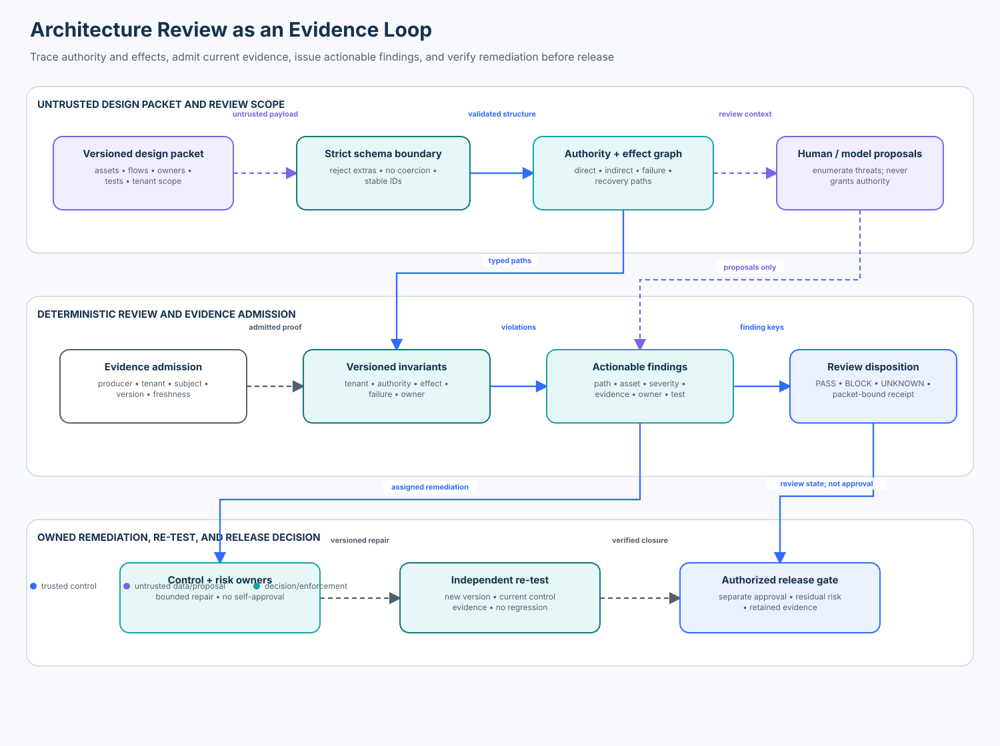

# 08 — Agent Security Architecture Review Workshop

<!-- roadmap-status -->
> **Roadmap status: Published.** This course includes a chapter, deterministic review engine, strict Pydantic v2 adapter, labelled fixtures, executable lab, notebook, architecture diagram, invariant tests, metrics, and checkpoint.

## Capability

Find, prioritize, prove, and remediate agent-system security gaps using a
repeatable evidence rubric. The goal is not a polished diagram or a long list
of recommendations. It is a review record that another team can reproduce and
use to decide whether a design is safe enough to proceed.

**Audience:** senior application and platform engineers, security architects,
AI assurance practitioners, and technical risk owners.

**Time:** 75–100 minutes for the chapter and notebook; 45–60 minutes for the
review exercise.

**Prerequisites:** Courses 02, 03, 05, 07, and familiarity with tenant-aware
agent systems, tool/effect boundaries, policy enforcement, and test evidence.

## Learning outcomes

By the end, you can:

1. turn an incomplete design packet into an asset, authority, data, and failure
   graph rather than trusting the drawing alone;
2. distinguish a generic recommendation from an actionable, evidence-backed
   finding with a violated invariant, attack path, severity, owner, and test;
3. trace direct, indirect, encoded, cross-tenant, fail-open, and stale-evidence
   paths through agent, model, data, protocol, and effect boundaries;
4. separate model or reviewer proposals from deterministic admission,
   authorization, disposition, and remediation verification;
5. measure finding precision, severe-gap recall, remediation quality, and
   reviewer agreement with explicit numerators and denominators; and
6. productionize the workshop with current policy, authenticated evidence,
   independent control owners, release gates, and retained review history.

## The course thesis

> An architecture review is useful only when it maps authority-changing paths
> to explicit invariants, admits current evidence, assigns accountable owners,
> and re-tests the remediated design.

A role, persona, typed object, model explanation, diagram label, or reviewer
confidence is not authority. A model may help enumerate paths or draft a
finding. Trusted application and infrastructure code validates the packet,
derives tenant and identity from authenticated state, evaluates deterministic
invariants, records the disposition, and verifies remediation.



## Enterprise scenario

Northstar Support plans to launch a multi-tenant agent that reads customer
records, invokes protocol-connected tools, updates tickets, and issues refunds.
The review team receives a diagram, API inventory, test excerpts, and owner
list. The drawing looks reasonable, but the packet contains:

- a direct refund path without complete tenant and effect-boundary controls;
- an encoded export capability routed through a protocol bridge;
- an authority path that fails open when policy evidence is unavailable;
- stale test evidence from the previous design version;
- a cross-tenant ticket target; and
- an indirect path without an accountable owner.

A diagram-only check sees valid endpoints and reports no problem. The workshop
traces each flow and blocks the packet with seven specific findings.

## State of the art: November 2026 snapshot

Architecture review draws from several complementary bodies of work. None of
them proves that a particular agent deployment is safe.

| Source | Current role in this course | What it does not prove |
| --- | --- | --- |
| [NIST AI RMF 1.0](https://doi.org/10.6028/NIST.AI.100-1) and [NIST AI 600-1 Generative AI Profile](https://doi.org/10.6028/NIST.AI.600-1) | Organize risk work across Govern, Map, Measure, and Manage and connect risks to accountable lifecycle activities. NIST reports that AI RMF 1.0 is being revised, so reviews record the version used. | That a named runtime control exists or blocks an attack path. |
| [NIST CSF 2.0](https://doi.org/10.6028/NIST.CSWP.29) | Connect design findings to Govern, Identify, Protect, Detect, Respond, and Recover outcomes. | Agent-specific authority, tool, memory, protocol, or model boundaries. |
| [OWASP Top 10 for Agentic Applications 2026](https://genai.owasp.org/resource/owasp-top-10-for-agentic-applications-for-2026/) | Seed agent-specific abuse cases such as goal hijacking, tool misuse, privilege abuse, supply-chain compromise, memory poisoning, insecure inter-agent communication, and cascading failures. | Completeness for one system or evidence that a mitigation is enforced. |
| [OWASP Multi-Agentic System Threat Modeling Guide v1.0](https://genai.owasp.org/resource/multi-agentic-system-threat-modeling-guide-v1-0/) | Provide a worked agentic threat-modeling lens for identities, messages, tools, orchestration, and shared state. | The local system's trusted identity, policy, or effect semantics. |
| [MITRE ATLAS](https://atlas.mitre.org/) | Supply a living knowledge base of adversary tactics and techniques involving AI-enabled systems. | Risk ranking, control efficacy, or release readiness for this design. |
| [CISA Secure by Design](https://www.cisa.gov/securebydesign) | Reinforce ownership of security outcomes and early design correction. | A testable invariant or an implementation-specific threat model. |

Treat taxonomies as prompts for coverage, not checklists that turn green merely
because a technique was mentioned. Record source version, retrieval date, and
the local mapping decision. A missing taxonomy mapping can be a coverage gap;
a present mapping is not evidence of mitigation.

## Tool and SDK landscape

Select tools for their job in the review pipeline. Do not let a tool's output
become an unverified release decision.

| Tool or library | Useful role | Boundary to preserve |
| --- | --- | --- |
| [OWASP Threat Dragon](https://owasp.org/www-project-threat-dragon/) | Collaborative data-flow diagrams, threats, and mitigations. | Diagram elements and mitigation labels remain review inputs. |
| [pytm](https://github.com/izar/pytm) | Threat-model-as-code, repeatable model generation, and custom findings. | The Python model represents the declared design, not observed runtime truth. |
| [Threagile](https://threagile.io/) | YAML-based threat models, risk rules, and generated reports. | Generated risks still need local severity, evidence, ownership, and verification. |
| [Microsoft Threat Modeling Tool](https://learn.microsoft.com/azure/security/develop/threat-modeling-tool) | Structured DFD review using templates and threat rules. | Template coverage does not establish agent-specific authorization or runtime behavior. |
| [MITRE ATLAS Navigator data](https://github.com/mitre-atlas/atlas-navigator-data) | Technique mapping and review coverage visualization. | Technique coverage is not detection or prevention coverage. |
| [NIST AI Resource Center](https://airc.nist.gov/) | AI RMF profiles, playbook material, and risk-management resources. | Framework outcomes must be translated into system-specific controls and tests. |
| [Pydantic v2](https://docs.pydantic.dev/latest/) | Strictly parse the untrusted design-packet schema in this lab. | Schema-valid data is not authenticated, authorized, current, or correct. |

The lab uses Pydantic because a strict contract catches malformed packets before
review logic runs. The security disposition remains deterministic Python code.
Production teams may connect the same contracts to their architecture catalog,
policy engine, CI evidence store, ticket system, and release platform.

## Mental model: review as an evidence loop

```text
authenticated review context
          |
          v
strict packet parsing -> assets + flows + evidence versions
          |
          v
authority/effect graph -> deterministic invariants -> finding register
          |                                         |
          |                                         v
          |                               severity + owner + test
          |                                         |
          v                                         v
explicit PASS / BLOCK / UNKNOWN <- independent remediation verification
          |
          v
version-bound release decision and retained evidence
```

The review has three different responsibilities:

| Actor | Appropriate work | Must not own alone |
| --- | --- | --- |
| Model or reviewer | Propose assets, paths, threats, mappings, attack hypotheses, and draft prose. | Identity, authorization, final severity, accepted risk, or release state. |
| Review service | Validate structure, derive scope, evaluate invariants, admit evidence, create receipts, and calculate metrics. | Production execution or self-approval of exceptions. |
| Control and risk owners | Implement controls, supply authenticated tests, accept bounded residual risk, and approve release through separate authority. | Editing evidence to make the review pass. |

## 1. Establish review scope before finding threats

Record the exact system and decision under review:

- packet ID, immutable version, tenant/environment, commit or deployment digest;
- business purpose, prohibited uses, data classes, and material effects;
- human, workload, agent, tool, protocol, model, and provider identities;
- entry points, storage, memory, retrieval, external resources, and side effects;
- trust boundaries and the owner of the target resource or effect;
- normal, degraded, containment, recovery, and shutdown modes; and
- evidence cutoff, reviewer identities, rule version, and decision deadline.

If scope or evidence is unavailable, the disposition is `UNKNOWN`, not `PASS`.
Unknown is an operational state that needs a named next action.

## 2. Build four connected views

### Asset view

List what matters: customer data, credentials, memory, models, policies,
approvals, checkpoints, evidence, budgets, external effects, and recovery
mechanisms. Include tenant, owner, criticality, lifecycle, and source of truth.

### Authority view

For every transition, ask what identity and capability arrive at the target,
who minted them, how tenant/resource ownership is bound, where current policy
is checked, and whether delegated authority is a strict subset of the parent.

### Data and instruction view

Track prompts, retrieved content, tool results, peer messages, memory,
configuration, and logs. Content can influence a proposal but cannot change
policy, identity, approval, or capability merely by containing instructions.

### Failure and recovery view

Trace timeouts, stale policy, duplicate delivery, replay, partial effects,
provider outage, queue redelivery, cancellation, and recovery. A fallback that
widens authority is a new design and requires its own review.

## 3. Convert review questions into invariants

This workshop evaluates five invariant families:

| Invariant | Deterministic question | Typical evidence |
| --- | --- | --- |
| `INV-TENANT-SCOPE` | Do authenticated tenant and both endpoint owners remain in the reviewed scope? | identity/ownership test and negative cross-tenant case |
| `INV-AUTHORITY-MEDIATION` | Does every authority-changing flow have workload identity, tenant binding, current policy enforcement, and an evidence receipt? | policy decision and boundary test |
| `INV-EFFECT-BOUNDARY` | Does every material effect enforce exact authorization, egress scope, and idempotency at the owning boundary? | denied bypass, duplicate-effect test, verified postcondition |
| `INV-FAIL-CLOSED` | Does authority remain denied or explicitly unknown when a dependency fails? | outage test and reconciliation trace |
| `INV-ACCOUNTABLE-OWNER` / `INV-CURRENT-EVIDENCE` | Is a named owner accountable, and is producer-authenticated evidence bound to this tenant, flow, and packet version? | owner registry plus fresh control-test artifact |

Names, comments, diagrams, and green build badges do not satisfy these
invariants. The evidence must exercise the boundary the finding claims to
protect.

## 4. Admit evidence before relying on it

The lab admits an evidence artifact only when all of these are true:

- producer authentication succeeded;
- tenant matches the authenticated review scope;
- subject identifies the exact flow;
- source version equals the packet version;
- observation time is not in the future and expiry is still current; and
- a non-empty digest binds the artifact contents.

Production evidence also needs access control, retention, chain of custody,
revocation, and an independently operated trust root. The local fixture digest
and HMAC are teaching integrity mechanisms, not production signing systems.

## 5. Write an actionable finding

Every finding in `architecture_review.py` contains:

1. stable invariant and flow identifiers;
2. affected asset and explicit attack path;
3. severity based on effect and exploitability;
4. admitted evidence references and known evidence gaps;
5. accountable owner;
6. bounded remediation; and
7. a verification test that can close the finding.

“Add guardrails,” “use zero trust,” or “improve monitoring” is advice, not a
finding. It does not say what is violated, where enforcement belongs, or how a
reviewer can verify closure.

## 6. Rank without averaging away severe gaps

Use severity to express consequence and urgency, not reviewer confidence:

- **Critical:** credible unauthorized cross-tenant disclosure/action or an
  unmediated consequential effect. Blocks release and cannot be averaged away.
- **High:** fail-open authority, missing accountable ownership, or absent/stale
  proof for a critical boundary. Blocks release until fixed or separately
  governed under an explicit policy.
- **Medium:** localized robustness or observability gap with bounded impact.
- **Low:** defense-in-depth or clarity improvement with no material control gap.

Risk acceptance is a separate, version-bound workflow. A review receipt is not
an exception, approval, deployment credential, or production authorization.

## 7. Worked review: the flawed support-agent packet

The labelled packet contains seven findings:

| Flow | Finding | Why it matters | Verifiable repair |
| --- | --- | --- | --- |
| `direct-refund` | authority mediation | tenant binding is absent | derive tenant from trusted identity and deny a cross-tenant negative test |
| `direct-refund` | effect boundary | exact effect authorization and idempotency are absent | enforce at the refund owner and prove duplicate-safe denial/execution |
| `encoded-export` | effect boundary | an encoded capability still reaches a material effect | classify by target/effect semantics, not capability text |
| `encoded-export` | fail closed | policy outage becomes an open path | return `UNKNOWN`/`DENY`, reconcile, and retry only under policy |
| `encoded-export` | accountable owner | no team owns the path | assign an operational and remediation owner |
| `encoded-export` | current evidence | the test is from packet version 2 | attach authenticated control-test evidence for version 3 or later |
| `cross-tenant-update` | tenant scope | a north runtime targets a south-owned asset | enforce target ownership from authenticated state |

The remediated packet increments its version, corrects each path, attaches
current control tests, and passes a second evaluation. Closing a ticket without
that re-review is not remediation proof.

## 8. Metrics with honest denominators

The lab exposes every count through a `Metric` record:

```text
finding precision = labelled true findings returned / all findings returned
severe-gap recall = labelled critical findings returned / all labelled critical findings
remediation quality = verified closures / attempted closures
reviewer agreement = equal include/exclude decisions / fixed review universe
```

Important interpretations:

- precision does not measure coverage;
- recall does not measure finding usefulness or remediation quality;
- agreement does not measure correctness—two reviewers can agree and be wrong;
- blocked attack attempts are not successful security violations; and
- a zero-size population reports `None`, not a fabricated 0% or 100%.

The fixture demonstrates the weakness of the baseline: diagram-only severe-gap
recall is `0/4`, while the structured review is `4/4`. Two reviewer submissions
agree on `8/10` fixed decisions; the disagreement is shown for adjudication
rather than hidden inside an average.

## 9. Failure injections

Run the same rules against:

- missing tenant binding on a direct refund path;
- an encoded export name that defeats keyword review;
- a cross-tenant target with otherwise complete controls;
- stale, wrong-version, future, unauthenticated, and empty-digest evidence;
- fail-open and degraded authority paths;
- a missing owner;
- unavailable evidence storage, which yields `UNKNOWN`; and
- a valid read path that must remain usable.

The tests also reject duplicate IDs, unknown endpoints, coerced booleans,
unknown fail modes, changed packet identity, unversioned remediation, tampered
receipts, and remediation without a current control test.

## 10. Hands-on lab

From this directory:

```bash
python lab.py
```

The lab:

1. parses the synthetic packet with the real Pydantic v2 adapter;
2. runs the weak diagram-only baseline;
3. reviews direct, indirect, encoded, cross-tenant, ownership, and evidence gaps;
4. verifies the packet-bound review receipt;
5. turns evidence-store outage into `UNKNOWN`;
6. applies a versioned remediation packet;
7. verifies each closure with current control-test evidence; and
8. prints all metric numerators and denominators.

Run the focused tests from the repository root:

```bash
python -m pytest -q tests/test_enterprise_architecture_review_workshop.py
```

Open `architecture_review_workshop.ipynb` for the guided learner path. It
imports the same modules the tests exercise; it does not carry a second,
notebook-only implementation.

## 11. Productionization map

| Teaching component | Production replacement |
| --- | --- |
| local dataclasses and Pydantic parsing | authenticated architecture catalog/API with schema evolution and access control |
| synthetic packet | immutable, versioned design bundle bound to commits, deployments, owners, data inventory, and policies |
| local HMAC receipt | managed signing service/HSM, verifier distribution, key rotation, revocation, and append-only audit store |
| deterministic fixture labels | maintained abuse-case suite with independent security review and change control |
| local evidence tuple | admitted CI/runtime evidence service with provenance, retention, freshness, and tenant isolation |
| in-process rule evaluation | versioned policy/rule service with review, rollback, fail-closed behavior, and availability objectives |
| local remediation function | ticket/change workflow plus independent re-test and release-gate integration |
| two synthetic reviewers | calibrated reviewer program with adjudication, sampling, drift checks, and conflict-of-interest controls |

At production scale, add concurrency control, atomic disposition transitions,
packet supersession, exception expiry, evidence revocation, notification,
legal/privacy review, and explicit ownership for detection, containment,
recovery, and retained review artifacts.

## 12. Workshop exercises

### Exercise A — Add a memory write boundary

Add a `memory.write` flow and a poisoned-memory fixture. Define controls for
subject/tenant binding, provenance, retention, supersession, and system-of-
record precedence. Add one valid and two adversarial tests.

### Exercise B — Review a delegated A2A effect

Model a parent agent delegating `ticket.read` to a peer that attempts
`ticket.resolve`. Prove capability attenuation at the receiving boundary and
ensure a peer message cannot widen scope.

### Exercise C — Add bounded risk acceptance

Implement a separate exception record bound to finding key, packet digest,
tenant, exact residual risk, approver role, policy version, issue/expiry times,
and non-waivable severity. Do not mutate the finding to “fixed.”

### Exercise D — Connect a threat-modeling tool

Export the packet to Threat Dragon, pytm, or Threagile. Preserve stable flow
IDs so generated threats can be reconciled with the deterministic finding
register. Document what remains manual and what the tool cannot prove.

## Checkpoint

### 1. What separates an actionable finding from a generic recommendation?

It names the violated invariant, exact attack path and asset, admitted evidence
or evidence gap, severity, accountable owner, bounded remediation, and a test
that independently verifies closure.

### 2. The diagram shows mTLS between the orchestrator and refund service. Is the refund path authorized?

Not necessarily. mTLS authenticates a peer connection. The refund owner must
also verify current workload/user delegation, tenant and resource ownership,
exact capability, policy, approval when required, idempotency, and postcondition.

### 3. Reviewers agree on every finding. Can the release gate pass?

Agreement alone says nothing about correctness or coverage. Compare findings
with the labelled or adjudicated universe, severe-gap recall, runtime tests,
evidence freshness, residual risk, and policy. A shared blind spot can produce
perfect agreement.

### 4. The evidence service is unavailable. What is the review disposition?

`UNKNOWN`. Do not infer that absent evidence means absence of risk or reuse
stale evidence silently. Restore or reconcile evidence, then rerun the version-
bound review.

## Definition of done

A production architecture review is complete only when:

- scope, packet version, tenant/environment, rule version, and evidence cutoff
  are explicit;
- assets and all authority, data, instruction, effect, failure, and recovery
  paths have owners;
- severe threats include direct and indirect abuse cases;
- every finding is reproducible and mapped to an invariant and evidence;
- evidence is authenticated, authorized, current, version-bound, and retained;
- remediation advances the packet version and passes independent tests;
- severe gaps are closed or handled by a separate permitted exception process;
- metrics retain their populations and denominators;
- `UNKNOWN` and degraded states have operational owners; and
- the final release decision is made by the authorized release boundary, not
  by a model, reviewer narrative, or review receipt alone.

## Authoritative references

- [NIST AI Risk Management Framework 1.0](https://doi.org/10.6028/NIST.AI.100-1)
- [NIST AI 600-1: Generative Artificial Intelligence Profile](https://doi.org/10.6028/NIST.AI.600-1)
- [NIST Cybersecurity Framework 2.0](https://doi.org/10.6028/NIST.CSWP.29)
- [OWASP Top 10 for Agentic Applications 2026](https://genai.owasp.org/resource/owasp-top-10-for-agentic-applications-for-2026/)
- [OWASP Agentic AI Threats and Mitigations](https://genai.owasp.org/resource/agentic-ai-threats-and-mitigations/)
- [OWASP Multi-Agentic System Threat Modeling Guide v1.0](https://genai.owasp.org/resource/multi-agentic-system-threat-modeling-guide-v1-0/)
- [MITRE ATLAS](https://atlas.mitre.org/)
- [CISA Secure by Design](https://www.cisa.gov/securebydesign)
- [Pydantic v2 documentation](https://docs.pydantic.dev/latest/)
