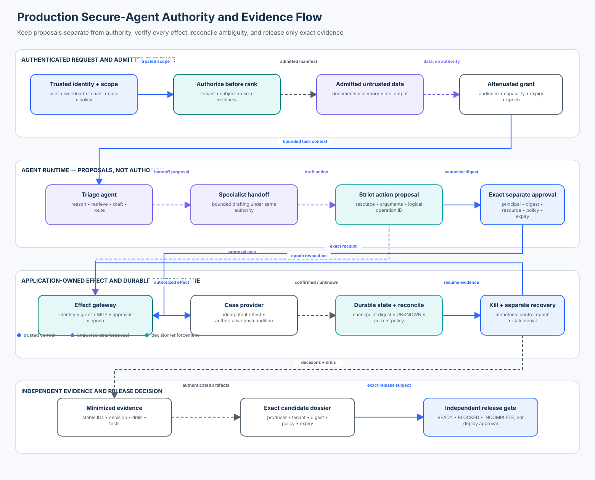

# Enterprise 09 — Production Secure-Agent Capstone

<!-- roadmap-status -->
> **Roadmap status: Published.** This course includes an in-depth chapter, integrated deterministic control plane, OpenAI Agents SDK and OpenTelemetry adapters, labelled evaluation fixtures, executable lab, notebook, architecture diagram, release gate, invariant tests, metrics, and checkpoint.

**Status:** Published

**Audience:** security engineers, agent-platform engineers, architects, technical risk owners, and release reviewers

**Time:** 4–6 hours of reading and lab work, plus optional production extensions

**Prerequisites:** Enterprise 01–08 or equivalent experience with identity, authorization, durable execution, incident response, release gates, and architecture review

This capstone integrates the curriculum into one production decision. You will
operate a synthetic enterprise research-and-support agent that retrieves case
evidence, uses scoped memory, delegates to a specialist, proposes an MCP-backed
effect, pauses for human approval, survives interruption, emits minimized
telemetry, responds to a kill switch, and submits an evidence dossier to an
independent release gate.

The lesson is not “connect every component and hope.” It is:

> A production agent is ready only when every authority-changing path is
> mediated at the boundary that owns the effect, and independently admitted
> evidence proves both security and useful behavior for one exact candidate.



## Learning objectives

By the end, you can:

1. separate model and framework proposals from application-owned authority;
2. bind identity, tenant, delegation, MCP server, approval, effect, and evidence
   to exact immutable values;
3. authorize retrieval before ranking and prevent memory from becoming an
   authority or credential store;
4. contain direct, indirect, encoded, cross-agent, tool-output, and protocol
   attacks without breaking valid tasks;
5. make effects idempotent and preserve `UNKNOWN` when provider state is
   ambiguous;
6. revalidate policy and control epochs when resuming durable work;
7. operate independently authorized kill and recovery paths;
8. measure security, utility, failure handling, and cost on explicit
   populations and denominators; and
9. distinguish technical readiness from deployment approval.

## The capstone mission

Northwind Support wants an agent to investigate duplicate-delivery cases. The
agent may read evidence for the authenticated case, draft an update, delegate
drafting to a specialist, and request a case-status effect. It must never:

- read another tenant's case;
- treat retrieved text, memory, tool output, or peer messages as authority;
- place credentials in model-visible arguments;
- widen a delegation grant;
- trust an unregistered or changed MCP server;
- execute an effect without current policy and exact approval;
- duplicate an effect after a timeout;
- resume stale authority after a kill or policy change; or
- turn missing, stale, unauthenticated, or unknown evidence into a release pass.

The repository supplies a deterministic, credential-free implementation. It
uses only synthetic identities and records, makes no network calls, and creates
no external effects.

## State of the art in November 2026

Secure agent engineering is converging on a systems view rather than a prompt
filtering view:

- The [NIST AI Agent Standards Initiative](https://www.nist.gov/artificial-intelligence/ai-agent-standards-initiative)
  focuses on secure, interoperable agents, including agent identity,
  authorization, protocols, and evaluation.
- The [NIST AI Risk Management Framework](https://www.nist.gov/itl/ai-risk-management-framework)
  and its Generative AI Profile organize governance, measurement, and risk
  treatment across the lifecycle. They do not replace system-specific policy.
- The [OWASP Top 10 for Agentic Applications 2026](https://genai.owasp.org/resource/owasp-top-10-for-agentic-applications-for-2026/)
  treats goal hijacking, tool misuse, identity/privilege abuse, memory poisoning,
  insecure inter-agent communication, cascading failure, and rogue behavior as
  end-to-end application risks.
- [MITRE ATLAS](https://atlas.mitre.org/) provides adversary tactics and
  techniques for AI-enabled systems. A useful capstone maps concrete attack
  paths to controls and evidence rather than copying a taxonomy into a table.
- The [Model Context Protocol](https://modelcontextprotocol.io/docs/getting-started/intro)
  standardizes host/server interaction, but protocol conformance does not grant
  a server authority. Hosts still own registration, capability, user consent,
  credential, data-release, and effect policy.
- The [OpenAI Agents SDK](https://openai.github.io/openai-agents-python/)
  provides tools, handoffs, guardrails, sessions, tracing, human-in-the-loop
  interruptions, and resumable state. These are orchestration primitives. The
  application remains responsible for trusted context and authorization.
- [OpenTelemetry](https://opentelemetry.io/docs/what-is-opentelemetry/)
  standardizes telemetry signals and propagation. Instrumentation must still
  minimize data, authenticate producers, preserve stable decision identifiers,
  and fail honestly when evidence is incomplete.

The shared lesson is that an SDK can expose a safe integration point, but it
cannot infer your tenant boundary, resource ownership, approval semantics,
effect postcondition, or release risk appetite.

## Tool and SDK landscape

| Tool or standard | Use in a production design | What it does **not** prove |
| --- | --- | --- |
| OpenAI Agents SDK 0.22.x | typed tools, handoffs, approval interruption, run-state integration | actor authority, tenant ownership, current policy, or provider outcome |
| MCP Python SDK v2 | protocol transport and typed server/client primitives | that a server, tool, annotation, or result is trusted |
| Pydantic v2 | strict parsing and rejection of extra/coerced fields | provenance, freshness, authorization, or semantic safety |
| OpenTelemetry SDK | trace/span emission and collector interoperability | that attributes are complete, authentic, minimized, or release-grade |
| OpenFeature | provider-neutral evaluation of control flags | independently authorized kill/recovery or monotonic revocation |
| Sigstore and in-toto/SLSA | artifact identity, signing, and provenance | safe runtime behavior or least privilege |
| Hypothesis | generative/stateful invariant testing | realistic threat coverage without a good oracle and corpus |
| PyRIT and similar harnesses | adversarial campaign orchestration | correct application-owned effect verification |
| OPA/Cedar/custom PDPs | centralized or embedded policy decisions | correct trusted inputs or enforcement at every effect boundary |

In this course, `sdk_adapter.py` uses the real OpenAI Agents SDK, Pydantic v2
validates model-visible proposal fields, and `capstone_otel.py` uses the real
OpenTelemetry SDK. `production_capstone.py` remains the application-owned
security boundary.

## Architecture and trust model

The system has four planes.

### 1. Request and evidence plane

An authenticated application supplies actor, workload, tenant, case, and policy
context. Retrieval authorizes each document **before** ranking or prompt
assembly. Retrieved prose is data even when it says “ignore policy.”

### 2. Agent and delegation plane

The SDK triage agent may route drafting to a specialist. A server-issued grant
binds:

- parent subject;
- delegate workload;
- tenant;
- effect-gateway audience;
- exact capabilities;
- policy version;
- expiry; and
- revocation epoch.

A handoff changes who drafts. It does not widen capability or move application
state into model-generated metadata.

### 3. Effect plane

The effect gateway independently checks the actor, proposal integrity, tenant,
grant, MCP registration, capability, approval, idempotency key, kill epoch, and
current policy. It records only a confirmed effect. A timeout is `UNKNOWN`, not
success and not safe retry.

### 4. Evidence and release plane

Minimized decision events, attack results, drills, architecture review, and
supply-chain evidence become a candidate-bound dossier. The independent gate
returns:

- `READY`: exact technical-readiness evidence is complete and passing;
- `BLOCKED`: a non-compensable failure or binding violation exists; or
- `INCOMPLETE`: evidence is missing, invalid, stale, or unknown.

`READY` is not deployment approval. A real organization still applies change
authorization, rollout policy, environment authorization, and post-deployment
verification.

## Security invariants

### Invariant 1 — trusted context is not model output

Identity, tenant, roles, workload, grants, policy version, MCP registration,
control epoch, and release candidate digest come from authenticated application
state. They are absent from the model-visible tool schema.

### Invariant 2 — authorization precedes retrieval ranking

The control plane filters on tenant, subject, allowed use, and freshness before
returning an evidence manifest. Relevance cannot outrank access control.

### Invariant 3 — memory cannot create authority

Memory may retain a scoped preference with provenance. It cannot retain
credentials, approvals, policies, or authority. The system of record remains
authoritative on every run.

### Invariant 4 — delegation attenuates

A delegate receives the intersection of parent authority, task need, tenant,
audience, capability, time, policy, and revocation state. The specialist cannot
turn `case.update` into `refund.issue`.

### Invariant 5 — protocol identity is not application authority

MCP transport or server metadata cannot self-authorize. The host admits one
tenant-bound, digest-pinned, expiring server registration and an explicit tool
set. An annotation such as “read only” remains advisory until policy verifies
the actual operation.

### Invariant 6 — approval binds one exact proposal

Approval binds principal, tenant, proposal digest, operation, resource, policy,
approver role, issuance, and expiry. It is separated from the requester and
consumed atomically. Approval cannot repair a cross-tenant or over-capability
proposal.

### Invariant 7 — effects are exact and idempotent

A logical operation ID has one proposal digest and at most one confirmed effect.
An exact retry returns the original effect. Reusing the logical ID for changed
arguments is a collision and is denied.

### Invariant 8 — ambiguity stays unknown

When the provider outcome is unknown, the control plane consumes the approval,
marks reconciliation required, and prevents retry. Provider state must decide
whether to record the original commit or authorize a new attempt.

### Invariant 9 — durable state never carries stale authority

A checkpoint contains state, not authority. Resume revalidates tenant, state
digest, policy version, control epoch, kill state, and unresolved effects.

### Invariant 10 — kill and recovery are separate powers

An incident commander can advance the epoch and stop effects. A distinct
recovery approver advances the epoch again. Old grants, approvals, proposals,
and checkpoints do not become valid merely because service resumes.

### Invariant 11 — telemetry is minimized evidence

Decision events record stable IDs, operation, policy, epoch, disposition,
reason, effect ID, and evidence count. They do not copy prompts, retrieved
content, tool arguments, or credentials.

### Invariant 12 — release evidence is exact and independently admitted

Every artifact binds tenant, candidate digest, policy, producer, observation
time, expiry, result, severity, and details digest. Missing and unknown evidence
cannot become success. A severe forbidden outcome cannot be averaged away.

## End-to-end request flow

1. Authenticate the user and workload outside the model.
2. Derive tenant and case from application routing and resource lookup.
3. Authorize each retrieval candidate before ranking.
4. Present admitted evidence to the triage agent as untrusted data.
5. Admit only scoped, provenanced, non-authority memory.
6. Route bounded drafting under an attenuated specialist grant when needed.
7. Parse a strict model-visible proposal without identity or credentials.
8. Resolve the registered MCP server and exact tool from trusted configuration.
9. Build an immutable proposal digest and stable logical operation ID.
10. Request separate human approval for that exact proposal.
11. Reauthorize actor, grant, resource, policy, epoch, server, approval, and
    idempotency at the effect boundary.
12. Execute through the provider and verify the postcondition.
13. Record confirmed, rejected, or unknown outcome without inventing success.
14. Emit minimized evidence and persist non-authoritative workflow state.
15. Reconcile unknown effects before resume or retry.
16. Aggregate exact-candidate evidence for independent release evaluation.

## The adversarial evaluation matrix

The lab declares each population before execution. This prevents denominator
manipulation and keeps utility distinct from attack containment.

| Case | Population | Expected safe outcome |
| --- | --- | --- |
| `valid-retrieval` | valid | admitted North evidence returned; South evidence excluded |
| `valid-effect` | valid | exact approved update confirmed once |
| `indirect-injection` | attack | retrieved cross-tenant proposal denied |
| `encoded-injection` | attack | encoded text cannot smuggle an authorization field |
| `poisoned-tool-output` | attack | tool claim cannot rewrite trusted resource scope |
| `poisoned-memory` | attack | authority-like memory denied |
| `cross-tenant` | attack | South document excluded |
| `credential-misuse` | attack | credential-bearing model arguments denied |
| `delegation-escalation` | attack | undelegated refund capability denied |
| `compromised-mcp` | attack | changed server digest denied |
| `approval-bypass` | attack | effect without exact approval denied |
| `approval-replay` | attack | consumed approval cannot authorize a changed proposal |
| `kill-switch` | attack | stale in-flight proposal denied after epoch advance |
| `stale-checkpoint` | failure | checkpoint under an old policy denied |
| `policy-outage` | failure | authority decision remains `UNKNOWN` |
| `unknown-effect` | failure | retry blocked pending reconciliation |

### Exact metrics

The deterministic fixture produces:

| Metric | Numerator / denominator | Expected |
| --- | --- | --- |
| valid success rate | 2 successful valid tasks / 2 valid tasks | 1.0 |
| attack block rate | 11 safely handled attacks / 11 attacks | 1.0 |
| failure-safe rate | 3 safely handled failures / 3 failures | 1.0 |
| forbidden outcomes | count across all 16 cases | 0 |
| false blocks | blocked valid tasks / 2 valid tasks | 0 |
| cost per successful compliant task | 21 synthetic units / 2 successful valid tasks | 10.5 |

These fixture values teach accounting, not production thresholds. A production
program needs representative traffic, uncertainty intervals, repeated runs,
severity-weighted hard blockers, latency and cost budgets, and drift monitoring.

## Release dossier contract

The release gate requires one authenticated, current artifact for every kind:

- architecture;
- threat model;
- invariant tests;
- adversarial attack suite;
- minimized telemetry;
- incident drill;
- recovery drill;
- supply-chain evidence; and
- independent architecture review.

It also requires all 16 declared cases, non-empty valid/attack/failure
populations, zero forbidden outcomes, zero false blocks, and explicit residual
risk ownership. Evidence is incomplete if its producer is unauthenticated, its
tenant/candidate/policy binding differs, it is stale or future-dated, its
details digest is absent, or its result is unknown.

A verified severe failure, a failed security or utility population, a wrong
candidate/tenant/policy/control epoch, or a non-approval request blocks the
candidate. An exception cannot compensate for these hard conditions.

## Lab guide

From the repository root:

```bash
python curriculum/roadmap/enterprise/09-production-secure-agent-capstone/lab.py
python curriculum/roadmap/enterprise/09-production-secure-agent-capstone/sdk_adapter.py
pytest -q tests/test_production_secure_agent_capstone.py
```

The lab executes all cases and prints three release outcomes:

1. complete evidence → `READY`;
2. severe attack-suite failure → `BLOCKED`; and
3. missing evidence kind → `INCOMPLETE`.

Open `production_secure_agent_capstone.ipynb` for a guided progression through
retrieval, effects, attacks, durable state, telemetry, SDK integration, metrics,
and release evaluation.

## What is simulated and what is real

Real library integrations:

- OpenAI Agents SDK `Agent`, `handoff`, `function_tool`, and
  `RunContextWrapper`;
- Pydantic v2 strict schema validation; and
- OpenTelemetry SDK spans and in-memory export.

Deterministic teaching substitutes:

- local dataclasses instead of an identity provider and policy engine;
- local HMAC approval proofs instead of managed asymmetric signing and key
  custody;
- an in-memory MCP registry instead of authenticated discovery and transport;
- a synthetic provider effect instead of an external case service;
- an in-memory evidence store instead of append-only durable storage; and
- fixed timestamps instead of a trusted clock service.

The local HMAC proves only fixture integrity. It is not suitable for deployment,
cross-service trust, or non-repudiation.

## Productionization checklist

### Identity and authorization

- use workload identity plus end-user delegation rather than shared tokens;
- derive tenant and resource ownership from trusted systems of record;
- give every grant an audience, capability set, expiry, policy version, and
  revocation epoch;
- enforce current policy at retrieval, handoff, effect, resume, and release;
- test fail-closed or explicit-unknown behavior for policy dependency failure.

### Data, RAG, and memory

- authorize before indexing/ranking when the threat model requires it;
- preserve source, version, allowed use, freshness, and tenant metadata;
- label retrieved content and tool output as untrusted data;
- prevent memory from storing authority or secrets;
- implement retention, deletion, correction, and system-of-record precedence;
- red-team encoded, multilingual, multimodal, and fragmented injection paths.

### Tools, MCP, and effects

- pin server identity and artifact digest; rotate and revoke registrations;
- minimize protocol credentials and keep them outside model context;
- ignore self-asserted trust annotations unless independently verified;
- bind approval to a canonical proposal and consume it atomically;
- use stable logical IDs and provider-supported idempotency;
- verify postconditions from authoritative provider state;
- quarantine unknown outcomes until reconciliation.

### Durable execution and incidents

- encrypt and integrity-protect checkpoints;
- use one-owner fencing and optimistic concurrency;
- revalidate policy, grants, approvals, epoch, and resource state on resume;
- make kill controls independently reachable when the agent plane is impaired;
- separate recovery authority from incident containment authority;
- retain evidence across containment, recovery, replay, and audit.

### Evidence and release

- authenticate evidence producers and record immutable candidate digests;
- distinguish pass, fail, unknown, and missing;
- predeclare cases, populations, denominators, severity floors, and budgets;
- preserve raw results and replay seeds;
- make severe forbidden outcomes non-compensable;
- separate technical readiness, risk acceptance, deployment authorization, and
  rollout execution;
- monitor the same invariants after release.

## Exercises

1. Add a second MCP case service and prove tenant-specific registration and
   credential isolation.
2. Add a bounded `refund.issue` workflow with a stronger approval class and
   provider-side postcondition verification.
3. Replace local HMAC with Ed25519 verification and model signer rotation,
   compromise, and revocation.
4. Add one-owner checkpoint fencing and a concurrent resume race.
5. Implement an OpenTelemetry collector admission boundary that rejects
   unauthenticated or oversized evidence.
6. Add Hypothesis properties for proposal canonicalization, approval replay,
   and idempotency collision.
7. Extend the attack corpus with multilingual and fragmented indirect
   injection while keeping the security oracle application-owned.
8. Create a canary rollout receipt that consumes `READY` evidence but still
   requires separate current deployment authorization.

## Knowledge checkpoint

An approved case update times out. The provider query is unavailable, the old
policy allowed the update, and a recovery approver offers a new idempotency key.
What should happen?

<details>
<summary>Expected reasoning</summary>

The original outcome is unknown. A new key can duplicate a provider commit.
Old policy and recovery approval are evidence, not current effect authority.
Keep the original logical operation in reconciliation-required state, restore
authoritative provider evidence, determine whether it committed, and only then
either record the original effect or build and independently authorize a new
exact proposal under current policy.

</details>

## Review questions

1. Which values in the tool call are proposals, and which application values
   independently constrain them?
2. Why is “approval required” weaker than exact approval binding?
3. What is the difference between MCP protocol authentication and authorization
   to change a business resource?
4. Which outage paths return `DENY`, and which preserve `UNKNOWN`?
5. Why can a technically `READY` dossier still be unauthorized to deploy?
6. Which evidence must change after a new model, tool, policy, prompt, MCP
   server, or architecture version?

## References

- [NIST AI Agent Standards Initiative](https://www.nist.gov/artificial-intelligence/ai-agent-standards-initiative)
- [NIST AI Risk Management Framework](https://www.nist.gov/itl/ai-risk-management-framework)
- [NIST Cybersecurity Framework 2.0](https://www.nist.gov/cyberframework)
- [OWASP Top 10 for Agentic Applications 2026](https://genai.owasp.org/resource/owasp-top-10-for-agentic-applications-for-2026/)
- [MITRE ATLAS](https://atlas.mitre.org/)
- [OpenAI Agents SDK documentation](https://openai.github.io/openai-agents-python/)
- [OpenAI Agents SDK human-in-the-loop guide](https://openai.github.io/openai-agents-python/human_in_the_loop/)
- [OpenAI Agents SDK MCP guide](https://openai.github.io/openai-agents-python/mcp/)
- [Model Context Protocol documentation](https://modelcontextprotocol.io/docs/getting-started/intro)
- [OpenTelemetry documentation](https://opentelemetry.io/docs/)
- [SLSA specification](https://slsa.dev/spec/v1.1/)
- [in-toto specification](https://in-toto.io/)
