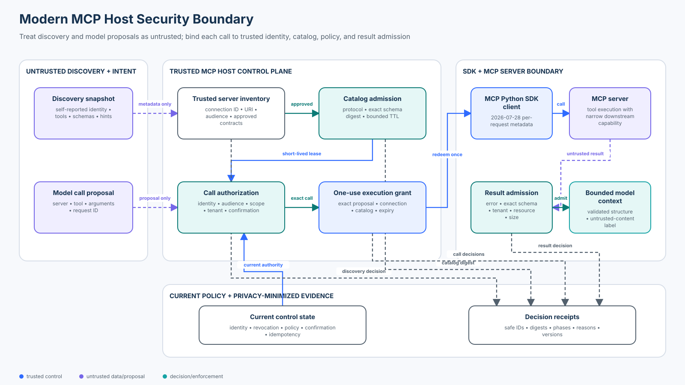

# 09 — MCP Security

<!-- roadmap-status -->
> **Roadmap status: Published.** This course includes a deterministic modern-MCP host boundary, official MCP Python SDK v2 adapter, executable notebook, architecture source, 28-case adversarial evaluation, focused tests, and Learning Hub checkpoint.

Build an MCP host that treats protocol metadata as interoperability data—not authority—and binds every tool call to authenticated identity, one approved server connection, an exact catalog, current policy, narrow credentials, and independent result admission.



The editable coordinates, ports, routes, and accessibility text live in [`architecture-spec.json`](architecture-spec.json).

## Course metadata

- **Level:** Intermediate
- **Time:** 4–5 hours
- **Prerequisites:** [F05 — Authorization, Approval, and Least Privilege](../../beginner/05-authorization-approval-and-least-privilege/README.md), [I03 — Agent Identity and Delegated Authority](../03-agent-identity-and-delegated-authority/README.md), [I06 — Network Egress and SSRF](../06-network-egress-ssrf-and-external-resource-security/README.md), and [I07 — Tool-result and Output Poisoning](../07-tool-result-and-output-poisoning/README.md)
- **Format:** protocol chapter, deterministic Python control plane, real MCP Python SDK v2 adapter, guided notebook, adversarial evaluation, and tests
- **Scenario:** a multi-tenant support host connects to an MCP server that can read cases and issue bounded service credits
- **Last reviewed:** 2026-10-25

## Security thesis

MCP standardizes how hosts, clients, and servers exchange capabilities and content. It does not turn a server name, description, annotation, schema, resource URI, state handle, tool result, or user-looking prompt into trusted authority.

```text
authenticate host request
  → resolve trusted principal, tenant, roles, and current token claims
  → connect through an authenticated inventory entry
  → discover protocol metadata and list tools
  → reconcile exact security-relevant catalog shape with approved policy
  → expose only application-owned tool descriptions to the model
  → validate one exact call against current identity, audience, scope, tenant, and confirmation
  → mint and redeem a one-use execution grant
  → invoke through the official SDK with a narrow downstream capability
  → validate error state, result shape, tenant, resource binding, and size
  → label admitted content untrusted before model exposure
```

The host and server both enforce access. A prompt can propose a call. Only trusted application code can authorize, dispatch, verify, and record it.

## Learning outcomes

By the end, you can:

1. Map the MCP host, client, server, transport, authorization, discovery, tool, resource, prompt, elicitation, and extension boundaries.
2. Explain the modern `2026-07-28` stateless request era and its difference from handshake-era sessions.
3. Keep authenticated connection identity separate from self-reported `serverInfo`, server instructions, tool descriptions, and annotations.
4. Pin an approved tool catalog to exact security-relevant schemas, a protocol version, trusted connection, local policy version, and bounded expiry.
5. Enforce issuer, resource audience, subject, tenant, role, scope, argument, resource-ownership, confirmation, and idempotency policy before `tools/call`.
6. Prevent token passthrough by exchanging the inbound access decision for a narrow downstream capability.
7. Revalidate `structuredContent`, error state, tenant, target, and size before exposing a result to a model.
8. Distinguish protocol errors, policy denials, tool execution errors, result blocks, and dependency failures.
9. Use the stable MCP Python SDK v2 `MCPServer` and `Client` APIs in a credential-free in-process lab.
10. Measure catalog-drift blocking, attack blocking, forbidden dispatches, valid-task blocking, and trace completeness with explicit denominators.

## Artifacts

| Artifact | Purpose |
| --- | --- |
| [`lab.py`](lab.py) | Reusable deterministic host control plane and 28-case evaluation |
| [`sdk_adapter.py`](sdk_adapter.py) | Real MCP Python SDK v2 discovery and tool-call integration |
| [`mcp_security.ipynb`](mcp_security.ipynb) | Guided baseline, modern protocol inspection, attacks, recovery, and evaluation |
| [`architecture-spec.json`](architecture-spec.json) | Versioned diagram geometry, routes, ports, and alt text |
| [`architecture.svg`](architecture.svg) | Deterministically rendered architecture image |
| [`tests/test_mcp_security.py`](../../../../tests/test_mcp_security.py) | Catalog, identity, call, confirmation, grant, result, and evaluation invariants |
| [`tests/test_mcp_security_sdk.py`](../../../../tests/test_mcp_security_sdk.py) | Official SDK v2 negotiation, discovery, execution, and boundary checks |

All identities, tokens, records, and results are synthetic. The default path opens no socket, calls no model, uses no API key, and makes no real side effect.

## Why this course is distinct from the earlier gateway lab

The earlier [Intermediate 02 MCP Gateway](../../../intermediate/02-mcp-gateway/README.md) establishes the basic admission/result-gate pattern. I09 extends that foundation into the current protocol lifecycle:

- `server/discover`, per-request metadata, modern version negotiation, and cache freshness;
- authenticated connection identity versus self-reported server identity;
- catalog contract pinning and tool-definition rug pulls;
- application-owned model-facing descriptions;
- one-use execution grants between authorization and SDK dispatch;
- current Python SDK v2 APIs and structured results; and
- protocol-era migration, extensions, state handles, and operational ownership.

The goal is not a second generic tool wrapper. It is a secure host architecture for a dynamic MCP ecosystem.

## Threat model and trust boundaries

| Boundary | Attack or failure | Consequence | Executable control |
| --- | --- | --- | --- |
| Endpoint → host | server reports a trusted-looking `serverInfo.name` | self-assertion becomes identity | trusted inventory keys policy by authenticated `connection_id` |
| Discovery → model | instructions or descriptions request privilege | server content changes host policy | expose application-owned descriptions only |
| Tool list → catalog | known schema changes or an `exfiltrate` tool appears | rug pull or capability widening | exact normalized catalog digest and short lease |
| Cache → call | expired catalog remains selectable | stale contract reaches execution | bound expiry and current policy/catalog recheck |
| Prompt → call | prompt supplies tenant, role, or extra fields | identity substitution or schema bypass | trusted principal plus exact application schema |
| Token → server | wrong issuer, audience, subject, tenant, time, or revocation | confused deputy or cross-resource use | deterministic claim validation before dispatch |
| Host → downstream API | inbound token is forwarded | token passthrough and weak attribution | gateway-minted narrow downstream capability |
| Sensitive tool | vague confirmation or replayed boolean | unintended or repeated effect | exact, expiring, single-use confirmation receipt |
| Grant → SDK | proposal, server, catalog, or policy changes | time-of-check/time-of-use bypass | one-use grant bound to all decision inputs |
| Server → model | extra fields, cross-tenant data, wrong target, oversized result | injection, leakage, or resource exhaustion | independent result admission and untrusted label |
| Dependency | timeout or exception after dispatch | fabricated success or unsafe retry | typed `error`, stable operation ID, no output |
| Audit | token, instructions, or raw case text is logged | secondary disclosure | identifiers, digests, phases, versions, reasons only |

### Protected assets

The protected assets are not limited to bearer tokens. They include tenant-confidential records and even their existence; server allowlists; approved tool contracts; confirmation state; idempotency state; downstream credentials; decision evidence; and the integrity of model-visible context.

### Non-goals

The lab does not claim production transport authentication, TLS, OAuth implementation, cryptographic signing, distributed atomicity, universal JSON Schema support, prompt-injection detection, or safe execution of arbitrary local servers. The in-process SDK transport proves API and protocol integration, not network security. Replace in-memory maps and local locks with managed identity, policy, secret, transactional, and telemetry systems in production.

## Mental model: five planes

| Plane | What MCP provides | What the application must still own |
| --- | --- | --- |
| Transport | JSON-RPC exchange over in-process, stdio, or Streamable HTTP | endpoint/workload authentication, TLS, egress, redirect and SSRF policy |
| Discovery | versions, capabilities, self-reported metadata, tools/resources/prompts | inventory, approval, catalog pinning, safe model-facing descriptions |
| Authorization | optional HTTP OAuth profile and scope challenges | business authorization, tenant/resource ownership, confirmation, separation of duties |
| Execution | typed request and result envelopes | one-use grant, budget, timeout, idempotency, downstream credential isolation |
| Context | resources, prompts, tool content, structured content | provenance, privacy, result admission, injection containment, release policy |

Schema-valid is not synonymous with authorized. Authenticated is not synonymous with permitted. A trusted server can be misconfigured or compromised. A permitted call can still return unsafe data.

## Current MCP mechanics — October 2026

### Two protocol eras

The current final MCP revision is `2026-07-28`. Its core requests are stateless and self-contained. Each request carries protocol context in `_meta`; `server/discover` reports supported versions, capabilities, cache hints, instructions, and optional self-reported server information.

The earlier era, through `2025-11-25`, begins with `initialize`, negotiates a connection session, and supports server-initiated requests. A current client may support both eras, but security policy must be explicit about which behavior is allowed. Session identifiers from the older era and state handles in either era are names, not authentication or authority.

The official Python SDK v2 `Client(target, mode="auto")` probes modern discovery and falls back to the handshake era for older servers. Pinning a version skips discovery and therefore does not establish server identity or capabilities. This course uses automatic negotiation, then applies independent inventory and catalog policy.

### Discovery is not authentication

`server/discover` returns:

- supported protocol versions;
- advertised capabilities;
- optional natural-language instructions;
- cache lifetime and scope; and
- optional `_meta["io.modelcontextprotocol/serverInfo"]`.

The specification says `serverInfo` is self-reported and should not drive security decisions. The lab deliberately lets a server call itself `self-asserted-production`; the policy still keys the connection by `workload:spiffe://example.test/mcp/support` supplied by trusted infrastructure.

Discovery cache hints are maximum reuse advice, not a requirement to trust stale data. The host clamps remote TTL to a stricter local maximum. A zero TTL is immediately stale. A policy disable or catalog change invalidates an existing execution grant even if an older cache entry has time remaining.

### Tool schemas and annotations

The tool specification supports JSON Schema 2020-12 inputs, optional output schemas, annotations, structured content, and tool-generated resource links. These improve interoperability, but:

- annotations are untrusted unless the server is trusted;
- tool names are unique only within one server;
- self-reported server names are not guaranteed unique;
- `outputSchema` describes structure, not tenant authorization, provenance, or truth; and
- `x-mcp-header` can expose selected arguments to network intermediaries and must never mirror secrets or sensitive personal data.

The lab hashes normalized name/input/output shapes while ignoring presentation-only titles, descriptions, and examples. It never forwards server instructions or descriptions to the model. This is a deliberate policy choice: model-facing descriptions are reviewed application content.

### Authorization and token isolation

For HTTP transports, MCP's optional authorization profile treats the MCP server as an OAuth resource server. Current requirements build on protected-resource metadata, authorization-server discovery, resource indicators, and issuer validation. The client requests a token for the canonical MCP resource; the server validates that the token is intended for itself.

Token passthrough is forbidden. An MCP server must not accept a token issued for another resource and forward it downstream. A production server should use its own workload identity, token exchange, or credential broker for each upstream API. The lab models this by deriving a short fingerprint for a grant-scoped downstream capability; the synthetic inbound token ID never crosses the execution boundary.

HTTP OAuth does not apply to stdio. A local server normally receives needed credentials from its environment, which makes command review, secret scoping, sandboxing, filesystem access, and process privileges critical.

### Multi-round-trip input and consent

Modern `2026-07-28` connections have no server-initiated request channel. Elicitation, sampling, or roots-dependent work is represented as an input-required result and retried with a sealed state handle and explicit responses. The Python SDK's resolver mechanism can bridge modern and legacy behavior.

Protocol elicitation is a transport mechanism, not proof of authorization. Consequential actions still require an application-owned receipt bound to the principal, tenant, exact action digest, policy version, approver, issue time, expiry, and unused state. I09 implements a compact confirmation receipt; I10 treats human-in-the-loop design in depth.

### Error semantics

Keep failure classes distinct:

| Class | Example | Model-visible? | Retry rule |
| --- | --- | --- | --- |
| Protocol error | unknown method, malformed envelope | usually diagnostic | correct protocol request |
| Policy denial | wrong audience, cross-tenant target | no sensitive result | terminal until authority changes |
| Tool execution error | validated call reaches business error | bounded error may help correction | only when safe and within budget |
| Result block | server returned extra/cross-scope data | no raw blocked data | investigate server/contract |
| Dependency error | timeout or unavailable service | typed error, no fabricated output | reconcile unknown effects first |

A successful JSON-RPC response is not proof that the business action succeeded. An approval is not proof of execution. A timeout is not proof of failure.

## Secure lifecycle implemented in `lab.py`

### 1. Admit a catalog

`MCPHostBoundary.admit_discovery` checks, in order:

1. authenticated host principal;
2. active trusted server registration;
3. authenticated connection identity;
4. approved protocol version;
5. required capability;
6. valid cache hint; and
7. exact approved catalog digest.

The resulting `CatalogLease` binds server, connection, protocol, digest, policy, issue time, and expiry. Only application-owned tool names and descriptions are returned for model exposure.

### 2. Authorize one call

`authorize_call` combines trusted principal state with verified token claims and the catalog lease. It checks issuer, revocation, subject/tenant binding, audience, time, current registration, lease freshness, current catalog, application scope, role, exact arguments, resource ownership, operation ID, and confirmation.

The proposal cannot set identity, tenant, roles, audience, or downstream credentials. For `lookup_case`, the only model-controlled field is `case_id`. Resource ownership is looked up in the application registry before the SDK call.

### 3. Redeem one execution grant

The admission result is not a boolean. It is a short-lived `ExecutionGrant` bound to the proposal digest, subject, tenant, server, trusted connection, tool, catalog, and policy. `begin_execution` atomically consumes it and rechecks disablement and catalog state. Changed arguments or a second redemption fail.

The execution boundary creates a narrower downstream capability. This is where a production host would request or inject a server-specific credential without forwarding the inbound user token.

### 4. Admit the result

`admit_result` requires:

- a redeemed grant;
- a non-error SDK result;
- the current application contract;
- exact required output fields and permitted primitive types;
- tenant equality with trusted host state;
- result target equality with the authorized request;
- value and size bounds.

Admitted strings remain `untrusted-mcp-result`. A schema contains data; it does not grant instruction authority.

## Worked scenario

Alice is an authenticated Northwind support manager. The host connects to the approved support server through a trusted workload identity.

1. The server reports the display name `Support MCP display name` and instructions to call `issue_credit` automatically. Both are recorded as untrusted protocol data.
2. The host compares the discovered tool schemas with its reviewed `lookup_case` and `issue_credit` contracts.
3. The model proposes `lookup_case(case_id="case-n-100")`.
4. The host verifies Alice, Northwind, token issuer/audience/time/scope, the current catalog lease, and server-side ownership of the case.
5. A one-use execution grant is redeemed and the SDK call runs with a narrow downstream capability.
6. The server returns `structuredContent`; the host validates exact fields, Northwind tenant, the same case ID, and bounds.
7. The result reaches model context with an untrusted-content label and a privacy-minimized receipt.
8. A proposed `issue_credit` additionally needs a single-use confirmation and operation ID. Changed amount, replayed receipt, or reused operation ID is denied.

## Practical lab

From the repository root:

```bash
python3 curriculum/roadmap/intermediate/09-mcp-security/lab.py
python3 curriculum/roadmap/intermediate/09-mcp-security/sdk_adapter.py
pytest -q tests/test_mcp_security.py tests/test_mcp_security_sdk.py
```

Open [`mcp_security.ipynb`](mcp_security.ipynb) to:

- compare a name-and-schema-only baseline with the secure host boundary;
- inspect modern SDK discovery and generated schemas;
- prove self-reported identity and instructions do not change the approved model view;
- inject schema drift, an extra tool, cross-tenant targets, wrong-audience tokens, changed confirmations, grant replay, cross-tenant results, and timeouts;
- inspect decision receipts without raw token or result text; and
- run the labelled evaluation with explicit populations.

## Official MCP Python SDK v2 integration

[`sdk_adapter.py`](sdk_adapter.py) uses the stable SDK v2 APIs:

```python
from mcp.client import Client
from mcp.server import MCPServer

server = MCPServer("self-asserted-production")

@server.tool(structured_output=True)
def lookup_case(case_id: str) -> CaseResult:
    ...

async with Client(server, mode="auto") as client:
    tools = await client.list_tools(cache_mode="reload")
    result = await client.call_tool("lookup_case", {"case_id": "case-n-100"})
```

The in-process transport is appropriate for a deterministic test. Production remote servers normally use Streamable HTTP; local processes commonly use stdio. Transport choice changes operational risks, not the application authorization invariant.

The repository accepts `mcp>=2.2,<3`. On the 2026-10-25 review date, v2 is the stable line and v2.3.0 is the latest release. Fresh CI resolves a compatible current v2 release; learners should preserve the major-version cap and monitor official security advisories.

## Evaluation contract

`evaluate_controls()` executes 28 labelled cases:

| Population | Cases | Expected result |
| --- | ---: | --- |
| valid behavior | 4 | normal read, inert display spoof/instructions, and confirmed write succeed |
| catalog attacks | 6 | connection, version, capability, TTL, schema drift, and extra-tool cases fail before a lease |
| admission attacks | 11 | identity, token, scope, freshness, catalog, tenant, and argument attacks fail before dispatch |
| runtime/result attacks | 7 | confirmation, replay, result, and timeout failures terminate safely |

Metric definitions:

- `valid_completion_rate = successful valid cases / all valid cases`
- `attack_block_rate = safely terminated attack cases / all attack cases`
- `catalog_attack_block_rate = blocked catalog attacks / all catalog attacks`
- `forbidden_dispatch_rate = attack cases that reached the synthetic server / all attack cases`
- `valid_task_block_rate = blocked valid cases / all valid cases`
- `trace_completeness_rate = receipts containing every required decision field / inspected receipts`

Four runtime attacks intentionally reach the synthetic server so result admission and timeout behavior can be measured. The eleven admission attacks and six catalog attacks never dispatch. Therefore the expected fixture result is:

```text
valid completion          1.000
attack blocking           1.000
catalog attack blocking   1.000
forbidden dispatch        0.167  (4 / 24 attack cases)
valid task blocking       0.000
trace completeness        1.000
```

`forbidden_dispatch_rate` is not the same as forbidden outcome rate. A deliberately malformed result must reach the synthetic server to prove the result gate works, but no invalid result is released. Production dashboards should split pre-dispatch attacks, post-dispatch blocks, unknown effects, and actual forbidden outcomes.

## Technology landscape

| Option | Useful capability | Secure use | Boundary or caveat |
| --- | --- | --- | --- |
| MCP Python SDK v2 | `MCPServer`, first-class `Client`, both protocol eras, structured results, built-in tracing | use current v2, explicit mode policy, strict host controls, bounded transports | SDK validation does not grant tenant/business authority |
| MCP TypeScript, Go, and C# SDKs | Tier 1 protocol implementations | apply the same host/server invariants and version policy | API shape and feature timing differ by SDK |
| MCP Inspector | interactive capability and message inspection | development-time schema/result review | inspection is not endpoint authentication or production approval |
| MCP Registry | standardized server metadata and distribution discovery | dependency inventory and review input | registry presence is not authorization or execution safety |
| Streamable HTTP | remote interoperable transport | TLS, origin pinning, body limits, OAuth, egress, redirect policy | metadata discovery creates SSRF and mix-up surfaces |
| stdio | simple local process integration | exact command review, sandbox, minimal environment, restricted filesystem/network | server runs with client process privileges unless isolated |
| OAuth resource indicators | resource-bound tokens | request exact MCP resource and validate audience/issuer | transport authorization does not replace business policy |
| OpenTelemetry | SDK spans and distributed correlation | record safe IDs, versions, decisions, latency, and errors | prompts, tokens, arguments, and content may be sensitive |
| JSON Schema 2020-12 | interoperable input/output shapes | bounded local validation and application constraints | avoid arbitrary remote `$ref`; shape is not authorization or truth |
| Tasks extension | opt-in long-running operations | explicit lifecycle, polling, input, cancellation, durable ownership | extension is independently versioned; SDK support and semantics must be verified |

Select an SDK for maintenance, compatibility, documentation, transport support, observability, and organizational language—not because it claims to make an untrusted server safe.

## State of practice

- **Established:** explicit server inventory, least-privilege tokens, no token passthrough, human confirmation for sensitive tools, exact input validation, output admission, sandboxed local servers, audit records, and dependency review.
- **Current protocol direction:** stateless per-request metadata, `server/discover`, cacheable capability discovery, multi-round-trip input, protocol extensions, stable Tier 1 SDKs, and standardized telemetry.
- **Maturing:** enterprise server registries, workload identity, policy-as-code around dynamic catalogs, signed distribution metadata, extension governance, cross-SDK conformance, and fine-grained scope step-up.
- **Research frontier:** usable consent at tool-ecosystem scale, continuous server behavior attestation, semantic contract change detection, compositional authorization across chained servers, and evaluation that predicts real-world agent misuse.
- **Open problem:** no registry badge, protocol schema, annotation, model guardrail, or single scanner proves that an evolving server is benign, authorized for this caller, and safe under every downstream dependency.

## Failure modes and recovery

| Failure | Unsafe response | Required response |
| --- | --- | --- |
| discovery unavailable | reuse an unbounded old catalog | use a still-valid policy-bound lease or fail closed |
| known tool schema changes | silently accept compatible-looking fields | quarantine, review, update approved digest, retest |
| server advertises extra tool | expose it to the model | keep hidden and treat exact-catalog policy as drift |
| insufficient scope | let model request administrator scope | bounded application-controlled step-up or terminal denial |
| confirmation changes | ask user to approve only the tool name | show exact target/arguments and issue a new bound receipt |
| tool times out after possible effect | create a new operation ID and retry | preserve operation ID and reconcile provider state |
| result violates schema/tenant | pass raw text as fallback | block, record reason, investigate server/contract |
| state handle belongs to another user | treat handle possession as permission | reauthorize principal and tenant on every use |
| OAuth metadata redirects internally | follow automatically | validate every hop, restrict schemes/IPs, use egress controls |
| local server package changes | execute on next client start | pin, verify, review provenance, sandbox, and stage rollout |

## Production upgrade checklist

- Authenticate the endpoint/workload independently of `serverInfo` and registry metadata.
- Keep a reviewed server inventory with owner, endpoint, version, provenance, transport, privileges, data classes, allowed tools, incident contact, and disable switch.
- Pin supported MCP eras and test downgrade/fallback behavior.
- Reconcile every discovered security-relevant contract with application policy; do not auto-expose new tools.
- Clamp discovery and list cache TTLs; invalidate on policy, incident, dependency, and catalog changes.
- Use Streamable HTTP for new remote deployments; enforce TLS, origin and redirect policy, response/body limits, DNS/IP protections, and an egress proxy where appropriate.
- For OAuth, validate protected-resource and authorization-server metadata, issuer, redirect URI, state, PKCE, resource/audience, scope, time, and revocation.
- Never accept or forward a token issued for another resource. Broker a server/upstream-specific credential.
- Keep model-controlled inputs narrow. Derive identity, tenant, role, resource scope, credentials, and confirmation outside the model payload.
- Treat tool annotations and descriptions as untrusted. Use application-reviewed descriptions for model selection.
- Require exact, expiring, single-use confirmation for consequential tools; bind it to the complete action digest.
- Use stable logical operation IDs, bounded retries, and reconciliation for uncertain effects.
- Reauthorize state handles every time; use high entropy, ownership binding, expiry, and server-side storage.
- Validate protocol errors, execution errors, structured content, resource links, embedded resources, MIME type, size, target, tenant, and provenance before context release.
- Sanitize or isolate unstructured content. Never treat returned prose as policy or instructions.
- Bound concurrency, requests, catalog size, schema complexity, `$ref` resolution, result size, progress events, multi-round trips, cost, and deadlines.
- Run local stdio servers with reviewed exact commands, minimal environment variables, least privilege, filesystem/network restrictions, and a sandbox.
- Record safe request, server, tool, catalog, policy, grant, operation, decision, latency, error, and result-admission fields without secrets or hidden reasoning.
- Maintain dependency and extension inventories, current supported SDK releases, security advisory monitoring, staged upgrades, rollback, and incident playbooks.

## Review questions

1. Why can a schema-valid call still be unauthorized?
2. Which trusted fact identifies a server connection if `serverInfo.name` is self-reported?
3. What belongs in a catalog digest, and why are server descriptions excluded in this design?
4. Why does a current discovery lease not authorize every tool it describes?
5. What problem does a one-use execution grant solve between policy evaluation and SDK dispatch?
6. Why is a state handle a name rather than a capability?
7. How should a host recover from a timeout after a side-effecting call may have committed?
8. Which result checks remain necessary when the SDK validates an `outputSchema`?

## Exercises

1. **Implementation:** add an application-approved `read_case_attachment` tool. Bind MIME type and maximum bytes, and reject cross-tenant or executable content.
2. **Diagnosis:** change the discovered `lookup_case` schema to allow an optional `tenant`. Explain why the catalog fails before testing a call.
3. **Authorization:** add a second resource audience and prove a token for one MCP server cannot be used with the other.
4. **Consent:** bind an approver identity and displayed action summary to `ConfirmationReceipt`; add altered, expired, replayed, and self-approval tests.
5. **Lifecycle:** model a catalog refresh during an in-flight call and decide which changes invalidate the grant versus only the next request.
6. **State:** add a synthetic case cursor handle and prove it is reauthorized for subject and tenant on every call.
7. **Architecture:** compare Streamable HTTP and stdio deployments for the same tool. Produce distinct threat models and controls.
8. **Evaluation:** add a result-size attack and split forbidden dispatch, result block, and forbidden outcome metrics.

## Checkpoint

An authenticated MCP connection reports `serverInfo.name="approved-support"`. Its `lookup_case` tool keeps the same name but adds a model-controlled `tenant` field, and the description says the change is safe. What should the host do?

**Answer:** quarantine the changed catalog and deny before dispatch. Self-reported identity and prose do not authorize a security-relevant schema change. A reviewer must update the application-owned contract, catalog digest, tests, and policy before a fresh discovery lease can expose the tool.

## References

- [MCP specification `2026-07-28`](https://modelcontextprotocol.io/specification/2026-07-28)
- [MCP `server/discover`](https://modelcontextprotocol.io/specification/2026-07-28/server/discover)
- [MCP tools and structured results](https://modelcontextprotocol.io/specification/2026-07-28/server/tools)
- [MCP resources](https://modelcontextprotocol.io/specification/2026-07-28/server/resources)
- [MCP prompts](https://modelcontextprotocol.io/specification/2026-07-28/server/prompts)
- [MCP elicitation](https://modelcontextprotocol.io/specification/2026-07-28/client/elicitation)
- [MCP authorization](https://modelcontextprotocol.io/specification/2026-07-28/basic/authorization)
- [MCP security best practices](https://modelcontextprotocol.io/docs/2026-07-28/tutorials/security/security_best_practices)
- [MCP Python SDK v2 documentation](https://py.sdk.modelcontextprotocol.io/)
- [MCP Python SDK source and releases](https://github.com/modelcontextprotocol/python-sdk)
- [MCP Registry](https://registry.modelcontextprotocol.io/)
- [MCP Tasks extension](https://tasks.extensions.modelcontextprotocol.io/specification/draft/tasks)
- [RFC 8707 — Resource Indicators for OAuth 2.0](https://www.rfc-editor.org/rfc/rfc8707)
- [RFC 9728 — OAuth 2.0 Protected Resource Metadata](https://www.rfc-editor.org/rfc/rfc9728)
- [RFC 9207 — OAuth 2.0 Authorization Server Issuer Identification](https://www.rfc-editor.org/rfc/rfc9207)
- [OAuth 2.0 Security Best Current Practice (RFC 9700)](https://www.rfc-editor.org/rfc/rfc9700)

Previous: [I08 — Agentic RAG Security](../08-agentic-rag-security/README.md).

Next: [I10 — Human-in-the-loop Security](../10-human-in-the-loop-security/README.md).
