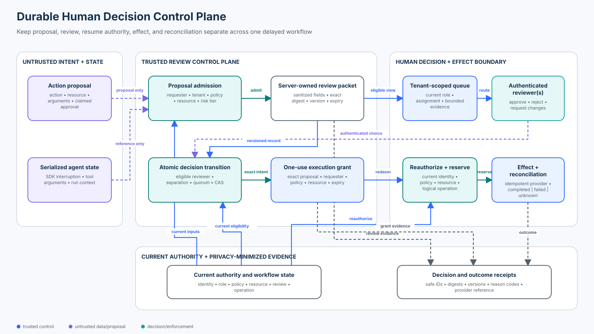

# 10 — Human-in-the-Loop Security

<!-- roadmap-status -->
> **Roadmap status: Published.** This course includes a durable human-decision control plane, a real OpenAI Agents SDK interruption adapter, an executable notebook, architecture source, a 20-case adversarial evaluation, focused tests, and a Learning Hub checkpoint.

Design human review as a server-owned security workflow—not an `approved=true` field—and carry one authenticated decision safely across delay, concurrency, policy change, execution, and recovery.



The editable coordinates, routes, ports, and accessibility text live in [`architecture-spec.json`](architecture-spec.json).

## Course metadata

- **Level:** Intermediate
- **Time:** 4–5 hours
- **Prerequisites:** [F05 — Authorization, Approval, and Least Privilege](../../beginner/05-authorization-approval-and-least-privilege/README.md), [I02 — State, Checkpoint, and Durable Execution Security](../02-state-checkpoint-and-durable-execution-security/README.md), and [I03 — Agent Identity and Delegated Authority](../03-agent-identity-and-delegated-authority/README.md)
- **Format:** security chapter, deterministic Python control plane, real OpenAI Agents SDK adapter, guided notebook, adversarial evaluation, and tests
- **Scenario:** a multi-tenant support agent requests a refund that may require one or two finance reviewers
- **Last reviewed:** 2026-10-28

## Security thesis

A human click is an input to a security decision. It is not authority by itself.

```text
authenticate requester and derive tenant-bound proposal
  → admit the proposed action under current policy
  → persist a sanitized review packet in server-owned state
  → route only to eligible tenant-scoped reviewers
  → authenticate and authorize each decision
  → enforce separation of duties, quorum, expiry, and optimistic concurrency
  → mint a short-lived one-use grant for the exact proposal
  → reauthorize requester, resource, policy, and business state at resume
  → atomically reserve one logical operation
  → execute once or preserve an unknown outcome for reconciliation
  → retain privacy-minimized decision and outcome evidence
```

The model may propose an action and explain why it thinks review is useful. Trusted application code owns the review record, reviewer eligibility, decision transition, execution grant, resume checks, effect boundary, and recovery path.

## Learning outcomes

By the end, you can:

1. Distinguish human oversight, approval, business authorization, and execution authority.
2. Model a review request as durable server-owned state with an explicit lifecycle.
3. Build a review packet that helps a human decide without disclosing secrets or rendering hostile content as trusted UI.
4. Route work through tenant-scoped queues and enforce reviewer authentication, role, separation of duties, and quorum.
5. Prevent stale-tab decisions and concurrent double decisions with versioned atomic transitions.
6. Bind an approval to one requester, tenant, action, resource, argument digest, policy version, resource version, expiry, and use.
7. Reauthorize the delayed action immediately before execution.
8. Handle timeouts as unknown outcomes and reconcile them without minting a second approval.
9. Use OpenAI Agents SDK interruptions and `RunState` without letting a browser or model replace trusted state or tool arguments.
10. Measure valid workflow completion, bypass, replay, altered-intent success, failure containment, and trace completeness with explicit denominators.

## Artifacts

| Artifact | Purpose |
| --- | --- |
| [`lab.py`](lab.py) | Durable review control plane and deterministic 20-case evaluation |
| [`sdk_adapter.py`](sdk_adapter.py) | Real OpenAI Agents SDK tool interruption and `RunState` round trip |
| [`human_in_the_loop_security.ipynb`](human_in_the_loop_security.ipynb) | Guided baseline, secure lifecycle, attacks, recovery, SDK exercise, and evaluation |
| [`architecture-spec.json`](architecture-spec.json) | Versioned diagram geometry, routes, ports, and alt text |
| [`architecture.svg`](architecture.svg) | Deterministically rendered control-plane diagram |
| [`tests/test_human_in_the_loop_security.py`](../../../../tests/test_human_in_the_loop_security.py) | Review, grant, concurrency, replay, recovery, privacy, and metric invariants |
| [`tests/test_human_in_the_loop_security_sdk.py`](../../../../tests/test_human_in_the_loop_security_sdk.py) | SDK interruption, serialization, strict schema, and effect-boundary checks |

All people, tenants, cases, policies, and provider responses are synthetic. The default path calls no model, requires no API key, opens no socket, and creates no real refund.

## Why this course is distinct from Foundation 05

[Foundation 05](../../beginner/05-authorization-approval-and-least-privilege/README.md) establishes the governing rule: authorization and exact approval must come from trusted policy state, not model text. I10 assumes that rule and examines what happens when a consequential workflow pauses for minutes or days:

- What information should the reviewer see, and what must never enter the UI?
- Which reviewer is eligible now, in this tenant, under separation-of-duties policy?
- What happens when two reviewers act from stale browser tabs?
- When does one reviewer suffice, and when is quorum required?
- What authority survives a policy, resource, requester, or employment-state change?
- How does serialized agent state relate to application-owned review state?
- What happens when the provider times out after the effect may already have happened?
- How do fatigue, queue pressure, escalation, and automation bias change the control's effectiveness?

This is the operational security of a durable human-decision system, not a second introduction to access control.

## Threat model and trust boundaries

| Boundary | Attack or failure | Consequence | Executable control |
| --- | --- | --- | --- |
| Model → proposal | model asserts `approved=true` | self-approval | ignore client approval claims; create a trusted review record |
| Proposal → UI | reason contains markup, secrets, or persuasive instructions | reviewer manipulation or disclosure | server-selected fields, escaping, redaction, and length bounds |
| Queue → reviewer | guessed review ID or cross-tenant listing | existence leak or unauthorized decision | tenant-scoped queue and indistinguishable unavailable response |
| Reviewer → decision | wrong role, self-approval, stale identity | unauthorized approval | current authentication, role, tenant, and separation-of-duties checks |
| Browser → store | two stale tabs decide the same request | conflicting decisions or duplicate quorum credit | expected version plus atomic compare-and-set |
| Decision → grant | arguments change after review | approved intent differs from executed effect | digest-bound, expiring, one-use execution grant |
| Delay → resume | policy, resource, or requester state changes | stale authority is exercised | reauthorization immediately before reservation |
| Resume → effect | two workers race or retry | duplicate refund | one logical operation and atomic grant consumption |
| Provider → workflow | timeout after dispatch | unsafe retry or fabricated failure | record `unknown`; reconcile provider state before any retry |
| Telemetry → operators | raw case text, tokens, or rationale leaks | secondary privacy incident | identifiers, digests, reason codes, versions, and timestamps only |

### Protected assets

The assets include funds; tenant-confidential case existence and content; requester and reviewer identity; reviewer independence; review rationale; policy and resource versions; one-use grants; idempotency state; provider references; and evidence needed for audit or incident response.

### Non-goals

The lab does not claim production identity, cryptographic signing, a distributed transaction, universal policy evaluation, fraud detection, accessibility certification, or guaranteed human judgment. Its in-memory lock and records make the invariants observable. Production replacements include managed identity, a transactional review store, a policy decision point, a durable workflow engine, provider idempotency keys, a secret manager, and privacy-governed telemetry.

## Human review is a control system

“Put a human in the loop” is incomplete. A useful design names:

- **trigger:** which risk, value, novelty, or policy condition creates review;
- **decision subject:** the exact proposed action and immutable evidence snapshot;
- **reviewer:** an authenticated person eligible for this tenant and action now;
- **decision:** approve, reject, or request changes, with bounded rationale codes;
- **transition:** an atomic server-side state change with an expected version;
- **authority:** a narrow execution grant derived from the accepted decision;
- **resume:** current authorization and resource checks after the delay;
- **outcome:** completed, failed, or unknown, with reconciliation ownership;
- **evidence:** privacy-minimized records sufficient to reconstruct the lifecycle.

The human is one component. Queue design, UI content, organizational independence, time pressure, and recovery operations determine whether the component works.

## Lifecycle and state machine

The lab keeps separate review and operation state:

```text
review: pending → approved → executing → completed
             ↘ rejected
             ↘ changes-requested
             ↘ expired
                              executing → unknown → completed | failed

operation:                  in-flight → completed
                                      ↘ unknown → completed | failed
```

Important rules:

1. Only a trusted submit path creates `pending`.
2. A decision is accepted only from `pending` at the caller's expected version.
3. Critical refunds require two distinct eligible reviewers.
4. Approval mints execution authority; it does not execute the effect.
5. Resume consumes the authority only after rechecking current state.
6. A reserved logical operation cannot be started again.
7. An unknown provider outcome must be reconciled, not blindly retried.

## The review packet

The reviewer should see enough to assess the action, not a raw transcript. `ReviewPacket` contains application-owned fields:

- review and request identifiers;
- tenant and authenticated requester subject;
- action, resource, and amount;
- an escaped, length-bounded display reason;
- the required reviewer role and quorum;
- proposal, policy, and resource versions;
- creation and expiry times.

The packet excludes API keys, bearer tokens, raw model context, hidden prompts, arbitrary HTML, and downstream credentials. In production, fetch supporting evidence through separately authorized links rather than embedding large confidential payloads.

### Human factors and secure UX

A technically correct approval can still fail under operational pressure. Protect the reviewer from:

- **automation bias:** show uncertainty, policy reason, and independent evidence—not a preselected “Approve” button;
- **habituation:** reserve review for meaningful decisions and monitor near-universal approval;
- **queue pressure:** set service levels, staffing, and escalation without silently weakening the policy;
- **social engineering:** label model-authored text and external content as untrusted;
- **choice confusion:** make reject, request changes, and expire first-class outcomes;
- **inaccessible UI:** test keyboard, screen-reader, color, and localization behavior;
- **rationale leakage:** use bounded codes plus separately governed notes when necessary.

Useful operational signals include approval rate by risk tier, median and tail decision time, stale-decision conflicts, self-approval denials, expired requests, escalation rate, override rate, reviewer concentration, post-approval blocks, unknown outcomes, and reconciliation age. Metrics are investigation signals, not quotas for individual reviewers.

## Reviewer eligibility, routing, and quorum

`reviewer_queue` derives visibility from authenticated tenant and role. Knowing an identifier does not grant read or decision access. Cross-tenant and unknown identifiers share an unavailable result to reduce existence disclosure.

`decide` rechecks:

1. review-store availability;
2. current reviewer authentication;
3. tenant equality;
4. required role;
5. separation from the requester;
6. pending and unexpired status;
7. expected record version; and
8. distinct reviewer identity for quorum.

Low-value refunds need one eligible reviewer. Critical refunds need two. A repeated click by the same person cannot satisfy quorum. Quorum is risk policy—not proof of correctness—and should be paired with fraud, conflict-of-interest, and staffing controls where required.

## Durable state and OpenAI Agents SDK interruptions

The OpenAI Agents SDK supports human approval with `function_tool(needs_approval=...)`. A run that reaches such a tool returns interruptions. `RunState` can be serialized, stored, deserialized, approved or rejected, and resumed.

That mechanism pauses agent execution; the application still owns the security workflow. The official guidance requires the server to retain state, authenticate and authorize the reviewer, avoid accepting replacement state or arguments from a client, and consume concurrent decisions atomically.

[`sdk_adapter.py`](sdk_adapter.py) demonstrates the real SDK without a model call:

1. a scripted SDK model proposes `issue_refund`;
2. `Runner.run` yields a real tool interruption;
3. `RunState.to_json()` and `RunState.from_json()` prove the durable SDK round trip;
4. only interruption identifiers and parsed proposal fields enter the course control plane;
5. the browser never supplies replacement SDK state or trusted arguments; and
6. the SDK-decorated refund function deliberately never performs the effect—the application effect boundary does.

### Sticky decisions need care

SDK approval state can apply to matching tool identities during a resumed run. Treat it as workflow coordination, not a reusable business authorization. Tools with broad argument surfaces—especially shell or patch tools—must not share one sticky approval merely because they share a tool name. Keep consequential tools narrow, bind application approval to exact arguments, and reauthorize each effect.

This repository pins `openai-agents>=0.22.2,<0.23`; the adapter is tested against that supported line. The upstream SDK was at `0.24.0` when this course was reviewed. SDK 0.x APIs can evolve, so pin the deployed version, review release notes, and rerun the adapter tests before upgrading.

## Exact grant and secure resume

An accepted approval creates `ExecutionGrant`, not a boolean. It binds:

- grant, review, requester, and tenant identifiers;
- exact proposal digest and logical operation ID;
- policy and resource versions;
- issue and expiry time; and
- unused state.

Immediately before execution, `_execution_reason` rechecks requester authentication, role and binding; exact grant; exact proposal digest; unknown or duplicate operation; unused and unexpired grant; approved status; current policy; current resource activity, tenant, version, and refundable balance; and the business limit.

This closes the time-of-check/time-of-use gap. A reviewer can approve a valid proposal at 09:00 and execution can still be denied at 09:05 if policy, ownership, balance, employment state, or the proposal changed.

## Atomic reservation and ambiguous outcomes

`begin_execution` consumes the grant and creates one `OperationRecord` while holding the store lock. Only then may the provider call run. A production system needs equivalent transactional or workflow-engine semantics.

Provider outcomes are classified:

| Outcome | Review state | Operation state | Next action |
| --- | --- | --- | --- |
| confirmed success | completed | completed | retain provider reference and receipt |
| confirmed failure before effect | failed | failed | investigate or submit a new proposal under policy |
| timeout or ambiguous response | unknown | unknown | query provider by logical operation ID; do not retry |
| reconciliation finds effect | completed | completed | record provider reference; no second effect |
| reconciliation finds no effect | failed | failed | close the operation; a new proposal requires new authority |

The logical operation ID is stable across provider queries. It is not a secret and does not replace authentication. The provider should also enforce idempotency.

## Worked scenario

Alice is an authenticated Northwind support agent. She proposes a USD 25 refund for a Northwind case.

1. The server ignores the proposal's forged `client_claimed_approved=True` field.
2. Admission resolves the case and current refund policy, then stores a sanitized packet.
3. Only Northwind finance approvers see the item in their queue.
4. Alice cannot approve her own proposal, even if a client adds a finance role.
5. Reviewer Fiona submits an approval at record version 1.
6. The server atomically accepts it and mints a two-minute, one-use grant for the exact digest.
7. Resume rechecks Alice, policy version, case version, tenant, amount, grant, and operation ID.
8. One worker reserves the operation; a racing worker is denied.
9. The provider confirms the refund and returns a reference.
10. Receipts retain identifiers, digests, versions, phases, and reason codes—not the raw case narrative.

A USD 55 critical refund requires Fiona and a second distinct finance approver. If the provider times out, the state becomes `unknown`; a recovery worker reconciles the existing operation instead of replaying it.

## Practical lab

From the repository root:

```bash
python3 curriculum/roadmap/intermediate/10-human-in-the-loop-security/lab.py
python3 curriculum/roadmap/intermediate/10-human-in-the-loop-security/sdk_adapter.py
pytest -q tests/test_human_in_the_loop_security.py tests/test_human_in_the_loop_security_sdk.py
```

Open [`human_in_the_loop_security.ipynb`](human_in_the_loop_security.ipynb) to:

- exploit a naive boolean gate;
- inspect a sanitized review packet and tenant-scoped queue;
- approve and execute one exact low-risk proposal;
- satisfy a critical two-person quorum;
- alter arguments after approval and observe denial;
- race execution workers and prove one reservation;
- preserve and reconcile an unknown provider outcome;
- create and serialize a real OpenAI Agents SDK interruption; and
- run the labelled evaluation with explicit populations and denominators.

## Adversarial evaluation

`evaluate_controls()` reports 20 labelled cases:

| Population | Denominator | Coverage |
| --- | ---: | --- |
| Valid | 5 | normal approval, critical quorum, rejection, request changes, safe display |
| Attack | 12 | forged approval, guessed ID, self/cross-tenant/wrong-role reviewer, changed amount/resource, stale resource/policy/grant, grant replay, stale decision version |
| Failure | 3 | unavailable review store, reviewer timeout/expiry, ambiguous provider outcome and reconciliation |

Expected deterministic result:

```text
valid workflow completion       5/5  = 1.00
valid approval completion       2/2  = 1.00
attack effect rate              0/12 = 0.00
approval bypass rate            0/5  = 0.00
replay success rate             0/2  = 0.00
altered-intent success rate     0/2  = 0.00
failure safe termination        3/3  = 1.00
trace completeness             20/20 = 1.00
```

The attack metrics use the observed effect result of each attack attempt; they are not hard-coded assumptions. Valid and failure populations are reported separately so a secure but unusable system cannot hide behind one average.

## Technology landscape

| Technology | Useful primitive | Security responsibility that remains with the application |
| --- | --- | --- |
| OpenAI Agents SDK | tool approvals, interruptions, serializable `RunState`, resume | reviewer authorization, secure state storage, exact business binding, concurrency, effect recovery |
| LangGraph | interrupts, checkpoints, durable execution, resume commands | identity, tenant routing, state integrity, business authorization, idempotency |
| Temporal | durable workflows, signals/updates, retries, timers | caller authorization, decision semantics, sensitive payload handling, provider reconciliation |
| AWS Step Functions | callback task tokens and managed workflow state | token custody, IAM, tenant isolation, exact action binding, application authorization |
| Camunda | user tasks, assignments, forms, BPMN lifecycle | identity integration, field minimization, policy, separation of duties, effect idempotency |
| Policy engines | centralized policy evaluation and decision evidence | trusted inputs, enforcement point, review UX, durable workflow, effect boundary |

These products solve different layers. A workflow engine can durably wait without proving the reviewer is eligible. A policy engine can authorize without safely rendering a review UI. An agent SDK can pause without owning the financial transaction.

## State of practice — October 2026

### Established

- server-owned workflow state and authenticated reviewer identity;
- separation of request and approval for consequential actions;
- least-privilege roles, tenant isolation, expiry, and audit records;
- idempotency keys and reconciliation for ambiguous payment outcomes;
- durable workflow timers, callbacks, and user tasks.

### Emerging

- native agent-SDK interruptions and resumable agent state;
- risk-based approval triggers using structured agent telemetry;
- portable policy and evidence envelopes across agent, workflow, and tool layers;
- systematic adversarial evaluation of approval bypass and post-approval mutation.

### Frontier and open problems

- measuring review quality without coercive worker surveillance;
- adaptive review that does not create attacker-controlled downgrade paths;
- privacy-preserving explanations that remain useful to reviewers;
- formal composition of agent state, policy state, human decisions, and provider effects;
- resilient cross-organization approval with verifiable independence;
- safe automation of low-risk decisions without normalizing approval fatigue.

An AI-generated risk score may help prioritize a queue, but it must not silently grant authority or suppress review. Treat scoring models as fallible inputs with monitored drift and an independently enforced policy floor.

## Failure, containment, and recovery

| Failure | Detection | Containment | Recovery owner |
| --- | --- | --- | --- |
| review store unavailable | health check and typed error | fail closed; do not infer approval | workflow platform |
| reviewer unavailable | age and expiry metrics | expire; never auto-approve | business operations |
| stale browser decision | version conflict | preserve accepted state; reject stale transition | application team |
| policy/resource changed | resume reauthorization denial | no provider call | policy or resource owner |
| concurrent execution | atomic reservation conflict | one logical operation | platform engineering |
| provider timeout | unknown operation state | block replay and new execution | payments/integration team |
| suspected reviewer compromise | anomalous decisions and identity alert | revoke identity, freeze pending grants | identity and incident response |
| sensitive receipt content | telemetry privacy scan | quarantine sink and rotate access | privacy/security operations |

Evidence retention should follow legal, privacy, and incident requirements. Preserve immutable decision lineage and provider references where justified; delete or tokenize unnecessary personal data. Do not store model chain-of-thought as an audit requirement.

## Production checklist

### Identity and policy

- [ ] Reviewer and requester identities come from current authenticated sessions.
- [ ] Tenant, role, resource ownership, and separation of duties are server-derived.
- [ ] Risk tier, quorum, expiry, and escalation are explicit policy.
- [ ] Role and employment changes revoke pending authority promptly.

### Review experience

- [ ] Packet fields are allowlisted, escaped, redacted, bounded, and labeled by provenance.
- [ ] Approve is not preselected or visually privileged over reject/change.
- [ ] Accessibility and localization are tested.
- [ ] Supporting evidence links are separately authorized.
- [ ] Queue load, fatigue, and anomalous approval patterns are monitored responsibly.

### State and concurrency

- [ ] Review records are stored server-side with encryption and access controls.
- [ ] Decisions use atomic expected-version transitions.
- [ ] Quorum counts distinct eligible identities.
- [ ] Grants are exact, short-lived, single-use, and revocable.
- [ ] Client-submitted serialized state and replacement arguments are rejected.

### Execution and recovery

- [ ] Resume reauthorizes requester, policy, resource, tenant, and business limits.
- [ ] One logical operation is transactionally reserved before dispatch.
- [ ] Providers receive stable idempotency keys.
- [ ] Timeout becomes unknown, not failed.
- [ ] Reconciliation has an owner, service level, and evidence trail.

### Evidence

- [ ] Receipts contain decision inputs, versions, reason codes, and timestamps—not secrets.
- [ ] Review, grant, operation, provider, and reconciliation identifiers can be correlated.
- [ ] Retention and access follow privacy and legal policy.
- [ ] Evaluation populations and denominators are explicit.

## Exercises

1. Add a fraud-investigator role and require one finance plus one fraud reviewer for a new risk tier. Prove the same person cannot satisfy both roles.
2. Add a reviewer-delegation record with issuer, recipient, tenant, scope, expiry, and revocation. Test cross-tenant and expired delegation.
3. Add an escalation timer that changes queue ownership without changing the approved proposal or lowering quorum.
4. Replace the in-memory lock with a transactional schema design. Identify the uniqueness constraint that prevents duplicate logical operations.
5. Add a provider reconciliation adapter that returns confirmed applied, confirmed absent, or still unknown. Never infer absence from timeout.
6. Propose three fatigue metrics and explain how to prevent them from becoming individual performance quotas.
7. Extend the SDK adapter with rejection and resume. Keep the decorated tool side-effect free and assert the application boundary remains authoritative.

## Review questions

1. Why is an authenticated click still insufficient if the reviewed arguments can change?
2. Which fields must be captured in a review packet, and which should be fetched separately?
3. How does expected-version checking differ from idempotency?
4. Why must current policy and resource state be checked again after approval?
5. When does a timeout require reconciliation instead of retry?
6. What can an agent SDK interruption prove, and what must the application prove?
7. How can review UX increase risk even when backend authorization is correct?

## Checkpoint

An agent run pauses on a sensitive tool and the browser later submits `{approved: true, arguments: {...}}`. Is that sufficient evidence to resume the effect?

**Expected reasoning:** No. The server must retain the trusted run and review state, authenticate and authorize the reviewer, atomically accept one decision, bind it to the exact proposal, and reauthorize current requester, policy, resource, and operation state before executing. Client approval booleans, replacement arguments, and replacement serialized state are untrusted.

## Official and primary references

- [OpenAI Agents SDK — Human-in-the-loop](https://openai.github.io/openai-agents-python/human_in_the_loop/)
- [OpenAI Agents SDK — Run state reference](https://openai.github.io/openai-agents-python/ref/run_state/)
- [OpenAI Agents SDK releases](https://github.com/openai/openai-agents-python/releases)
- [NIST AI RMF 1.0 Core](https://airc.nist.gov/airmf-resources/playbook/)
- [NIST AI RMF Appendix C — Human-AI Interaction](https://airc.nist.gov/airmf-resources/airmf/appendices/appendix-c/)
- [OWASP LLM06 — Excessive Agency](https://genai.owasp.org/llmrisk/llm062025-excessive-agency/)
- [Temporal — Workflow message passing](https://docs.temporal.io/encyclopedia/workflow-message-passing)
- [LangGraph — Interrupts](https://docs.langchain.com/oss/python/langgraph/interrupts)
- [AWS Step Functions — Callback with a task token](https://docs.aws.amazon.com/step-functions/latest/dg/connect-to-resource.html#connect-wait-token)
- [AWS Well-Architected Agentic AI Lens](https://docs.aws.amazon.com/wellarchitected/latest/agentic-ai-lens/agentic-ai-lens.html)
- [Camunda — User tasks](https://docs.camunda.io/docs/components/modeler/bpmn/user-tasks/)

Protocol, SDK, identity, and workflow-engine behavior is version-sensitive. Revalidate these references and rerun the focused tests before adopting a new provider or version.
